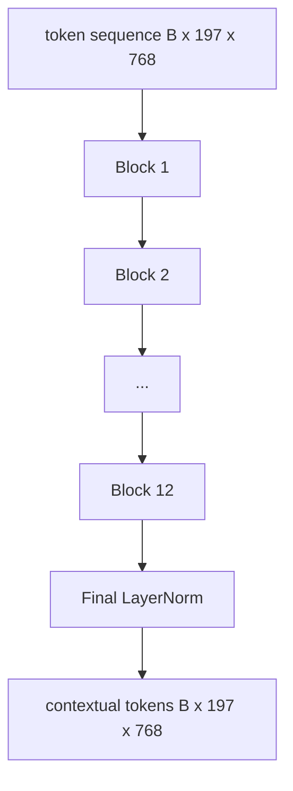

# 视觉 محول 编码器

> 补丁单独看不到──具有 12 个注意头的 12 层预 LN Transformer سوف تحويل سلسلة إضافات الترميز إلى سلسلة إضافات الترميزات التالية، حيث سيتم تحويل رمز CLS إلى حالة مخفية في النهاية لتجميع صفات الصورة كلها── هذا البرنامج هو غرفة المحركات لكل نموذج لغة تصويري حديثة──

**Type:** Build
**Languages:** Python
**Prerequisites:** 第19期第30-37课（B轨基础）
**Time:** ~90 分钟

## 學习目标

- 实现具有多头自注意和前子层的预 LN 转变器块──
- 堆叠 12 个具有 12 个头的块,形成 ViT-Base 编码器──
- إضافة إلى ذلك، فإن المادة 58 تصل إلى جهاز التدوين وتعمل إلى المعلومات.
- 验证 CLS token هل تم جمع معلومات كل تصحيح

## 问题

تصميمات تضمنت مجموعة من 197 رمز، كل رمز هو واحد، لا يعرف أي تصميمات أخرى. صورة قطة تحتاج إلى كل تصميمات لمعرفة أي تصميمات تحتوي على الحوض، والتي تحتوي على خلفية، والتي تحتوي على العين.

التركيبة المعيارية هي 12 كتلة عميقة 、 12 كتلة عرضة ، مع طبقة سابقة 放置、GELU 激活 و 4 مرات 前 توسع。 التركيبة هي CLIP ViT-L、SigLIP、DINOv2、Qwen-VL 系列、InternVL وبالإضافة إلى جميع أسهم المعدلات الأخرى المفتوحة للصيغة الراقية في 2025-2026‬‬‬‬‬‬‬‬‬‬‬‬‬‬‬‬‬‬‬‬‬‬‬‬‬‬‬‬‬‬‬‬‬‬‬‬‬‬‬‬‬‬‬‬‬‬‬‬‬‬‬‬‬‬‬‬‬‬‬‬‬‬‬‬‬‬‬‬‬‬‬‬‬‬‬‬‬‬‬‬‬‬‬‬‬‬‬‬‬‬‬‬‬‬‬‬‬‬‬‬‬‬‬‬‬‬‬‬‬‬‬‬‬‬‬‬‬‬‬‬‬‬‬‬‬‬‬‬‬‬‬‬‬‬‬‬‬‬‬‬‬‬‬‬‬‬‬‬‬‬‬‬‬‬‬‬‬‬‬‬‬‬‬‬‬‬‬‬‬‬‬‬‬‬‬‬‬‬‬‬‬‬‬‬‬‬‬‬‬‬‬‬‬‬‬‬‬‬‬‬‬‬‬‬‬‬‬‬‬‬‬‬‬‬‬‬‬‬‬‬‬‬‬‬‬‬‬‬‬‬‬‬‬‬‬‬‬‬‬‬‬‬‬‬‬‬‬‬‬‬‬‬‬‬‬‬‬‬‬‬‬‬‬‬‬‬‬‬‬‬‬‬‬‬‬‬‬‬‬‬‬‬‬‬‬‬‬‬‬‬‬‬‬‬‬‬‬‬‬‬‬‬‬‬‬‬‬‬‬‬‬‬‬‬‬‬‬‬‬‬‬‬‬‬‬‬‬‬‬‬‬‬‬‬‬‬‬‬‬‬‬‬‬‬‬‬‬‬‬‬‬‬‬‬‬‬‬‬‬‬‬‬‬‬‬‬‬‬‬‬‬‬‬‬‬‬‬‬‬‬‬‬‬‬‬‬‬‬‬‬‬‬‬‬‬‬‬‬‬‬‬‬‬‬‬‬‬

## 概念




### LN 前与 LN 后

أول محول سوف يضع LayerNorm بعد残差── قبل LN( كل طبقة قبل LayerNorm) هو نسخة من كل نموذج لغة الرؤية الحديثة المستخدمة، لأنه لا يحتاج إلى تعلم معدل التدريب التالي.

### الكثير من الاهتمام

كل رأس سيتم إشارة حجم الصور إلى حجمها الخاص`head_dim = hidden / num_heads``(query, key, value)`ثلاثة أفراد`hidden = 768`和`heads = 12`، كل رأس لديه`dim = 64` 12 رأس يشارك في المشاركة، ثم يتم ربطها إلى 768 维并通过输出投影── نقطة أهمية من العديد من الرؤوس هي، أن رأس واحد يمكن أن يتعلم الاهتمام بالقطعين، والآخر يمكن أن يتعلم الاهتمام بالمناسبة دون إزعاج.

### لماذا يجب أن يتم 4x قبل توسيع

لـ`hidden -> 4 * hidden -> hidden`، GELU قع وسطها. العامل 4 هو تجربي، منذ عام 2017 كان يطبق على اللغة والبصرية.

|组件| ViT-Base 规模的参数 |
|-----------|------------------------------|
|每个块的 qkv 投影 | `3 * 768 * 768 = 1.77M` |
|每个块的输出投影| `768 * 768 = 590K` |
|每块 FFN（4 倍扩展）| `2 * 768 * 4 * 768 = 4.72M` |
|每块的 LayerNorm | `4 * 768 = 3K` |
|每块总计 |约 710 万 |
| 12 块 |约85M |
|加前端|总计约86M |

فييت-بايس هو جهاز إعدادات 86M 参数编码器. وفقا لمعايير عام 2026، فإن هذا القيمة صغيرة جدا.

### لماذا لا؟

تحويل الرؤية يحتوي فقط على جهاز إعداد و هو إثنين من: الـ: الـ: الـ: الـ: الـ: الـ: الـ: الـ: الـ: الـ: الـ: الـ: الـ: الـ: الـ: الـ: الـ: الـ: الـ: الـ: الـ: الـ: الـ: الـ: الـ: الـ: الـ: الـ: الـ: الـ: الـ: الـ: الـ: الـ: الـ: الـ: الـ: الـ: الـ: الـ: الـ: الـ: الـ: الـ: الـ: الـ: الـ: الـ: الـ: الـ: الـ: الـ: الـ: الـ: الـ: الـ: الـ: الـ: الـ: الـ: الـ: الـ: الـ: الـ: الـ: الـ: الـ: الـ: الـ: الـ: الـ: الـ: الـ: الـ: الـ: الـ: الـ: الـ: الـ: الـ: الـ: الـ: الـ: الـ: الـ: الـ: الـ: الـ: الـ: الـ: الـ: الـ: الـ: الـ: الـ: الـ: الـ: الـ: الـ: الـ: الـ: الـ: الـ: الـ: الـ: الـ: الـ: الـ: الـ: الـ`i`يمكن أن تشارك في أي رمز`j` لا يوجد مجابات.  الاهتمام في الدرجة 61   سيتم استخدام الحجاب في الدرجة، ولكن في الدرجة الدرجة الدرجة الدرجة الدرجة الدرجة الدرجة الدرجة الدرجة الدرجة الدرجة الدرجة الدرجة الدرجة الدرجة الدرجة الدرجة الدرجة الدرجة الدرجة الدرجة الدرجة الدرجة الدرجة الدرجة الدرجة الدرجة الدرجة الدرجة الدرجة الدرجة الدرجة الدرجة الدرجة الدرجة الدرجة الدرجة الدرجة الدرجة الدرجة الدرجة الدرجة الدرجة الدرجة الدرجة الدرجة الدرجة الدرجة الدرجة الدرجة الدرجة الدرجة الدرجة الدرجة الدرجة الدرجة الدرجة الدرجة الدرجة الدرجة الدرجة الدرجة الدرجة الدرجة الدرجة الدرجة الدرجة الدرجة الدرجة الدرجة الدرجة الدرجة الدرجة الدرجة الدرجة الدرجة الدرجة الدرجة الدرجة الدرجة الدرجة الدرجة الدرجة الدرجة الدرجة الدرجة الدرجة الدرجة الدرجة الدرجة الدرجة الدرجة الدرجة الدرجة الدرجة الدرجة الدرجة الدرجة الدرجة الدرجة الدرجة الدرجة الدرجة الدرجة الدرجة الدرجة الدرجة الدرجة الدرجة الدرجة الدرجة الدرجة الدرجة الدرجة الدرجة الدرجة الدرجة الدرجة الدرجة الدرجة الدرجة الدرجة الدرجة الدرجة الدرجة الدرجة الدرجة الدرجة الدرجة الدرجة الدرجة الدرجة الدرجة الدرجة الدرجة الدرجة الدرجة الدرجة الدرجة الدرجة الدرجة الدرجة الدرجة الدرجة الدرجة الدرجة الدرجة الدرجة الدرجة الدرجة الدرجة الدرجة الدرجة الدرجة الدرجة الدرجة الدرجة الدرجة الدر

### كلاس تيكون تعلمت ماذا

رمز CLS يبدأ من العناصر التعلمية، دون محتوى إصلاحي خاص به، ويجري من خلال كل كتلة من الاهتمام لتجميع المعلومات. إلى الطبقة الأخيرة، فإن خط CLS هو مجموع الطول للصورة بأكملها.


```figure
ch-cls-funnel
```

## بناءها

`code/main.py`实现:

- `MultiHeadSelfAttention`, مع `qkv`和输出投影、缩放点积注意力数学和形状断言──
- `FeedForward`4 倍扩展 GELU MLP
- `Block`، واحد من قبل LN 块، من التركيز والباقي مع الفجوة الاولى الوقوف على الارض.
- `ViT`12 قطعة من المجموعة، مع الطبقة النهائية.
- `VisionEncoder`، سوف يكون`VisionFrontEnd`من المرحلة 58                                                                                                                                                                                                                                                                                                                                                                                                                                                                                                                         `ViT`堆,并公开返回上下文序列和池化 CLS إلى الكمية `forward()`.
- عرض، من خلال مُخترف كامل 运行合成 224x224 مقسوء 图像,并每隔一层打印输入形状、输出形状、参数计数和 CLS 范数──

运行它:

```bash
python3 code/main.py
```

输出:الوصول المصممة`(1, 197, 768)`张量──CLS 范数 随着层的组合向上漂移,然后稳定在最终 LayerNorm──总参数报告约为86M──

## استخدمها

يختلف المعدل المحدد هنا على الواسعة والعمق مع كل كتلة من الوزن المفتوحة في VLM في 2025-2026:

- **宽度和深度。**لـ (VIT-Large)`hidden=1024, depth=24, heads=16`؛ SigLIP So400M 是 `hidden=1152, depth=27, heads=16`✿ نفس القطعة ✿
- **池化头。**CLS池(本课) مع متوسط池(SigLIP) مع الاهتمام池(اللاحق VLM)
- **位置处理。**固定正弦曲线 ((第 58 课) مع تعلم 1D、ALiBi مع 2D RoPE。块数学没有改变。
- **注册token。**DINOv2 前置 4 个额外学习的代码.

سيتم تنفيذ الدروس التالية على أساس هذا

## 测试

`code/test_main.py`تغطي:

- 单块保留形状并且对于输入批量大小不变
-  على طول محور الرئيسي 
- 剩余路径已连接(零输入仍通过CLS رمز产生非零输出)
- 4 طبقات تتراكم إلى الأمام إلى الوصول لتكون شكلاً صحيحاً
- 梯度 من CLS 输出流向面片投影

运行它们:

```bash
python3 -m unittest code/test_main.py
```

## التدريب

1. 添加寄存器token(CLS 后添加 4 学习向量)并重新运行──通过最后层的软max 分布的来比较注意力图的平滑度──

2. لتحويل LN إلى LN 后، وتدريب على التركيب على شكل التفريق عصر.

3. ستنجح في تحقيق ذلك`attn_mask`参数، حتى يتم إعادة استخدام نفس الكتلة ككتلة فكّرة`(seq, seq)`,下三角形

4. استخدام `torch.profiler`تحليل حجم الكتلة: 1、8、64 من التسليم الأمامي.

5. باستخدام درجة منخفضة لـ LoRA  适配器 استبدال رأس الاهتمام ق-ك-ك-ف 投影, 结结其余部分,并验证梯度 فقط في الموقع الذي تتوقعه.

## 关键术语

|术语 |这意味着什么 |
|------|---------------|
|预 LN | LayerNorm 应用在每个子层之前而不是之后 |
|自我关注 |每个token都以相同的顺序关注其他所有token |
|多头|隐藏的dim分布在 `H` 独立注意头中 |
| FFN 扩展 |前馈层在收缩之前加宽至 `4 * hidden` |
| CLS 池 |使用第一个token 的最终隐藏状态作为图像摘要 |

##  المزيد阅读

- بالنسبة لتركيب المعدات، فإن صورة واحدة تستحق 16 × 16 كلمة واحدة ((ViT,2021))).
- DINOv2 (2023) 用于注册token和自监督预训练目标──
- سيجليب (2023) ، المستخدمة في فصل 62                                                                                                                                                                                                                                                                                                                                                                                                                                                                                                                 
