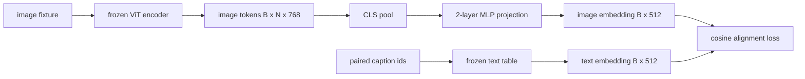

# باستخدام مستوى الصور المُتَصَل

> يُنتج المُصوّر الفيديو رمز الصورة. يُستهلك المُصوّر الفيديو رمز الصورة. يُعِيشان في مختلف مساحات محيطية. يُنْبِتُ مُخططات مُخططتان لتحديد الصورة إلى المُضخّم الفيديو. ويهدف ذلك إلى تَحقيق التّصَلُّف في المُضَمَّنِ.

**Type:** Build
**Languages:** Python
**Prerequisites:** 第19期第30-37课（B轨基础）
**Time:** ~90 分钟

## 學习目标

- بناء منظمة MLP ذات طبقتين ، ستقوم بتسجيلها إلى المدونة.
- بناء مقال مثالي في المطبوعة
- 计算投影图像代币和配对标题嵌入之间的余弦对齐损失──
- استخدام 结视觉编码器和结文本表单独训练投影──

## 问题

لديك جهاز تصويري للنظر (الدرجة 58-59) ، يمكن أن تولد الدرجة`vision_hidden = 768`رمز. لديك جهاز تحرير الكتب، تريد أن تكون في الحجم المثبت`text_hidden = 512`之上(أي رقم آخر هو أيضا معقول) ―― الترميز يحتاج إلى رمزات شكل نصية── الترميزات الصورة ليست شكل نصي: فهي موجودة في الترميز في أساس التعلم خلال تدريبات الاحتياطي المباشر، مع الكلمات المتوسطة للترميز لا علاقة لها──

两层 MLP 投影(线性、GELU、线性) تمكنت من تعويض هذا الفجوة──它足够小(大约`768 * 1024 + 1024 * 512 = 1.3M`العناصر) ، يمكن أن يتم تدريبها على GPU واحدة في غضون بضع دقائق ، وهي الجزء الوحيد الذي يحتاج إلى التعلم في مرحلة كاملة.

## 概念



### 投影前池化

视觉编码器发发出 197 个标记──文本侧有单个标题级嵌入──为了对应它们,每个样本需要一个图像级向量── CLS 池化是最简单的:从编码器获取第一个标记并投影对它──对所有197 个标记进行平均池是另一种选择,也是 SigLIP 使用方法──要么将197 个向量合并为一个──

### لماذا تكون مرتفعتين وليس واحدة

يمكن أن يتحرك الإشارة السريعة الواحدة وإعادة التوسع، ولكن إذا لم يتطابق معدل منحنى الفضاء، فلن يكون هناك أساس ثابت. يوفر GELU للإشارة حلقة غير سريعة بين الطبقتين السريتين، وهذا على مرّة التجربة كافٍ لتحقيق إضافة خصائص CLIP إلى نموذج اللغة إلى التجميع.

|层|形状|参数|
|-------|-------|------------|
| FC1 | `(vision_hidden, projection_hidden)` | `768 * 1024 + 1024` |
|激活|格鲁| 0 |
| FC2 | `(projection_hidden, text_hidden)` | `1024 * 512 + 512` |

واحد`768 -> 1024 -> 512`هناك حوالي 1.3 مليون عنصر

### 余弦对齐损失

لم يعني`image_emb == text_emb`"معنى "كوزي`image_emb`في العلاقة`text_emb`إشارة إلى نفس الاتجاه`1 - cos_sim(image, text)`، المدى من 0( تماما على الجد) إلى 2(相反)  التدريب سوف يقدمها إلى كل مقابل مقابل صفر.

### 结编码器是门

视觉编码器有86M参数――文本表还有几百万――从模拟语料库中训练所有这些人是不可能的――结结两意味着投影的1.3M参数是唯一的变化,并合成对数百步就足以降低损失――这正是每个基于适配器的VLM的操作形状:重型部件保持结状态,轻型桥梁列车――


```figure
ch-projection-bridge
```

## بناءها

`code/main.py`实现:

- `MLPProjector(in_dim, hidden_dim, out_dim)`, مع GELU  فعالة من الطبقات الثنائية من المخططية MLP
- `MockTextEmbedding(vocab_size, dim)`، a 结嵌表,具有来自种子的确定性初始化.
- `make_pair(seed, vocab_size)`, sintet ein对(图像、标题) نموذج。标题是短 id 序列;标题嵌入是对代币嵌入进行平均值池化。
- `cosine_alignment_loss(image_emb, text_emb)`, لكل`1 - cos_sim`العينات
- دورة تدريبية واحدة، تم تنفيذها على 32 دورة مركبة على 200 خطوة من الإشارات، وحدة تحرير المشاهد والنص، وتطبيقها مرة واحدة في كل 25 خطوة.

运行它:

```bash
python3 code/main.py
```

输出: تقرير التدريب في 200 خطوة من الخسارة الأولية حوالي 1.07 إلى 0.80، يظهر فقط على الإشارة يمكن أن تكون الصورة الوصول إلى الفضاء المكتبي.

## استخدمها

في كل إطار مفتوح للشحن في كل مكان هناك نفس النمط:

- **LLaVA 1.5.**من CLIP-ViT-L 隐藏到LLaMA 嵌入在我的两层 GELU MLP 投影──结视觉编码器,结 LLM,仅训练投影(然后在第二阶段解 LLM) 』
- **BLIP-2.**ق-مقدم من خلال تحويلات التركيز على رموز الصور الحصول على 32 رموز استفسار دراسية، ثم الإستعراض إلى LLM 嵌入dim── ق-مقدم
- **MiniGPT-4.**من BLIP-2 Q-Former 输出 إلى Vicuna 嵌入dim的单线性投影──
- **Qwen-VL.**مع العديد من الطبقات من المكاسب التركيز المتقاطع، ولكن الجزء الأخير لا يزال حتى LM 嵌入dim الإشارة

الوضع مختلف، ولكن الدوار هو نفسه:

## 测试

`code/test_main.py`تغطي:

-  الصواريخ الصادرة والشكل والتشكيل `out_dim`匹配
- 结文本嵌入表的 `requires_grad`参数为零
- خسارة السندات في نفس الوسيط هو صفر، في الوسيط المضاد هو 2
- 1 مرة إلى الوراء نقل بعد إلقاء الوسيط التدريجية
-  تدريب دورة تقلل من الخسائر بين الخطوات 0 و الخطوات 200 

运行它们:

```bash
python3 -m unittest code/test_main.py
```

## التدريب

1. استبدال CLS بـ 196 رمزة إصطحاف على متوسط القيمة المعدنية، ومقارنة مع الخسارة النهائية بعد 200 خطوة.

2. سوف تتم زيادة درجة حرارة المعلم إلى خسارة الصف`cos / tau`) 中,并观察当 `tau`                                                                                                                                                                                                                                                              

3. استبدال الملفات المعدنية المعدنية المعدنية إلى طبقة واحدة وتقييم الفجوة في الخسارة.

4. في الوسيط الإلقائي إضافة لجنة صغيرة على الوزن، ومراقبة كيف يتفاعل مع السيناريو على التوازن.

5. الحفاظ على وزن جهاز الإشارة، ثم إعادة تحميل وتشغيل التقييم، لا حاجة إلى جهاز إعدادات الفيديو إلى ما بعد، للتحقق من إرسالها فقط تحتاج إلى جهاز الإشارة.

## 关键术语

|术语 |这意味着什么 |
|------|---------------|
|模态对齐 |使图像和文本嵌入在一个共享空间中具有可比性的行为 |
|投影头|将一个空间映射到另一个空间的小模块，通常是 2 层 MLP |
|余弦相似度 |点积除以 L2 范数的乘积 |
|冻结编码器|视觉（或文本）模型的所有参数均带有 `requires_grad=False` |
|模拟语料库|使用合成对，因此训练不依赖于数据集下载 |

##  المزيد阅读

- تستخدم على مرحلتين من التدريب LLaVA 论文(المشروع، ثم تفسر LM)
- ق- سابقة من BLIP-2 مقال كملحوظة بديلة للتقديم للدراسة
- قوان-VL  التقنية تقرير، سوف交叉注意力适配器用作更深的投影头――
