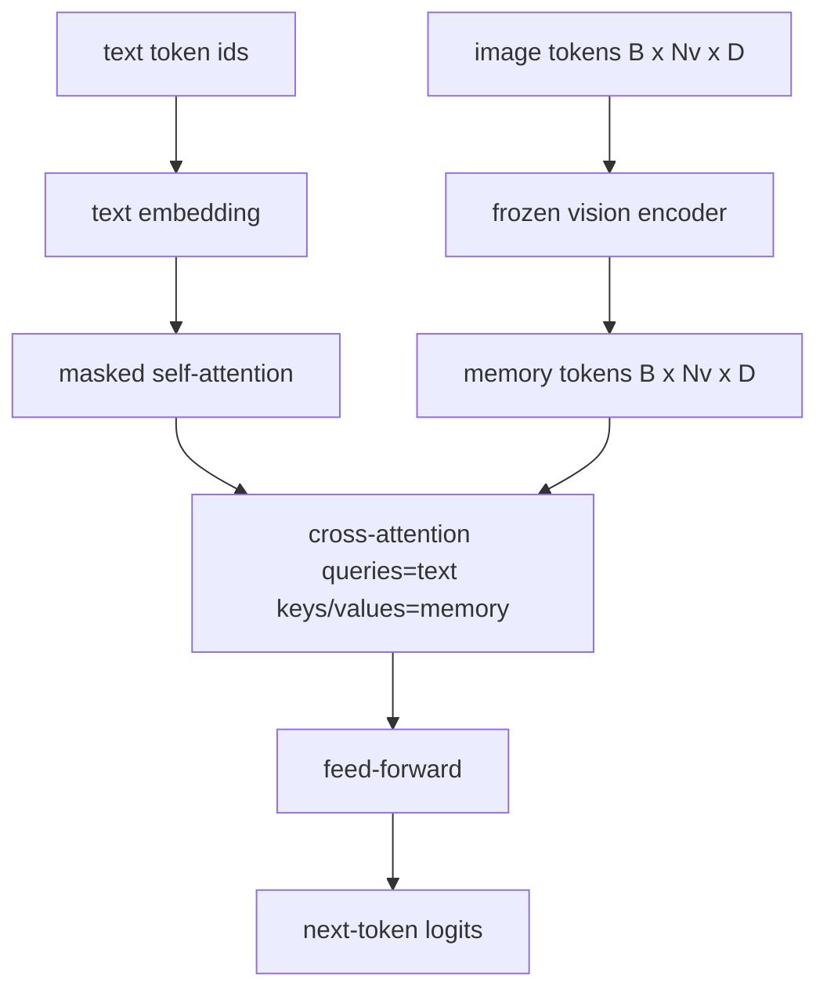
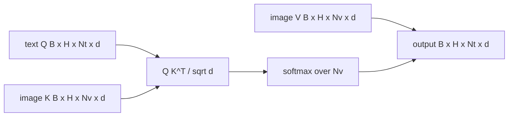

# 交叉注意力融合

> ستقوم طبقة الإلقاءات بتحديد محور الصورة مع محور العنوان. يحتاج جهاز تحليل اللغة الفصرية الحقيقي إلى مشاركة كل رمز في كل رمز إضافي، لذلك يمكن للنموذج وضع كل كلمة في منطقة واحدة.

**Type:** Build
**Languages:** Python
**Prerequisites:** 第19期第30-37课（B轨基础）
**Time:** ~90 分钟

## 學习目标

- 实现多头交叉注意力,其中查询流是文本,键/值流是视觉──
- 组成解码器块:因果自注意力+交叉注意力+前。
- الحصول على شكل مخفي صحيح: للاستخدام في الغطاء من الاهتمام الذاتي، للاستخدام في عدم الاهتمام المتبادل.
- استخدام الكتيبات والمعلامات الثابتة

## 问题

أن تكون علامات الصور والمعلامات النسخية متصلة إلى سلسلة واحدة هي خيارات التجمع (التجمع المبكر، والخميلون و Emu3)  الاهتمام بال交叉 هو آخر (التجمع اللاحق، والعلامة اللاحق)  الاهتمام بال交叉 يمتد إلى التيارات النسخية ().

后期融合有两优点――首先,文本流保持干净,模型保留纯文本功能――第二,图像流对每图像计算一次,并在每个解码步骤中重复使用,因此即使对于长标题,生成也很便宜――成本是每个块一个额外的注意力层――

## 概念





### 面具形状

الاهتمام في الحجر يتطلب الاختلاف:

|注意|查询长度 |密钥长度|面膜|为什么 |
|-----------|--------------|------------|------|-----|
|自我关注 | `Nt`（文本）| `Nt`（文本）|因果：下三角 `(Nt, Nt)` |自回归期间文本token可能不会向前看 |
|交叉注意力| `Nt`（文本）| `Nv`（愿景）|没有口罩|整个图像对每个文本位置都是可见的 |

هذا البرنامج يتضمن وظيفة تصحيح شكل، لذلك سوف تضمنها معا ك `ValueError`خطأ، وليس خسرة خسرة من التوترات

### لماذا تركيز التعبير لا يخفي

قبل إنشاء أي نص، أولاً مراقبة الصورة بالكامل.`t`يمكن التركيز على أي إصلاح للصورة؛ لا يوجد ترتيب لقطعة الصورة. بعض فلامينغو  المتغيرات تضيف نمط تخفيض لكل نموذج عند تقاطع العديد من الصور والنصوص، ولكن بالنسبة لصور واحدة بالإضافة إلى العنوان، يمكن التركيز على التقاطع رؤية كل شيء.

### 键/值缓存

图像键和值在解码开始时计算一次并保存在缓存中──每一个新文本代码都使用缓存而无需重新计算──这就是推理时字幕快速运行的原因:重型ViT 运行一次;交叉注意在每一步中重用其键和值──本课程公开缓存并测试缓存中路径──

### 块组成

解码器块运行:预 LN -> 自注意力 -> 残差 -> 预 LN -> 交叉注意力 -> 残差 -> 预 LN -> 前 -> 残差──三个子层, كل ذي层有自己的 LayerNorm。 Flamingo 论文添加一个关于交叉注意的学习门,因此模型可以在训练时稳定性为代价选择退出图像路径;规范基线(在这里使用)没有门──

```python
class DecoderBlock:
  def forward(self, text_tokens, image_tokens, text_mask, cross_mask):
      text_tokens = text_tokens + self.self_attn(self.ln1(text_tokens),
                                                 mask=text_mask)
      text_tokens = text_tokens + self.cross_attn(self.ln2(text_tokens),
                                                  image_tokens,
                                                  mask=cross_mask)
      text_tokens = text_tokens + self.ffn(self.ln3(text_tokens))
      return text_tokens
```


```figure
ch-crossattn-fan
```

## بناءها

`code/main.py`实现:

- `CrossAttention(hidden, heads)`, مع منفردة`q`和 `kv`投影的多头交叉注意力──
- `CausalSelfAttention(hidden, heads)`، من الحماية من الاهتمام من الجهاز المحدد
- `DecoderBlock`، مع الـ "إل إن" المتبقية تتكون من ثلاثة طبقات
- `VisionLanguageDecoder`، من قبل المثالية تصنيف المعدات المصدر والصيغة الصغيرة المطبوعة المضمنة جدول المعدات الأربع مستويات.
- `causal_mask(length)`عودتي`(length, length)`أسفل الموقع
- في عرض واحد، فإنه يوفر سلسلة نصين لقطعة واحدة من 10 طولها 197 صورة في الذاكرة، وتطبق وضعية إصدارات الصورة، وضعية الاهتمام الذاتي والصورة الصورة الصورة الصورة الصورة الصورة الصورة الصورة الصورة الصورة الصورة الصورة الصورة الصورة الصورة الصورة الصورة الصورة الصورة الصورة الصورة الصورة الصورة الصورة الصورة الصورة الصورة الصورة الصورة الصورة الصورة الصورة الصورة الصورة الصورة الصورة الصورة الصورة الصورة الصورة الصورة الصورة الصورة الصورة الصورة الصورة الصورة الصورة الصورة الصورة الصورة الصورة الصورة الصورة الصورة الصورة الصورة الصورة الصورة الصورة الصورة الصورة الصورة الصورة الصورة الصورة الصورة الصورة الصورة الصورة الصورة الصورة الصورة الصورة الصورة الصورة الصورة الصورة الصورة الصورة الصورة الصورة الصورة الصورة الصورة الصورة الصورة الصورة الصورة الصورة الصورة الصورة الصورة الصورة الصورة الصورة الصورة الصورة الصورة الصورة الصورة الصورة الصورة الصورة الصورة الصورة الصورة الصورة الصورة الصورة الصورة الصورة الصورة الصورة الصورة الصورة الصورة الصورة الصورة الصورة الصورة الصورة الصورة الصورة الصورة الصورة الصورة الصورة الصورة الصورة الصورة الصورة الصورة الصورة الصورة الصورة الصورة الصورة الصورة الصورة الصورة الصورة الصورة الصورة الصورة الصورة الصورة الصورة الصورة الصورة الصورة الصورة الصورة الصورة الصورة الصورة الصورة الصورة الصورة الصورة الصورة الصورة الصورة الصورة الصورة الصورة الصورة الصورة الصورة الصورة الصورة الصورة الصورة الصورة الصورة الصورة الصورة الصورة الصورة الصورة الصورة الصورة الصورة الصورة الصورة الصورة الصورة الصورة الصورة الصورة الصورة الصورة الصورة الصورة الصورة الصورة الصورة الصورة الصورة الصورة الصورة الصورة الصورة الصورة الصورة الصورة الصورة الصورة الصورة الصورة الصورة الصورة الصورة الصورة الصورة الصورة الصورة الصورة الصورة الصورة الصورة الصورة الصورة الصورة الصورة الصورة الصورة الصورة الصورة الصورة الصورة الص

运行它:

```bash
python3 code/main.py
```

输出:解码器产生 `(2, 10, text_vocab)`المخططات 张量──面罩形为`(10, 10)`◊ KV 缓存重用检查确认缓存和未缓存路径之间的相同逻辑。

## استخدمها

التركيز في الانتاج يظهر في سلسلتين:

- **Flamingo 和 IDEFICS。**كل ك 个语言模型块插入一个交叉注意力层,并使用结的LM──视觉语言适配器是交叉注意力块及其门──
- **BLIP-2.**Q- سابق استخدام من مجموعة ثابتة من 32 علامة استفسار التفاصيل التركيز على الصورة في الصورة، ثم سوف تستخدم استفسار إلقاء الصورة إلى LM 嵌入空间中──

تشكل الشكل من القطاعات في هذا الدروس يتم رسمها مباشرة إلى الاثنين.

## 测试

`code/test_main.py`تغطي:

- سبب الغطاء هو التساوي في الثلث السفلي ويتطابق مع الشكل المنتظر
- مهما كانت طول المفتاح، فإن التركيز المتوسط ينطلق بشكل كامل`(B, Nt, hidden)`
- مسار KV  تخزين وتطابق مسار عدم تخزين في اختلاف السعة
- عدم التوافق بين النص والصور أثار اختلاف واضح`ValueError`
- املة المفصلة الجهاز الجهاز الجهاز الجهاز الجهاز الجهاز الجهاز الجهاز الجهاز الجهاز الجهاز الجهاز الجهاز الجهاز الجهاز الجهاز الجهاز الجهاز الجهاز الجهاز الجهاز الجهاز الجهاز الجهاز الجهاز الجهاز الجهاز الجهاز الجهاز الجهاز الجهاز الجهاز الجهاز الجهاز الجهاز الجهاز الجهاز الجهاز الجهاز الجهاز الجهاز الجهاز الجهاز الجهاز الجهاز الجهاز الجهاز الجهاز الجهاز الجهاز الجهاز الجهاز الجهاز الجهاز الجهاز الجهاز الجهاز الجهاز الجهاز الجهاز الجهاز الجهاز الجهاز الجهاز الجهاز الجهاز الجهاز الجهاز الجهاز الجهاز الجهاز

运行它们:

```bash
python3 -m unittest code/test_main.py
```

## التدريب

1. 将学习的门 门添加到交叉注意残差(Flamingo 技巧),并验证训练从接近零的初始门收──门从0开始;该模型在混合图像流之前恢复纯文本行为──

2. 实现交错注意力, منها نفس المفسرة استهلاك العديد من الصور والعدد من المواد المستندة إلى الصور.

3. في`Nt=64, Nv=576`(على تحليل الاهتمام المتبادل مع الاهتمام الذاتي`Nt * Nv`، ويحتل مكانة رئيسية في عالية درجة تحديد الصور.

4. في رسم الخط التركيز على الصفحة إضافة إلى إيقاف نهاية الاستفسار،并测量演示中的标题多样性(اختلاف في نموذج العنوان مع زيادة الإيقاف في رسم الخط التركيز)

5. ستبدل الصف الاهتمام المتبادل بـ Q-Former 风格 الاهتمام الكتلة، من بينها ثالثين محددة  تكن استفسار池 كل طبقة تركز على صورة واحدة خصائصها.

## 关键术语

|术语 |这意味着什么 |
|------|---------------|
|后期融合|文本和视觉位于不同的流中；交叉注意力在每个区块上架起了桥梁|
|交叉注意力| Q 来自一个流，K 和 V 来自另一个流 |
|因果面具|下三角布尔掩码，可防止在自回归过程中向前看 |
| KV缓存|图像键和值存储一次并在每个解码步骤中重复使用 |
|记忆token|解码器进入的冻结图像token |

##  المزيد阅读

- فلامينغو (2022) تستخدم لتصميم معين للتركيز على المجال.
- ق-مقدم BLIP-2 (2023) ، وهو مجسمة كجزء من حفرة الاهتمام في حفرة استفسارات التعلم.
- إديفيكس (2023) تستخدم في فلامينغو
