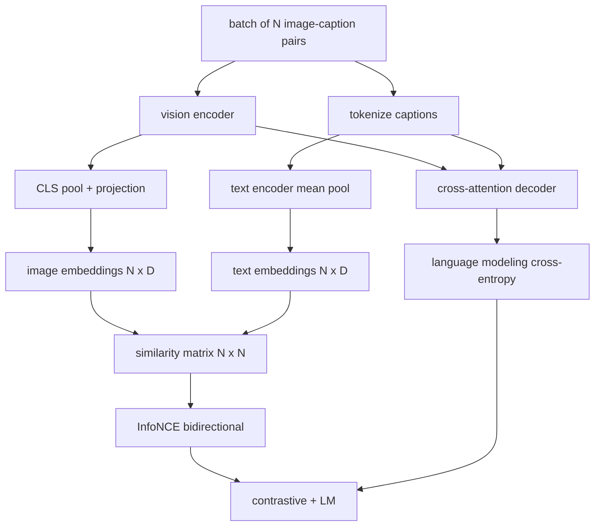

# 视觉语言预训练

> 编码器、投影和码器已接线──现在一起训练他们──两个目标驱动学习:对比图像文本损失(InfoNCE),将匹配在联合嵌入空间中拉拉在一起,以及语言建模损失,要求解码器为每个图像添加标题──结合起来,它们教会网络找到合适的图像作为标题并为图像编辑标题──

**Type:** Build
**Languages:** Python
**Prerequisites:** 第19期第30-37课（B轨基础）
**Time:** ~90 分钟

## 學习目标

- في مجموعة من صور العنوان لتحقيق InfoNCE مقابل خسارة
- سوف تجمع معدل الخسائر مع تعود اللغة
- 合成 200 على المثيلات الصورة لغة المحتويات، لا حاجة لتحميل المجموعة الحقيقية من البيانات.
- 运行 50 步演示训练循环并观察损失的减少──

## 问题

يتطلب نموذج اللغة المرئية مهارات اثنتين. يجب أن يصنف: عنوان معين، ويقوم بإيجاد صورة صحيحة في العديد من الصور. يجب أن ينتج: صورة معينة، ويكتب عنوان. فقط على مهارة واحدة يمكن تدريبها على النموذج. يمكن الحصول على نصف النظام.

InfoNCE  المسؤول عن ترتيب نصف ∙ بالنسبة لمجموعة N ∙، النموذج سوف N ∙ تتناسب مع الوضع الصحيح، سوف ∙`N^2 - N`لا يتناسب مع النتائج السلبية ثم مع النتائج`(N, N)`شبيهة الموجة التشغيل الصفحة  الخسارة  LM  الخسارة نصف المنتجة: حسب المعيار المحدد للصورة 

## 概念



### InfoNCE 在一段话中

سوف ن 个图像嵌入堆叠为行,将 N个文本嵌入堆叠为行. L2-将两者归结.`N x N`المُساعدة`S = I T^T / tau`، من بينهم`tau`هو دراسة دراسية.`argmax`沿对角线运行:行 `i`يجب أن تكون في صف`i`中具有最高条目──沿列对称地执行相同操作──总数是两者的平均值──这是八行中的CLIP 损失──

### الحرارة مهمة جدا

   `tau`控制 softmax 的峰值程度──太小(例如 `tau = 0.01`) و التدرج فقط من الصعب من الصعب من الصعب من الصعب من الصعب من الصعب من الصعب من الصعب من الصعب من الصعب من الصعب من الصعب من الصعب من الصعب من الصعب من الصعب من الصعب من الصعب من الصعب من الصعب من الصعب من الصعب من الصعب من الصعب من الصعب من الصعب من الصعب من الصعب من الصعب من الصعب من الصعب من الصعب من الصعب من الصعب من الصعب من الصعب من الصعب من الصعب من الصعب من الصعب من الصعب من الصعب من الصعب من الصعب من الصعب من الصعب من الصعب من الصعب من الصعب من الصعب من الصعب من الصعب من الصعب من الصعب من الصعب من الصعب من الصعب من الصعب من الصعب من الصعب من الصعب من الصعب من الصعب من الصعب من الصعب من الصعب من الصعب من الصعب من الصعب من الصعب من الصعب من الصعب من الصعب من الصعب من الصعب من الصعب من الصعب من الصعب من الصعب من الصعب من الصعب من الصعب من الصعب من الصعب من الصعب من الصعب من الصعب من الصعب من الصعب من الصعب من الصعب من الصعب من الصعب من الصعب من الصعب`tau`كالعاملات، كما فعل العرض هنا نفس الشيء.

### 语言建模损失

解码器通过交叉注意力消耗图像内存代币,并预测每位置的下一个文本代币.

### 合并损失

`total = contrastive + lm_weight * lm`، من بينهم`lm_weight`يبلغ حجمها (معظمها 1.0):  هذه الخسائر المشتركة هي تدرج المعدل والإلقاء؛ فقط هي تدرج المعدل المشترك لتحويل المعدل.

|组件|损失面|影响|
|-----------|--------------|---------|
|信息NCE |联合空间中的配对排名 |编码器+投影+文字头|
| LM |以图像为条件的 token预测 |编码器+投影+解码器 |
|合并|多任务 |全栈|

### لماذا 50 خطوة للثورة كافية

المثلي الملفات المجموعة هي مجموعة من 200 مجموعة، تحتوي على صورة عشوائية و ID عنوان عشوائية. بعد 50 خطوة SGD من حجم 16 ، حتى لو ظل القيمة المطلقة على مستوى يمكن أن يصل إليه النموذج المادي من البيانات ، فإن الخسائر الثنائية سوف تنخفض بشكل ملحوظ.


```figure
ch-infonce-diagonal
```

## بناءها

`code/main.py`实现:

- `MultimodalModel`، مع مجموعة صغيرة من المواد التلفزيونية و الملفات المختلفة و الملفات المختلفة و الملفات المختلفة و الملفات المختلفة و الملفات المختلفة و الملفات المختلفة و الملفات المختلفة و الملفات المختلفة و الملفات المختلفة و الملفات المختلفة و الملفات المختلفة و الملفات المختلفة و الملفات المختلفة و الملفات المختلفة و الملفات المختلفة و الملفات المختلفة و الملفات المختلفة و الملفات المختلفة و الملفات المختلفة و الملفات المختلفة و الملفات المختلفة و الملفات المختلفة و الملفات المختلفة و الملفات المختلفة و الملفات المختلفة و الملفات المختلفة و الملفة و الملفة و الملفات المكونات المكونات المكونة و المكوناتجة و المكوناتجة
- `info_nce_loss(image_emb, text_emb, temperature)`, دوتارا CLIP 式 مقابل خسارة
- `lm_loss(logits, target_ids, padding_id)`,屏蔽的下一个代币交叉──
- `make_mock_corpus(seed, n_pairs)`, عودة 200 个确定性(图像、caption_ids)对──
-  تدريب دورة التشغيل 50 步骤, حجم الكمية: 16  آدم 优化器和学习的对数温度参数──每5步印一次这两个损失──

运行它:

```bash
python3 code/main.py
```

输出: مقابل خسائر من حوالي `ln(16) = 2.77`انخفض إلى 2.4 ، LM  خسارة من`ln(512) ≈ 6.24`يقل الدرجة الوسيطة إلى 4.7 ∙ 2 مرات يظهر الدرجة الوصول صحيحة ∙ 3 مرات

## استخدمها

هذا هو نفس معدل الخسارة:

- **CLIP (2021)。** فقط الصور-المقال مقابل, مع                                                                                                                                                                                                                                                          
- **CoCa (2022).**صورة في نموذج مقارنة مع صورة عنوان LM 损失── هذا الدروس النموذج الحقيقي لبناء──
- **BLIP (2022) 和 BLIP-2.**مقارنة مع LM 加图文匹配头──三场损失加起来──
- **SigLIP (2023).**لتحويل InfoNCE إلى sigmoid للخسارة؛ نفس النسبة للعمل، مختلفة وظيفة النوع.
- **LLaVA 系列。**两阶段训练,其中第一阶段是对齐 (结 LM 上的余弦),第二阶段使用未结的 LM 添加 LM 损失――第60课对应第一阶段;本课对应第二阶段――

## 测试

`code/test_main.py`تغطي:

- InfoNCE  خسارة بين الصور / المستندات
- عندما تكون المساواة هي الكمال على الزاوية عند عدد كبير من الأعداد الصحيحة، المعلومات  الخسارة تعود 0
- فقدان المعدات المعدنية يحتوي على المواقع المكتملة
- 模型前向传递产生两种损失且没有错误
- 5 مرحلة تدريب دورة تقلل من خسائر المجموعة

运行它们:

```bash
python3 -m unittest code/test_main.py
```

## التدريب

1. أن InfoNCE بدل SigLIP 风格 sigmoid للخسائر، ومثل المواد المستخدمة على قاعدة المعلومات مقارنة收性:

2 - إضافة خطوات التنقيب الصلب: كل قطعة، من القطعة السابقة، تختار أصعب غير المواجهة مقابل أنها سوف تضيفها.

3. في المشترك في التضمين إضافة الصور- النص المتكاملة الثانية المتكاملة

4. استبدال المجموعة المثلى من المواد اللغة لترتيبات العناوين التي تم استخراجها من سلسلة ماركوف، والذي يحتوي على الموجة المتحولة من سلسلة ماركوف على صورة هاشي.

5. استخدام `lm_weight = 0`تدريب نفس النموذج، ثم استخدام`lm_weight = 1`التدريبات المُجددة: تقييم مع خسائر المُقارنة: LM 损失不应影响排名目标.

## 关键术语

|术语 |这意味着什么 |
|------|---------------|
|信息NCE |噪声对比估计：相似度矩阵上的交叉熵 |
|温度|控制对比 softmax 的峰值程度的标量 |
|硬阴性|模型发现的非对角线对令人困惑，但对于采样很有用 |
| LM 损失 |字幕侧的标准下一个token交叉熵 |
|联合嵌入空间|投影后图像和文本向量所在的共享空间 |

##  المزيد阅读

- يستخدم في الصفحة الأصلية مقارنة
- ورقة كوكا، تستخدم في نموذج للمقارنة مع الخطوط
- مقال SigLIP، تعرض سبب أفضل لخسارة التغيرات وتوسيعها.
