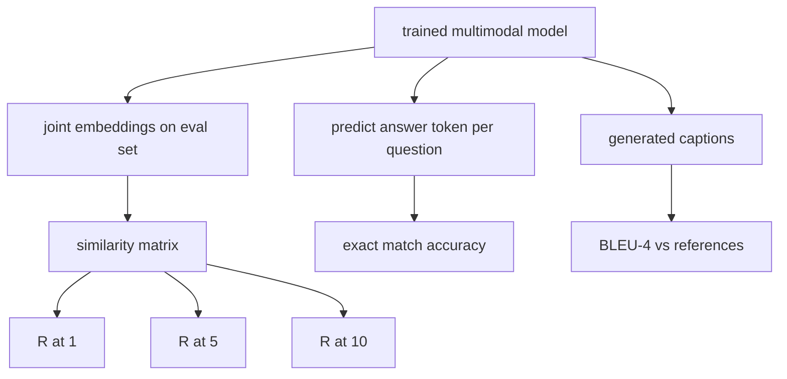

# 多模态评估

> 培训是循环的一半――另一半是测量――本课程从基元构建三个评估表面:图像标题检索报告为R@1、R@5、R@10;视觉问答报告为精确匹配准确性;图像字幕报告为BLEU-4──每个指标都是模型输出函数和运行在几秒内的综合评估套件──

**Type:** Build
**Languages:** Python
**Prerequisites:** 第19期第58-62课（Track E基础：编码器、Transformer、投影、交叉注意力融合、预训练）
**Time:** ~90 分钟

## 學习目标

- 根据图像和标题嵌入之间的相似性矩阵计算 Recall@K。
- 根据将(图像、问题) على تحديد ما يصل إلى ما يصل إلى المشكلة 
- من النتائج والإشارات المحتوى المحتوى BLEU-4، لا حاجة إلى أي مخزن خارجي.
- 针对构建在第62课训练模型之上综合套件运行所有三个评估──

## 问题

عندما تتجه خسائر التدريب إلى الاستقرار، فمن المرجح أن نعلن أن نموذج متعدد الأشكال قد تم الانتهاء منه.

- **检索（R@1，R@5，R@10）。**لتحقيق عنوان بناء التكامل المشترك؛ على بعد الحزمة لتنظيم كل صورة في حفرة التقييم؛ لتقرير مطابقة الصورة ما إذا كانت تقع في 1 ̇ ̇ ̇ 5 ̇ ̇ ̇ 10 名──对称(الصورة إلى النص)
- **视觉问答（完全匹配）。**给定(图像,问题),模型输出一个答案token──精确匹配是每个样本一个: هل الرد التوقعي يساوي الرد المرجعي؟
- **字幕 (BLEU-4)。**生成字幕── حسب عنوان المرجعية الحساب 1 克 إلى 4 克 متوسط الجغرافية الدقيقة، ومضحية بـ简洁性──多重参考是标准形式(一张图像,多个参考标题)。

كل قياس هو وظيفة رقيقة. هذا البرنامج سوف يبنيهم جميعاً باستخدام الكود، لذلك الرياضيات هي محددة، والسطح لا يزال تحت سيطرتك.

## 概念



### من المماثلة المميزة

 إعداد الصور والعنوان بين الوضع `(N, N)`余弦相似性矩阵── بالنسبة لكل سطر ، يتم ترتيبها حسب التشابهة 降低序列对列── Recall@K هو عدد من الصفوف الموجودة في مؤشر الزاوية الموجودة في موقع K 个前── Symmetric Recall@K(تسمة إلى صورة) يتم حسابها على الم矩阵 المتحولة── هذه الأرقام تم تقريرها── بالنسبة إلى تقييم N=100 ، R@1 = 0.6 يعني 60 عملية بحث من 100 صيغة وصلت إلى الصورة الصحيحة كالتلائم الأفضل──

### VQA 精确匹配

 لكل صورة، والمسألة، والجواب) ، والصورة للتدوين، والإدخال في السؤال، والمركز التجمع، ويقرأ التوقيت التالي.

### (BLEU-4)

```math
\text{BLEU-4} = \text{BP} \cdot \exp\big(\text{mean}(\log p_1, \log p_2, \log p_3, \log p_4)\big)
```

من بينهم`p_n`هو بعد تعديل n 元语法精度 (((ظهر في أي مرجعية النسخة النسخة النسخة النسخة النسخة النسخة النسخة النسخة النسخة النسخة النسخة النسخة النسخة النسخة النسخة النسخة النسخة النسخة النسخة النسخة النسخة النسخة النسخة النسخة النسخة النسخة النسخة النسخة النسخة النسخة النسخة النسخة النسخة النسخة النسخة النسخة النسخة النسخة النسخة النسخة النسخة النسخة النسخة النسخة النسخة النسخة النسخة النسخة النسخة النسخة النسخة النسخة النسخة النسخة النسخة النسخة النسخة النسخة النسخة النسخة النسخة النسخة النسخة النسخة النسخة النسخة النسخة النسخة النسخة النسخة النسخة النسخة النسخة النسخة النسخة النسخة النسخة النسخة النسخة النسخة النسخة النسخة النسخة النسخة النسخة النسخة النسخة النسخة النسخة النسخة النسخة النسخة النسخة النسخة النسخة النسخة النسخة النسخة النسخة النسخة النسخة النسخة النسخة النسخة النسخة النسخة النسخة النسخة النسخة النسخة النسخة النسخة النسخة النسخة النسخة النسخة النسخة النسخة النسخة النسخة النسخة النسخة النسخ`BP`هو مجرد عقوبة:

```math
\text{BP} = \begin{cases} 1 & \text{当生成长度} > \text{参考长度} \\ \exp(1 - r/g) & \text{否则，其中 } r \text{ 为参考长度，} g \text{ 为生成长度} \end{cases}
```

لبعضهم`p_n`لأجل نموذج صغير من الصفر، تحتاج إلى عملية تسوية. يجب أن يتم ذلك باستخدام طريقة Chen 和 Cherry.

### 综合评估套件

مجموعة 50 نموذجًا من مجموعة التقييم هي بناءً على نفس النموذج المستخدم في درجة 62، والذي تم بناؤه في الذاكرة، ومعهم بذور محفظة.

- `pairs`:50 个图像、caption_ids) على المستخدمين في الاختبار
- `vqa`:50 个图像、问题 ID、答案 ID) 三元组──
- `caps`:50 个(图像,reference_caption_ids,...])条目, كل صورة الأكثر 3 个引用。

يتم تحديد المجموعة من بين البذور والاحتفاظ بها من قاعدة المواد التدريبية ، لذلك فإن المؤشر يعتمد على بيانات محاسبة لم يسبق لها أن شوهد من قبل. سيتم الحفاظ على المجموعة لتدريب JSON.

|指标|范围 |随机基线 (N=50) |
|--------|-------|------------------------|
| R@1 | 0 到 1 | 0.02（1/N）|
| R@5 | 0 到 1 | 0.10 |
| R@10 | 0 到 1 | 0.20 |
| VQA EM | 0 到 1 | 1 / 词汇 |
| BLEU-4 | 0 到 1 |小但非零 |

بالنسبة للتدريبات الـ 50 خطوة التي تعمل على البيانات المجمعة، فإن المؤشرات المتوقعة لن تكون مرتفعة جداً؛ فإنها تتوقع ارتفاعها إلى خط أساسي عشوائي، وهذا هو محتوى الاختبار التجريبي.


```figure
ch-recall-window
```

## بناءها

`code/main.py`实现:

- `recall_at_k(sim_matrix, k)`، في اتجاهين العودة`[0, 1]`عدد النقاط المتوسطة
- `vqa_exact_match(predictions, references)`, عود`int`متوسط قيمة
- `bleu4(generated, references, smoothing=True)`, مع العديد من المراجع الدعم
- `build_eval_suite(seed, n_samples, vocab_size, max_len)`، عودة إلى قائمة تقييم اليقينات
- `evaluate(model, suite)`, انها تعمل على جميع المؤشرات الثلاثة و تعود`dict`...العدد
- عرض، تحميل نموذج متعدد الأشكال من بداية جديدة في الدرجة 62، لتقييمها، ثم إجراء تدريب 50 خطوة لها ومراجعة مرة أخرى، طباعة قبل / بعد المؤشر.

运行它:

```bash
python3 code/main.py
```

输出: قبل / بعد جدول قياس يظهر الوصول من الصورة القريبة إلى تحسينات في إشارات تعلم النموذج، VQA  تحسينات مرتفعة إلى الصورة، BLEU-4  تحسينات

## استخدمها

كل مؤشر يتم تصويره مباشرة إلى أساس الإنتاج:

- **检索。**MS-COCO 5K val و Flickr30K هو نفس المشكلة R@K على المصفوفة المقابلة.
- **VQA。**VQA v2、GQA、OK-VQA استخدام نفس صيغة المكافأة الدقيقة(استخدمة acc-soft بدلا من VQA v2 واحد الإجابة EM) 
- **BLEU-4.**MS-COCO 字幕、NoCaps、Flickr30K 字幕均使用BLEU-4加 CIDER 和 METEOR──添加 CIDER 是另一项功能──

بالنسبة لتحقيق الاختبار، من فضلك`build_eval_suite`替换为真正的加载程序并保留函数体──数学与基准无关──

## 测试

`code/test_main.py`تغطي:

- recall@k في المثالية حيث أن التماثيل الموجة يعود 1.0, في الموجة المتحولة يعود 0.0 ((ك < ن)
- recall@k 尊重 `k <= N`العدالة
- عندما تكون المنتجة من اللون الأزرق4  تماماً يساوي إحدى المشاركات، عودة 1.0
- بلو4 在不相交词汇上 回复 0.0
- vqa  تحديد المقابلة = عدد المواجهات
- build_eval_suite  عودة المتوقع عدد المكالمات vqa 项和标题条目数

运行它们:

```bash
python3 -m unittest code/test_main.py
```

## التدريب

1. إضافة CIDER إلى مؤشر الأسلحة. CIDER في n-gram فوق استخدام TF-IDF إضافة الحقوق، وهذا سوف يعطي مكافأة معلومات غنية من الوسائل.

2. تنفيذ التدقيق في القانون: كل سؤال لديه العديد من الإجابات الشخصية، إذا كان هناك ما يتناسب، التدقيق هو`min(human_count / 3, 1)`❖复制 VQA v2──

3. إضافة`bleu4`من NaN التغيرات الآمنة، يمكن معالجة سلسلة إنتاج الفضاء دون أن ينهار.

4. مع R@K 一起计算平均倒数排名 (MRR)  MRR حساس جداً لموقع المشاريع الصحيحة التي تقع خارج قمة K  R@K حساس جداً لمكان K 

5. خلال التدريب، تم وضع 6 نقاط لتحقيق النموذج لتقييم عملياته.

## 关键术语

|术语 |这意味着什么 |
|------|---------------|
| R@K |正确匹配出现在前 K 个结果中的查询比例 |
|精确匹配 |最简单的VQA评分：预测答案等于参考|
| BLEU-4 | 1 到 4 克精度的几何平均值，带有简洁性代价 |
|多参考|字幕指标接受每个图像的多个参考字幕 |
|保留 |评估集是从与训练语料库不相交的种子中采样的 |

##  المزيد阅读

- باستخدام صيغة دقة صعبة ومجموعة بيانات إحصائية VQA v2
- يستخدم في TF-IDF 加权 n-gram 字幕的CIDEr 论文──
- BLEU 原始版本(Papineni 等人,2002) تستخدم في التغيرات المُسَوَّة
- يستخدم كتاب تقييم المعلومات المستخدم في إدارة المعلومات.
