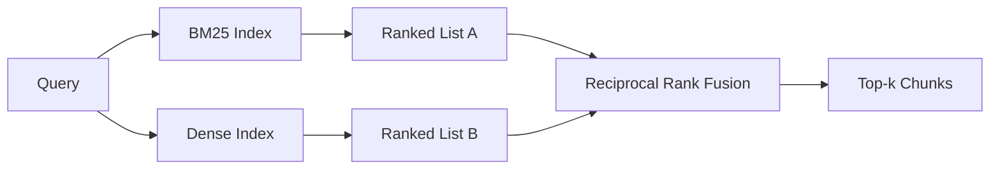

# BM25 ومتداخلات كثيفة

> 词汇和语义检索 في التوزيع على الاستفسارات في المقابل.

**Type:** Build
**Languages:** Python
**Prerequisites:** 第 11 阶段课程 04（嵌入）、06（RAG）；第 19 阶段 Track B 基础（第 20-29 课）；第 19 阶段第 64 课（分块策略）
**Time:** ~90 分钟

## 學习目标
- وفقاً لـ روبرتسون و سبارک جونز 公式 من البداية لتنفيذ BM25, مع حيز إضافة إلى الوصف، ومعايير طول الملفات ويمكن تعديلها k1 و b。
- في تحديد المثيلات المثبتة على إضافة بناء متجر مكثف، حتى تتداول دورة خارج الإنترنت.
- 完全 وفقاً لكورماك、 كلارك و بويتشر كما نشرت في عام 2009 ، تحقق إندماج درجة الاحتساب ، و شرح لماذا يحتل مكانة رئيسية في الفئة الاحتسابية والإضافة.
- 调整 RRF k 常数和每种模态权重,并在小型固定 语料库上读取权重──

## 问题

عندما تحصل المعلومات على المعلومات عن الكلمات التي تتضمن الكلمات`AbortMultipartOnFail`يُرجع البحث من خلال BM25 في ميسو ثانية إلى المُثبت الصحيح من Go 函数.

عندما يتم تفسير الاستفسار على أنه رمزية من قاعدة البيانات ، فإن البحث المكثف سوف يفوز. يطرح المستخدم كيفية التعامل مع إزالة الإزالة عندما لم يُدخل أبداً كلمة إزالة الإجهاض أو كلمة متعددة الأجزاء.

 اختيار بين الاثنين ليس مستقلة.  توزيع الاستفسار هو متغير.  إنتاج نظام RAG  معالجة هذه الفئات من نفس النقطة، لذلك يجب أن يعالج الاستفسار في نفس الوقت.  هذا هو الاختلاط.  الخطوة المشتركة هي الجزء الصحيح.

## 概念



### BM25 一段话

BM25 通過 استفسار الملفات المطلوبة والمعاملة المتكررة للثروة المرجعية المعدلة لتحتوي على طول التوحيد والمعاملة المتكررة للثروة المرجعية،`k1`控制词频和度;默认值 1.5 是已发布的建议,你不应在没有基准的情况下移动它――`b`控制文档长度的重要性;默认值 0.75 表示较长文档会受到惩罚,但不是线性──

الجيش الإسرائيلي 公式 استخدام平滑的 روبرتسون و سبارک جونز 定义,即 `log((N - df + 0.5) / (df + 0.5) + 1)`عندما يظهر مصطلح في أكثر من نصف المجموعات، فإن إضافة في日志 ستجعلها تحافظ على قيمة صحيحة.

字段加权可让你告诉 BM25, التكيف على اسم الرمز أكثر أهمية من التكيف في الكتابة الصغرى.

### في المقطع المكثف

استخدام نموذج التثبيت يضع كل بلوك في محيط طول ثابت. في الاستفسار، يضع استفسار، يقوم بتقييم السلالات المتبقية على كل بلوك على أساس التشابه، ويعود إلى الـ k 个.

هذا البرنامج يستخدم إدخالات على أساس الحاجز على أساس اليقين، لذلك لا تحتاج إلى استخدام شبكة للتقنية.

### 倒数秩融合,已公布的公式

两个排名榜――对于任一列表中出现的每一位候选人,将其倒数排名贡献相加―― 2009论文使用`1 / (k + rank)`, k = 60 كمقيمة افتراضية  حسب الترتيب الإجمالي  هذا هو الخوارزمية بأكملها 

الإعلان عن العدد العادي k = 60 ليس خياراً. عندما k = 60، فإن مساهمة المرتبة الأولى هي 1/61, مساهمة المرتبة العاشرة هي 1/70.

من بين عملياتنا يمكن تحويلها`k`常数──重量对每种模态,这样当你有预先证据表明其中一个在你的语料库上更好时,你可以提高BM25或密度──将排名贡献乘重是最简单的原则实现;它保留了等级衰减形状并保持无标性──

### لماذا التكامل أفضل من الفئات

BM25 分数 غير مقيد ويعتمد على قاعدة المواد .`alpha * bm25 + (1 - alpha) * cosine`تحتاج كل قاعدة المواد الفا 调整, وكل مرة إعادة التصفية سوف تتوقف. لا، تستند إلى تركيب درجات. الدرجات اثنتان في أوضاع مختلفة. منذ عام 2010، تم إصدار خطوط RRF على كل مسار TREC عامة. هذا يربح القيمة الإضافة إلى النسبة. وهذا هو نفس النقطة التي سمعتها في وثائق Vespa و Weaviate حول RankFusion و RRF.


```figure
rrf-fusion
```

## بناءها

`code/main.py`实现:

- `tokenize(text)`- 快速正则表达式代币器──
- `BM25Index`-المركز المضيف، مع`add`和 `search`ويمكن أن تصلح
- `mock_embed`.`DenseIndex`- نفس اليقينة التي تم وضعها في الدرجة 64، وبالتالي فإن الكتلة لها نسبية
- `rrf(rankings, k, weights)`- 已发布多模态权重融合──
- `HybridRetriever`- 结合了BM25和密集──
- عرض`main()`، تحميل مجموعة صغيرة 语料库، وتشغيل ثلاثة خاصة لتعرض كل استفسار عن نقاط ضعف المفتش، وتطبيع كل نموذج من الترتيبات التي تم إنشاؤها وكذلك قائمة التكامل

运行它:

```bash
python3 code/main.py
```

并排读演示输出──文字标识符查询位于 BM25 排名 1、密集排名 4、RRF 排名 1──释义查询位于 BM25 排名 6、密集排名 1、RRF 排名 1──模糊查询位于 BM25 排名 3、密集排名 3、RRF 排名 1──它在每个查询类别上获胜的系统──

## 调整旋

|旋钮|默认|何时调高|何时调低|
|------|---------|----------------|------------------|
| BM25 k1 | 1.5 |文档中的术语会重复，且你希望频率更重要 |文档很短，术语重复主要是噪音 |
| BM25 b | 0.75 |长文档确实每个词携带的信息更少 |文档长度与主题无关 |
| RRF k | 60 |较深排名的候选仍应投票 |Top-1 应该占主导 |
| BM25 weight | 1.0 |语料库包含字面标识符，查询也按字面匹配 |查询多为用户改写 |
| Dense weight | 1.0 |查询多为改写或语义表达 |查询多为字面表达 |

من خلال إعادة تنفيذ أدوات التقييم في الدورة 68 على مجموعة الاستفسارات المحفوظة لتحقيق التكيف، وليس بالبدوى مباشرة.

## 演示将隐藏的故障模式

**词汇外token。**تم تحليل IDF في BM25 على أساس قاعدة البيانات، لذلك فإن مساهمة الفصائل في الاستفسار فقط هي صفر. يخلق التثبيتات المكثفة نفس الشكل. بالنسبة إلى المعالم خارج قاعدة البيانات، فإن نموذج المكثف يعود إلى الجوار المنطقي ولكن الخطأ.

**停止token统治。**BM25 针对单词the在语料库中产生统一的排名──过索引器中停止token或接受高 IDF 术语自然占主导地位──

**跨模态的内容相同。**إذا كان مخزون المواد الخاص بك صغير بما فيه الكفاية، حتى أن المجموعة الأولى من BM25 هي أيضا المجموعة الأولى من المجموعة الأولى، فإن RRF سوف توفر لك نفس المجموعة الأولى من المجموعة الأولى من المجموعة الأولى من المجموعة الأولى من المجموعة الأولى من المجموعة الأولى من المجموعة الأولى من المجموعة الأولى من المجموعة الأولى من المجموعة الأولى من المجموعة الأولى من المجموعة الأولى من المجموعة الأولى من المجموعة الأولى من المجموعة الأولى من المجموعة الأولى من المجموعة الأولى من المجموعة الأولى من المجموعة الأولى من المجموعة الأولى من المجموعة الأولى من المجموعة الأولى من المجموعة الأولى من المجموعة الأولى من المجموعة الأولى من المجموعة الأولى من المجموعة الأولى من المجموعة الأولى من المجموعة الأولى من المجموعة الأولى من المجموعة الأولى من المجموعة الأولى من المجموعة الأولى من المجموعة الأولى من المجموعة الأولى من المجموعة الأولى من المجموعة الأولى من المجموعة الأولى من المجموعة الأولى من المجموعة الأولى من المجموعة الأولى من المجموعة الأولى من المجموعة الأولى من المجموعة الأولى من المجموعة الأولى من المجموعة التي تمثل من المجموعة من المجموعة من المجموعة من المجموعة من المجموعة من المجموعة من المجموعة من المجموعة من المجموعة من المجموعة من المجموعة من المجموعة من المجموعة من المجموعة من المجموعة من المجموعة من المجموعة من المجموعة من المجموعة من المجموعة من المجموعة من المجموعة من المجموعة من المجموعة من المجموعة من المجموعة من المجموعة من المجموعة من المجموعة من المجموعة من المجموعة من المجموعة من المجموعة من المجموعة من المجموعة من الموحة من الموحة من الموحة من الموحة من الموحة من الموحة من الموحة من الموحة من الموحة من الموحة من من من من من من من من من من من من من من من من من من من من من من من من من من من من من من من من من من من من من من من من من من من من من من من من من من من من من من من

## استخدمها

النمط الناتج:

- 索引 BM25 正在处理中;瓶是词频字典,而不是向量──
- في الاحتياطي الخاص بك، سوف تستخدم HNSW)
- ويقوم عمل استفسارات اثنين، والانكماش هو التكامل مع الوقت الثابت في المجموعة.
- حافظ على كل بحث في وضع الحياة حتى يستطيع المرتبة التالية أن ترى أي وضعية تصوت له.

## 发货

第66 课采用本课中的融合 top-k 并使用交叉编码器重新排名. 第68 课使用精度、召回率、MRR 和 nDCG 评估整个流程.

## التدريب

1. ستعمل`mock_embed`替换为供应商提供的真实模型──重新运行演示并报告 仅密集排名在释义查询上的变化──
2. 添加第三种模式:单独索引的块摘要并融合为第三排名列表──测量增益──
3. رسم المخططات المذكورة في الدورة 68، تقرير المخططات المذكورة في المقالة
4. صحيح تحقيق BM25F ((كل حجر طول قياس بدلا من ضربة عدد المهارات) وترتيب رمزية على أهم قاعدة المواد المقارنة:

## 关键术语

|术语 |人们怎么说|它实际上意味着什么 |
|------|-----------------|------------------------|
| BM25 | “词汇搜索” | idf x 饱和 tf x 长度归一化的概率排名 |
|参考文献 | “等级融合”|各个排名列表的 1 / (k + 排名) 之和； k = 60 默认 |
| k1 | “TF 饱和度” |控制重复术语停止添加更多分数的速度 |
|乙| “长度惩罚” | 0 表示忽略文档长度，1 表示完全标准化 |
|场加权 | “符号提升”|在索引期间重复token以增强该字段中的匹配|
|基于排名与基于分数的融合 | “为什么 RRF 优于线性”|不同模式下的排名具有可比性；分数不|

##  المزيد阅读

- كورماك، كلارك، بويتشر، 倒数排名融合优于孔多塞和个人排名学习方法,SIGIR 2009
- روبرتسون والكر بيولييو غاتفورد بيني اوكابي في ترك-3
- [Vespa：使用 BM25 和 Embeddings](https://docs.vespa.ai/en/tutorials/hybrid-search.html)إجراء عملية اختلاط
- [Weaviate：混合搜索](https://weaviate.io/developers/weaviate/search/hybrid)
- 第 11 阶段 第 06 课 - RAG 基础知识
- 第19 阶段 第64 课 - 分块器的输出 在此编制索引
- 第19 阶段 第66 课 - 消耗融合的顶-k 的交叉编码器重排器
