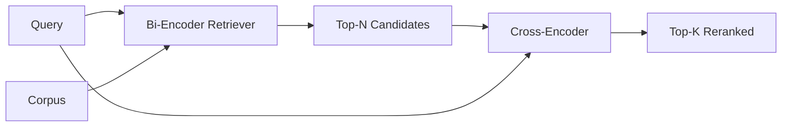

# 交叉编码器重排序

> 双编码器独立嵌入查询和文档――交叉编码器将它们连接起来并同时读取――交叉编码器是最聪明的读者,也是最慢的――用作双编码器上级的第二级,它本身就有价值――

**Type:** Build
**Languages:** Python
**Prerequisites:** 第11期第06课（RAG）、第11期第07课（高级RAG）；第 19 阶段 Track B 基础（第 20-29 课）；第 19 阶段第 65 课（混合检索喂养此阶段）
**Time:** ~90 分钟

## 學习目标
- من خلال إدخال الشكل والمعايير والمسألة كل استفسار تم التمييز بين محركات تحديد المعدات والمتعدد عبر محركات تحديد المعدات.
- من البداية تطبيق جهاز تحويل صغير كجزء من المتحول، فإنه يستهلك طرق البحث والوثائق ويتم إصدار عبارة ذات صلة واحدة.
- 连接两阶段检索然后重新排序管道: باستخدام检索器廉价检索器检索前 N, باستخدام交叉编码器将 N 重新排序为前 K, 回归 K。
- في قاعدة المواد المتعلقة بالتخفيف الصغيرة، يُقيّم الوزن بين التأخير والجودة، ويتمّ تحديد الميزانية المحددة للتخفيف.

## 问题

سوف يقوم المُعدّين المزدوج بتسجيل الملفات والمسائل إلى نفس الفضاء المتعدد وترتيبها بالخطوط المتبقية. هذين النوعين من الملفات لن يراهم أبداً. يجب على النموذج أن يضغط على كل المحتوى المفيد في الملف إلى محيط واحد، دون النظر في المُسائل.

代价就是精度. يمكن أن يكون لدى المستندين ذوي نفس الموضوع الكامل إدخالًا متطابقًا تقريبًا، حتى لو أجاب أحدهم على السؤال ولم يجيب الآخر.

交叉编码器通过一起阅读查询和文件来解决这个问题――该模型收录 `[query] [SEP] [document]`كسلسلة واحدة، تنشط في جميع الاتصالات بشكل كامل، وتولد كميات معينة ذات صلة. كل رمز في الملف يمكن أن يشارك في كل رمز في الاستفسار.

成本就是吞吐量──双编码器嵌入一次并永久查询的情况下,交叉编码器每个查询,文档) على运行一次──对于包含10000000 مستندات المجموعة من المواد, كل استفسار يحتاج إلى إجراء 10000000 مرة إلى الأمام وإلى الوصول── في الميزانية المطلوبة لا يمكن أن تعمل──

الحل هو分阶段── استخدام محركات إعدادية مزدوجة  个前 N 个── استخدام محركات إعدادية مزدوجة سوف تُعد N 重新排序 إلى أعلى-K── N 很小(50 إلى 200) ، تحسين جودة محركات إعدادية مزدوجة ترعى تركز في أماكن مهمة── إجمالي التأخير يبقى في ميزانية الطلب── الجدول العام هو جودة محركات إعدادية مزدوجة، والحد الأعلى هو معدل استدعاء المحركات إعدادية مزدوجة في N 处──

## 概念



### صيغة إدخال المعدات

标准包装为`[CLS] query_tokens [SEP] document_tokens [SEP]` CLS  موقع المخرج يتم إرسالها إلى الصادرة من العلامات ذات الصلة.

22M المكونات交叉编码器(已发布的`ms-marco-MiniLM-L-6-v2`الوزن (بالإنجليزية: weightweight) هو النموذج النموذجي النموذجي الذي يُعتبر أقل من معدل خسارة الجودة، وسرعة النموذج أكبر من معدل الخسارة.`bge-reranker-v2-m3`) للحفاظ على إعادة تصنيفها على الإنترنت أو إعادة تصنيف الصفحة الأولى من K 较小的.

### لماذا هذا الجزء من التدريب هو الطفل الصغير

المعدل الحقيقي للصفاف هو المعدل المتغير المتغير. في الإنتاج، تقوم بتحميل نقطة فحص وتشغيلها. في هذه الدورة، هدفنا هو أن نريك شكل النموذج وشكل منحنى الجودة المتأخرة، وليس تدريب المعدل المتقدم.`nn.Module`، منها يتضمن كتلة Transformer 、多头注意力 ((بالتوقيع 4 个头) و رأس عائد ٬ وهو يبدأ من البذور بشكل محدد ، لذلك يمكن إعادة عرض العرض ، دون الحاجة إلى الوزن على القرص.

模型玩具从固定语料库学习正确形状:相关查询-文档对不相关对具有更高预测分数――تقوم أنبوب端到端 بإعادة ترتيب إصدارات المعدل المزدوج، ويعود إعادة ترتيب أعلى-ك إلى علامة الذهب 

### 延迟与质量

المرحلة الثانية من الأنابيب لديها عنصر يمكن تعديلها: N. في مجموعة الاستفسارات المحفوظة سوف تكون N من 5  مسح إلى 100, أي يمكن الحصول على منحنى.

|N |第 2 阶段的 recall@1 |每个查询的交叉编码器前向传递 |延迟 |
|---|--------------------|---------------------------------------|---------|
| 5 | 0.62 | 0.62 5 |低|
| 20 | 0.81 | 0.81 20 |中等|
| 50 | 50 0.86 | 0.86 50 | 50高|
| 100 | 100 0.86 | 0.86 100 | 100非常高|

الرقم أعلاه هو مجرد تعريف للشكل، وليس القيمة القياسية لهذا التصميم. الشكل هو حقيقي.

من منحنى التقييم اختيار N بالإضافة إلى التأخير الميزاني.


```figure
rerank-funnel
```

## بناءها

`code/main.py`实现:

- `CrossEncoder`- واحد صغير`torch.nn.Module`:توكين فيختر، بلاك تحول مع العديد من الرؤوس والاهتمام، وتوليد نقطة متوسط القيمة من العلامة.
- `tokenize_pair(query, document)`- وضع اثنين من الخطوط على تسلسل هوية ، نوعها رمز هوية الحدود
- `train_tiny(pairs)`- للتدريب على الجهاز المستخدم (التسجيلات) ، والتي تمتد على الجهاز المستخدم،
- `rerank(query, candidates, top_k)`- 生产接口
- `pipeline(query, retriever, top_n, top_k)`- 两级流――
- 演示 `main()`، من الـ 65 ة درجة من النموذج تحميل المواد اللغة، والتحقيق قبل N 个، وإعادة ترتيب إلى قبل K 个،并排 طباعة قائمة اثنين،并 تقرير تأخير كل مرحلة.

运行它:

```bash
python3 code/main.py
```

输出显示双编码器的顶-N、交叉编码器的顶-K以及时间序摘要──交叉编码器的调用需要更长时间,但不会运行在完整的语料库──当选择双编码器排名第二或第三的答案时,两阶段总数保持在请求预算范围内──

## 演示将隐藏的故障模式

**交叉编码器不对称。** `rerank(q, d)`和 `rerank(d, q)`..إذا لم تكن لديك أي فكرة عن التبادل، فإن الذكريات ستنهار

**N 太低，无法暴露该 bug。**إذا تم تعيين N = K، فإن جهاز التنسيق لا يمكن إعادة ترتيبه؛ فإنه يمكن إعادة تسميته فقط.

**训练数据泄漏到评估中。**إذا كان تدريبات الـ Handmade Token تتضمن استفسارات تقييم، فإن إعادة التصنيف تبدو رائعة.

**生产权重很密集。**22M 参数交叉编码器在float32 时为 88MB──在承诺低于100毫秒的p95 之前规划模型服务器的内存──

**批处理很重要。**⇒ ⇒ ⇒ ⇒ ⇒ ⇒ ⇒ ⇒ ⇒ ⇒ ⇒ ⇒ ⇒ ⇒ ⇒ ⇒ ⇒ ⇒ ⇒ ⇒ ⇒ ⇒ ⇒ ⇒ ⇒ ⇒ ⇒ ⇒ ⇒ ⇒ ⇒ ⇒ ⇒ ⇒ ⇒ ⇒ ⇒ ⇒ ⇒ ⇒ ⇒ ⇒ ⇒ ⇒ ⇒ ⇒ ⇒ ⇒ ⇒ ⇒ ⇒ ⇒ ⇒ ⇒ ⇒ ⇒ ⇒ ⇒ ⇒ ⇒ ⇒ ⇒ ⇒ ⇒ ⇒ ⇒ ⇒ ⇒ ⇒ ⇒ ⇒ ⇒ ⇒ ⇒ ⇒ ⇒ ⇒ ⇒ ⇒ ⇒ ⇒ ⇒ ⇒ ⇒ ⇒ ⇒ ⇒ ⇒ ⇒ ⇒ ⇒ ⇒ ⇒ ⇒ ⇒ ⇒ ⇒ ⇒  ⇒   ⇒   ⇒   ⇒       ⇒          ⇒                                                                                                                                                                                                                                                                                        `_batch_encode`中执行此操作, it use `torch.tensor(...)`构建批量 id 和类型-id 张量并运行一次前向传递──跳过批处理,延迟会乘以 N──

## استخدمها

النمط الناتج:

- إعادة تشغيل المعدل المزدوج، والمتصفح المعدل المزدوج، والمتصفح المزدوج، والمتصفح المزدوج، والمتصفح المزدوج، والمتصفح المزدوج، والمتصفح المزدوج، والمتصفح المزدوج، والمتصفح المزدوج، والمتصفح المزدوج، والمتصفح المزدوج، والمتصفح المزدوج، والمتصفح المزدوج، والمتصفح المزدوج، والمتصفح المزدوج، والمتصفح المزدوج، والمتصفح المزدوج، والمتصفح المزدوج، والمتصفح المزدوج، والمتصفح المزدوج، والمتغيرات التي لا يمكن أن تكون غير فعالة.
- 通過 (quest, document_id) 哈希缓存重排器的输出──稳定语料库上的相同查询会重排成相同顺序;缓存命中可以免费降低延迟──
- 记录排名第 1 交叉编码器分数──top-1 分数低于语料库特定值的查询是域外命中;让LLM表达我不确定──

## 发货

第68 课端到端评估这两阶段管道. 第69 课将这重排器连接在第65 课混合检查器之后,答案生成器之前.

## التدريب

1. سوف نُمثل من 5 扫 إلى 50،并绘制重排输出回忆@1──找到该固定上的拐点──
2. لتدريب المعدات المترتبة على عشرة حقول بدلاً من 1 .
3. استخدام رمز CLS 头替换平均值池──比较该固定的收性──
4. إضافة رأس إعداد ثاني للصفحة، لتحديد ما إذا كان الإجابة في الملفات هي كذلك.
5. سيتم استبدال المعدل المزدوج في الدورة 65، ويتم ربط مرحلتين.

## 关键术语

|术语 |人们怎么说|它实际上意味着什么 |
|------|-----------------|------------------------|
|双编码器 | “矢量检索器” |独立编码查询和文档；余弦对它们进行排名 |
|交叉编码器 | “重排” |联合编码(query, doc)；输出一个相关标量 |
|两级管道 | “检索并重排” |便宜的检索器返回 N，昂贵的重排器保留 K |
| N（候选预算）| “重新排列池” |每个查询交叉编码器得分的候选者数量 |
|平均池头 | “最后隐藏的平均值” |将编码器的最后一层输出平均为一个向量 |

##  المزيد阅读

- Nogueira, Cho,Passage إعادة ترتيب مع BERT,2019 年 - 规范的交叉编码器排名论文
- ريمرز، غيورفيش،Sentence-BERT: استخدام سيمسية BERT 网络的句子嵌入,2019 年 - 关于双编码器与交叉编码器
- [SentenceTransformers 交叉编码器文档](https://www.sbert.net/examples/applications/cross-encoder/README.html)
- [BGE Reranker v2 模型卡](https://huggingface.co/BAAI/bge-reranker-v2-m3)
- 第19 阶段 第65 课 - 混合检索器养此重新排序阶段
- 第19 阶段 第68 课 - 衡量重新排名带来的提升评估
