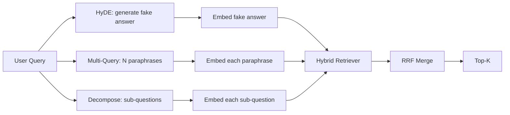

# 查询重写:HyDE、多查询和分解

> استفسارات المستخدم المدخلة ليست استفسارات المفتش الخاص بك تريد. إعادة الكتابة تمتد الفجوة التي كانت موجودة قبل الاستفسارات، لذلك فإن محتوى المفتش الذي يراه أقرب إلى الإجابة.

**Type:** Build
**Languages:** Python
**Prerequisites:** 第 11 阶段课程 04（嵌入）、06（RAG）；第 19 阶段 Track B 基础（第 20-29 课）；第 19 阶段第 64 和 65 课
**Time:** ~90 分钟

## 學习目标
- 实现假设文档嵌入 (HyDE): إنشاء جواب مزيف، وضعها، بناءً على هذا الطرف بدلاً من الطرف الاستقصائي.
- 实现多查询扩展: إعادة كتابة استفسار واحد إلى N个释义,检查个别,通过倒数等级融合合并并集──
- 实现查询分解:将复杂问题分为子问题,按子问题检索,合并──
- مقارنة: 3 كتاب في مسابقة،并 شرح كل استراتيجية متى يفوز.
- تصل بـ "مدرسة التدريب القانوني" ، وتتولى إصدار ثابت محدد، حتى يتم إعادة كتابة دورة التدريب على الإنترنت

## 问题

المستخدم الإدخال عندما يفشل الإرسال والبدولة، ماذا يفعل فريقنا؟── في أحد الملفات في الملفات قائلا: AbortMultipartOnFail سوف يتوقف عن إرسال S3 في المرحلة المُجرية، ويقلل من إرسال الإرسال عند الفشل من إعادة إرسال كل سطل.‬‬‬المفاوضات والبدلات لا توجد كلمة مشتركة.‬BM25 غير مقصود.‬‬المعدل الثنائي يضع الملفات في المرتبة الثالثة أو الرابعة، لأن اتجاه الإرسال يقع في المجال المُضمن أكثر تحديداً على إزالة المهام ‬الملفات، وليس في منطقة الملفات.‬المفاوضات إذا دخلت الإجابة في المرحلة الأولى، فيمكن إعادة إرسال الملفتين في المرحلة الثانية والستين؛ ولكن إذا لم يكن هناك إرسال إرسال إرسال إرسال إرسال إرسال إرسال إرسال إرسال إرسال إرسال إرسال إرسال إرسال إرسال إرسال إرسال إرسال إرسال إرسال إرسال إرسال إرسال إرسال إرسال إرسال إرسال إرسال إرسال إرسال إرسال إرسال إرسال إرسال إرسال إرسال إرسال إرسال إرسال إرسال إرسال إرسال إرسال إرسال إرسال إرسال إرسال إرسال إرسال إرسال إرسال إرسال إرسال إرسال إرسال إرسال إرسال إرسال إرسال إرسال إرسال إرسال إرسال إرسال إرسال إرسال إرسال إرسال إرسال إرسال إرسال إرسال إرسال إرسال إرسال إرسال إرسال إرسال إرسال إرسال إرسال إرسال إرسال إرسال إرسال إرسال إرسال إرسال إرسال إرسال إرسال إرسال إرسال إرسال إرسال إرس

修复方法在查询触及检查器之前重写查询. 2023年论文 精确零射密度检查没有相关性标签(Gao 等人)介绍 HyDE:要求 LLM 编写一篇能够回答查询的文档,嵌入这个假设文档,并把它嵌入用于检查向量.

两种近亲技术与HyDE相结合――多查询扩展(استخدم Microsoft's GraphRAG 术语) لتوليد استفسارات N 个释义并检索每个释义,然后合并――分解( في 2024 斯坦福 DSPy 工作中流行为子查询分解) سوف 当传输失败而预算耗尽时我们的团队会做什么分为两个问题:当传输失败时会发生什么和重试预算耗尽时会发生什么──

هذا البرنامج سوف ينجح في تنفيذ هذه المشاريع الثلاثة، ويتم تنفيذها على نفس المجموعة المثبتة لللغة.

## 概念



### الهيدي 详细信息

HyDE باستخدام LLM 编写的假设文档向量替换用户的查询向量──提示很短:

```text
You are a domain expert. Write a one-paragraph passage that answers the question
below. Use the same vocabulary and phrasing the documentation in this domain would
use. Do not refuse. Do not say you do not know.

Question: {user_query}

Passage:
```

الـ LLM الإجابة كإجابة حقيقية هي خاطئة، لأن LLM لا يعرفك الملفات القاعدة. ذلك جيد.

في الإنتاج، ستحد من المفترضات إلى جملتين إلى ثلاث جملات. المفترضات الطويلة ستجمع المزيد من الضوضاء. الكلمات القصيرة ستفقد إشارات الكلمات المطلوبة من HyDE.

### 多查询扩展详解

生成用户查询的N 个释义──最简单的提示:

```text
Rewrite the following question in {N} different ways. Each rewrite must preserve
the original intent. Number them 1 to {N}. Do not add explanations.
```

检索每个释义的顶级k――将 N个排名列表与RRF 合并(同与第 65 课程中的算法相同) ∼廉价、并行、确定性──

عندما يكون تصريح المستخدم هو واحد من العديد من الطرق المثلى للقراءة من الأسئلة، فالتسائل الفائزة، وأي إعادة كتابة سوف تكون أفضل طرحها.

### التفاصيل

单一检索不能满足多方面的问题――分解要求 LLM 将问题拆成子问题,系统再检索每个子问题――提示:

```text
The following question may require information from multiple distinct topics.
Decompose it into a list of sub-questions. Each sub-question must be answerable
independently. If the question is already atomic, return it unchanged.

Question: {user_query}
```

检索每个子问题――合并―― بالنسبة لمشكلة تتضمن连词、多从句比较或两个主题不相关,分解是正确的工具――原子问题工具错误;

### لماذا هذه الثلاثة موجودة

ثلاثة هو التكامل. . . . . . . . . . . . . . . . . . . . . . . . . . . . . . . . . . . . . . . . . . . . . . . . . . . . . . . . . . . . . . . . . . . . . . . . . . . . . . . . . . . . . . . . . . . . . . . . . . . . . . . . . . . . . . . . . . . . . . . . . . . . . . . . . . . . . . . . . . . . . . . . . . . . . . . . . . . . . . . . . . . . . . . . . . . . . . . . . . . . . . . . . . . . . . . . . . . . . . . . . . . . . . . . . . . . . . . . . . . . . . . . . . . . . . . . . . . . . . . . . . . . . . . . . . . . . . . . . . . . . . . . . . . . . . . . . . . . . . . . . . . . . . . . . . . . . . . . . . . . . . . . . . . . . . . . . . . . . . . . . . . . . . . . . . . . . . . . . . . . . . . . . . . . . . . . . . . . . . . . . . . . . . . . . . . . . . . . . . . . . . . . . . . . . . . . . . . . . . . . . . . . . . . . . . . . . . . . . . . . . . . . . . . . . . . . . . . . . . . . . . . . . . . . . . . . . . . . . . . . . . . . . . . . . . . . . . . . . . . . . . . . . . . . . . . . . . . . . . . . . . . . .

## 模拟 ماجستير في العلوم

المثالية LLM هي جدول بحث صغير مفتاح استفسارات المستخدم، فضلا عن إعدادات استفسارات غير مرئية.

- 对于每一个固定 查询:书面假设段落、三个释义和分解结果──
- 对于未知查询:确定性转换: الحصول على كلمة محتوى استفسار، من خلال معنى كلمة خريطة على ذلك التوسع، ثم العودة إلى النتيجة.

شكل المزيج هو فقط المهم، وليس البيانات. في الإنتاج، ستبدل المزيج في النموذج الحقيقي.


```figure
cd-hyde-vector
```

## بناءها

`code/main.py`实现:

- `MockLLM`- المذكورة أعلاه
- `HyDERewriter`- 调用LLM编写假设文档,将重写机输出返回为`RewriteResult`، والتي تتضمن افتراضات النص والتحقيقات التي يجب استخدامها.
- `MultiQueryRewriter`- 调用LLM进行N个释义,返回查询列表
- `DecomposeRewriter`- 调用LLM进行分解,返回子问题──
- `retrieve_with_rewriter`- استخدام الـ "كتابة" والـ "مراقبة" ،
- عرض، على الثلاثة عدة أجهزة للعمل على المعدات والطباعة

重复 استخدام 六 课中的检索器形状(混合 BM25 + dense) ・・・融合仍然是相同的RRF。唯一新形状是重写器接口,它很小──

运行它:

```bash
python3 code/main.py
```

输出是每个策略的排名和最终摘要―― HyDE 在措辞不匹配的查询中获胜──多查询在释义方差查询中获胜──分解在多主题查询中获胜──后备方案 (无重写器) 失败至少在三者之一中──

## 演示将隐藏的故障模式

**HyDE 对语料库特定标识符的幻觉是错误的。**هذا النموذج ابتكر اسم وظيفي. افتراضات المستندات على اليمين BM25 分数崩، لأن اسم الإبتكار الآن هو علامة عالية الوزن، لم يظهر في المؤشر.

**多查询重写全部收敛。**弱模型 produce three almost the same release. N 次检索返回 the same top-k. RRF 合并并不是比单个检索好.

**分解过度分割。**سوف يُحوّل المُحلّل إلى قائمة. كلّ المُحَصّنات ستعود إلى نفس المُصنف، لكنّ التصنيف ينخفض.

**延迟成倍增加。**HyDE 需要花费一次LLM 通话费用──多查询花费一次LLM 调用生成 N 次重写,然后生成 N 次检索──分解需要一次LLM 调用分解,然后进行 M 次检索──检索并行进行; LLM 电话是发言权──

## استخدمها

النمط الناتج:

- 按查询长度选择每一个查询策略:原子短查询得到多查询,复杂多句查询得到分解,行话重查询得到 HyDE──
- 通過查询哈希缓存重写器输出──许多查询重复──
- ويقومون بتشغيل جميع مجموعات النتائج الثلاثة، وباستخدام RRF، ويتم دمج مجموعات النتائج الثلاثة إلى واحدة.

## 发货

المادة 69  ة يُحصل على مرحلة إعادة الكتابة قبل إعادة كتابة المادة 65 ة ، ويضعها قبل إعادة ترتيب المادة 66 ة ة ة ة ة ة ة ة 68 ة ة تقييم إعادة كتابة لإعادة كتابة الاختبار التذكير ة تحسينات ة

## التدريب

1. 实现 RAG-Fusion ((多查询的 2024年变体), من بينها إعادة كتابة 释义有意多样化, ثم إعادة ترتيب الخطوات ((第 66 课) اختيار القائمة النهائية。
2. 添加第四种策略:step-back prompting(向LLM 问问更一般问题,检索该问题,然后再缩小范围)
3. من خلال إضافة  المشكلة هي  رأس الذرات لتدريب المُفصلون لتحديد استفسارات الذرات 
4. استخدام النموذج الحقيقي لتحويل المعلمين إلى الجامعة.
5. لـ كل إعادة كتابة إضافة إعتمادية .

## 关键术语

|术语 |人们怎么说|它实际上意味着什么 |
|------|-----------------|------------------------|
|海德 | “伪造文件检索”| LLM写出答案；嵌入并检索它而不是查询 |
|多查询 | “释义扩展”| N次重写查询；检索N次，按RRF合并|
|分解 | “子查询分割” |多主题查询拆分为子问题，单独检索 |
|原子查询 | “单一主题” |如果不发明假子问题就无法分解 |
|后退一步| “抽象查询”|提出更一般性的问题，检索，然后缩小范围 |

##  المزيد阅读

- 高、马、林、Callan,无相关标签精确零样本密集检索(HyDE),2023
- 微软研究院, 检索的多查询扩展
- 斯坦福大学 ديسبي,多跳 QA 的子查询分解
- [LlamaIndex 查询转换文档](https://docs.llamaindex.ai/en/stable/optimizing/advanced_retrieval/query_transformations/)
- 第11 阶段 第07 课 - 高级 RAG 模式
- 第19 阶段 第65 课 - 重写器 المقدمة
- 第19 阶段 第68 课 - 测重写器提升的评估
