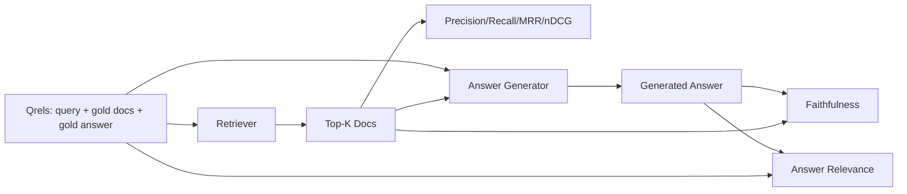

# تقييمات الجمعيات العربية المتحدة: معدل التأكد، معدل الاستدعاء، معدل التدقيق، معدل التدقيق، معدل التدقيق، معدل التدقيق، معدل التدقيق، معدل التدقيق، معدل التدقيق، معدل التدقيق، معدل التدقيق، معدل التدقيق، معدل التدقيق، معدل التدقيق، معدل التدقيق، معدل التدقيق، معدل التدقيق، معدل التدقيق، معدل التدقيق، معدل التدقيق، معدل التدقيق، معدل التدقيق، معدل التدقيق، معدل الإجابة

> إذا لم تتمكن من تقييم البحث والإجابة في نفس الوقت، فلن تتمكن من إرسال النظام.

**Type:** Build
**Languages:** Python
**Prerequisites:** 第11期第06课（RAG）、10（评估）；第 19 阶段 Track B 基础（第 20-29 课）；第 19 阶段课程 64, 65, 66, 67
**Time:** ~90 分钟

## 學习目标
- 根据黄金 qrel 计算四个检索指标: precision@k、recall@k、MRR(平均倒数排名) و nDCG@k。
- 计算两个答案等级指标:忠诚度 (كل اقتراح مبني على المراجعة إلى أعلى) وارتباط الرد (الرد حل المشكلة) 
- 构建一个由 eval 端到端读取的固定 qrels 文件(查询、黄金文档 ID、黄金答案文本)
- 读取 مؤشر قيمة الموقع الذي حدث فيه إصابة في الأنابيب التشخيصية: الاختبار والتقييم أو إنتاج أو استغلالها

## 问题

نظام RAG  يوجد أربعة أجزاء نشطة على الأقل: متجر الحفرة  متجر المراقبة  متجر المرتبة الثانية  المولدات  أي من هذه الأجزاء يمكن أن تؤدي إلى إجابة خاطئة  إذا لم يكن هناك مؤشر لكل مرحلة، فستكون عمياء حالياً 

المستخدم التقارير خطأ الإجابة. هل هو لأن المقطع قطع الإجابة عبر؟ هل هو لأن المفتش لم يضع الجزء في أعلى-ك؟ هل هو لأن المعدل الثابت وضع الجزء الصحيح بعد أن وصل إلى المركز الأول؟ هل هو لأن المولد تجاهل الجزء وجعل المحتوى؟ فقط مع الإجابة لا يمكن أن تقرر. تحتاج:

- مؤشر الاختبار، يستخدم لقيام بتقييم نتائج الاختبار.
- يتم تصنيف المؤشرات، لتقييم المكونات الصحيحة في الترتيب.
- 忠实地对生成器是否停留在检查到的上下文进行评价──
- هل حلّت المشكلة تماماً؟

هذا البرنامج يستند إلى جميع المؤشرات الستة على الملفات المثبتة.

## 概念



### 精度@k

في الملفات السابقة التي يعودها المفتش ، ما هو النسبة في المجموعة الذهبية؟ إذا كان هناك 3 مستندات للذهب ، و 3 أعلى يعود اثنين من الملفات و واحد خطأ الملف ، فإن الدقة 3 = 2 / 3 .

### التذكير

في الملفات الذهبية، كم جزء من الملفات الذهبية؟ إذا كان هناك 3 ملفات، و 5 ملفات تحتوي على كل هذه الملفات، فإن التذكر @ 5 = 1.0.

في إنتاج RAG، فإن المؤشر الذي يستخدمه الناس عادة هو recall@k. يمكن أن يتم بسهولة حذف الكتل غير المرتبطة. لا يمكن أن يتم إنشاء إجابة من الكتل التي لم يسبق لها أن رأيتها.

### (متوسط الـ (معدل الـ)

对于每一个查询,找到排名列表中的第一相关文档位置――排名倒数为1/位置――整个查询集的平均值――MRR是查询器将最好的答案放在顶部程度的单个数字摘要――

مساومة المساعدة المشتركة للموقع 1: مساومة المساعدة المشتركة للموقع 1: مساومة المساعدة المشتركة للموقع 1: مساومة المساعدة المشتركة للموقع 1: مساومة المساعدة المشتركة للموقع 1: مساومة المساعدة المشتركة للموقع 1: مساومة المساومة المشتركة للموقع 1: مساومة المساومة المشتركة للموقع 1: مساومة المساومة الموقع 1: مساومة المساومة الموقع 2: مساومة المساومة الموقع 1: مساومة المساومة الموقع 1: مساومة المساومة الموقع 1: مساومة المساومة الموقع 2: مساومة المساومة الموقع 10: مساومة المساومة الموقع 1: مساومة المساومة الموقع 1: مساومة المساومة الموقع 1: مساومة المساومة الموقع 1: مساومة المساومة المساومة الموقع

### nDCG@k

標準化贴现累积收益──公式完整的公式为每检索到的文件分配增益(عادةً 1 表示相关,0 表示不相关),根据位置对数进行折扣,求和,然后除以理想的DCG(如果排名完美,你将拥有DCG) 范围 0到1──

nDCG 适应分级相关性:黄金可以说文档 A 是 3,文档 B 是 2,文档 C 是 1── MRR 和recall@k 将所有内容平化为二进制──当语料库每查询有多部分相关文档时,请使用 nDCG──

### 忠诚

بالنسبة لكل بيان في الإجابة المنتجة، فحص ما إذا كان المقالة السابقة على المقالة المطلوبة تدعم هذا البيان.

忠诚度抓住模型发明内容的生成器故障模式──即使检查器返回正确块,产生幻觉的生成器也会损坏──忠诚也称为基础、支持、归属──

في هذا الدورة من خلال تحديد المثابة الحكم لتحقيق الوفاء، يجب أن يختبر ما إذا كان رمز كل بيان مع التداول فوق البحث.

### 答案相关性

هل الجواب يحل حقاً المشكلة؟ هل الجواب يستند إلى العكس؟────────────────────────────────────────────────────────────────────────────────────────────────────────────────────────────────────────────────────────────────────────────────────────────────────────────────────────────────────────────────────────────────────────────────────────────────────────────────────────────────────────────────────────────────────────────────────────────────────────────────────────────────────────────────────────────────────────────────────────────────────────────────────────────────────────────────────────────────────────────────────────────────────────────────────────────────────────────────────────────────────────────────────────────────────────────────────────────────────────────────────────────────────────────────────────────────────────────────────────────────────────────────────────────────────────────────────────────────────────────────────────────────────────────────────────────────────────────────────────────────────────────────────

## الـ (قـر)

```python
{
  "qid": "q1",
  "query": "what is the abort threshold for multipart uploads",
  "gold_doc_ids": ["d1", "d3"],
  "gold_answer_substring": "three failed parts",
  "graded_relevance": {"d1": 3, "d3": 2},
}
```

كل استفسار يحمل:
- 查询字符串،
- واحد من أدوات الصفحة الذهبية
- 分级相关性字典(على nDCG) ،
- 黄金答案字符串( كحفظ بيانات مرجعية لكل كرول؛ والصدق في هذا الدروس هو من خلال بناء على ما ورد في المقالة السابقة وليس في هذه الصفوف الحكم على بيانات الاختيار للحساب)

في الإنتاج، يمكنك القيام بهذه المشاريع. هذا البرنامج يوفر إطارًا يدويًا لبناء، لذلك يمكن تقييمها على الفور.


```figure
ci-rag-metric-ladder
```

## بناءها

`code/main.py`实现:

- `precision_at_k(retrieved, gold, k)`- 字面定义──
- `recall_at_k(retrieved, gold, k)`- 字面定义──
- `mean_reciprocal_rank(retrieved_list_of_lists, gold_list)`- متوسط قيمة الاستفسار
- `ndcg_at_k(retrieved, graded_relevance, k)`- DCG / IDCG 具有二进制或分级增益
- `extract_claims(answer)`- أن تكون الإجابة مقسمة إلى شكل جملة
- `faithfulness(claims, context_texts, judge)`- جزء من المطالبات التي تم تحديدها
- `answer_relevance(question, answer, judge)`- 判断答案是否解决问题──
- `MockJudge`- تحديد الوضع، لتقييم التشغيل
- `evaluate_pipeline(pipeline_fn, qrels, ks)`- 运行 كل مؤشر المنسق
- 针对 qrel 运行三种管道变体(分块基线、混合检索、混合 + 重新排名)并印标签表的演示──

运行它:

```bash
python3 code/main.py
```

输出显示每个变体的精度在单指标中. 查询混合检行在召回方面击败分块器基线.

## 读取标志来诊断故障

|症状|可能的原因 |修复什么问题 |
|---------|-------------|-------------|
|低召回率@k，低精度@k |分块剪切答案或检索器找不到它 |分块边界（第 64 课）或检索器模态（第 65 课） |
|不错的召回率@k，低 MRR |右块位于 top-k 中但不在位置 1 |重新排序（第 66 课）|
|高MRR，低忠诚度|尽管上下文正确，生成器仍然发明内容 |生成提示；强制引用或拒绝 |
|忠诚度高，相关性低 |答案有根据但偏离主题 |查询重写器（第 67 课）或生成提示 |
|均四高，用户仍抱怨|评估集不具有代表性 |使用真实用户查询扩展 qrels |

## 演示将隐藏的故障模式

**LLM-as-judge 偏差。**عندما يحدد النموذج خروجه ، يعتقد عادة أنه أكثر صدقًا من الحالة الواقعية. يستخدم سلسلة من النماذج مختلفة عن المولّد لتحكم ، أو لتحقيق فئة حركة على النموذج.

**Qrel 腐烂。**随着语料库的变化, فإن الذهبية أيضا سوف تتغير.                                                                                                                                                                                                                                                      

**忠诚度微观检查错过了宏观声明。**يمكن أن يتم تمرير وفاء كل جملة، بينما يمكن أن يحدث خطأ في هيكل الإجابة الكاملة.

**Recall@k 掩盖了每个查询的失败。**يمكن أن تخفي متوسط نسبة استدعاء 90٪ حالة فقدان نوع الاستفسار بشكل عام.

## استخدمها

النمط الناتج:

- لجميع المراقبين أو المولدين لتغييرات التشغيل تقييمها.
- حافظ على متابعة كل استفسار. عندما يشتكي المستخدم، ابحث عن المعلومات الملائمة.
- على المجموعة التجارية: 20 مجموعة من الاستفسارات التي تعمل في المجموعة المركزية ؛ 200 مجموعة من الاستعلامات التي تعمل في الليل ؛ 2000 مجموعة من الاستعلامات التي تعمل في الأسبوع ؛

## 发货

第 69 课连接整个管道 ((分块器、检索器、重排器、生成器),并针对端到端系统运行此评估──

## التدريب

1. 添加第五个检索指标:hit-rate@k。将其与recall@k 进行比较──当它们不同时进行解释──
2. 实行分级忠诚度:0(不支持) 、1(部分支持) 、2(完全支持) ∼相应地更新指标──
3. استخدام النموذج الحقيقي لتحديد القرارات المثلية.
4. 添加查询类片片(字面、释义、多主题) 报告──每片标志──
5. 添加答案长度标标并将其与忠诚度相关──绘曲线──

## 关键术语

|术语 |人们怎么说|它实际上意味着什么 |
|------|-----------------|------------------------|
|精度@k | “命中率超过检索” | top-k 中黄金的比例 |
|recall@k | “命中了 gold 吗”| top-k 中包含 gold chunk 的比例 |
| MRR | “第一击位置”| 1 的平均值/第一个相关文档的排名 |
| nDCG@k | “分级排名质量”| top-k 上的 DCG 除以理想 DCG |
|诚信| “接地气” |检索到的上下文支持的答案声明的比例 |
|答案相关性 | “它解决了这个问题吗？” |答案是否符合问题的意图 |
|问题 | “金标”|带标签的查询集及其黄金文档和答案 |

##  المزيد阅读

- باكلي، وورهيز، تقييم تقييم استقرار،SIGIR 2000 - 关于排名指标的规范论文
- جيرفيلين، كيكالينين، إير تقنية على أساس التقييمات المتراكمة للمكاسب
- [Ragas：RAG 管道的自动评估](https://docs.ragas.io)
- [人择，评估 RAG](https://www.anthropic.com/news/evaluating-rag)
- 第 11 阶段 第 10 课 - 评估框架基础
- 第19 阶段课程 64-67 - هنا تقييم
- 第19 阶段 第69 课 - هذه الاختبار التقييمية
