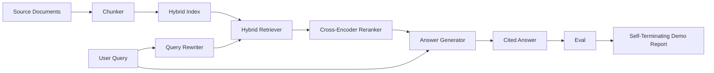

# 端到端 RAG 系统

> 组件的六课――一根管道――一轮评估――一轮自动终止演示――这是您交付的系统――

**Type:** Build
**Languages:** Python
**Prerequisites:** 第11期第06课（RAG）、10（评估）；第 19 阶段 Track B 基础（第 20-29 课）；第 19 阶段课程 64, 65, 66, 67, 68
**Time:** ~90 分钟

## 學习目标
- تحديد المكونات المختلفة، المختلطة المختلفة المختلفة، المختلفة المختلفة المختلفة المختلفة المختلفة المختلفة المختلفة المختلفة المختلفة المختلفة المختلفة المختلفة المختلفة المختلفة المختلفة المختلفة المختلفة المختلفة المختلفة المختلفة المختلفة المختلفة المختلفة المختلفة المختلفة المختلفة المختلفة المختلفة المختلفة المختلفة المختلفة المختلفة المختلفة المختلفة المختلفة المختلفة المختلفة المختلفة المختلفة المختلفة المختلفة المختلفة المختلفة المختلفة المختلفة المختلفة المختلفة المختلفة المختلفة المختلفة المختلفة المختلفة المختلفة المختلفة المختلفة المختلفة المختلفة المختلفة المختلفة المختلفة المختلفة المختلفة المختلفة المختلفة المختلفة المختلفة المختلفة المختلفة المختلفة المختلفة المختلفة المختلفة المختلفة المختلفة المكونة
- 实现一个答案生成器,通过块点引用其声明,并具有低信任拒绝回归功能──
- تقييمات تدريبية للأنابيب المكونة بشكل جيد، والتي تثبت أن المرحلة المكونة في كل مؤشر تفوق المكونات نفسها بشكل منفصل.
- إنشاء عرض CLI ينهي التشغيل الذاتي، يحتوي على قاعدة بيانات ثابتة، ويجري مجموعة استفسارات ثابتة، ويخرج تقرير ملخص إلى صفر.

## 问题

لا يمكن أن يثبت أي شيء. يمكن أن يُمكن للجهاز المُعدّد في recall@5 على قاعدة المواد، ولكن يُفشل في recall@5 على النظام، لأن المُعدّد لا يستطيع ترتيب المحتوى الذي يصدر من الجهاز المُعدّد. يمكن للجهاز المُعدّد في تحسين MRR على حفرة المرشحين المُختلّفين، ولكن لا يمكن معالجة مرشح المُعدّدين الحقيقيين، لأنّ معدّل استدعاء المُعدّدين تحت ميزانية التقييم المُعدّدين منخفض جدا. يمكن للمُعدّد المُعدّد في الاستفسار المُعدّد في استفسار واحد، ثم يُمكن لجهاز المُعدّد في الاستفسار التالي، لأنّه يُمثل إعادة إعادة إعادة فرضية.

اختبار التكامل هو أنبوب كامل يستهدف نفس المكونات التي تعمل من نهايتها إلى نهايتها ، ولها نفس المؤشر ، و يستخدم ملفًا مُعدًا يربط كل المحتوى معاً. هذا هو محتوى هذا الدروس. إذا كان مؤشر الأنبوب التكامل أفضل من مؤشر التظاهر المستقل لكل مرحلة ، فأنت قد أثبتت النظام.

## 概念



### 接线选择

الممر هو رسم صغير. كل مرحلة هي وظيفة مع توقيع واضح.

|舞台|输入|输出|
|-------|-------|--------|
|块块|文档正文 |块记录列表 |
|检索器 |查询字符串 | Top-N chunk 记录 |
|重写器（可选）|查询字符串 |重写列表+假设|
|重新排序 |查询，候选人 |带有交叉分数的 Top-K 块记录 |
|发电机|查询，top-K Chunk 记录 |带有引文的答案字符串 |

عندما يتم تحديد كل توقيع، تكون المجموعة بسيطة جدا.`Pipeline`类包含五阶段和按顺序运行它们的 `query`方法── كل مرحلة قابلة للتبادل: تمتد إلى مختلف قطع الأجزاء٬ متصفحات٬ كتبها مجددا٬ تخصيصها أو المولدات، والأنابيب لا تزال قابلة للعمل──

### 带引文的答案生成器

الجهاز هو الدرجة الأخيرة، و هو أيضا أسهل التلف. هذا البرنامج يوفر المولد المثالي الوقائي، هذا المولد:

1. 取出前 K 个重新排序的块──
2. أقصى اختيار اثنين من المواد التي تحتوي على أعلى مستوى من الاختبار على حدة.
3. إصدار إجابة واحدة، والجواب هو سلسلة من جملة في كل قطعة محددة، كل جملة بعد واحدة`[doc_id:chunk_index]`点──
4. إذا لم يكن هناك كتلة تتكثف أعلى من الرفض، فإننا لا نعرف

في الإنتاج، يمكنك استخدام نموذج النص سوف تمثل استبدال لتحقيقي LLM 调用:

```
You are answering a question using only the snippets below.
Cite every claim with the anchor in parentheses.
If the snippets do not answer the question, say "I do not know".

Question: {query}

Snippets:
{enumerated chunks with anchors}

Answer:
```

低信度拒绝路径是记录跨编码器排名 1 分数的全部原因──如果它低于语料库值,则生成器会拒绝──这是防止幻觉答案的安全──

### منذ نهاية العرض

يطبق العرض من المرحلة إلى المرحلة كل مادة من المرحلة، على أربعة قواعد ثابتة لتقييم العرض، ويعرض مؤشر، إذا كانت جميع المؤشرات في المرحلة 68 تلبي قيمة المرحلة المحددة في العرض، فإنه يعود إلى حالة صفر.

هذا هو شكل اختبار CI 冒烟测试──该管道离线运行、快速、确定──值的固定故意严格,因此 أي من الدروس في الدورة الستة ستؤدي إلى فشل العرض──


```figure
rag-pipeline-flow
```

## بناءها

`code/main.py`实现:

- `Chunk`- 穿穿所有阶段的记录(استخدام chunk_index 和源 doc_id 扩展第 64 课的形状)
- `Chunker`- من第 64 课中选择策略 (默认递归分割)
- `HybridIndex`- 捆绑 BM25 + 密集 + RRF من第 65 课――
- `Rewriter`(可选) - بناء على وجود طول الاستفسار والكلمات المرتبطة من درجة 67 选择 HyDE、多查询、分解之一──
- `Reranker`- 第 66 课中训练过的交叉编码器,使用较小的固定 训练集,因此可以在几秒内收收──
- `Generator`- مصدر مثالي لتحديد المشاركات والقليل من الثقة
- `Pipeline`- استخدام مرة أخرى `Result(answer, top_k, latency_ms_per_stage)``query(question)`طريقة لتشكيل خمس مراحل
- `run_demo()`- 摄取语料库,运行三个固定 查询,运行评估,印印结果,并按值设置退出代码──

运行它:

```bash
python3 code/main.py
```

输出是一段印印的查询跟踪、完整评估表和最终通过/失败状态──在默认固定上返回退出代码 0──

## 演示将隐藏的故障模式

**分块器边界漂移。**إذا قمت بتبادل استراتيجية القطع المكونة بين عملية تقييم القطع والعرض، فإن هوية الملفات الذهبية لا تتجدد مرة أخرى، فسيتم تحديد استراتيجية القطع المكونة في الملفات.

**Reranker 训练集泄漏到 eval 中。**في المادة 66 ، تشمل 14 مجموعة من التدريبات مثل استفسارات التقييم. في الإنتاج ، تحافظ على استفسارات التقييم.

**模拟生成器隐藏了幻觉风险。**لا يمكن للمثيل أن يخلق الوهم، لأنه ينبع فقط من الكتيب الذي تم استكشافه إلى الحجر. لاحظ هذا البرنامج، وأشار إلى طريقة تغيير الإنتاج الحقيقي للمثيل.

**无流式传输。**الممرات في نهاية كل مرحلة يعود إلى النتائج الكاملة. النظام الإنتاجي سوف ينتقل النتائج.

**延迟是离线的。**模拟LLM 调用是恒定时间──真正LLM电话占主导地位──在请求范围内规划延迟预算;本课程的每阶段计时时只测量CPU工作──

## استخدمها

النمط الناتج:

- إرسال ملفات الأنابيب إلى جهاز ترتيب تحت اتصال مرحلة محددة لتجنب توزيع الأسلاك في مخزن الاحتياطي
- في كل مرحلة من المرحلة المرتبطة قبل إجراء التقييم. إذا كان التقييم ينخفض، فإن التقييم لن يقع.
- حافظ على متابعة مؤشرات كل عملية CI حتى تتمكن من العودة إلى مرحلة التبادل.
- إضافة 20 استفسارات من مجموعة التدخين (إضافة إلى 20 استفسارات من مجموعة التدخين) ، وقت التشغيل لا يتجاوز 30 ثانية؛ مجموعات التشغيل الكاملة في كل ليلة.

## 发货

وثائق الأنابيب في هذا الدورة هي التشكيل الذي تمت تطبيقه في المرحلة 19 من المسار F. الجزء المتبقية من الدورة.

## التدريب

1. في كتابة كتابة كتابة كتابة كتابة كتابة كتابة كتابة كتابة كتابة كتابة كتابة كتابة كتابة كتابة كتابة كتابة كتابة كتابة كتابة كتابة كتابة كتابة كتابة كتابة كتابة كتابة كتابة كتابة كتابة كتابة كتابة كتابة كتابة كتابة كتابة كتابة كتابة كتابة كتابة كتابة كتابة كتابة كتابة كتابة كتابة كتابة كتابة كتابة كتابة كتابة كتابة كتابة كتابة كتابة كتابة كتابة كتابة كتابة كتابة كتابة كتابة كتابة كتابة كتابة كتابة كتابة كتابة كتابة كتابة كتابة كتابة كتابة كتابة كتابة كتابة كتابة كتابة كتابة كتابة كتابة كتابة كتابة كتابة كتابة كتابة كتابة كتابة كتابة كتابة كتابة كتابة كتابة كتابة كتابة كتابة كتابة كتابة كتابة كتابة كتابة كتابة كتابة كتابة كتابة كتابة كتابة كتابة كتابة كتابة كتابة كتابة كتابة كتابة كتابة كتابة كتابة كتابة كتابة كتابة كتابة كتابة كتابة كتابة كتابة كتابة كتابة كتابة كتابة كتابة كتابة كتابة كتابة كتابة كتابة كتابة كتابة كتابة كتابة كتابة كتابة كتابة كتابة كتابة كتابة كتابة كتابة كتابة كتابة كتابة كتابة كتابة كتابة كتابة كتابة كتابة كتابة كتابة كتابة كتابة كتابة كتابة كتابة كتابة كتابة كتابة كتابة كتابة كتابة كتابة كتابة كتابة كتابة كتابة كتابة كتابة كتابة كتابة كتابة كتابة كتابة كتابة كتابة كتابة كتابة كتابة كتابة كتابة كتابة كتابة كتابة كتابة كتابة كتابة كتابة كتابة كتابة كتابة
2. في env 标志后面添加对生成器的真正 LLM 调用──默认为模拟──测量延迟增量──
3.  توسيع العرض للحصول على تحميل المجموعة الحقيقية `--corpus path`标志──重新运行评估和值检查──
4. إلى分块器添加 `--strategy`标志── قياس كل استراتيجية على إسهام التذكر من النهاية إلى النهاية──
5. إضافة التيار المولد واجهة و سوف يدخلها إلى eval 中── تأكيد الوفاء هو على أساس الخط النهائي وليس على أساس التيار السابق الحساب.

## 关键术语

|术语 |人们怎么说|它实际上意味着什么 |
|------|-----------------|------------------------|
|管道| “RAG 管道”|从摄取到引用答案的撰写阶段|
|引文锚| “来源链接” |每个声明附加的 (doc_id, chunk_index) 引用 |
|低置信度拒答| “我不知道” |当重排器 top-1 分数低于阈值时，生成器不返回答案 |
|smoke set | “CI 评估”|每次 PR 检查中运行的最小 qrels 子集 |
|阶段接口| “函数签名”|各个管道阶段的稳定输入输出类型 |

##  المزيد阅读

- [人择、建筑搜索与检索](https://www.anthropic.com/news/contextual-retrieval)
- [Pinterest，MCP 内部搜索](https://medium.com/pinterest-engineering)- 参考生产架构
- [Ragas：RAG 管道的自动评估](https://docs.ragas.io)
- 第 11 阶段 第 06 课 - RAG 基础知识
- 第19 阶段课程 64-68 - هنا هي الهيكل
