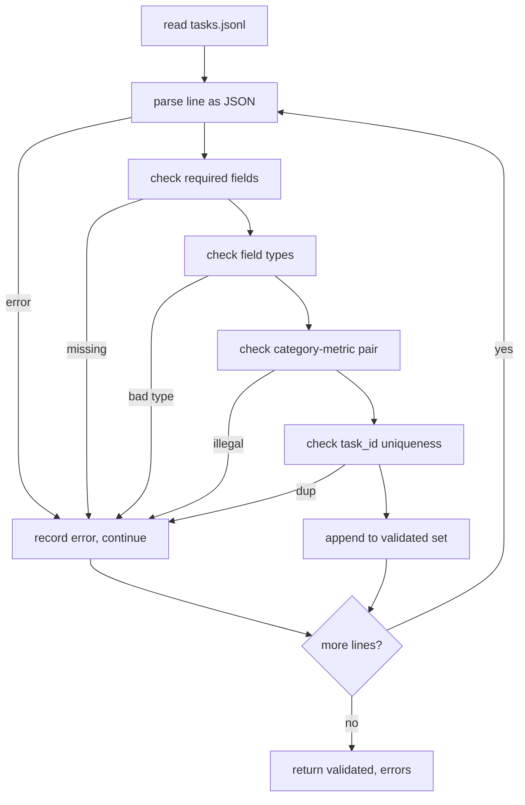

# 任务规范格式

> 评估安全带的好坏取决于其任务执行合同── 在编写单个评分函数之前,请结 JSONL 形状和量词汇──

**Type:** Build
**Languages:** Python
**Prerequisites:** 19期B轨地基
**Time:** ~90 分钟

## 學习目标


```figure
ci-task-spec-gate
```

- 定义一个 JSONL 任务记录模式,以一种形式涵盖算术、多项选择、代码执行、分类和自由文本摘要──
- 固定度量名称的封闭词汇表,以便下游课程 (71-73) يمكن تقسيمها في أحادي الفصول
- تحديد عدد قليل من النماذج على سبيل المثال والقواعد المعالجة الخلفية كجزء من المهمة ، وليس جزء من الجاري ، لذلك فإن نفس النصيحة ستخلق نفس الهدف بين النموذج.
- تنفيذ مؤشر صارم، قبل وصول سجلات الخطأ في الشكل إلى جهاز التنقل، يتم رفضها.
- إصدار مجموعة ثابتة تتضمن 10 مهام، للاستخدام في كل فروع من قواعد الاختبار، حتى يكون الاختبارات شيء حقيقي يمكن أن ──

## لماذا يجب أن نضع القواعد

دراسة الكودات الكتب التجميع تقييم 脚本 速度 التجميع 速度 التجربة أيضا أسرع. بعد ستة أشهر، كل مذكرة لديها شكل JSON الخاص بها، كل مؤشر يتم إعادة تنفيذها مرتين، و لا يمكن إجراء مقارنة بين التشغيلات.

هذا الشكل يستفيد من فكرة BIG-bench、HELM 和 lm-eval 风格线束, ولكن 字段名称是我们的.

## 记录形状

المهمة هي JSON على صف واحد على العبارة.`tasks.jsonl`ويقومون بتحقيق كل خط.

```json
{
  "task_id": "arith_001",
  "category": "arithmetic",
  "prompt": "Compute the result. Question: 17 + 24\nAnswer:",
  "targets": ["41"],
  "metric_name": "exact_match",
  "few_shot_examples": [
    {"prompt": "Question: 2 + 2\nAnswer:", "completion": "4"}
  ],
  "post_process": "strip_whitespace",
  "metadata": {"difficulty": "easy"}
}
```

يجب أن تكون`task_id`.`category`.`prompt`.`targets`.`metric_name`.`post_process`.`few_shot_examples`和 `metadata`هو ممثل.

## 字段规则

`task_id`هو حروف بدون فجوة.

`category`نعم`arithmetic`.`mcq`.`code_exec`.`classification`.`summary`واحد. هذا النوع يحد من القانونية في المعالجة بعد الاعتدال.`code_exec`المهام يجب أن تستخدم`metric_name = code_exec`،`mcq`المهام يجب أن تستخدم`metric_name = exact_match`.

`prompt`هو شريط غير فارغ. المحاكم حظر التأخير مع الفضاء ومرفض النص.

`targets`هو قائمة غير فارغة`exact_match`، أي عنصر متطابق يتم احتسابه`f1`和`rouge_l`، والنسبة الأعلى للفوز`mcq`, المجموعة تحتوي على عنصر واحد فقط

`metric_name`نعم`exact_match`.`f1`.`bleu_4`.`rouge_l`.`accuracy`.`code_exec`واحد. كلمة تعني إغلاق.

`few_shot_examples`نعم`{prompt, completion}`على قائمة:: المحققين سوف يحدد قائمة إلى ثمانية مقالات، لتقييد النص

`post_process`نعم`none`.`strip_whitespace`.`lower`.`extract_letter`.`extract_code_block`.`extract_first_line`واحد. كل قاعدة لها سلوك محدد.

## سلوك الاختبار



يعود جهاز التحقق إلى قائمتين: سجلات التحقق والسجلات الخطأ، والتي تحتوي على مخالفات للقواعد والقواعد والخطأ. إذا كان قائمة الخطأ غير فارغة، فإن جهاز التشغيل يرفض تشغيلها، ما لم يضع واضحا.`--allow-bad-tasks`العلامة

##                                                                                                                                                                                                                                                               

سيُشير المتشغيل إلى أن بعض الأمثلة السابقة تتصل بالفاصل الفارغ. كل نموذج يعمل على نفس مسار الكود، لذلك فإن الاختلاف الوحيد هو المصدر من النموذج نفسه.

```python
def render(task):
    parts = []
    for ex in task.get("few_shot_examples", []):
        parts.append(ex["prompt"] + " " + ex["completion"])
    parts.append(task["prompt"])
    return "\n\n".join(parts)
```

## 后处理规则

بعد عملية التنفيذ بعد التوليد بعد التعلم قبل التنفيذ.

- `none`返回字符串不变──
- `strip_whitespace`去除前导和尾随空白──
- `lower`-أجل، أنا بخير
- `extract_letter`返回与 `[A-E]`匹配的第一个字符,用于MCQ──
- `extract_code_block`返回第一三重反引号隔离块主体,用于代码执行──
- `extract_first_line`返回第一个非空行,用于汇总分类──

需要此列表之外的规则的任务属于新课程──

## 本课不做什么

لا يستخدم النموذج، لا يعمل على الكود، وذلك في المادة 71 و72 و75، وذلك في التعليم، وذلك في التعليم.

10 个任务 fixture 覆盖两个算术项,两个 MCQ项,两个代码执行项,两个分类项,两个摘要项.`tasks_bad.jsonl`) سوف تتناسب مع كل قاعدة، والعدد من الأخطاء التي يعود بها الاختبار هو نفسها.

## كيف تقرأ ؟

`main.py`تعريف`TaskSpec`.`validate_task`.`validate_file`و CLI دخول نقطة .`load_fixtures`染和后处理助手 位于验证逻辑旁边, لذلك اللاعب في الدرجة 75 只需要导入单个模块──

من فوق إلى أسفل`main.py`✿ ثمّ读取 `code/tests/test_spec.py` تثبت كل قواعد التحقق وكل سلوك التدريب اللاحق`main.py`底部的演示会验证捆绑的固定并印摘要──

## أكثر

مجموعة التقييم الحقيقية تتم على نحو نمط نمو صفات نمو الفئة. النتائج النظيفة هي رفض إضافة فئة دون إضافة مؤشرات. قواعد المعالجة اللاحقة ومهام ثابتة على الأقل.
