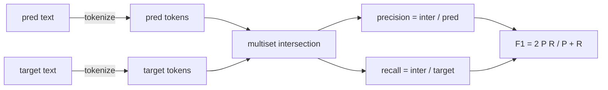
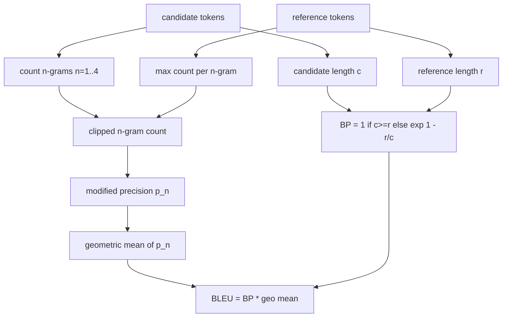

# 经典指标

> بلو-روج-إل-F1٬ تحديد الملاءمة٬ معدل التأكد٬ خمسة مؤشرات لا تزال تشكل معظم المطبوعات الجامعية  تقييم الأرقام٬ من المبدأ الأول لتحقيق كل مؤشر، بحيث تعرف معنى الأرقام٬

**Type:** Build
**Languages:** Python
**Prerequisites:** 第 19 期 Track B 基础，第 70 课
**Time:** ~90 分钟

## 學习目标


```figure
cd-bleu-overlap
```

- 通過 وضوح قواعد التوضيح لتحقيق مستوى التوضيحات
- من البداية  تنفيذ BLEU-4: تعديل n دقة الفقرة العضوية، n متوسط الجيميات يساوي 1 إلى 4,简洁性损失──
- استخدام أطول سلسلة عامة من الجسم و مجموعة F-beta من الدقة والعدد من استدعاء لتحقيق ROUGE-L:
- 调度第 70 课中的 metric_name 字段, بحيث يبقى المتدرب في حالة لا علاقة له بالمؤشر
- استخدام النموذج المرجعي المُستفيد من المجموعة الثالثة بدلاً من استخدام مثال العمل إلى السلوك الثابت.

## لماذا يجب أن يتم إعادة التنفيذ

ستقرأ مقال BLEU 28.3 ورسالة أخرى من BLEU 0.283. ستجد اختلافاً في عدد ROUGE-L في المكتبات 10 ٪، لأن أحد المكتبات يقطع للكتابة الصغيرة، بينما الآخر لا يقطع.

ستلب加上numpy就足够了──BLEU هي التركيبات والمركزات──ROUGE-L هي التخطيط الحركي──F1 هي مجموعة من التركيبات على التركيبات── الجزء الأكثر صعوبة هو اختيار التركيبات ومكافحة ذلك──

## التعبير

 分词器是 `re.findall(r"\w+", text.lower())`◊小写、字母数字运行、删除标点符号── كل مؤشر في هذا الدورة يستخدم هذا الكلمة المحددة──الركاب ليس لديهم حق الاختيار── إذا قمت بتبادل الكلمات المختلفة، فسوف تقوم بتجربة مختلفة.

```python
TOKEN_RE = re.compile(r"\w+", re.UNICODE)
def tokenize(text):
    return TOKEN_RE.findall(text.lower())
```

هذا هو التبسيط المقصود. سيتعلق إعداد الإنتاج بـ CJK, التكبير والمعارض الكودية.

## 精确匹配

```python
def exact_match(pred, targets):
    return float(any(pred.strip() == t.strip() for t in targets))
```

كل مهمة تعود إلى 1.0 أو 0.0  جمع مجموعة البيانات هو القيمة المتوسطة  هذا هو القوة الرئيسية للقيام بالتحليلات  المكثفات المختلفة و المهام المختلفة 

## الوسائل

وضع لتنبؤ والهدف من ترمزات متعددة الجمعيات── الدقة هي ترمزات متعددة الجمعيات منفصلة عن ترمزات متعددة الجمعيات التى تم تنبؤها── معدلات الدعوة هي نفس ترمزات منفصلة عن ترمزات متعددة الجمعيات التى تم تناوله── F1 هو المعدل والمتوسط── يجب أن يتمكن من معالجة حالة الجانب الهائل والغرض الهائل──



بالنسبة لمهمات متعددة الأهداف، نختار أفضل F1 من قائمة الأهداف. وهذا يتوافق مع سلوك SQuAD الذي تم الإبلاغ عنه على نطاق واسع في المستندات.

## (BLEU-4)

بليو هو مؤشر ترجمة الآلة المحدد، لا يزال موجود في العمل الموجز. الصيغة التي نستخدمها هي بليو 4 من مستوى قاعدة المواد، مع معايير بسيطة من العقوبة والإضافة إلى عدد القواعد الفكرية بعد التعديل.

بالنسبة لكل مرشح - المرجح، نقوم بحساب دقة n من الفقرات الفكرية بعد تعديل 1 ̊2 ̊3 ̊4 ̊.



قاعدة التسوية هي طريقة لين و اوش تقول: قبل أخذ عدد، سوف كل عنصر من الجزيئيات والفاصل الدقيقة تضيف 1♦ عندما تستشهد غير متطابقة 4 غرام ومحافظة على مقربة من القيمة غير المتسوية للانتخابات، وهذا يمكن تجنب`log 0`.

## 脂-L

ROUGE-L مقارنة سلسلة مؤشرات المرشحين وأطول سلسلة عامة من سلسلة مؤشرات المرجعية. LCS  التسلسل الكلمات لا يضطر إلى التسلسل، وهذا هو السبب في أنه هو الامتثال المخصص لعدد الموجب.`lcs / reference length`,精度为`lcs / candidate length`,并与F-beta 结合,其中对称F1 形式的β等于1──

```python
def lcs_length(a, b):
    n, m = len(a), len(b)
    dp = numpy.zeros((n + 1, m + 1), dtype=int)
    for i in range(n):
        for j in range(m):
            if a[i] == b[j]:
                dp[i+1, j+1] = dp[i, j] + 1
            else:
                dp[i+1, j+1] = max(dp[i+1, j], dp[i, j+1])
    return int(dp[n, m])
```

تعريفات المستخدمة لتحقيق وضوحة القراءة ؛ Pure Python 列表也可以工作──选择 ROUGE-L 的任务为每任务支付 $O(n m)$成本── للحفاظ على طول الموجة النموذجي أقل من ملي ثانية──

## 准确度

 لمهام متعددة الأهداف، فإن الدقة سوف تنخفض إلى التطابق الدقيق مع أهداف قياسية واحدة.`metric_name`على إجراء تحديدات، و لا حاجة إلى إجراء مقارنات في المتدربين

## إرسال

单一入口点是 `score(metric_name, prediction, targets)`۞ يعود`[0, 1]`في المرحلة الـ 75، سيتم التمسك بالمنظمة المحددة للقيام بالمهام التي تمتد إليها في المرحلة الـ 70.

```python
def score(metric_name, pred, targets):
    if metric_name == "exact_match":
        return exact_match(pred, targets)
    if metric_name == "f1":
        return max(f1_score(pred, t) for t in targets)
    if metric_name == "bleu_4":
        return max(bleu4(pred, t) for t in targets)
    if metric_name == "rouge_l":
        return max(rouge_l(pred, t) for t in targets)
    if metric_name == "accuracy":
        return accuracy(pred, targets)
    raise ValueError(f"unknown metric_name: {metric_name}")
```

`code_exec`في الدورة 72 من التعليمات المختلفة

## 本课不做什么

انها لا تستخدم النموذج. انها لا تجعل قياسها خارج نطاق القواعد التي تمت بعد التعامل في فصل 70. انها لا تحسب في منطقة الاعتقاد. انها لا تنفذ BLEURT أو BERTScore.

## كيف تقرأ ؟

`main.py`تعريف كل مؤشر على أنه وظيفة حرة بالإضافة إلى عملية ضبط.`_reference_examples`块中── هذه العرض تستهدف 8 أمثلة من عمليات تنظيم الممارسات وتطبيق عدد كل مؤشر‬‬‬‬‬‬‬‬‬‬‬‬‬‬‬‬‬‬‬‬‬‬‬‬‬‬‬‬‬‬‬‬‬‬‬‬‬‬‬‬‬‬‬‬‬‬‬‬‬‬‬‬‬‬‬‬‬‬‬‬‬‬‬‬‬‬‬‬‬‬‬‬‬‬‬‬‬‬‬‬‬‬‬‬‬‬‬‬‬‬‬‬‬‬‬‬‬‬‬‬‬‬‬‬‬‬‬‬‬‬‬‬‬‬‬‬‬‬‬‬‬‬‬‬‬‬‬‬‬‬‬‬‬‬‬‬‬‬‬‬‬‬‬‬‬‬‬‬‬‬‬‬‬‬‬‬‬‬‬‬‬‬‬‬‬‬‬‬‬‬‬‬‬‬‬‬‬‬‬‬‬‬‬‬‬‬‬‬‬‬‬‬‬‬‬‬‬‬‬‬‬‬‬‬‬‬‬‬‬‬‬‬‬‬‬‬‬‬‬‬‬‬‬‬‬‬‬‬‬‬‬‬‬‬‬‬‬‬‬‬‬‬‬‬‬‬‬‬‬‬‬‬‬‬‬‬‬‬‬‬‬‬‬‬‬‬‬‬‬‬‬‬‬‬‬‬‬‬‬‬‬‬‬‬‬‬‬‬‬‬‬‬‬‬‬‬‬‬‬‬‬‬‬‬‬‬‬‬‬‬‬‬‬‬‬‬‬‬‬‬‬‬‬‬‬‬‬‬‬‬‬‬‬‬‬‬‬‬‬‬‬‬‬‬‬‬‬‬‬‬‬‬‬‬‬‬‬‬‬‬‬‬‬‬‬‬‬‬‬‬‬‬‬‬‬‬‬‬‬‬‬‬‬‬‬‬‬‬‬‬‬‬‬‬‬‬‬‬‬‬‬‬‬‬‬‬‬‬‬‬‬‬‬‬‬‬‬‬‬‬‬‬‬‬‬‬‬‬‬‬‬‬‬‬‬‬‬‬‬‬‬‬‬‬‬‬‬‬‬‬‬‬‬‬‬‬‬‬‬‬‬‬‬‬‬‬‬‬‬‬‬‬‬‬‬‬‬‬‬‬‬‬`code/tests/test_metrics.py`وسط اختبار ثابتة استناد إلى الحجم并 شدد على كل حالة حافة ((空预测、空参考、无共享token、精确匹配、重复短语剪辑) 

من فوق إلى أسفل`main.py` هذه الوظائف حسب التعقيدات. تُرتب حسب المُعدل.

## أكثر

العلامات الكلاسيكية ضرورية، ولكن لا تكفي. فإنها تكافئ على الاعتبار والإهمال. بمجرد أن تثق بالطبقة الأساسية الكلاسيكية، فإن الطريقة الحلّية هي أن تكون على أساس النموذج من العلامات التنظيمية.
