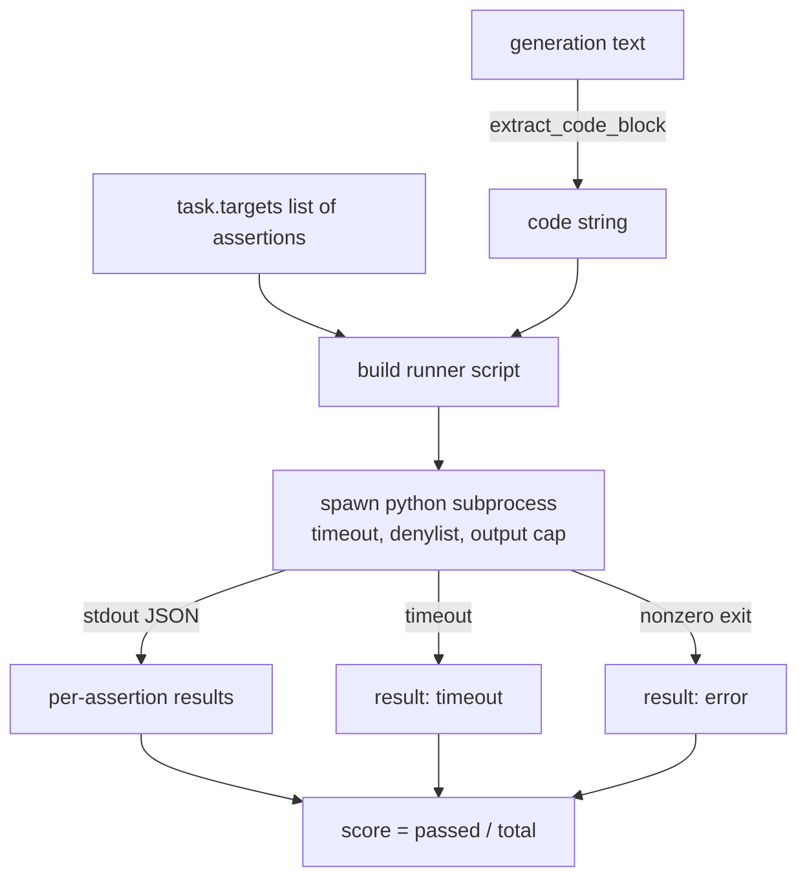
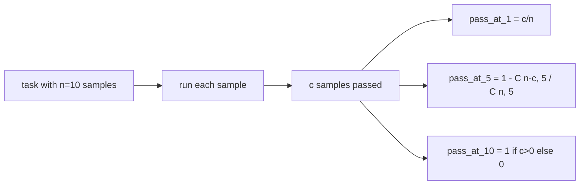

# 代码 تنفيذ مؤشر

> كود النمو بعد الاختبار صحيح. أداة التقييم يجب أن تستخرج الكود، وتعمل في حالة عدم الإنهيار الرئيسية، ومع ذلك، معدل الإحصاء الحقيقي.

**Type:** Build
**Languages:** Python
**Prerequisites:** 第 19 期 Track B 基础，第 70 和 71 课
**Time:** ~90 分钟

## 學习目标


```figure
sandbox-runner
```

- وذلك في طريقة تتناسب مع قواعد المعالجة اللاحقة في الفصل 70 من التجميع من شكل حري
- في عملية الانفصال من قائمة مع معلقة الوقت فوق الوقت، تنفيذ كود المرشحين في إصدارات الحدود العليا وإدخال رفض القائمة.
-  تقييم المهمة على أساس عدد المرشحين الذين تمروا بالخطوط المقدمة.
- الحساب من نموذج واحد لمتابعة العديد من المهام الممرة.
- وضعية الفشل في الصندوق والخطأ في اللغة والوقت الخارق، ويتميز بالرمز المختلف للعودة إلى الموقع.

## لماذا تحتاج إلى عملية معزولة

في غضون`exec`وجود سلامة واستقرار`while True: pass`永远阻止 eval──生成的 `import shutil; shutil.rmtree('/')`确实像听起来如灾难性── الحل هو إنشاء مفسر Python جديد لكل مرشح، في stdin 上传递代码، سوف يكتب النتيجة في stdout، ويقوم بإنهاء العملية عند overflow.

HumanEval、MBPP、BigCodeBench 和 LiveCodeBench وغيرها من التقييمات الحقيقية تستخدم أدوات عملية في الصندوق. بعض الطبقات Docker  تقع على القمة.

## 代码 تنفيذ مهمة

`code_exec`المهام المتحملة`targets`فان المُنتج يُستَخدِمُ مِنْ تَجْرِيدِهِ مُفَرَّدَةً مِنْ كُتُبِ الكود، و يُحيطُ بِهِ بِبَناءِ أدواتِ الاختبار، ثم يُنْشِرُ النتائجِ.



     `[0, 1]`معدل النقاط. تمتلك ثلاث وظائف، اثنان منها تمر بنتيجة 0.667. مهما حدث خطأ، سيعود المتدربون إلى نفس الشكل: سيتم تصوير انهيار العملية إلى رمز الخطأ المعياري، بدلاً من عودة Python إلى الخيط.

## 拒绝名单

قائمة رفض مبنية على الإدخال. قبل أن يتم تشغيل كود المرشحين، سوف يقوم الكاتب المسابق بإعادة كتابة إدخال المودول الخطير إلى الإدخال.`ImportError("denied")`من بين الوصف:`os.system`.`subprocess`.`socket`.`requests`.`urllib`.`urllib.request`.`urllib.error`.`urllib.parse`.`ctypes`.`shutil`-أجل`http.client`.`asyncio.subprocess`.

نحن لن نظاهر بأن هذا هو السلاح الصلبة. لا يمكن أن يفر من أي عملية في بايثون. لا يمكن أن يفر من أي عملية في بايثون. لا يمكن أن يفر من السلاح.

```python
DENIED = {
    "os.system": True,
    "subprocess": True,
    "socket": True,
    "shutil": True,
    "requests": True,
    "urllib": True,
    "ctypes": True,
}
```

نحن نُمضي في المُضافة`import sys`و من خلال إصلاحات`os.system`لتحقيق حراسة لتحمل المرشحين`main.py`في الوسط

## 挂钟超时

كل عملية لديها ميزانية افتراضية لمدة ثلاث ثوانٍ.`subprocess.run(..., timeout=t)`إذا كان الوقت متأخر، فسيغادر الجاري`TimeoutExpired`, إنهاء العملية , و سجل المهام`timeout`退出原因──该任务分数为零──跑步继续进──

超时是 `run_candidate``timeout_s`参数; 第 75 课的跑者 通过 `code_exec_timeout_s`لـ كل عملية إعداد مرة واحدة.`run_candidate`سوف تحدّد هذه القيمة بين 0.1 إلى 30 ثانية، للحفاظ على حدود المجموعة.

## 输出上限

يمكن أن يغرق العملية المحددة المخرجة، وتستهلك كل المعلومات المكتسبة.`exit_code = error`, تفصيل المعلومات`"output overflow"`عندما يكتب جيل من الناس بشكل غير متوقع دورة لا نهاية لها في الطباعة، هذا يحدث في الممارسة العملية.

## من خلال

المضي في الك هو جهاز تقدير غير محايد يستخدم من قبل الاصدقاء والصديقين`n`独立样本和其中的 `c`من خلال، من خلال`n``k`نموذج يحتوي على على الأقل واحدا من احتمالات تمرير الحل:

```
pass_at_k(n, c, k) = 1 - C(n - c, k) / C(n, k)
```

عندما`n - c < k`时, حسب المعتاد, الجزيئي `C(n - c, k)`لم يستطع أن يكون أقل من`k`个失败中选出 `k`个) ، لذلك قيمة为 `1` يجب أن يتم التعامل مباشرة مع الحدود.`pass_at_k(n, c, k)`供排行榜层使用──



## 退出代码

الجاري يعود إلى كل مهمة واحدة من نتائج الخمسة:

- عندما كل شيء يمر`pass`.
- `assertion_fail`لكن على الأقل هناك تصريح واحد عندما يفشل
- `syntax_error`عندما لا يتم استيراد الكود أو هناك خطأ في اللغة
- `timeout`عندما كان الوقت متأخر
- `error`لاستخدام أيّة أسباب أخرى، بما في ذلك رفض القائمة و الإصدار والإصدار`"output overflow"`(تفوق فوق سطح)

النسبة مازالت صفرية. الرسوم المنسوبة هي بيانات. يمكن للدورة القادمة أن تقرر ما إذا كانت ستعمل على تخفيض الوقت إلى صفر أو فقدان البيانات.

## 本课不做什么

لن يمنحك صندوقًا حقيقيًا. لن يعمل كودًا غير موثوق به من شبكة مفتوحة. لن يعالج مهامًا قائمة ، مثل الملفات I / O أو مكالمة الشبكة.

## كيف تقرأ ؟

`main.py`تعريف`extract_code`.`run_candidate`.`score_code_exec`和 `pass_at_k`△子进程runner脚本构建为字符串,并作为 `-c`传递给新Python 解释器──`code/tests/test_exec.py`تم تنفيذ أربع كودات إرجاعية بالإضافة إلى إرسال كود.

من فوق إلى أسفل`main.py` 流道模板是承重件── 着断言循环,直到你可以预测它写回父进程的JSON 信封──

## أكثر

عندما يتفاعل شكل التوصيل ، فإن المشكلة التالية هي قابلية النقل. مختلفة Python  إصدارات في Windows على طريقة مختلفة للتعامل مع SIGKILL. أفضل حل هو وضع المُشغل في Docker 镜像.
