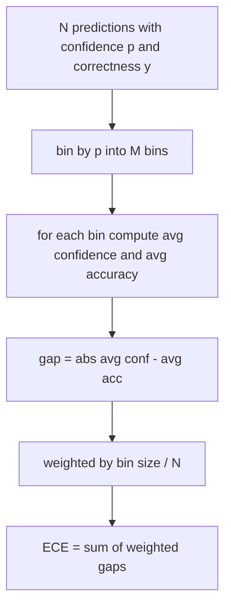
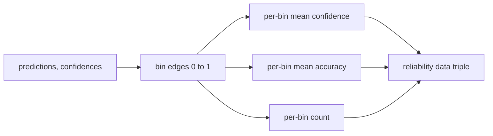

# 困惑度和校准

> إذا كان نموذجك يظهر 90% من الثقة في 1000 إجابة ، و أجاب بشكل صحيح 600 ، فهذا يظهر أنه لم يمر في تحديد جيد.

**Type:** Build
**Languages:** Python
**Prerequisites:** 第 19 期 Track B 基础，第 70 和 71 课
**Time:** ~90 分钟

## 學习目标


```figure
cd-reliability-diagram
```

- 根据模型适配器提供的代币负对数概率计算保留语料库上的代币级困惑度──
- 根据分箱预测概率计算分类器或多项选择评估的预期校准误差 (ECE) 
- 计算 Brier 分数(针对正确性指标的平均差差)并解释它何时执行 ECE 不执行操作──
- بناء الخرائط الموثوقية المطلوبة لتسليم الثقة والدقة
- كل ثلاثة من هذه المجموعات ستصل إلى خط التقييم حتى يُمكن للجاري أن يُمكنك`perplexity`.`ece`和 `brier`编号附加到模型报告中──

## 困惑 أخبرك ماذا

تعتبر الحيرة 1 تعني نموذج لكل نموذج تمتلك احتمالية توزيع كل نموذج فعلي 1 تعني حيرة 1 تعني نموذج متوحد ولا يتعلم أي شيء تعني الوضع غير صحيح بينهما:

الوسيلة نفسها لا تحسب على احتمالات العدد. هذه من الموديل المتكامل. الوسيلة تجمع: فإنها تحصل على كل علامة على قائمة احتمالات العدد.

```python
def perplexity(neg_log_probs, token_counts):
    total_nll = sum(neg_log_probs)
    total_tokens = sum(token_counts)
    return math.exp(total_nll / total_tokens)
```

في الواقع، فإنّ التطبيقات التي تمتلكها هذه المعلومات هي:`log p`بدلاً من ذلك`-log p`سوف يظهر المعدل أقل من 1 من الارتباك، وهذا مستحيل.

## ما هي تدابير الإقليمية

 التوقعات في الاختلافات في المهارات على أساس الاعتقاد سيتم تقسيم التوقعات إلى عدد ثابت من الصناديق، ثم قياس الفجوة المتوسطة بين الاعتقاد والدقة في كل الصناديق، ومع ذلك في الصندوق



标准公式在 `[0, 1]`على استخدام 10 等宽的bin. يجب أن تحقق دعم أي عدد صحيح.`bins`参数، بحيث يمكن للمشغلين اختيار بين إصدار التقييم (10) ومقارنة التقييم (15)

يستخدم 10 قمامة و 100 توقعات، لا يمكنك التمييز بين 0.02 قمامة و ضجيج المواصلات. يجب أن يتم إعادة إرسال عدد القمامة المملوءة و ECE، وبالتالي يمكن للمشغل رفض تقرير عدد واحد من القمامة القديمة.

## برير 分數是 ECE 没有的

إذا كان النموذج يقلل من الثقة في نصف صندوق البيانات، ويكون قليلًا من الثقة في نصف صندوق البيانات الآخر، فإن ECE قد يكون أقل، وفي الوقت نفسه تكون المؤهلات المحلية أيضًا ضعيفة.

بالنسبة للنتيجة الثانية، برير هو`mean((p_i - y_i)^2)` يُنفصل إلى موثوقية  قرارات وغير مؤكدة  نحسب العدد والانفصال  تقرير الجاري عن حجم المعدات، ولكن سجل انفصال لوحات الأجهزة 

```python
def brier(p, y):
    return float(np.mean((p - y) ** 2))
```

## بيانات موثوقية

يمكن الاعتماد على الرسم على التجربة المحددة في كل صندوق. يتم رسم الرسم على الرسم على الرسم على الرسم على الرسم على الرسم على الرسم على الرسم على الرسم على الرسم على الرسم على الرسم على الرسم على الرسم على الرسم على الرسم على الرسم على الرسم على الرسم على الرسم على الرسم على الرسم على الرسم على الرسم على الرسم على الرسم على الرسم على الرسم على الرسم على الرسم على الرسم على الرسم على الرسم على الرسم على الرسم على الرسم على الرسم على الرسم على الرسم على الرسم على الرسم على الرسم على الرسم على الرسم على الرسم على الرسم على الرسم على الرسم على الرسم على الرسم على الرسم على الرسم على الرسم على الرسم على الرسم على الرسم على الرسم على الرسم على الرسم على الرسم على الرسم على الرسم على الرسم على الرسم على الرسم على الرسم على الرسم على الرسم على الرسم على الرسم على الرسم على الرسم على الرسم على الرسم على الرسم على الرسم على الرسم على الرسم على الرسم على الرسم.



返回的元组是调用层绘图或计算自定义 ECE 变体(自适应 ECE、扫描 ECE等) مطلوبة元组── 我们返回 numpy 数组,因此下游代码不必进行转换──

## 置信来源

الوسيلة لا تفترض أن الثقة تأتي من softmax.`[0, 1]`في الوسط أي رقم. بالنسبة لمجموعة من المهام المختارة، فإن الاعتقاد الطبيعي هو`softmax over option log-likelihoods` بالنسبة للفيسبوكس الحر، فإن الاعتقاد الطبيعي هو مؤشر احتمالية تقرير الذات أو متوسط على عدد مماثل للنموذج.

##  الحالة

- جميع التوقعات هي خاطئة:ECE هي متوسط الاعتقاد،Brier هي القيمة العالية،confusedness هي النموذج على النظرة إلى النص.
- %%%%%%%%%%%%%%%%%%%%%%%%%%%%%%%%%%%%%%%%%%%%%%%%%%%%%%%%%%%%%%%%%%%%%%%%%%%%%%%%%%%%%%%%%%%%%%%%%%%%%%%%%%%%%%%%%%%%%%%%%%%%%%%%%%%%%%%%%%%%%%%%%%%%%%%%%%%%%%%%%%%%%%%%%%%%%%%%%%%%%%%%%%%%%%%%%%%%%%%%%%%%%%%%%%%%%%%%%%%%%%%%%%%%%%%%%%%%%%%%%%%%%%%%%%%%%%%%%%%%%%%%%%%%%%%%%%%%%%%%%%%%%%%%%%%%%%%%%%%%%%%%%%%%%%%%%%%%%%%%%%%%%%%%%%%%%%%%%%%%%%%%%%%%%%%%%%%%%%%%%%%%%%%%%%%%%%%%%%%%%%%%%%%%%%%%%%%%%%%%%%%%%%%%%%%%%%%%%%%%%%%%%%%%%%%%%%%%%%%%%%%%%%%%%%%%%%%%%%%%%%%%%%%%%%%%%%%%%%%%%%%%%%%%%%%%%%%%%%%%%%%%%%%%%%
- p=0.5 时完全不确定的预测因子:ECE为 0.5 减去准确性,Brier为 0.25 减去校正项.
- 空输入:ECE、Brier 和可靠性 `0.0`(أو 0 ملء عدد) ✿ بالنسبة للوضع المختلف، الارتباك  العودة `NaN` لا تنشر هذه الطرق تحذيرات؛ يقوم المتدرب بفحص هذه القيم وتقرر ما إذا كانت قد تمت التقارير أو تجاوزها.

هذه الحالات مدرجة في الاختبار. النموذج الحقيقي في الاختبار الحقيقي لا يضربهم، ولكن هناك عيوب في المعدات أو العينات الصغيرة سوف يضربهم، والمتشغيل لا ينبغي أن ينهار.

## 调度

校准不像F1 那样是针对每个任务的指标――这是每个模型的报告――跑步在整个评估过程中积累`(confidence, correct)`على,并计算一次 ECE、Brier 和可靠性数据── تعصب في حساب على قاعدة المواد المكتوبة المحفوظة, مع تقييم المهام الفردية مفتوحة.

المقابلة هي:

```python
report = CalibrationReport.from_predictions(confidences, correct)
report.ece          # float
report.brier        # float
report.reliability  # tuple of three numpy arrays
report.populated_bins  # int
```

`PerplexityResult.from_token_nll(neg_log_probs, token_counts)`عودة كل رمز من المشكلة و متوسط السلبية على عدد مماثل

## 本课不做什么

انها لا تستخدم النموذج. انها لا تحقق softmax. انها لا تقدير إعتمادات الناتج. انها عمل المعدل. انها لا تجري ارتفاع درجة الحرارة أو التخفيضات الكاملة.

## كيف تقرأ ؟

`main.py`定义 `perplexity`.`expected_calibration_error`.`brier_score`.`reliability_diagram`和 `CalibrationReport`- لا ، لا`PerplexityResult`ويعمل هذا التمثيل على التنبؤات المشتركة للحقائق الأساسية المعروفة: نموذج جيد من المقرر، نموذج متأمن للغاية ومثيل غير متأمن بما فيه الكفاية.`code/tests/test_calibration.py`متوسط اختبار ثابت لكل حالة حافة وكذلك قيمة مرجعية للتغيرات التوقعات المشتركة.

من فوق إلى أسفل`main.py` ترتيب الوظائف من المعدل إلى الحجم لإجراء تقرير. كل وظيفة لديها سلسلة وثائق قصيرة، تحتوي على الرياضيات والعقود.

## أكثر

التنظيم هو المحور الأكثر سهولة في تجاهل التقييمات المنشورة. غالبية المرتبات تقرر رقم دقة وتصفها بأنه مكتمل. النموذج الذي يفوز في الدقة بينما يفشل في برير هو أقل درجة من الدقة ولكن يبلغ بشكل موثوق عن نموذج عدم اليقين في وضع أسوأ في الانتاج. بمجرد أن تكون الأنابيب المنتهية من التنظيم في موقعها ، ويزيد من تضخم درجة الحرارة على قطع التحقق المحفوظة ، وإعادة حساب ECE ، ومراقبة التقليص الفاصل.
