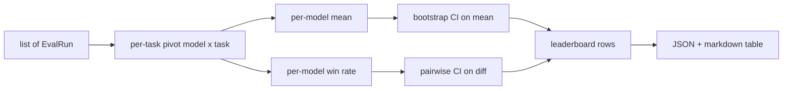
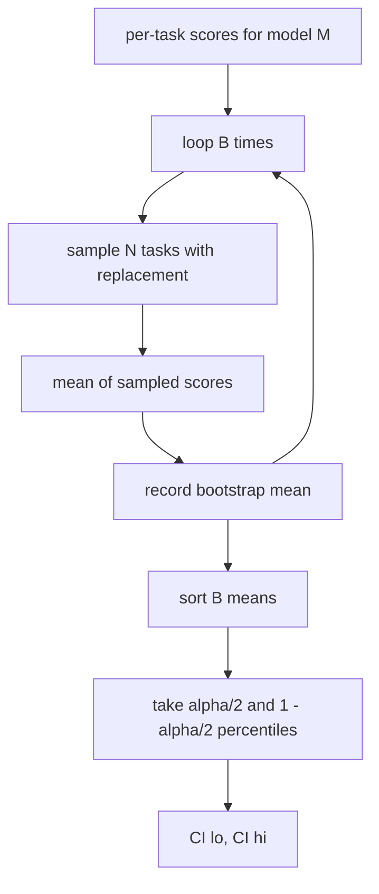

# 排行榜聚合

> كل مهمة من المهام السهلة. كل نموذج من المهام المتعددة من المهام المختلفة تصنيف أكثر صعوبة.

**Type:** Build
**Languages:** Python
**Prerequisites:** 第19期B轨基础，第70、71、73课
**Time:** ~90 分钟

## 學习目标


```figure
ci-leaderboard-ci
```

- جمع عدد من النماذج والمهام في كل مهام في خط كامل لكل نموذج
-                                                                                                                                                                                                                                                               
-                                                                                                                                                                                                                                                               
- 计算每个模型的平均分分和成对差异的引导置信区间──
- سوف يتم تصدير القائمة إلى تقرير JSON  وتعريف المشاركة، والمسابق في الدورة 75  يمكن لصقها إلى CI 评论中.

## 输入的形状

استخدام المواد المجمعة`EvalRun`记录列表:

```python
@dataclass
class EvalRun:
    model_id: str
    task_id: str
    metric_name: str
    score: float          # in [0, 1]
    category: str
```

第 75 课中的跑者为每一个`(model, task)`لإنتاج سجل. المجمعات لا تهتم كيفية ظهورها.`[0, 1]`في الوسط

## 输出

出来三张表:



排行榜行包含:`model_id`.`mean_score`.`mean_ci_lo`.`mean_ci_hi`.`win_rate`.`tasks_completed`وبالنسبة لكل فئة من المتوسطات`categories`الخريطة

## 標準化

إذا كان هدف مهمة`[0, 1]`، هدف مهمة أخرى`[0, 100]`، إذا كان المهام الثانية تُحكم بشكل صامت في القيمة المتوسطية.`[0, 1]`中,否则拒运行.修复位于上游:该指标应该已经回归一个分数.

## 平均值和胜率

هذه النوعين من المخططات لترتيبات الخدمة لتحقيق أهداف مختلفة.

متوسط النقاط هو متوسط قيمة نموذج لكل نقاط المهمة. هذا هو التقرير الرقمي المرتبة.

胜率计算模型在同一任务中击败所有其他模型的频率──对于每任务,最高分的模型获胜(平局时,每个并列模型都算完整一次获胜)──胜率等于获胜次数除了模型得分的任务数──它对异常值和尺度差异不太敏感,但会丢失信息──

```python
def win_rate(model_id, runs_by_task, all_models):
    wins, total = 0, 0
    for task_id, runs in runs_by_task.items():
        scores = {r.model_id: r.score for r in runs if r.model_id in all_models}
        if model_id not in scores:
            continue
        total += 1
        best = max(scores.values())
        if scores[model_id] >= best:
            wins += 1
    return wins / total if total else 0.0
```

حارس 会同时报告两者──第 75 课中的跑者 默认按平均排名排名; 胜率的标记 列也保留在那里,以便用户偏好这种视角时使用──

## أنفسها

كل نموذج متوسط قيمة لديه من خلال المهمة لإعادة التقاط التقييمات التوقعات.`B`و بعد ذلك`alpha`级别获取百分位间隔──



بالنسبة للمقارنة، نحن نقوم بتحديد اختلافات في كل مهمة`score_A - score_B`، الحصول على مئوية المقاييس و تقرير ذلك. المستخدم يقرأ ما إذا كان الفاصل لا يحتوي على صفر. إذا كان ذلك صحيحاً، فإن الفرق في الفا 水平 واضح.

低级助手`bootstrap_mean_ci`.`bootstrap_pairwise_diff`) يعتقد`B=1000`؛ public聚合器`aggregate`.`pairwise_diffs`) يعتقد`b=500`، لذلك ، تظل الموضة والاختبار سريعة.

## 类别

إذا تم إعدادها`EvalRun.category`، المجمعات أيضا تقرير متوسط كل فئة. هذا هو واحد من كل تصنيف، مكتوب عليه.`math`.`reasoning`.`code`.`safety`يمكن للمركز أن يكتشف ما إذا كان النموذج جيدًا بشكل عام ولكن البرمجة ضعيفة، هذا هو متوسط القيمة المخفية للموضوع‬‬‬‬‬‬‬‬‬‬‬‬‬‬‬‬‬‬‬‬‬‬‬‬‬‬‬‬‬‬‬‬‬‬‬‬‬‬‬‬‬‬‬‬‬‬‬‬‬‬‬‬‬‬‬‬‬‬‬‬‬‬‬‬‬‬‬‬‬‬‬‬‬‬‬‬‬‬‬‬‬‬‬‬‬‬‬‬‬‬‬‬‬‬‬‬‬‬‬‬‬‬‬‬‬‬‬‬‬‬‬‬‬‬‬‬‬‬‬‬‬‬‬‬‬‬‬‬‬‬‬‬‬‬‬‬‬‬‬‬‬‬‬‬‬‬‬‬‬‬‬‬‬‬‬‬‬‬‬‬‬‬‬‬‬‬‬‬‬‬‬‬‬‬‬‬‬‬‬‬‬‬‬‬‬‬‬‬‬‬‬‬‬‬‬‬‬‬‬‬‬‬‬‬‬‬‬‬‬‬‬‬‬‬‬‬‬‬‬‬‬‬‬‬‬‬‬‬‬‬‬‬‬‬‬‬‬‬‬‬‬‬‬‬‬‬‬‬‬‬‬‬‬‬‬‬‬‬‬‬‬‬‬‬‬‬‬‬‬‬‬‬‬‬‬‬‬‬‬‬‬‬‬‬‬‬‬‬‬‬‬‬‬‬‬‬‬‬‬‬‬‬‬‬‬‬‬‬‬‬‬‬‬‬‬‬‬‬‬‬‬‬‬‬‬‬‬‬‬‬‬‬‬‬‬‬‬‬‬‬‬‬‬‬‬‬‬‬‬‬‬‬‬‬‬‬‬‬‬‬‬‬‬‬‬‬‬‬‬‬‬‬‬‬‬‬‬‬‬‬‬‬‬‬‬‬‬‬‬‬‬‬‬‬‬‬‬‬‬‬‬‬‬‬‬‬‬‬‬‬‬‬‬‬‬‬‬‬‬‬‬‬‬‬‬‬‬‬‬‬‬‬‬‬‬‬‬‬‬‬‬‬‬‬‬‬‬‬‬‬‬‬‬‬‬‬‬‬‬‬‬‬‬‬‬‬‬‬‬‬‬

## التسجيل

排行榜呈现为 ماركdown 表:

```text
| Rank | Model | Mean | 95% CI | Win rate | Tasks |
|------|-------|------|--------|----------|-------|
| 1    | gpt   | 0.78 | 0.74-0.82 | 0.62 | 50 |
| 2    | claude| 0.75 | 0.71-0.79 | 0.34 | 50 |
| 3    | random| 0.10 | 0.07-0.13 | 0.04 | 50 |
```

العرض حسب الترتيب المتوسط. CI الحفاظ على اثنين من الأرقام الصغيرة.

## 本课不做什么

انها لا تعمل على النموذج. انها لا تستخدم المستوى القياسي. انها لا تحقق التكيف الذاتي مع ECE أو غيرها من المتغيرات المُهكّلة. هذه هي المادة 73. انها لا تنفيذ المهام المضافة. هنا، كل المهام هي ذات الأهمية.`weight`字段将该子保持开状态,但在聚合器中忽略它. إذا لزم الأمر، يمكن إضافة الوزن في الدورة التالية.

## كيف تقرأ ؟

`main.py`تعريف`EvalRun`.`LeaderboardRow`.`aggregate`.`bootstrap_mean_ci`.`bootstrap_pairwise_diff`和 `render_markdown` تمثل هذه العرض مجموعة شاملة تتكون من ثلاثة نماذج و12 مهمة، وتجميعها وتطبيقها قائمة وتصميمها على جدول التفاوت.`code/tests/test_leaderboard.py`اختبار وسط يحدد إطلاق                                                                                                                                                                                                                                                           

من فوق إلى أسفل`main.py` DATA Shape`EvalRun`.`LeaderboardRow`) يظهر أولاً، ثم هو المجمع، وثالث هو البوتستراب، وأخيراً هو الـ染── كل وظيفة لديها عقد مركز.

## أكثر

كل نموذج هو غير متوازنة، ولكن مقارنة بين النماذج يجب أن تكون متوازنة. إذا كان النماذج A و B تعمل نفس المئة مهمة، فإن الاختبار المناسب هو لتحديد اختلاف المهام الفردية.`bootstrap_pairwise_diff`已实现它──除此之外,你还需要一个尊重任务系列的分层引导程序(المسائل الرياضية ليست مستقلة عن بعضها البعض; النموذج الخطأ الحسابي يؤثر على عشرة منها)──这是后续行动──本课程重点是正确发言,以便评估报告你可以防范的数字──
