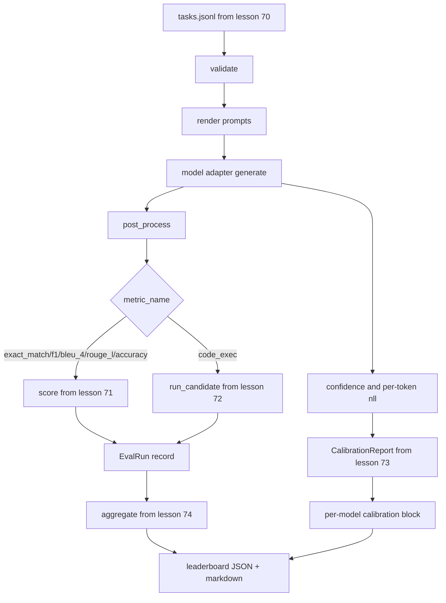

# 端到端评估运行器

> 五堂管道安装课,一堂水课, 跑步阅读第70课中的任务规范,通过适配器调用模型, 评价第71课和第72课, 附加第73课中的校准报告,并发出第74课中的排行列, 演示自动终止──

**Type:** Build
**Languages:** Python
**Prerequisites:** 第 19 期 Track B 基础，第 70 至 74 课
**Time:** ~90 分钟

## 學习目标


```figure
eval-grid
```

- تعريف أي نموذج 模拟、本地、API) يمكن أن يتم من خلال طريقة صغيرة على سطح تلبية `ModelAdapter`接口‬
- في تقييم عمليات JSONL على الملفات المثبتة، وفي عمل البحيرة وممارسة المهام التنفيذية.
- 1-المرحلة المختلفة: (F1 بليو 4 روج-L كود)
- أرسلت كل نموذج`EvalRun`记录并将其直接输入排行榜聚合器──
- مع إصدار JSON  تقرير و علامة التسجيل ؛ إصدار صفر عند التشغيل الجاف ، إصدار صفر عند الفشل في التحقق أو التشغيل.

## الأنابيب



الجاري هو نقطة التجميع. في كل درس من 70 إلى 74   ة هناك ماودول مكتوب من قبل الجاري. الجاري لن ينسخ أي من المنطق من هذه المواد: فإنه سوف يدرجها.

## 适配器接口

适配器是跑步和任何模型之间的接口――接口故意很小――

```python
class ModelAdapter:
    model_id: str

    def generate(self, prompt: str, task: TaskSpec) -> Generation: ...
```

`Generation`هو نوع من البيانات، مع:

- `text`:模型的自由格式输出
- `confidence`:`[0, 1]`متوسط عدد النقاط، يعبر عن احتمال الإجابة على النموذج
- `token_nll`: توليد الاختيارات للعدد المماثل للجميع
- `token_count`: توليد الاختيارات

المعدات المعدة في المعدات المعدة المعدة المعدة المعدة المعدة المعدة المعدة المعدة المعدة المعدة المعدة المعدة المعدة المعدة المعدة المعدة المعدة المعدة المعدة المعدة المعدة المعدة المعدة المعدة المعدة المعدة المعدة المعدة المعدة المعدة المعدة المعدة المعدة المعدة المعدة المعدة المعدة المعدة المعدة المعدة المعدة المعدة المعدة المعدة المعدة المعدة المعدة المعدة المعدة المعدة المعدة المعدة المعدة المعدة المعدة المعدة المعدة المعدة المعدة المعدة المعدة المعدة المعدة المعدة المعدة المعدة المعدة المعدة المعدة المعدة المعدة المعدة المعدة المعدة المعدة المعدة المعدة المعدة المعدة المعدة المعدة المعدة المعدة المعدة المعدة المعدة المعدة`RuleBasedAdapter`(التأكيد، تقريباً كاملة)`NoisyAdapter`(تفوق الذكاء، خطأ كثير) و`BiasedAdapter`(擅长一类,糟糕于另类) 

## ولم يتم تنفيذها

المتجول استخدام `concurrent.futures.ThreadPoolExecutor`按模型并行运行任务──工作线程数默认为8 和任务数中较小的人──线程就足够了,因为实际模型调用瓶是网络 I/O──代码执行路径在任务内生成自己的子进程,执行器只安排等着──

لامتحانات اليقين، الجاري`run_eval(adapters, tasks, parallel=False)`، كي يتمكن اختبار التأكد من ترتيب تنفيذها.

## 单遍评分循环

لكل مهمة:

1. 染提示(قليل من المصاصة 前加上提示正文)
2. 呼叫适配器并为呼叫计时──
3. وفقًا لقواعد المهمة، فإن التوليد قد تم بعد المعالجة.
4. 调度到度量层──
5. استخدام العدد والمعيارات البيانات`EvalRun`-تاريخ
6. ستعمل`(confidence, correct)`لـ إضافة إلى منطقة تأهيل التدريب

对于精确匹配样式标标`exact_match`.`accuracy`.`code_exec`(`correct`إشارة`score >= 1.0`، بالنسبة لمؤشر الدرجة`score >= 0.5`إشارة`score >= 0.5`                                                                                                                                                                                                                                                              `_correct_from_score`و لن يكون المُشغل عاماً

## 聚合

بعد كل مهمة تحصل على نتائج، الجاري سوف يستخدم في الفصل 74`aggregate`和 `pairwise_diffs`و في الدراسة 73`CalibrationReport.from_predictions`△输出是一个 JSON 信封:

```json
{
  "leaderboard": [...],
  "pairwise": [...],
  "calibration": {
    "model_id_a": {"ece": 0.04, "brier": 0.10, "populated_bins": 8, ...},
    ...
  },
  "summary": {
    "tasks": 10,
    "models": 3,
    "wall_seconds": 1.2
  }
}
```

يُرجع المُسافر أيضاً على المُشاركة في المُصدر، حتى يتمكن المستخدم من تمليث النتائج إلى تعليقات العلاقات العامة.

## منذ نهاية العرض

هذا العرض سوف يبدأ في العشر المواصفات في المرحلة الـ 70  المهام  العمل على ثلاثة مقارنات  ساعة الحائط  الوقت يجب أن تقل عن عشرة ثوانى 

清洁运行标准是:

- المادة 70 中验证 كل مهمة
- وكل المهام في المادة 71 و 72
- المادة 73                                                                                                                                                                                                                                                                                                                                                                                                                                                                                                                           
- ستقوم القائمة بتصنيف المعدات المرتبة على أساس القواعد بشكل صارم على أساس المعدات المرتبة المرتبة على أساسها.

إذا كان أي من هذه الانقطاعات، فستعود المتدربة بأحكام غير صفر، ويتم ظهور خطأ هيكلي في JSON信封.

## 本课不做什么

لا يستخدم النموذج الحقيقي. لا يطبق API 密钥流或速率限制处理. لا يطبق التيار أو جزء من إنتاج. لا يطبق التيار أو جزء من إنتاج. لا يطبق التيار في كل مرة يستخدم فيها التيار. لا يطبق إعادة التجربة أو تخزين.

## كيف تقرأ ؟

`main.py`هو مجتمع.`_load_sibling`‬‬‬‬‬‬‬‬‬‬‬‬‬‬‬‬‬‬‬‬‬‬‬‬‬‬‬‬‬‬‬‬‬‬‬‬‬‬‬‬‬‬‬‬‬‬‬‬‬‬‬‬‬‬‬‬‬‬‬‬‬‬‬‬‬‬‬‬‬‬‬‬‬‬‬‬‬‬‬‬‬‬‬‬‬‬‬‬‬‬‬‬‬‬‬‬‬‬‬‬‬‬‬‬‬‬‬‬‬‬‬‬‬‬‬‬‬‬‬‬‬‬‬‬‬‬‬‬‬‬‬‬‬‬‬‬‬‬‬‬‬‬‬‬‬‬‬‬‬‬‬‬‬‬‬‬‬‬‬‬‬‬‬‬‬‬‬‬‬‬‬‬‬‬‬‬‬‬‬‬‬‬‬‬‬‬‬‬‬‬‬‬‬‬‬‬‬‬‬‬‬‬‬‬‬‬‬‬‬‬‬‬‬‬‬‬‬‬‬‬‬‬‬‬‬‬‬‬‬‬‬‬‬‬‬‬‬‬‬‬‬‬‬‬‬‬‬‬‬‬‬‬‬‬‬‬‬‬‬‬‬‬‬‬‬‬‬‬‬‬‬‬‬‬‬‬‬‬‬‬‬‬‬‬‬‬‬‬‬‬‬‬‬‬‬‬‬‬‬‬‬‬‬‬‬‬‬‬‬‬‬‬‬‬‬‬‬‬‬‬‬‬‬‬‬‬‬‬‬‬‬‬‬‬‬‬‬‬‬‬‬‬‬‬‬‬‬‬‬‬‬‬‬‬‬‬‬‬‬‬‬‬‬‬‬‬‬‬‬‬‬‬‬‬‬‬‬‬‬‬‬‬‬‬‬‬‬‬‬‬‬‬‬‬‬‬‬‬‬‬‬‬‬‬‬‬‬‬‬‬‬‬‬‬‬‬‬‬‬‬‬‬‬‬‬‬‬‬‬‬‬‬‬‬‬‬‬‬‬‬‬‬‬‬‬‬‬‬‬‬‬‬‬‬‬‬‬‬‬‬‬‬‬‬‬‬‬‬‬‬‬‬‬‬‬‬‬‬‬‬‬‬‬‬‬‬‬‬‬‬‬‬‬‬‬‬‬‬‬‬‬‬‬‬‬‬‬‬‬`Generation`.`EvalReport`和 `ModelAdapter`هو مقصود محلي.

من فوق إلى أسفل`main.py`◊浏览进口, ثم查看 `run_eval`ثمّ`_score_one`ثم هو المعدل.

`code/tests/test_runner.py`وسط اختبار متواصلة المكاسب المتواصلة  دورة طريق واحد  موازاة مع التسلسل والانفعالات  تحديد المكافحة وال JSON  شكل الشبكة 

## أكثر

هذا الجاري هو الأرض.`(task_id, model_id, model_version)`键控制的结果缓存、跟踪每次运行美元和代币的成本分类账、重试层的回退率限制、通过-at-k 任务的采样策略以及长套件的流输出格式──其中每个是单独的关注点,它包装运营器,而无需改变指标或聚合层──这种分离是合同的重点──

بعد ذلك، إضافة المخططات المقدمة الحقيقية إلى المعدات المعدلة.
