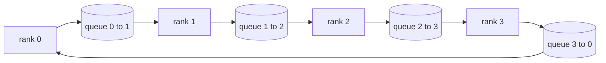

# من التحقق من العمليات الجماعية

> سيتم دمج عمليات التدريب الموزعة مع أربعة عمليات جماعية هي كل القلل والتوزيع والجميع و القلل_التمزيق.`multiprocessing.Queue`على شبكة بناء واحدة منها، وفقا للمراجعة لتحقيقها، والباقي من الممرات تحولت إلى الأنابيب.

**Type:** Build
**Languages:** Python
**Prerequisites:** 第 19 阶段 Track C 课程 42-49
**Time:** ~90 分钟

## 學习目标

- في اثنين من التسليمات لتحقيق حلقة كلخفضة، أولاخفضة، ثمجميع)
- في`multiprocessing.Queue`فوق النقطة على النقطة إرسال فوق بناء الإعلانات والتجميع و تقليل التنشر
- وفق نفس الإدخال`torch.distributed`كلّاً، كلّاً، كلّاً، كلّاً، كلّاً، كلّاً، كلّاً، كلّاً، كلّاً، كلّاً، كلّاً، كلّاً، كلّاً، كلّاً، كلّاً، كلّاً، كلّاً، كلّاً، كلّاً، كلّاً، كلّاًا، كلّاً، كلّاً، كلّاً، كلّاً، كلّاً، كلّاً، كلّاً، كلّاً، كلّاً، كلّاً، كلّاً، كلّاً، كلّاً، كلّاً، كلّاًا، كلّاًا، كلّاًا، كلّاًا، كلّا، كلّاًا، كلّا، كلّا، كلّا، كلّا، كلّا، كلّا، كلّا، كلّا، كلّا،
- في مجال تشكيل المجموعة 延迟下限 والحدود العليا لتحميل الحلقات والشجرة

## 问题

على مستوى N  简单 allreduce 将张量 N 次发送到根并广播 N 次。 كل رتبة من التوسع وتوسع إلى$O(N)$،أصل يصبح بطلاً، ويعمل على أن تكون الطابق الثاني بطيئة التواصل$T/N$من$2(N-1)$块، لذلك كل صف 字节 下降到$2T(N-1)/N$، مع مجموعة كبيرة لا علاقة لها. شجرة كلخفض في الصغر N وارتفاع تأخر سلسلة النصر، لأن العمق هو$\log_2(N)$跳 بدلاً من $2(N-1)$                                                                                                                                                                                                                                                              

 كل إطار تدريب منتشر سوف تقرأ في هذا الدروس يعتمد على هذه الأربعة لغات أساسية‬‬‬‬‬‬‬‬‬‬‬‬‬‬‬‬‬‬‬‬‬‬‬‬‬‬‬‬‬‬‬‬‬‬‬‬‬‬‬‬‬‬‬‬‬‬‬‬‬‬‬‬‬‬‬‬‬‬‬‬‬‬‬‬‬‬‬‬‬‬‬‬‬‬‬‬‬‬‬‬‬‬‬‬‬‬‬‬‬‬‬‬‬‬‬‬‬‬‬‬‬‬‬‬‬‬‬‬‬‬‬‬‬‬‬‬‬‬‬‬‬‬‬‬‬‬‬‬‬‬‬‬‬‬‬‬‬‬‬‬‬‬‬‬‬‬‬‬‬‬‬‬‬‬‬‬‬‬‬‬‬‬‬‬‬‬‬‬‬‬‬‬‬‬‬‬‬‬‬‬‬‬‬‬‬‬‬‬‬‬‬‬‬‬‬‬‬‬‬‬‬‬‬‬‬‬‬‬‬‬‬‬‬‬‬‬‬‬‬‬‬‬‬‬‬‬‬‬‬‬‬‬‬‬‬‬‬‬‬‬‬‬‬‬‬‬‬‬‬‬‬‬‬‬‬‬‬‬‬‬‬‬‬‬‬‬‬‬‬‬‬‬‬‬‬‬‬‬‬‬‬‬‬‬‬‬‬‬‬‬‬‬‬‬‬‬‬‬‬‬‬‬‬‬‬‬‬‬‬‬‬‬‬‬‬‬‬‬‬‬‬‬‬‬‬‬‬‬‬‬‬‬‬‬‬‬‬‬‬‬‬‬‬‬‬‬‬‬‬‬‬‬‬‬‬‬‬‬‬‬‬‬‬‬‬‬‬‬‬‬‬‬‬‬‬‬‬‬‬‬‬‬‬‬‬‬‬‬‬‬‬‬‬‬‬‬‬‬‬‬‬‬‬‬‬‬‬‬‬‬‬‬‬‬‬‬‬‬‬‬‬‬‬‬‬‬‬‬‬‬‬‬‬‬‬‬‬‬‬‬‬‬‬‬‬‬‬‬‬‬‬‬‬‬‬‬‬‬‬‬‬‬‬‬‬‬‬‬‬‬‬‬‬‬‬‬‬‬‬‬‬

## 概念



### 分两次进行 allreduce

لتقسيم الصفحة إلى N 个相等块,索引为 0..N-1── كل صف 拥有与其级相等块索引──第 1 遍,reduce_scatter,运行 N-1 步骤──在步骤 s,rank r 发送块 (r - s) mod N 到rank (r + 1) mod N,并从rank (r - 1) mod N 接收块 (r - s - 1) mod N,将收到的块 积累到本地副本中──经过 N-1 步骤后,全部 r 拥有块 r总和和和──第 2 阶段,全部收集,运行 N-1 个步骤,并绕绕旋转完成块,直到每个级块都保存了全部总和.

|原语|每 rank 字节 |步骤|何时使用 |
|-----------|---------------|-------|-------------|
|Ring allreduce| 2T(N-1)/N | 2(N-1) |大 T、fat-pipe 同构集群 |
|Tree allreduce | T log2(N) | 2 log2(N) |小 T 或高延迟链路 |
|广播| T | log2(N) 树 |参数初始化，标量配置|
|allgather| T(N-1)/N | N-1 |分片转发，ZeRO 取消分片 |
|reduce_scatter | T(N-1)/N | N-1 | ZeRO 梯度分片 |

### 队列网格 كبديل لـ NCCL

NCCL على PCIe و NVLink على تشغيل، وقلل من تحميل الأجهزة.`multiprocessing.Queue`لتقديمك مع منتج واحد ومستهلك واحد نقطة مقابل نقطة تسليم. تقليل يحدث في مساحة المستخدم، لذلك تحتاج إلى دفع ثمن Python، ولكن نموذج الاتصال مع NCCL كل تقليل مماثلة.

### 针对 gloo 进行验证

كل لغة أصل تقوم بإجراء اختبار واحد، وتصدر إصدارها على نفس الكمية من الكميات التي تستخدمها في نفس العالم الصغير`torch.distributed`إذا كان حلقةك تقلل جميع التفاوتات مع اللوحة عن فلوات32 إيبسيلون، فإن اختبار الفشل.


```figure
ci-ring-allreduce
```

## بناءها

`code/main.py`实现:

- `Mesh`类,将 N 个 `multiprocessing.Queue` مثال متصل إلى الحلقة،并按等级公开 `send(dst, tensor)`和 `recv(src)`.
- `ring_allreduce(mesh, rank, world_size, tensor)`运行两遍算法──
- على الأشجار`broadcast(mesh, rank, world_size, tensor, src)`.
- `allgather(mesh, rank, world_size, tensor)`استخدام N-1 轮换。
- `reduce_scatter(mesh, rank, world_size, tensor)`ككل القلل من الجزء الأول
- `_gloo_reference(op, world_size, tensor)` من خلال `torch.distributed`运行相同输入,并使用glou 进行字节相等比较──

运行它:

```bash
python3 code/main.py
```

输出: مقارنة صف صفات 格和 gloo 输出 كل صفات 证表, 后面跟随一个证明 2T(N-1) /N 缩放的每列节计器──

## 野外生产模式

ثلاثة أشكال تجعل القوة قوية بما فيه الكفاية، يمكن أن تسليمها.

**在 allreduce 之前对梯度进行分桶。**نموذج 1B 参数 لديه عشرات الآلاف من تراجات张量── كل تراجات يتم إجراءها مرة واحدة كلخفض 会支付 N 倍的延迟下限── د.د.ب. سوف تخزن تراجات تخزين لـ 25 MB من الكتل ، وتصدر واحدة لكل سطل تخزين ؛ 小张量骑大张量的后面── إذا لم تقسم سطل ، فإن التأخير سوف يحتل المرتبة المهيمنة──

**通信与计算重叠。**العودة إلى الوراء في التسلسل على نحو متناقض على بعد درج الحسابات. عندما تكون درجة الطبقة الأخيرة جاهزة، تبدأ في تقليلها، في حين تستمر الطبقة التالية في الحساب.

**根据消息大小而不是宗教来选择环或树。**NCCL قدم جهاز اختبار إلكتروني، يمكن أن يكون مرتفعاً عن ~ 1 MB، يمكن أن يكون مرتفعاً عن ~ 1 MB، يمكن أن يكون مرتفعاً عن ~ 1 MB، يمكن أن يكون مرتفعاً عن ~ 1 MB.

## استخدمها

النمط الناتج:

- **PyTorch DDP。**في التحول إلى التطبيق على درجة المجموعة`dist.all_reduce`斗大小可调؛ بالنسبة لـ 100Gbit 以太网،默认 25 MB 是合理的──
- **DeepSpeed ZeRO。**发出减_scatter لتنظيم التدابير، و إجراء جمع قبل الانتقال لإعادة بناء العناصر الكاملة.
- **FSDP.**前向从allgather 开始对层进行取消分片,计算,然后使用减少_scatter 进行缩减并丢弃取消分片──相同原语,不同的时间表──

## 发货

استخدام 第77-81 课中的队列网格原语──第77 课把所有减少 接入 DDP──第78 课把减少_scatter 接入 ZeRO──第79 课用点对点发送和回复(而不是集体) 传递管道激活──第81 课把这四者组合成端到端演示──

## التدريب

1. إضافة شجرة جميع تقليل التغيرات، وفقًا للصورة
2. إضافة`recv_timeout_ms`، حتى يتمثل تصنيف المتوقف في خطأ في النهاية بدلاً من الإرتفاع للأبد.
3. ستعمل على إعداد أربعة لغات`multiprocessing.Queue`替换为TCP 套接字──相同的测试,真线──
4. 添加带宽检测挂, حتى يتم تسجيل كل صفوف الجهاز الحاسب إلى JSONL。
5. مقارنة مع 4 درجات من الحلقة مع الوقت التعلق على الشجرة مع حجم 1KB ∙ 1MB ∙ 16MB ∙

## 关键术语

|术语 |人们怎么说|它实际上意味着什么 |
|------|----------------|------------------------|
|allreduce| “跨等级总和”|调用后，每个等级都保留相同的简化张量 |
|戒指| “快速拓扑”| N-1 个大小为 T/N 的块绕周期流动两次 |
|树| “日志拓扑”|归约遵循二叉树；深度为 log2(N) 跳 |
|allgather| “连接碎片”|每个等级都以其他等级的碎片结束 |
|reduce_scatter | “平分总和”|每个排名仅以一个块的总和结束 |
|桶| “融合小张量”|将N个小的全部合并为一个大的|

##  المزيد阅读

- [PyTorch 分布式：NCCL 集体](https://pytorch.org/docs/stable/distributed.html#collective-functions)
- [Horovod环全减纸](https://arxiv.org/abs/1802.05799)
- NCCL拓和算法选择](https://docs.nvidia.com/deeplearning/nccl/user-guide/docs/index.html)
- [Patarasuk 和 Yuan，带宽最优 allreduce 算法](https://www.cs.fsu.edu/~xyuan/paper/09jpdc.pdf)
- 第10 阶段 第05 课 - التدريب المُنظم
- 第19 阶段 第77 课 - DDP 连接在这些原语之上
