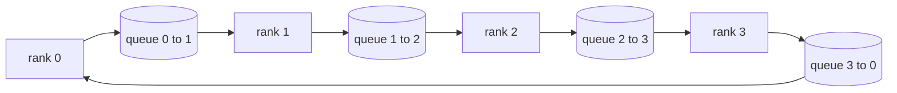

# من التحقق من العمليات الجماعية

> 支分布式训练的四种集体通信(集体)操作是 allreduce、broadcast、allgather 和 reduce_scatter── التدريب الإطار المقدم لغة أخرى الأصلية تقريباً هي حزمة هذه الأربعة──先在`multiprocessing.Queue`التحقق مرة أخرى، مرة أخرى للتحقق من التحقق من التحقق، هذا المسار الباقي من الجزء هو مجرد الاتصال 

**Type:** Build
**Languages:** Python
**Prerequisites:** Phase 19 Track C lessons 42-49
**Time:** ~90 分钟

## 學习目标

- استخدام اثنين من الالجيومات لتحقيق حلقة كلخفضة، أولا تقليل-تشتت، مرة أخرى كلجمع) ،并证明 كل صف من حجم الاتصال هو كل عنصر.$2(N-1)/N$字节。
- في`multiprocessing.Queue`أعلى النقاط على النقاط إرسال أعلى تحقيق البث كل جمع و تقليل الوسائل المنتشرة
- على نفس المدخل، استخدام`torch.distributed`后端作为参考,验证每一个原语──
- من شكل مجموعة 延迟下限和带宽上限发发,论证该选环 还是树

## 问题

في N 个级 上做朴素 allreduce, will把张量到根 发送 N 次,再广播回来 N 次.$O(N)$إضاف، الجذر تحول إلى قنينة ، والحدود التوقيتية أسفل هي أبطأ سلسلة ضربة ∞ الحلقة كلخفضها وضعها على التوالي ∞$2(N-1)$个大小为 $T/N$من الجزء، فكل رتبة من العدد من العبرة انخفض إلى$2T(N-1)/N$، مع زيادة التوجهات$2T$且永不超出,与集群规模无关. 树全减少在小N、高延迟链路上更优,因为深度是$\log_2(N)$跳، بدلا من $2(N-1)$拓选错, أبطأ قطعة من GPU سوف تحدد الخطوة 时间‬

تعتمد DDP باستخدام كل علبة من العناصر مرة واحدة كلخفض من أجل التسلسلات نفسها. زيرو باستخدام reduce_scatter 分片优化器状态, reuse allgather 广播更新后的参数. FSDP وضع كاملة إلى الأمام 变成 allgather 加减少_scatter.

## 概念



### 两遍完成的环全减

وضع张量拆成N 个等大块,索引为0..N-1──每个级别 拥有与自身级别 号相同的块索引──第 1遍就是减少-散射,跑N-1 步──在第 1 步,排名 r 把块$(r - s) \bmod N$أرسلي لي رتبة$(r + 1) \bmod N$،并从行 $(r - 1) \bmod N$接收 قطعة $(r - s - 1) \bmod N$، ضع الجزء المُتلقى 累加到本地副本──经过N-1 步骤后, rank r 持有 الجزء r 完整求和──第二遍是全部聚集,再跑N-1 步步,把完成的部分 绕环旋转,直到每个级都持有每个部分的完整求和──

| 原语 | 每 rank 字节数 | 步数 | 何时使用 |
|-----------|---------------|-------|-------------|
| Ring allreduce | 2T(N-1)/N | 2(N-1) | 大 T、同构 fat-pipe 集群 |
| Tree allreduce | T log2(N) | 2 log2(N) | 小 T 或高延迟链路 |
| Broadcast | T | log2(N) tree | 参数初始化、标量配置 |
| Allgather | T(N-1)/N | N-1 | 分片 forward、ZeRO unshard |
| Reduce_scatter | T(N-1)/N | N-1 | ZeRO 梯度分片 |

### استخدام صف شبكة بدلا من NCCL

NCCL 跑在PCIe 和 NVLink 上,归约可硬件卸载──在CPU 上没有这些──环上每条边一个 `multiprocessing.Queue`يمكن الحصول على ترتيب من النقاط مقابل النقاط، و فقط المنتج وحيد الحياة والمستهلك وحيد. يحدث ذلك في حالة المستخدم، لذلك يجب أن تدفع Python 开销، ولكن نموذج الخطوط و NCCL الخاتم كل ما يقلل من نفس الشيء.

### لمراقبة الظلام

كل لغة أساسية تحمل وحدات اختبار: في نفس حجم العالم`torch.distributed`مقابل مقابل مقابل مقابل مقابل مقابل مقابل مقابل مقابل مقابل مقابل مقابل مقابل مقابل مقابل مقابل مقابل مقابل مقابل مقابل مقابل مقابل مقابل مقابل مقابل مقابل مقابل مقابل مقابل مقابل مقابل مقابل مقابل مقابل مقابل مقابل مقابل مقابل مقابل مقابل مقابل مقابل مقابل مقابل مقابل مقابل مقابل مقابل مقابل مقابل مقابل مقابل مقابل مقابل مقابل مقابل مقابل مقابل مقابل مقابل مقابل مقابل مقابل مقابل مقابل مقابل مقابل مقابل مقابل مقابل مقابل مقابل مقابل مقابل مقابل مقابل مقابل مقابل مقابل مقابل مقابل مقابل مقابل مقابل مقابل مقابل مقابل مقابل مقابل مقابل مقابل مقابل مقابل مقابل مقابل مقابل مقابل مقابل مقابل مقابل مقابل مقابل مقابل مقابل مقابل مقابل مقابل مقابل مقابل مقابل مقابل مقابل مقابل مقابل مقابل مقابل مقابل مقابل مقابل مقابل مقابل مقابل مقابل مقابل مقابل مقابل مقابل مقابل مقابل مقابل مقابل مقابل مقابل مقابل مقابل مقابل مقابل مقابل مقابل مقابل مقابل مقابل مقابل مقابل مقابل مقابل مقابل مقابل مقابل مقابل مقابل مقابل مقابل مقابل مقابل مقابل مقابل مقابل مقابل مقابل مقابل مقابل مقابل مقابل مقابل مقابل مقابل مقابل مقابل مقابل مقابل مقابل مقابل مقابل مقابل مقابل مقابل مقابل مقابل مقابل مقابل مقابل مقابل مقابل مقابل مقابل مقابل مقابل مقابل مقابل مقابل مقابل مقابل مقابل مقابل مقابل مقابل مقابل مقابل مقابل مقابل مقابل مقابل مقابل مقابل مقابل مقابل مقابل مقابل مقابل مقابل مقابل مقابل مقابل مقابل مقابل مقابل مقابل مقابل مقابل مقابل مقابل مقابل مقابل مقابل مقابل مقابل مقابل مقابل مقابل مقابل مقابل مقابل مقابل مقابل مقابل مقابل مقابل مقابل مقابل مقابل مقابل مقابل مقابل مقابل مقابل مقابل مقابل مقابل مقابل مقابل مقابل مقابل مقابل مقابل مقابل مقابل مقابل مقابل مقابل مقابل مقابل مقابل مقابل مقابل مقابل مقابل مقابل مقابل مقابل مقابل مقابل مقابل مقابل مقابل مقابل مقابل مقابل مقابل مقابل مقابل مقابل مقابل مقابل مقابل مقابل مقابل مقابل مقابل مقابل مقابل مقابل مقابل مقابل مقابل مقابل مقابل مقابل مقابل مقابل مقابل مقابل مقابل مقابل مقابل مقابل مقابل مقابل مقابل مقابل مقابل مقابل مقابل مقابل مقابل مقابل مقابل مقابل مقابل مقابل مقابل مقابل مقابل مقابل مقابل مقابل مقابل مقابل مقابل مقابل مقابل مقابل مقابل مقابل مقابل مقابل مقابل مقابل مقابل مقابل مقابل مقابل مقابل مقابل مقابل مقابل مقابل مقابل مقابل مقابل مقابل مقابل مقابل مقابل مقابل مقابل مقابل مقابل مقابل مقابل مقابل مقابل مقابل مقابل مقابل مقابل مقابل مقابل مقابل مقابل مقابل مقابل مقابل مقابل مقابل مقابل مقابل مقابل مقابل مقابل مقابل مقابل مقابل مقابل مقابل مقابل مقابل مقابل مقابل مقابل مقابل مقابل مقابل مقابل مقابل مقابل مقابل مقابل مقابل مقابل مقابل مقابل مقابل مقابل مقابل مقابل مقابل مقابل مقابل مقابل مقابل مقابل مقابل مقابل مقابل مقابل مقابل مقابل مقابل مقابل مقابل مقابل مقابل مقابل مقابل مقابل مقابل مقابل مقابل مقابل مقابل مقابل مقابل مقابل مقابل مقابل مقابل مقابل مقابل مقابل مقابل مقابل مقابل مقابل مقابل مقابل مقابل مقابل مقابل مقابل مقابل مقابل مقابل مقابل مقابل مقابل مقابل مقابل مقابل مقابل مقابل مقابل مقابل مقابل مقابل مقابل مقابل مقابل مقابل مقابل مقابل مقابل مقابل مقابل مقابل مقابل مقابل مقابل مقابل مقابل مقابل مقابل مقابل مقابل مقابل مقابل مقابل مقابل مقابل مقابل مقابل مقابل مقابل مقابل مقابل مقابل مقابل مقابل مقابل مقابل مقابل مقابل مقابل مقابل مقابل مقابل مقابل مقابل مقابل مقابل

```figure
ci-ring-allreduce
```

## بناءها

`code/main.py`实现:

- `Mesh`类:把 N 个 `multiprocessing.Queue`接成环,并按排名 暴露 `send(dst, tensor)`مع`recv(src)`.
- `ring_allreduce(mesh, rank, world_size, tensor)`: دو遍算法
- `broadcast(mesh, rank, world_size, tensor, src)`"تذهب إلى الأشجار"
- `allgather(mesh, rank, world_size, tensor)`: باستخدام N-1 次轮转――
- `reduce_scatter(mesh, rank, world_size, tensor)`: ككل القلل من الــ1⁄2段
- `_gloo_reference(op, world_size, tensor)`:把相同输入送进带glou 的 `torch.distributed`,做字节级对比──

运行:

```bash
python3 code/main.py
```

输出:按原语对比排队-شبكة مع gloo 输出验证表,以及证明 $2T(N-1)/N$缩放的每级 字节计计器──

## عملية في بيئة النمو

ثلاثة أنماط يمكن أن تجعل هذه اللغات الأصلية صلبة إلى حد ممكن على الإنترنت.

**allreduce 前先对梯度分桶。**نموذج معدل مليار دولار لديه مائة ألف درجة张量── كل张量一次 allreduce, يجب أن يدفع N 倍延迟下限──DDP وضع التعدد على علبة من حوالي 25 MB، كل وعاء 发发发一次 allreduce; 小张量搭大张量后面──不分桶时,延迟开销会主导整个步骤──

**让通信与计算重叠。**للخلف 按层反向逐层算梯度──最后层梯度一就绪,就启动它的全部减少,同时下层继续算──PyTorch DDP باستخدام رماد جاهز للعباء 接上这个事──网络有余量时,重叠能把可见通信时间砍半──

**按消息大小选 ring 或 tree，不要教条。**نكتة التقاطع: حوالي 1 MB أو أكثر من حلقة اختيار، تحت شجرة اختيار.$2T(N-1)/N$占主导,ring 胜出; أقل من 1 MB 时$\log_2(N)$跳数占优――写死一种拓,会在错误消息大小上损失吞吞

## استخدمها

النمو في المنتجات:

- **PyTorch DDP。**للخلف  بعد ذلك على التسجيل التدريجي`dist.all_reduce`◊ بُكيت ∼ 100 جيجابت 以太网下默认 25 MB 合理。
- **DeepSpeed ZeRO。**发 reduce_scatter 分片梯度,forward 前再再再重建完整参数──本课的原语正是ZERO 实际发射调用──
- **FSDP。**للأمام قبل كل شيء جمع وضع هذا الطبقة غير مقطوعة، حساب كاملة إعادة استخدام تقليل_تشتت 归约并丢掉未分裂──同一套原语,不同调度──

## 交付 it

في دروس 7781  دروس 77  دروس 77  دروس                                                                                                                                                                                                                                                                                                                                                                                                                                                                                                             

## التدريب

1. زيادة شجرة كلقلل 变体,并按消息大小在 ring 与 tree 之间切换──测出交叉点──
2. 增加 `recv_timeout_ms`، دع صفة القاضي يرمي إلى الخطأ ، بدلاً من العلق للأبد
3. ضع أربعة لغات أساسية`multiprocessing.Queue`تغيير إلى محطة TCP.
4. 加带宽探测 hook،把每位 字节计计器记到JSONL。
5. في 4 个排列上,对 1KB、1MB、16MB 张量比较戒指与树的墙钟时间──用实测为交叉点辩护──

## 关键术语

| 术语 | 人们常说 | 实际含义 |
|------|----------------|------------------------|
| Allreduce | “跨 rank 求和” | 调用结束后每个 rank 持有相同的归约张量 |
| Ring | “更快的拓扑” | N-1 个大小为 T/N 的 chunk 绕环流两圈 |
| Tree | “对数拓扑” | 归约沿二叉树进行；深度为 log2(N) 跳 |
| Allgather | “拼接分片” | 每个 rank 最终持有所有其他 rank 的分片 |
| Reduce_scatter | “把求和切开” | 每个 rank 最终只持有某一个 chunk 的求和 |
| Bucket | “融合小张量” | 把 N 次小 allreduce 合并成一次大的 |

## 延伸阅读

- [PyTorch Distributed: NCCL collectives](https://pytorch.org/docs/stable/distributed.html#collective-functions)
- [Horovod ring allreduce paper](https://arxiv.org/abs/1802.05799)
- [NCCL topology and algorithm selection](https://docs.nvidia.com/deeplearning/nccl/user-guide/docs/index.html)
- [Patarasuk and Yuan, Bandwidth optimal allreduce algorithms](https://www.cs.fsu.edu/~xyuan/paper/09jpdc.pdf)
- المرحلة 10 الدروس 05 - استعراض التدريب الموزع
- المرحلة 19 الدروس 77 - DDP سلكية فوق هذه البدائيات
