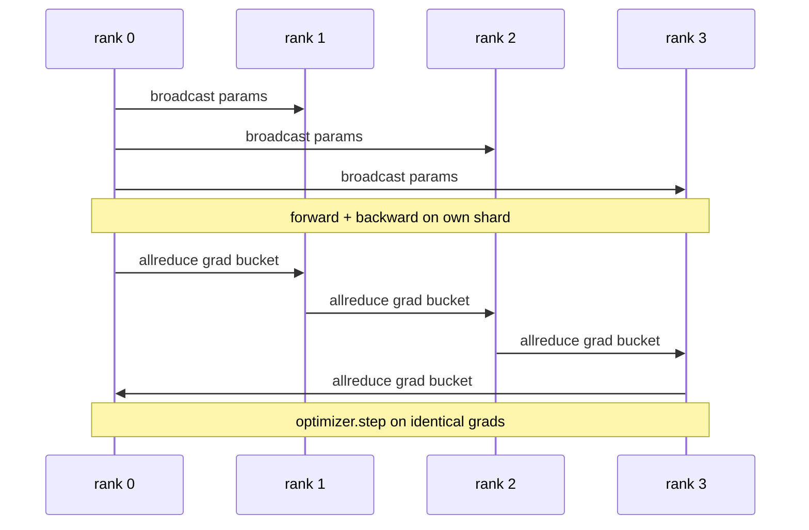

# من البداية البيانات ومعالجة DDP

> المزدوج الموزع هو واحد على كل 子 之上的 allreduce. تعبئة نموذج واحد، من الصف 0 تبدأ نشر العناصر الأولية، بحيث كل الصف تبدأ نفسها، في كل صف إصدار تعادلات allreduce.

**Type:** Build
**Languages:** Python
**Prerequisites:** 第 19 期 Track C 课程 42-49
**Time:** ~90 分钟

## 學习目标

-                                                                                                                                                                                                                                                                                                                                                                                                                                                                                                                              `DistributedDataParallel`形的包装器,该包装器广播初始参数并后向后减少梯度──
- spawn N CPU في المجموعة القائمة على الملفات`torch.multiprocessing.spawn`.
- 通过 التدريب على نفس البيانات على نفس النموذج و عرض كل خطوة المعايير المساواة لتثبت صحة التساوي التدريجي 
- استخدام الحاوية الاحتياطية (تعدد التكامل) والإكمال (تكامل التكامل) ، وذلك كعمل في تحويل الحاوية الاحتياطية إلى تحويلات لإنتاج الحاوية الاحتياطية.

## 问题

具有 12 GB 激活量10亿参数模型不适合消费级GPU──即使合适, 训练也需要数周时间──数据并行将批次分成N 级别,每个级别计算其分片上前向后向,并在每一步中, 梯度的每个级别都会相加,以便所有N 副本保持相同──求和梯度就是优化器采用了──

إذا كان هناك تناغم من التسلسلات، فإن N 个副本会发生分歧 في الخطوة الثانية. لم تعد هذه النموذجة نموذجًا تمارس على المزيد من البيانات، بل تمتلك بشكل غير ملائم النموذج N 个独立模型، والتي تمارس الوزن الأولي. إذا كان التسلسلات غير جيدًا، فإن كل عنصر يتقلص بشكل كامل، لا يوجد تعليق، لا يوجد حفرة، فإن الشبكة ستصبح بطاقة، وGPU 会空 انتظار الطريق.

## 概念



### الحاجة إلى ثلاث عمليات

|舞台|集体|为什么 |
|-------|-----------|-----|
|初始化|从排名 0 开始广播 |每个排名都以相同的参数开始 |
|后退|各梯度的 allreduce |平均梯度是优化器所采用的 |
|有时|缓冲区广播| Batchnorm 运行统计数据保持同步 |

### لماذا هو متوسط القيمة وليس مجموع

كلخفض-SUM إضافة إلى العالم_حجم الحصول على متوسط التعدد. متوسط القيمة بالنسبة للعالم_حجم هو لا يتغير: في المرحلة الأولى تعديل من التعلم في المرحلة الرابعة، لأن كل خطوة تدخل في التعدد لا يتغير.

### لماذا تستخدم المعدل

المحول لديه آلاف الحدود 張量. كل 張量一次 allreduce 会支付 gloo 延迟下限 آلاف مرات من التكاليف. DDP سوف تنسجم التعدد إلى حوالي 25 MB في خزانة الاحتياطي، وتصدر كل تخفيض لكل خزانة.

### لماذا يجب أن تثبيت

كل رتبة يجب أن تكون مُستعدة`torch.manual_seed(seed + rank)` إجراء غسل, ولكن调用`torch.manual_seed(seed)`进行参数初始化──单个共享种子意味着每个级别都看到相同批次序序(击败数据并行); 参数的特定级别种子意味着初始参数与浮动epsilon不一致,并且梯度同步不再使副本相同──获得正确种子模式,否则参数等效性测试将失败在步骤1──


```figure
ci-ddp-grad-sync
```

## بناءها

`code/main.py`实现:

- `MiniMLP`3 طبقة MLP، صغيرة إلى كافية في غضون بضع ثوان، كبيرة إلى كافية لتعرض الأسلوب.
- `DistributedDataParallel(model, world_size)`: في البناء , إرجاع معدات التعبئة ,其`sync_grads`سوف تجمع كلخفض الطلب والدرجة إلى حجم العالم
- `worker(rank, world_size, ...)`: من خلال Gloo、前进、后退、同步、步进进行 `torch.distributed`حلقة التدريب الكاملة
- `_reference_single_process_loop(...)`: على مستوى على التسلسل على نفس البيانات تدريب نفس النموذج، لاستخدامها في كل خطوة بعد اختبار الطرازات في مرحلة التساوي العناصر والفعالية.

运行它:

```bash
python3 code/main.py
```

输出: جدول التدريب في كل خطوة، تقارن مع خسارة عملية واحدة ومقاييس العنصر مع DDP التي تعمل في 4 درجات أعلى.

## 野外生产模式

ثلاثة أنماط تجعل DDP صلبة إلى ما يكفي لتسليمها.

**查找未使用的参数。**بعض المخططات المتحولة لديها حاليات للانتقال إلى العناصر المتحركة.`find_unused_parameters=True`أخبر DDP قبل أن تقلل فلترى ما هي العناصر التي حصلت على التدريج.

**静态图优化。**عندما تتحول عبر الخطوات مستقرة،`static_graph=True`让DDP 预先计算储存桶调度―― تحسين الحجم مهم جدا: الحسابات الوقائية تمدد بضعة ملايين ثانية في كل خطوة، وهذا يعادل 10000 خطوة.

**梯度累积需要小心。**في كل قطعة صغيرة يمكن تحقيق زيادة في التعبئة 10 مرات على حد سواء على حدة من التراكم على الكتلة الصغيرة.`no_sync()`علـى علـى إدارة النص، يستخدم لوقف بعد كلخفضها.

## استخدمها

النمط الناتج:

- **PyTorch DDP。**规范的实现──`torch.nn.parallel.DistributedDataParallel(model)`连接分桶、重叠和 no_sync 上下文──
- **HuggingFace Accelerate。**添加一个处理 `torchrun`环境变量和模型包装的启动器──底层的DDP相似──
- **Megatron-LM 数据并行。**الجمع بين DDP و张量并行 إلى النموذج الكبير؛ جزء بيانات并行 هو نفس النموذج 

## 发货

第 78 课程: (((ZeRO 分片) سوف يبدل كل عنصر من الردود إلى الردود_المتوزع، وبالتالي فإن كل درجة تخزن فقط جزء من حالة المحفزات.

## التدريب

1. إضافة يمكن تخصيص كبيرة من السفن التدرجية، ووضع على النموذج العميق قياس مع كل عنصر معدل تسريع كلخفض.
2. ستعمل`no_sync()`实现为上下文管理器,并验证梯度累积与 K 个微批次单进程基线相相相相相应.
3. إضافة`find_unused_parameters`模式, من بينها الاولى و الاخرى يقفز من خلال واحدة من طبقات MLP; إذا لم يكن هناك هذا العلامة, فإن النشاط سوف يقع في 局。
4. سوف يبدل`torch.distributed.barrier()`- فقط التوافق، الشعور على أساس التوافقات القصوى والتحديدات القائمة على الحواجز
5. 量批量大小为 1、16、256 梯度同步开销作为步长时间的一部分,并解释缩小比例──

## 关键术语

|术语 |人们怎么说|它实际上意味着什么 |
|------|----------------|------------------------|
|DDP | “数据并行” |广播参数并减少每一步梯度的包装器 |
|桶| “保险丝梯度”| N组小都化为一大|
|重叠| “隐藏通讯” |当后面的层仍在向后计算时发出 allreduce |
|无同步 | 「积累」|跳过后向 allreduce 进行梯度累积 |
|查找未使用的 | “分支前进”|减少之前检测无梯度的参数 |

##  المزيد阅读

- [PyTorch 分布式数据并行文档](https://pytorch.org/docs/stable/generated/torch.nn.parallel.DistributedDataParallel.html)
- PyTorch DDP内部教程](https://pytorch.org/tutorials/intermediate/ddp_tutorial.html)
- [Li等人，PyTorch分布式：加速数据并行训练的经验](https://arxiv.org/abs/2006.15704)
- 第19 阶段 第76 课 - مجموعات إنشاء DDP
- 第19 阶段 第78 课 - ZeRO 分片 سوف كل عنصر من القلل بدل في القلل_تشتت
