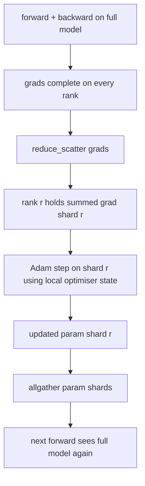

# زيرو 优化器状态分片

> آدم لخزن كل عنصر اثنين من التقديرات، وذلك في وضع التخزين السطحية32 ‬‬‬‬‬‬‬‬‬‬‬‬‬‬‬‬‬‬‬‬‬‬‬‬‬‬‬‬‬‬‬‬‬‬‬‬‬‬‬‬‬‬‬‬‬‬‬‬‬‬‬‬‬‬‬‬‬‬‬‬‬‬‬‬‬‬‬‬‬‬‬‬‬‬‬‬‬‬‬‬‬‬‬‬‬‬‬‬‬‬‬‬‬‬‬‬‬‬‬‬‬‬‬‬‬‬‬‬‬‬‬‬‬‬‬‬‬‬‬‬‬‬‬‬‬‬‬‬‬‬‬‬‬‬‬‬‬‬‬‬‬‬‬‬‬‬‬‬‬‬‬‬‬‬‬‬‬‬‬‬‬‬‬‬‬‬‬‬‬‬‬‬‬‬‬‬‬‬‬‬‬‬‬‬‬‬‬‬‬‬‬‬‬‬‬‬‬‬‬‬‬‬‬‬‬‬‬‬‬‬‬‬‬‬‬‬‬‬‬‬‬‬‬‬‬‬‬‬‬‬‬‬‬‬‬‬‬‬‬‬‬‬‬‬‬‬‬‬‬‬‬‬‬‬‬‬‬‬‬‬‬‬‬‬‬‬‬‬‬‬‬‬‬‬‬‬‬‬‬‬‬‬‬‬‬‬‬‬‬‬‬‬‬‬‬‬‬‬‬‬‬‬‬‬‬‬‬‬‬‬‬‬‬‬‬‬‬‬‬‬‬‬‬‬‬‬‬‬‬‬‬‬‬‬‬‬‬‬‬‬‬‬‬‬‬‬‬‬‬‬‬‬‬‬‬‬‬‬‬‬‬‬‬‬‬‬‬‬‬‬‬‬‬‬‬‬‬‬‬‬‬‬‬‬‬‬‬‬‬‬‬‬‬‬‬‬‬‬‬‬‬‬‬‬‬‬‬‬‬‬‬‬‬‬‬‬‬‬‬‬‬‬‬‬‬‬‬‬‬‬‬‬‬‬‬‬‬‬‬‬‬‬‬‬‬‬‬‬‬‬‬‬‬‬‬‬‬‬‬‬‬‬‬‬‬‬‬‬‬‬‬‬‬‬‬‬‬‬‬‬‬‬

**Type:** Build
**Languages:** Python
**Prerequisites:** 第 19 期 Track C 课程 42-49
**Time:** ~90 分钟

## 學习目标

- N 个级的碎片优化器状态(第一时刻、第二时刻、fp32 主副本), لذلك كل درجة تمتلك 1/N。
- استخدام تقليل_تشتت فقط نقل كل درجة من تراجات وقطعة، ثم كل جمع سوف تحديث العنصرات المنتشرة مرة أخرى.
- 根据普通 DDP 计算阶段 1、阶段 2、阶段 3 的内存节省表。
- في نموذج الحجم والتنمية الميزانية الدفاع عن المرحلة الأولى، المرحلة الثانية، والمرحلة الثالثة.

## 问题

نسخة فانيلا DDP كل شيء: العناصر 梯度 والحالة المعدل موجودة كاملة في كل درجة. بالنسبة إلى نموذج 7B 参数 في fp16 ، وهذا يعني كل درجة 14 GB 参数  14 GB 梯度 و 56 GB  الحالة المعدل.

في مرحلة ZeRO الأولى يتم إجراء تقسيمات على حالة المحفز. كل درجة تمتلك 1/N من آدم 时刻. في وقت لاحق، ZeRO لن تقلل من التدرج بأكمله وتدخل إلى مكانها، بل تقلل من التشتت، وبالتالي فإن كل درجة تتلقى فقط مجموعات التدرج من التدرج.

## 概念



### مرحلة زيرو

|阶段|分片对象 |每 rank 内存|每 step 通信|
|-------|----------------|------------------|---------------|
| DDP |无 |params + grads + optim | 1x allreduce |
| ZeRO-1 |optimizer state |params + grads + optim/N | 1x reduce_scatter + 1x allgather |
| ZeRO-2 |optim + grads |params + grads/N + optim/N | 1x reduce_scatter + 1x allgather |
| ZeRO-3 |optim + grads + params |params/N + grads/N + optim/N |每层 1x allgather + 每层 1x reduce_scatter |

المرحلة الأولى هي أقل تكلفة للنجاح، لأن حالة التحسين تسيطر على الميزانية. المرحلة الثانية تحتاج إلى تراجعة، ولكن المرحلة الثالثة (FSDP) هي نفس المرحلة.

### ذكر الرياضيات،实数

 بالنسبة لموديل استخدام آدم على تدريب الدقة المختلطة مع P 参数:

|术语 |vanilla|ZeRO-1 |为什么 |
|------|---------|--------|-----|
| fp16 参数 | 2P字节| 2P字节|需要转发|
| FP16 梯度 | 2P字节| 2P字节|需要落后|
| fp32 母版 | 4P字节| 4P/N 字节 |只有最优化的人才会使用它 |
| fp32 第一时刻 | 4P字节| 4P/N 字节 |只有最优化的人才会使用它 |
| fp32 第二时刻 | 4P字节| 4P/N 字节 |只有最优化的人才会使用它 |
|总计 | 16P字节| 4P + 12P/N 字节 |   |

N=8 时:فانيلا 16P,ZeRO-1 5.5P, انخفاض 65%。 N=64 时:فانيلا 16P,ZeRO-1 4.19P, انخفاض 74%。

### لماذا تقليل_تشتت  أفضل من كل تقليل-ثم-تشتت

كلخفض للكل درجة توفر التطلب والدرجة الكاملة. إذا كان هناك حاجة فقط إلى قطع، فإن خفض درجة النقاط.


```figure
cd-zero-shard
```

## بناءها

`code/main.py`实现:

- `flatten_params(module)`和 `unflatten_into(module, flat)`وضع العناصر في النموذج إلى حجم متواصل من الزجاج وفرز الضغط مرة أخرى.
- `ZeroOptimizer(model, world_size, rank, lr)`تمتلك نسخة رئيسية وقطع من الدرجة الثانية
- `step()`في التسعير المُسطح، يتمّ إعادة التوزيع على التسعير المُسطح، ويتمّ استخدام آدم لتنظيم المُفصلات، ويتمّ جمع جميع العناصر المُحَدَّثة.
- عرض، تدريب 3 مستويات MLP 20 خطوة، ومطبوعة كل خطوة من ميزانية الذاكرة وكذلك عادي DDP 基线──

运行它:

```bash
python3 code/main.py
```

输出: في كل خطوة خسرة وذاكرة تبين ZeRO-1 مقارنة النسخة الكاملة من DDP، في كل درجة الحفاظ على حالة المحفزات 1/N.

## 野外生产模式

ثلاثة أشكال يجعل الزيرو

**分片检查点很重要。**وضع المتحفّز ZeRO-1 حسب التقسيم الدرجي؛ يجب أن تسجل نقاط التفتيش ما تمتلكه.

**混合精度是重点。**زرو هو تقنية دقيقة مختلطة. fp32 主副本是分片的. في حالة عدم وجود دقيقة مختلطة، تعمل زرو على إعطاء fp32 master 带来内存税، دون تناظر مع fp16 前向胜利.

**第一阶段几乎是免费的。**通信在带宽方面与DDP相似――内存节省与N 成线性关系――唯一成本是优化器分片的簿记――生产堆默认为阶段1,除非梯度或参数内存也是问题――阶段2 在不增加带宽的情况下对梯度分片;只有阶段3对参数本身分片,它用阶层通信来换这个部分内存――

## استخدمها

النمط الناتج:

- **DeepSpeed ZeRO。**参考实现。 `deepspeed_config.json`选择阶段 1/2/3 和分区大小──
- **PyTorch FSDP。**البيتورش 原生等效项── `ShardingStrategy.SHARD_GRAD_OP`هو " زيرو-2 "`FULL_SHARD`هو زيرو-3
- **HuggingFace Accelerate。**سوف تكون DeepSpeed و FSDP مغلفة في تكوين موحد

## 发货

第 79 课程) 管道并行) هو محور الصفحة: الممرات ليست عبر نفس النموذج على حالة المحفزات لتنفيذ التفاصيل، ولكن عبر المستويات لتنفيذ التفاصيل.

## التدريب

1. 通过分片梯度扩展到ZeRO-2: كل رتبة تخزن فقط درجة من分片, من خلال في المقابل بعد ذلك سوف تكون غير جزء من جزء واضحة للقيام بذلك.
2. إضافة محلل الذاكرة، لطباعة في الصف 0  حالة استخدام الفيروسات الفعلية في fp32 字节 مع حالة التنبؤ الرسمي
3. قياس DDP العادي مع زرو-1 في كل خطوة من الوقت، ويزرّجها إلى الجهة الأمامية 、 الجهة الخلفية 、 الاتصال‬
4. في ZeRO-1 أسفل تحقيق تراجعة القطع: يجب أن تمر عبر محلية فانومبوس مربع من كلخفض 跨所有分片计算 L2 范数。
5. استخدام كلخفض بدلا من خفض_تشتت  تحقيق بكار ، قياس وقت الخط الاختلاف  باستخدام الرقمية لحماية خيار خفض_تشتت‬‬‬‬‬‬‬‬‬‬‬‬‬‬‬‬‬‬‬‬‬‬‬‬‬‬‬‬‬‬‬‬‬‬‬‬‬‬‬‬‬‬‬‬‬‬‬‬‬‬‬‬‬‬‬‬‬‬‬‬‬‬‬‬‬‬‬‬‬‬‬‬‬‬‬‬‬‬‬‬‬‬‬‬‬‬‬‬‬‬‬‬‬‬‬‬‬‬‬‬‬‬‬‬‬‬‬‬‬‬‬‬‬‬‬‬‬‬‬‬‬‬‬‬‬‬‬‬‬‬‬‬‬‬‬‬‬‬‬‬‬‬‬‬‬‬‬‬‬‬‬‬‬‬‬‬‬‬‬‬‬‬‬‬‬‬‬‬‬‬‬‬‬‬‬‬‬‬‬‬‬‬‬‬‬‬‬‬‬‬‬‬‬‬‬‬‬‬‬‬‬‬‬‬‬‬‬‬‬‬‬‬‬‬‬‬‬‬‬‬‬‬‬‬‬‬‬‬‬‬‬‬‬‬‬‬‬‬‬‬‬‬‬‬‬‬‬‬‬‬‬‬‬‬‬‬‬‬‬‬‬‬‬‬‬‬‬‬‬‬‬‬‬‬‬‬‬‬‬‬‬‬‬‬‬‬‬‬‬‬‬‬‬‬‬‬‬‬‬‬‬‬‬‬‬‬‬‬‬‬‬‬‬‬‬‬‬‬‬‬‬‬‬‬‬‬‬‬‬‬‬‬‬‬‬‬‬‬‬‬‬‬‬‬‬‬‬‬‬‬‬‬‬‬‬‬‬‬‬‬‬‬‬‬‬‬‬‬‬‬‬‬‬‬‬‬‬‬‬‬‬‬‬‬‬‬‬‬‬‬‬‬‬‬‬‬‬‬‬‬‬‬‬‬‬‬‬‬‬‬‬‬‬‬‬‬‬‬‬‬‬‬‬‬‬‬‬‬‬‬‬‬‬‬‬‬‬‬‬‬‬‬‬‬‬‬‬‬‬‬‬‬‬‬‬‬‬‬‬‬‬‬‬

## 关键术语

|术语 |人们怎么说|它实际上意味着什么 |
|------|----------------|------------------------|
|ZeRO-1 | “优化器分片”|每个等级拥有 1/N 的 fp32 master + Adam 时刻 |
| ZeRO-2 | “grads 也分片”|每个 rank 在 reduce_scatter 后也会丢弃非本分片的梯度 |
|ZeRO-3 | “分片参数” |每个等级保存 1/N 的 fp16 参数；向前每层allgather |
|master copy| “fp32 权重”|高精度参数复制优化器更新|
|reduce_scatter | “平分总和”|仅提供每个等级其分片的梯度总和 |

##  المزيد阅读

- [Rajbhandari 等人，ZeRO：训练万亿参数模型的内存优化](https://arxiv.org/abs/1910.02054)
- [DeepSpeed ZeRO 文档](https://www.deepspeed.ai/tutorials/zero/)
- [PyTorch FSDP 文档](https://pytorch.org/docs/stable/fsdp.html)
- 第19 阶段 第76 课 - 本课所涉及的减少_scatter和全集
- 第19 阶段 第80 课 - حالة زيرو يجب استخدامها
