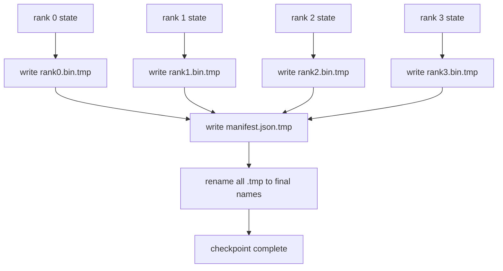

# 分片检查点和原子恢复

> كل ساعات بعد الاجتماع تعليق بسبب تعطيل العنصر 70B العاملات التدريبية العمل. تصميم نقطة التفتيش يقرر أنك خسارة 30 دقيقة أو 30 ساعة. نقطة التفتيش المشتركة كتابة كل جزء من كل درجة، وتسجيل الملكية في القائمة. استئناف من الملف الخاص بها تحميل كل جزء من كل درجة، في نفس العالم، والتحسينات مثل لا شيء يحدث.

**Type:** Build
**Languages:** Python
**Prerequisites:** 第 19 期 Track C 课程 42-49
**Time:** ~90 分钟

## 學习目标

- ستتم إعادة حفظ نقاط التفتيش متعددة المستويات للفورات المفصلة لكل مستوى، فضلاً عن السجلات التي تمتلكها المستوى.
- استخدام النظام النووي للدخول ([[المنصوصات النووية النووية النووية النووية النووية النووية النووية النووية النووية النووية النووية النووية النووية النووية النووية النووية النووية النووية النووية النووية النووية النووية النووية النووية النووية النووية النووية النووية النووية النووية النووية النووية النووية النووية النووية النووية النووية النووية النووية النووية النووية النووية النووية النووية النووية النووية النووية النووية النووية النووية النووية النووية النووية النووية النووية النووية النووية النووية النووية النووية النووية النووية النووية النووية النووية النووية النووية النووية النووية النووية النووية النووية النووية النووية النووية النووية النووية النووية النووية النووية النووية النووية النووية النووية النووية النووية النووية النووية النووية النووية النووية النووية النووية النووية النووية النووية النووية النووية النووية النووية النووية النووية النووية النووية النووية النووية النووية النووية النووية النووية النووية النووية النووية النووية النووية النووية النووية النووية النووية النووية النووية النووية النووي النووي النووي النووي النووي النووي النووي النووي النووي النووي النووي النووي النووي النووي النووي النووي النووي النووي النووي النووي النووي النووي النووي النووي النووي النووي النووي النووي النووي النووي النووي النووي النووي النووي النووي النووي النووي النووي النووي النووي النووي النووي النوو
- من الصفحة الاحتياطية، التحقق من كل درجة على fp16 参数 و ZeRO 优化器状态的字节相等状态──
- 保护清单架构免受三种故障模式的影响:

## 问题

نقطة التفتيش العادية ستقرأ جميع العناصر وحالة المحفز إلى المستوى 0 ، وتجمع وتكتب في ملفات فردية. بالنسبة للنموذج 70B ، من خلال منفذ شبكة من الدرجة الأولى يقدم 1.1 TB  حالة. ستمنع التفتيش جميع المستويات الأخرى ، لأن هذه هي فارغة  تنتظر التجمع.

تم تحويل نقطة فحص المقطع إلى نمط: كل درجة تكتب قطعها الخاصة وتكتبها في ملفاتها. تم تسجيل كل درجة تحتوي على أي قطع، وبالتالي يمكن الاسترداد إعادة كل قطعة إلى مصدرها. تمتلك نقطة فحص 1 طبل لتنفيذ درجة واحدة، وتحتاج إلى 4 ساعات لتنفيذ 64 درجة.

## 概念



### 清单架构

```json
{
  "world_size": 4,
  "step": 1234,
  "wall_clock_seconds": 4521,
  "shards": [
    {"rank": 0, "path": "rank0.bin", "sha256": "...", "param_shard_offset": 0, "param_shard_numel": 65536},
    {"rank": 1, "path": "rank1.bin", "sha256": "...", "param_shard_offset": 65536, "param_shard_numel": 65536}
  ],
  "schema_version": 1
}
```

ثلاثى الملاعب كلها تحمل ثقيلة`world_size`أن مختلفة الكبيرة من السجلات فشل، بدلا من التلف بشكل صامت.`sha256`إكتساب جزء أو تلف في كل قطعة`param_shard_offset`和 `param_shard_numel`让载机在正确位置重建平面参数张量──

### 原子写入

标准模式:将每个分片写入 `<name>.tmp`,将清单写入 `manifest.json.tmp`،fsync كل قطعة ، ثم إعادة تسمية. POSIX في نفس النظام الملفي إعادة تسمية هي الذرة. إما الملف الجديد موجودة بالكامل ، أو الملف القديم موجودة بالكامل. الإنهيار قبل إعادة تسمية النهائية سوف يجعل من النقطة المفتاحية السابقة نقطة التفتيشية النشطة. إذا لم يتم كتابة الذرات ، فإن الإنهيار قد يبقى جزء آخر مع إشارة إلى صفحة الحالية ، ويحطم في حالة التحسين عند الاسترداد.

### 模式 must defend 三种故障模式

|失败|症状|防御|
|---------|---------|---------|
|世界规模的变化|在 N=8 上恢复，并从 N=4 开始清单 |清单中的 world_size 不匹配，大声失败 |
|分片数量不匹配 |resume 看到的 rank*.bin 文件少于 manifest 中的分片 |枚举分片，验证每个分片都存在 |
|部分写入|分片文件在刷新过程中被截断|加载时进行 sha256 验证 |

كل دفاع سوف يرفض كل مرة ممكنة الحمل السيئ ؛ والخيار الآخر هو التلف الصامت ، عندما يتغير التلف إلى NaN 100، ستظهر هذه التلفة بعد 100 خطوة.

### لماذا كلّ ملف من الدرجة، وليس ملف كبير

 من خلال `O_APPEND`في الواقع، فإن حجم التحركات داخل قطعة واحدة يتجاوز منطقة من MB الكبيرة، ويغلق على المجال المهيمن. عندما يتم تشغيل نظام الملفات الأساسي على متن متن واحد، لا يوجد أي نزاع في كل درجة من الملفات، ويمكن الاستفادة منها.


```figure
ci-sharded-checkpoint
```

## بناءها

`code/main.py`实现:

- `ShardManifest`وبالإضافة إلى ذلك،`to_json`-أجل`from_json`.
- `save_sharded(state_dict_per_rank, dir, step)`باستخدام النظام التنظيمي المُستمر، ستكتب كل درجة من الحالات الثانوية في ملفها الخاص، ثم تكتب في صفحة.
- `load_sharded(dir, expected_world_size)`读取清单,验证每个分片的 sha256,并返回每个级别的状态字典──
- 往返测试:构建每列状态、保存、加载、断言字节相等──

运行它:

```bash
python3 code/main.py
```

输出:4 个分片文件以及写入清单,然后通过字节相等验证重新加载──

## 野外生产模式

ثلاثة أنماط تجعل نقطة التفتيش قوية بما فيه الكفاية لتنفيذ النقل.

**异步写入。**إنتاج كومة في خط أو عملية منفصلة إرسال نقطة فحص لتسجيل التدريبات، حتى يستمر.`async_io`标志正是这样做──本课程保持写入同步,因此步骤可见──

**先本地快速磁盘，然后异步上传。**写入本地 NVMe(快速), ثم异步上传到S3 أو GCS── دو层模式使集群内检查点能够快速恢复,同时将持久副本发送到集群外进行存档──清单携带本地路径;上传清单携带远程路径──

**轮换很重要。**إنتاج عمل يحتفظ بالخير K 个检查点( عادةً 3-5 个) ويتم تحويل أول نقطة فحص. إذا لم تدور، فإن القرص الصلبي سوف يملأ في عملية التشغيل، ويتم فشل نقطة فحص التالية.

## استخدمها

النمط الناتج:

- **DeepSpeed 检查点。** `deepspeed.save_checkpoint(tag=step)`كتابة كل درجة من المستندات والإشارات إلى علامات الحدث`latest`الملفات
- **PyTorch FSDP 检查点。** `torch.distributed.checkpoint`استخدام قرار كل درجة من المخططات `Planner`保存分片状态──
- **NeMo.**استخدام إضافة بيانات`save_to_checkpoint`إيه بي إيه إيه إيه بي إيه إيه بي إيه بي إيه بي إيه بي إيه بي إيه بي إيه بي إيه بي إيه بي إيه بي إيه بي إيه بي إيه بي إيه بي إيه بي إيه بي إيه بي إيه بي إيه بي إيه بي إيه بي إيه بي إيه بي إيه بي إيه بي إيه بي إيه بي إيه بي إيه بي إيه بي إيه بي إيه بي إيه بي إيه بي إيه بي إيه بي إيه بي إيه بي إيه بي إيه بي إيه بي إيه بي إيه بي إيه بي إيه بي إيه بي إيه بي إيه بي إيه بي إيه بي إيه بي إيه بي إيه بي إيه بي إيه بي إيه بي إيه بي إيه بي بي إيه بي إيه بي إيه بي إيه بي إيه بي إيه بي إيه بي إيه بي إيه بي إيه بي إيه بي إيه بي إيه بي إيه بي إب

## 发货

第 81 课保存端到端 DDP+ZeRO 运行分片检查点, ووضعها مرة أخرى على نفس العالم小, لتثبت إعادة تشكيل تشيكو تأسيسها.

## التدريب

1. 添加异步写入: فى线程启动保存并让训练继续──阻止下一次保存,直到下一次保存完成──
2. إضافة`last_5_steps`轮换: احتفظ بـ 5 نقاط فحص قريباً، و إزالة أقدم نقاط فحص، ثم حفظ نقاط فحص جديدة
3. لتحويل الدورة لإعادة تحميل إضافة فقط لCRC طريق التحقق السريع.
4. إضافة عبر العالم الصغير: من خلال قراءة الصفحة والتواصل وإعادة تقسيم المكونات، سيتم إعادة توازن المكونات من N=4 إلى N=8
5. سوف يضيف إلى S3 ((2nd目录)) و يكتب على سعر清单── دفاع استراتيجيات تخزين الطبقات

## 关键术语

|术语 |人们怎么说|它实际上意味着什么 |
|------|----------------|------------------------|
|分片检查点 | “按等级保存”|每个rank并行写入自己的分片文件|
|清单 | “索引”|记录分片路径、偏移量和 sha256 的 JSON 文件 |
|原子写| “tmp 然后重命名” |写入 .tmp，然后 POSIX 重命名，以便崩溃使先前的文件保持活动状态 |
|部分写入| “截断的碎片” |写入过程中的崩溃会产生损坏的分片； sha256 抓住它 |
|旋转| “保留最后 K”|在写入新检查点以限制磁盘使用量之前删除最旧的检查点 |

##  المزيد阅读

- [DeepSpeed 检查点](https://www.deepspeed.ai/tutorials/checkpointing/)
- [PyTorch torch.distributed.checkpoint](https://pytorch.org/docs/stable/distributed.checkpoint.html)
- [POSIX重命名原子性](https://pubs.opengroup.org/onlinepubs/9699919799/functions/rename.html)
- 第19 阶段 第78 课 - 此检查点旨在保存的ZRO 状态
- 第19 阶段 第81 课 - 端到端演示往返保存的状态
