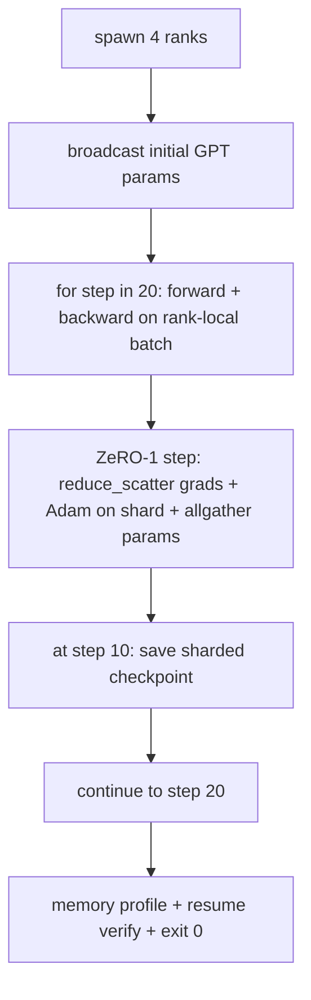

# التدريبات الموزعة

> 第 76 课到第 80 课各拼 一件作品──这是组件: GPT النموذج الصغير الذي يتم تدريبه على 4 صفات المثالية، باستخدام DDP  للتنسيق التسلسلي، ZeRO-1 باستخدام تطبيق الحالة المتحفز، فضلا عن نقطة فحص المقطع في وسط الجهاز.

**Type:** Build
**Languages:** Python
**Prerequisites:** 第 19 期 Track C 课程 42-49
**Time:** ~90 分钟

## 學习目标

- سوف يضع DDP ((第 77 课) + ZeRO-1 ((第 78 课) +分片检查点 ((第 80 课)
- في قاعدة لغات صغيرة مصنوعة تدريب على 2 مستويات محول 语言模型، عبر 4 模拟等级 إجراء 20 步骤.
- طبع كل خطوة ضائعة، كل صف من الملفات المخصصة لخلف الذاكرة، و قائمة نقاط التفتيش مثل الصفوف التي تم استعادتها في نفس العالم.
- دفاع النصوص: كل عمل يمكن اختبارها بشكل مستقل في الدروس السابقة ، وهذا الدراسة تثبت أنها من المكونات.

## 问题

كابستون هو دليل على تجميع كل جزء معا. 第76课 implement collector. 第77 课将它们纳入 DDP. 第78 课使用减少_散布 分片优化器状态. 第79 课分析管道. 第80 课保存分片检查点.

هذه الدورة تعمل من نهايتها إلى نهايتها وتثبت أربعة عدم التغيرات: (أ) خسرة في 20 خطوة من خلال خفض الضجيج المتفجرة، (ب) الحفاظ على نفس العيارات في كل خطوة، (ج) كل خطوة من خلال خيارات التحسينات المحفوظة في الجهاز تساوي صيغة ZeRO-1 12P/N 字节، و (د) نقطة فحص في الخطوة 10 في إعادة تشغيل خطوة التحميل، و إلخ.

## 概念



### 迷你 GPT

هذا النموذج قصداً صغير جداً: 2 个Transformer block、嵌入dim 32、4 个注意力头、词汇 64、序列长度 16、批次 4。几千个参数──足够大执行每个连线决策(多头注意力运行标准屏蔽路径;LayerNorm 有需要同步权重;LM 头是返回词汇的单独线性投影)──足够小,4 个CPU 级别的20 个步骤可以完成在几秒内──

### 组成规则

|课程片段 |它拥有什么 |它留给循环什么？
|--------------|--------------|----------------------------|
| DDP广播 |初始参数同步 |构建时一次调用 |
| ZeRO-1 步骤 |梯度同步、母版更新、参数广播 |每一步调用一次，替换 optimiser.step |
|分片检查点 |保持每等级状态，用 sha256 体现 |通过 allgather 收集状态，调用等级 0 |
|训练循环 |向前、向后、丢失记录 |按顺序调用以上三个 |

لا يعرف الدورة عن تقليل التنشر أو تقديم الملفات.

### لماذا هو GPT الصغيرة وليس فقط MLP

في الدورة 77 ، إضاف MLP 足以验证梯度同步── GPT صغير إلى ثلاثة أشياء: رأس LM منفصل على الكلمة، في الدورة ، من أجل البدء بوضوح ، سوف يفتح ؛ GPT كاملة عادة ما تكون الرأس مع التركيزات المضمنة (تعال) ‧softmax +交叉 كخسارة (((أكثر من حالة حافة قيمة رقمية من MSE ‬) ، فضلا عن التوجه الأمامي غير المتناظرة (((التركيز ثم الاهتمام ، ثم كل طبقة MLP) ‬استمر في استخدام MLP ‬ كCapstone ‬ كالتخفيض ما إذا كان سيتم معالجة الطبقةNorm أو التخفيض الصيغة التدريرية للطبقة.‬

### منذ نهاية يعني الخروج 0

循环运行 ثابت 20 步并退出──没有`while True`لا يوجد أي تدخل من أجل أي شخص، لا تعود من حالة خارجية. يمكنك أن تعمل في حالة عدم وجود قدرة على الإنسان، وبعد الانتهاء من ذلك يمكنك أن تجد كابستون في التاريخ الكامل.


```figure
ci-distributed-assembly
```

## بناءها

`code/main.py`实现:

- `MiniGPT`: مع حجب الذاتية والإنتحار LM 头的2层Transformer──
- `make_corpus(seed, total_tokens)`: تحديدات:
- `_train_worker`: حسب درجة إنتاج؛广播初始化参数,运行循环,调用 ZeRO 步骤,在步骤 10 写入分片检查点──
- `verify_resume`: بعد النشاط الرئيسي، والمرحلة التالية في عملية إعادة التحميل، ومثبتة الحفاظ على الجزء الرئيسي مع التوازن في النشاطات النموذجية.
- `main`: ترتيب عرض كامل، طباعة خسرة جدول، وملفات إعدادات الذاكرة والتحقق من نتائجها

运行它:

```bash
python3 code/main.py
```

输出:20 行丢失表、4 行 في كل صف من الملفات التنظيمية في الـ内存、检查点清单以及成功时的RESUME VERIFIED行──

## 野外生产模式

ثلاثة أنماط تمت بناء عمليات حقيقية

**每 K 分钟检查一次，而不是每 K 步骤一次。**步骤时间 随着 长度和微批次计数而变化──无论模型大小如何,10 分钟的检查点节奏都捕获相同的计算──为了简单的起见,本课程使用步骤基础的方式;生产采用挂钟为主──

**及早检测分歧。**إنتاج تشغيل في الظهر إضافة NaN 防护和丢失尖峰检测器؛ إذا كانت الخسارة في الخطوة تزيد عن 2 مرات، فانعكس إلى نقطة التفتيش السابقة، بدلاً من جعل المحفزات تدخل حالة التدهور.

**跨等级聚合内存配置文件。**كل درجة موجودة في عمليات العملية من خلال درجة مختلفة عن درجة ((مع درجة أكبر مرحلة الأنابيب لديها المزيد من النشاط) 

## استخدمها

النمط الناتج:

- **DeepSpeed.**في تكوين واحد، تم دمج DDP + ZeRO + 管道 + 激活检查点──هي تكوين هذا البرنامج هو مخفف شكل DeepSpeed──
- **PyTorch FSDP。**本机等效项.`FullyShardedDataParallel`和 `ShardingStrategy.SHARD_GRAD_OP`هو زيرو-2
- **NeMo 和 Megatron-LM。**لأكبر نموذج إضافة 张量并行؛ وإلا، تشكل المكونات نفسها.

## 发货

完整曲目到此结束── هذه الستة دورات تشكل معًا فريقًا حقيقيًا سيتم بناؤه قبل اعتماد DeepSpeed  قبل أن يتم استخدام DeepSpeed  ؛ تم إثبات هذا الاستمار على مستوى العالم ، وتم استخدام نمط الاختراق في المرحلة الـ 17 ]]

## التدريب

1. إضافة الاهتمام الرأس حجم المجموعة المجموعة المجموعة المجموعة المجموعة المجموعة المجموعة المجموعة المجموعة المجموعة المجموعة المجموعة المجموعة المجموعة المجموعة المجموعة المجموعة المجموعة المجموعة المجموعة المجموعة المجموعة المجموعة المجموعة المجموعة المجموعة المجموعة المجموعة المجموعة المجموعة المجموعة المجموعة المجموعة المجموعة المجموعة المجموعة المجموعة المجموعة المجموعة المجموعة المجموعة المجموعة المجموعة المجموعة المجموعة المجموعة المجموعة المجموعة المجموعة المجموعة المجموعة المجموعة المجموعة المجموعة المجموعة المجموعة المجموعة المجموعة المجموعة المجموعة المجموعة المجموعة المجموعة المجموعة المجموعة المجموعة المجموعة المجموعة المجموعة المجموعة المجموعة المجموعة المجموعة المجموعة المجموعة المجموعة المجموعة المجموعة المجموعة المجموعة المجموعة المجموعة المجموعة المجموعة المجموعة المجموعة المجموعة المجموعة المجموعة المجموعة المجموعة المجموعة المجموعة المجموعة المجموعة المجموعة المجموعة المجموعة المجموعة المجموعة المجموعة المجموعة المجموعة المجموعة المجموعة المجموعة المجموعة المجموعة المجموعة المجموعة من المجموعة المجموعة المجموعة المجموعة من المجموعة من المجموعة من المجموعة من المجموعة المجموعة من المجموعة من المجموعة من المجموعة من المجموعة من المجموعة من المجموعة من المجموعة من المجموعة من المجموعة من المجموعة من المجموعة من المجموعة من المجموعة من
2. إضافة 4 مجموعات صغيرة من التعدد، وتثبت التعدد يساوي التعدد من مجموعة كبيرة.
3. إضافة إلى طريق من الخطوة 10  البدء في التعافي، هذا الطريق في الواقع استمر في التدريب حتى الخطوة 20 ، وتتسبب في نفس الخسارة النهائية من العمل الأصلي.
4. سيتم إضافة المعلمات إلى JSONL، حتى يتمكن من رؤية العملية لاحقاً.
5. إضافة NaN  دفاع، في وقت الضياع القمة مرة أخرى إلى نقطة فحص السابقة، و استخدام خطوة واحدة LR  ضرب عدد القمة القوية لتنفيذ القمة مرة أخرى.

## 关键术语

|术语 |人们怎么说|它实际上意味着什么 |
|------|----------------|------------------------|
|端到端| “将一切连接起来”|一次运行构成了每个部分，而不是每个部分的单元测试 |
|内存简介 | “每级 GB”|每个等级上保存的参数、梯度、优化器状态的字节数 |
|简历合同 | “保存并加载”|检查点往返后每列状态字节相等 |
|自动终止 | “有界奔跑”|固定步数，完成后退出 0，循环中没有人 |

##  المزيد阅读

- DeepSpeed端到端 تدريب تدريبhttps://www.deepspeed.ai/getting-started/)
- PyTorch FSDP进阶教程](https://pytorch.org/tutorials/intermediate/FSDP_advanced_tutorial.html)
- Megatron-LM تدريب脚本参考](https://github.com/NVIDIA/Megatron-LM)
- 第19 阶段 第76-80 课 - 本课组成的每首曲子
- 第17 阶段 - سيتم نقل المجموعة إلى مجموعة حقيقية
