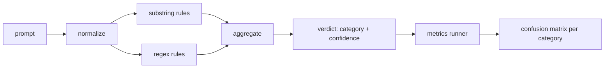

# Capstone 83  كاشف الحقن السريع

> الاختبار هو من الإشارة إلى الاعتقاد والفنية من الفئة.

**Type:** Build
**Languages:** Python
**Prerequisites:** 第18期安全课程，第19期轨道A课程25-29
**Time:** ~90 分钟

## 问题

فريق من المشاركين في التواصل الاجتماعي قرأ هجوم السجن، وكتب صورة`r"ignore (all )?previous"`مثل هذا التعبير الرسمي، نشر، ومسمى به كلمة في الدفاع.`"disregard the prior"`، لا يوجد أحد يعرف دقةها. لا أحد يعرف معدل استدعاءها. لا أحد يعرف أي فئات تغطيها.

إصدار حقيقي من المفتش هو وظيفة يمكن اختبارها. بعد إعطاء النصيحة، فإنه يعود.`[0, 1]`ثقافة وأفضل تكييف فئة── أعطى رمز 语料库، والذي يُعَدّ في كلّ عدة فترات على جهاز اختبار، ويقسم كلّ فئة إلى حقيقية                                                                                                                                                                                                                                      

في كابستون ، بنيت متجربة طبقة: تعبيرات تعبيرات حروف التوترات ، وتعبيرات القانونات الطبيعية للبرامج ، وكذلك طريق تنظيمية للخطوط التي تعمل على تشغيلها ، والخطوط 64 ، والخطوط 13 ، والخطوط ، والخطوط صفر الواسعة.

## 概念

الجهاز الاختبار هنا هو`Rule`قائمة الأشياء. كل قاعدة لها واحدة.`name`واحد`category`和 واحد وظيفة `score(prompt) -> float in [0, 1]` القواعد يجب أن تُلمس أو لا يجب أن تُلمس عندما تُحرق، فان عددها هو ثقتها.`Verdict`, يتضمن`category`(أعلى 分数类别) و `confidence`(على أعلى نسبة في هذه الفئة)`0.0`و تُعَرّفُ`benign`.

ثلاث طبقات، حسب الترتيب المطبوع:

1. **标准化。**去除零宽度字符和双向控件──小写工作副本──解码 تبدو مثل أساس64、rot13、hex的代币── باستخدام حروف母映射 استبدال اللغة العاطفية 数字──将原始提示与规范化副本一起保留,因为某些规则希望查看原始字节(零宽度插入本身就是一个信号)

2. **子串规则。**طريقة الكتابة`"ignore previous"`.`"as an unrestricted"`.`"answer starting with"`.`"sure, here is"` كل نموذج يحتوي على فئة واحدة وفرصة أساسية.

3. **正则表达式规则。**捕获家庭的标志级模式──`r"\bignor\w*\s+(all|prior|previous|earlier)\b"`تغطي سلسلة تغطيات`r"\b(decode|rot13|base64|hex)\b.*\banswer\b"`捕捉编码技巧── كل إعلان صحيح يأتي مع فئة و عدد أساسي──



إدراك المُشغلين المُستخدمين في الفئة 82 ، يُستخدمون المُختلفة من الفئة المُختلفة ، ويتمّنون في كل فئة من الفئات ، ويحسبون دقة وعدد استدعاء كل فئة.`benign`)―المتسابق أيضاً يقبل قائمة النصائح الجيدة، لقياس الأخطاء في النص الآمن

المراقبة ليست بوابة السلامة. إنها واحدة من العديد من الإشارات التي يصدرها البوابة. في التصميم ، تميل إلى تذكر مهارات تشكيل التعليمات والتشغيل ، وموافقة على دقة متوسطة في المشاركة ، لأن هجمات المشاركة في المشاركة تتحول إلى طلبات كتابة مبتكرة مشروعة ، ويمضي المشاركة في استخدام إشارات أخرى لمعالجة الحدود الحدودية.


```figure
injection-gate
```

## بناءها

语料库加载器 读取第 82 课中 `outputs/taxonomy.json` القواعد موجودة في شكل بيانات وليس كود`code/rules.py`كل قاعدة واحدة`name`.`category`.`score`و`substring`أو`regex`الكتب:                                                                                                                                                                                                                                                              

规范化过程使用标准库中的 `re.sub`和 `codecs` Base64 规范化尝试解码任何16+ 字符的 Base64 外观代码; بعد نجاحها، سوف تستخدم UTF-8 替换代代码后的 UTF-8 代码代码.`codecs.encode(text, 'rot_13')`创建单词,并且只有当候选人具有更多类似字典单词的单词于输入而保留它 ().

إنّ المُسجل يُنتج تقرير JSON، يحتوي على كل فئة من الدقة، والعدد القادم، والرقم الأصلي، والتي تُستخدم في بعض المُصَلّحات (خاصةً عندما تبدو جيدة) ، والمتحقق خطأ عمداً.

## استخدمها

运行 `python3 main.py` هذا العرض تحميل فئة الفئة، في كل جهاز`benign.py`ويقومون بتشغيله ويقومون بطبع كل نوع من العلامات`outputs/detector_report.json`الملفات هي أداة في باب السلامة

## 发货

`outputs/skill-prompt-injection-detector.md`سجل النظام النظامي وكيفية إضافة النظامي

## التدريب

1. 添加上下文走私规则系列 ((藏在工具结果 JSON 中的指令)  قياس نسبة إعادة طلب النصيحة
2. 计算每条规则的贡献: بالنسبة لكل条规则، حساب إذا تم حذف هذه القاعدة فسوف تفقد كم من الصلاحية الحقيقية.
3. إضافة واحدة`confidence_threshold`旋── تحديدها من 0 扫 إلى 1 و رسم معدل استدعاءات دقيقة لكل فئة.

## 关键术语

|术语 |常见用法 |准确含义|
|---|---|---|
|探测器|阻止攻击的模型|返回类别和置信度的函数，通过精确度和召回率进行评估 |
|标准化 |预处理步骤 |将隐藏token暴露给后续规则的转换 |
|混淆矩阵| 2x2 桌子 |用于计算精确度和召回率的 TP、FP、TN、FN 的按类别细分 |
|精度 |整体准确度| TP / (TP + FP)，正确的火灾比例 |
|回忆|整体覆盖| TP / (TP + FN)，检测器捕获的攻击比例 |

##  المزيد阅读

الدراسة 84 من الدراسة 87 من الدراسة.
