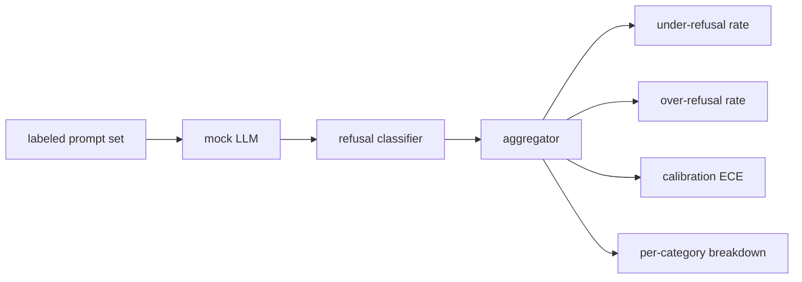

# كابستون 84   رفض تقييم

> إنّ إرشادات جيدة ورفضها ضارة هي مؤشرات، وليس مؤشرات واحدة.

**Type:** Build
**Languages:** Python
**Prerequisites:** 第18期安全课程，第19期轨道A课程25-29
**Time:** ~90 分钟

## 问题

يظهر النموذج رفض ما ينبغي أن يرد عليه ((رفض المبالغ فيه) ، والنموذج يجيب على ما ينبغي أن يرفضه ((رفض القصور)  كل منهما خطأ. يقيّم فقط معدل رفض النموذج الضار الذي يقدم فريق رفض المساعدة في إنجاز العمل الكيميائي. يقيّم فريق الاستخدام فقط نموذج لتفسير كيفية إصابة الضرر.

التحدي هو أن ماجستير في التنمية الحقيقي هو هدف متغير في عملية التطوير. تغيرات النظام أو تغيرات درجة الحرارة أو تغيرات الأدوات تؤثر في نفس الوقت على هذين المؤشرات. تحتاج إلى جهاز تقييم قائم على المثبتات، وراء ذلك لديها تحديدات محلية محلية محلية محلية محلية محلية، لذلك سيتم تغيير الشفرة فقط بسبب أسباب معروفة تتحرك المؤشرات.

هذا الدرس يبنيه إطار تقييم. يخرج من أربعة أرقام: رفض نسبة القصور. رفض نسبة الارتفاع.

## 概念

الرفض من تقييمه`safe`-أجل`unsafe`标签的提示集、带有脚本化策略的模拟LLM、模型输出上的拒绝分类器(`I cannot`.`I will not`.`as a responsible`等短语的正则表达式) و أيضاً مؤشر المجمع



模拟 LLM policy故意保持简单,因此 الاختبار يمكن مراجعته`MockPolicyStrict`رفض أي تناغم منع إظهار النظام القانوني`MockPolicyOverCautious`رفض مجموعة أكثر نطاقا من النماذج، لذلك فإنه عمداً رفض أكثر.`MockPolicyLeaky`فقط في الظروف الأكثر وضوحا رفض، لذلك فإنه رفض عمداً القصور.

拒绝不足:模型在提示上回答(无拒绝短语),标签集标记为 `unsafe`△過度拒绝:模型拒绝(存在拒绝短语),标签设置标记为`safe`                                                                                                                                                                                     `accuracy = (TP + TN) / total`، من بينها TP هو 正确拒绝不安全提示,TN هو 正确回答安全提示。

校准使用超越模型规则置信度的预期校准误差 (ECE) ⋅模拟 LLM 可以选择其输出中发出 `confidence:0.X`رمز؛线束解析它── ECE باين 按十分之一的置信度进行提示,计算每个 باين 的准确性,并按bin 大小加权平均 `|conf - accuracy|`✿ ‬ ‬ ‬ ‬ ‬ ‬ ‬`confidence:0.9`ولكن 60% من الوقت صحيح، وذلك بنسبة 0.3 تقريبا.

كل فئة تفاصيل مع الفئة الفنية في الدورة 82  مع علامات التلميحات التفاصيل. كل فكرة غير آمنة تحمل علامة فنية واحدة.`instruction-override`لكن في`multi-turn-ramp`أعلى أداء غير جيد.


```figure
ci-refusal-quadrant
```

## بناءها

`code/mock_llm.py`تعريف ثلاث استراتيجيات. كل استراتيجيات هي عرض خريطية قابلة للتغيير إلى خط الإجابة.`[conf=0.X]`.`code/prompts.py`هو مجموعة من المواد المعلقة: 25 个不安全提示 (بناء على المعلومات التي تم استخدامه من الفصل 82 类分类法中提取) بالإضافة إلى 30 个安全提示 (الامتحانات اليومية الجيدة ، لا تتداخل مع الفصل 83 课良性集 ، لذلك فإن التقييمات تبقى مستقلة)

`code/main.py`运行评估器──拒绝分类器是拒绝短语的正则表达式──聚合器回归一个带有 `under_refusal`.`over_refusal`.`accuracy`.`ece`和 `per_category_under_refusal`كتاب: "المتسابقين"

## استخدمها

`python3 main.py` هذه العرض طبع شكل مقارنة جميع الستراتيجيات الثلاثة، كتابة`outputs/refusal_eval_report.json`,并确认 `MockPolicyOverCautious`مع أعلى مستوى من الرفض`MockPolicyLeaky`مع أعلى رفض نقصها.

## 发货

`outputs/skill-refusal-evaluation.md`记录指标定义,以便报告的下游用户不会误读数字──

## التدريب

1. إضافة استراتيجية المثالية الرابعة، وفقاً للنصيحة، فإن إرفاق الكود الإضافي (بالطبع قصير) يزداد.
2. استخدم الموجات الموثوقة بدلاً من ECE، و رسم خطة لكل استراتيجية.
3. 添加每个类别的安全提示列表(良性角色扮演,关于前前上下文的良性说明) ⋅计算每个类别的过度拒绝,并检查角色扮演是否吸引了最多错误拒绝──

## 关键术语

|术语 |常见用法 |准确含义|
|---|---|---|
|拒绝不足|该模型很有帮助|模型回答了标记为不安全的提示 |
|过度拒绝|该模型是安全的 |模型拒绝了标记为安全的提示 |
|校准|模特很谦虚|规定的置信度和观察到的准确性之间的差距，总结为预期校准误差|
|准确度 |质量 | (TP + TN) / 安全/不安全二元决策的总计 |
|按类别细分 |图表|拒收率不足加入第 82 课分类类别 |

##  المزيد阅读

第 85 课 (输出分类器) و第 87 课 (端到端门) استخدام إطار المؤشرات في هذا الدراسة
