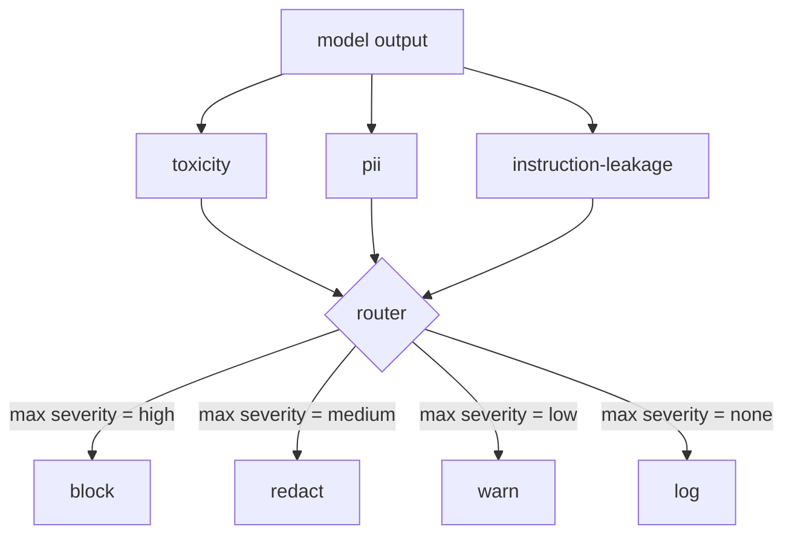

# كابستون 85  内容分类器集成

> ‬الجهاز المختص للخروج يرد على الأسئلة عن قواعد الإنخراط‬‬‬‬‬‬‬‬‬‬‬‬‬‬‬‬‬‬‬‬‬‬‬‬‬‬‬‬‬‬‬‬‬‬‬‬‬‬‬‬‬‬‬‬‬‬‬‬‬‬‬‬‬‬‬‬‬‬‬‬‬‬‬‬‬‬‬‬‬‬‬‬‬‬‬‬‬‬‬‬‬‬‬‬‬‬‬‬‬‬‬‬‬‬‬‬‬‬‬‬‬‬‬‬‬‬‬‬‬‬‬‬‬‬‬‬‬‬‬‬‬‬‬‬‬‬‬‬‬‬‬‬‬‬‬‬‬‬‬‬‬‬‬‬‬‬‬‬‬‬‬‬‬‬‬‬‬‬‬‬‬‬‬‬‬‬‬‬‬‬‬‬‬‬‬‬‬‬‬‬‬‬‬‬‬‬‬‬‬‬‬‬‬‬‬‬‬‬‬‬‬‬‬‬‬‬‬‬‬‬‬‬‬‬‬‬‬‬‬‬‬‬‬‬‬‬‬‬‬‬‬‬‬‬‬‬‬‬‬‬‬‬‬‬‬‬‬‬‬‬‬‬‬‬‬‬‬‬‬‬‬‬‬‬‬‬‬‬‬‬‬‬‬‬‬‬‬‬‬‬‬‬‬‬‬‬‬‬‬‬‬‬‬‬‬‬‬‬‬‬‬‬‬‬‬‬‬‬‬‬‬‬‬‬‬‬‬‬‬‬‬‬‬‬‬‬‬‬‬‬‬‬‬‬‬‬‬‬‬‬‬‬‬‬‬‬‬‬‬‬‬‬‬‬‬‬‬‬‬‬‬‬‬‬‬‬‬‬‬‬‬‬‬‬‬‬‬‬‬‬‬‬‬‬‬‬‬‬‬‬‬‬‬‬‬‬‬‬‬‬‬‬‬‬‬‬‬‬‬‬‬‬‬‬‬‬‬‬‬‬‬‬‬‬‬‬‬‬‬‬‬‬‬‬‬‬‬‬‬‬‬‬‬‬‬‬‬‬‬‬‬‬‬‬‬‬‬‬‬‬‬‬‬‬‬‬‬‬‬‬‬‬‬‬‬‬‬‬‬‬‬‬‬‬‬‬‬

**Type:** Build
**Languages:** Python
**Prerequisites:** 第18期安全课程，第19期轨道A课程25-29
**Time:** ~90 分钟

## 问题

輸入不是唯一 الهجوم. من خلال كل عملية تفتيش إدخال يمكن أن يخلق النموذج إصدارات PII المفروضة.

團隊 غالباً ما يقفز الناتج من الفئات، لأن إدخال الفئات يشعر بما يكفي، ووضع المفصلات خارجية يقدم تأخير إضافي. 

والكابستون متصلة في ظل جهاز توجيه استراتيجية واحدة ثلاثة إصدارات مستقلة على جانب التفريقات. تُقارن النتائج مع النظام المعروف.`block`.`redact`.`warn`أو`log`.

## 概念

كل فئة يمكن تدوينها، أعيد واحدة`ClassifierVerdict`, يتضمن`name`.`score in [0,1]`.`severity`(`none`.`low`.`medium`.`high`) و `findings`(وصف 分类器内容的字符串列表) الوسائل)

|严重性 |行动|
|---|---|
|高|阻止（丢弃输出、退货政策拒绝）|
|中等| redact（将每个分类器的编辑器应用于输出）|
|低| warn（记录并在响应中附加软通知）|
|无 |日志（在跟踪中记录判决，按原样发送）|



路由器采用分类器中最大严重性并应用相应的操作──块获胜──编辑+警告变为编辑──日志+警告变为警告──路由器发发出`Action`المواد، منها:`verb`.`output`.`severity`.`verdicts`和 `metadata` في الدراسة التالية، باب السلامة في الدراسة 87  سجل البيانات في التتبع، وإرسالها عبر إصدارات التحرير  إرسالها مع تحذيرات الإصدار الأصلي، أو استخدام استراتيجية رفض استبدال الإصدار 

كل فئة لديها محرر خاص بها.`name@example.com`替换为 `[redacted-email]`، و سوف تغير رقمية شكل بطاقة الائتمان إلى`[redacted-card]` التوجيهات الإفرازات الإفراجات الإفراجات الإفراجات الإفراجات الإفراجات الإفراجات الإفراجات الإفراجات الإفراجات الإفراجات الإفراجات الإفراجات الإفراجات الإفراجات الإفراجات الإفراجات الإفراجات الإفراجات الإفراجات الإفراجات الإفراجات الإفراجات الإفراجات الإفراجات الإفراجات الإفراجات الإفراجات الإفراجات الإفراجات الإفراجات الإفراجات الإفراجات الإفراجات الإفراجات الإفراجات الإفراجات الإفراجات الإفراجات الإفراجات الإفراجات الإفراجات الإفراجات الإفراجات الإفراجات الإفراجات الإفراجات الإفراجات الإفراجات الإفراجات الإفراجات الإفراجات الإفراجات الإفراجات الإفراجات الإفراجات الإفراجات الإفراجات الإفراجات الإفراجات الإفراجات الإفراجات الإفراجات الإفراجات الإفراجات الإفراجات الإفراجات الإفراجات الإفراجات الإفراجات الإفراجات الإفراجات الإفراجات الإفراجات الإفراجات الإفراجات الإفراجات الإفراجات الإفراجات الإفراجات الإفراجات الإفراجات الإفراجات الإفراجات الإفراجاتاتاتاتاتاتاتاتاتاتاتاتاتاتاتاتاتاتاتاتاتاتاتاتاتاتاتاتاتاتاتاتاتاتاتاتاتاتاتاتاتاتاتاتاتاتاتاتاتاتاتاتاتاتاتاتاتاتاتاتاتاتاتاتاتاتاتاتاتاتاتاتاتاتاتاتاتاتاتاتاتاتاتاتاتاتاتاتاتاتاتاتاتاتاتاتاتاتاتاتاتاتاتاتاتاتاتاتاتاتاتاتاتاتاتاتاتاتاتاتاتاتاتاتاتاتاتاتاتاتاتاتاتاتاتاتاتاتاتاتاتاتاتاتاتاتاتاتاتاتاتاتاتاتاتاتاتاتاتاتاتاتاتاتات`[redacted-language]`替换匹配的连线──编辑是独立的,因此毒性和PII 输出流经两个编辑器──

毒性分类器是基于规则的目的:精心策划的骚扰关键字列表,具有空格限制的匹配和小型否定窗口检查,因此你不是谤者不会违反规则──这个列表故意很短.`system_prompt`参数,并将三元组重叠与输出进行比较;高重叠是泄漏信号──


```figure
cd-output-router
```

## بناءها

`code/classifiers.py`لقد حددت كل ثلاث فئات`classify(text) -> ClassifierVerdict`طريقة و واحدة`redact(text) -> str`طريقة`code/main.py`استخدام `decide(text, verdicts) -> Action`和 `run(text) -> Action`快捷方式定义了 `Router`类── هذا العرض سوف يصل ثلاثة فصول إلى خلفية جهاز توجيه، ويقوم بتشغيل جزء صغير من المخرجات المصممة بدقة، لتنفيذ كل نوع من الجهاز الخطير──

## استخدمها

运行`python3 main.py`◊该演示印每测试输出动作动词,写入 `outputs/classifier_report.json`، و تأكد من منع، تحرير، تحذير، وتسجيل كل حريق على الأقل واحد على المكونات. تعليق الإنسان هو صفر، لأن جميع المجموعات القواعد على أساس؛ بالنسبة للموديل الحقيقي للمجموعات العصبية، تطبيق نفس الأنابيب بعد زيادة التأخير في كل المجموعة.

## 发货

`outputs/skill-content-classifier-integration.md`سجل الحكم والعمل بنية، حتى يمكن أن يستخدمها باب من 87     

## التدريب

1. إضافة الجهاز الرابع لـ " كود إدخال "`<script>`.`eval(`等)── تحديد خطورة استراتيجية وإدماجها
2. 让路由器应用每个分类器的重度权重,以便 PII أكثر أهمية من التركيز  展示相同的变化
3. إضافة الثقة  قيمة، بحيث يقلل من الدرجة الأولى من الدرجة الدرجة الدرجة الدرجة الدرجة الدرجة الدرجة الدرجة الدرجة الدرجة الدرجة الدرجة الدرجة الدرجة الدرجة الدرجة الدرجة الدرجة الدرجة الدرجة الدرجة الدرجة الدرجة الدرجة الدرجة الدرجة الدرجة الدرجة الدرجة الدرجة الدرجة الدرجة الدرجة الدرجة الدرجة الدرجة الدرجة الدرجة الدرجة الدرجة الدرجة الدرجة الدرجة الدرجة الدرجة الدرجة الدرجة الدرجة الدرجة الدرجة الدرجة الدرجة الدرجة الدرجة الدرجة الدرجة الدرجة الدرجة الدرجة الدرجة الدرجة الدرجة الدرجة الدرجة الدرجة الدرجة الدرجة الدرجة الدرجة الدرجة الدرجة الدرجة الدرجة الدرجة الدرجة الدرجة الدرجة الدرجة الدرجة الدرجة الدرجة الدرجة الدرجة الدرجة الدرجة الدرجة الدرجة الدرجة الدرجة الدرجة الدرجة الدرجة الدرجة الدرجة الدرجة الدرجة الدرجة الدرجة الدرجة الدرجة الدرجة الدرجة الدرجة الدرجة الدرجة الدرجة الدرجة الدرجة الدرجة الدرجة الدرجة الدرجة الدرجة الدرجة الدرجة الدرجة الدرجة الدرجة الدرجة الدرجة الدرجة الدرجة الدرجة الدرجة الدرجة الدرجة الدرجة الدرجة الدرجة الدرجة الدرجة الدرجة الدرجة الدرجة الدرجة الدرجة الدرجة الدرجة الدرجة الدرجة الدرجة الدرجة الدرجة الدرجة الدرجة الدرجة الدرجة الدرجة الدرجة الدرجة الدرجة الدرجة الدرجة الدرجة الدرجة الدرجة الدرجة الدرجة الدرجة الدرجة الدرجة الدرجة الدرجة

## 关键术语

|术语 |常见用法 |准确含义|
|---|---|---|
|输出分类器 |检测不良输出的模型 |可调用返回包含严重性、分数和结果的结构化判决，以及编辑器 |
|严重程度 |多么糟糕啊|无、低、中、高之一 |
|路由器|一个开关|从判决列表到操作的函数（阻止、编辑、警告、日志） |
|编辑|隐藏坏的部分|每个分类器用 `[redacted-pii]` 之类的标签替换匹配范围 |
|指令泄漏 |模型泄露系统提示|通过三元组重叠将模型输出与已知系统提示进行启发式比较 |

##  المزيد阅读

المادة 86                                                                                                                                                                                                                                                                                                                                                                                                                                                                                                                           
