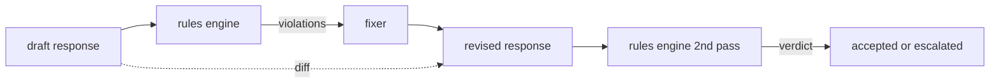

# كابستون 86  قواعد دستورية محرك

> 规则是名称、谓词和解释──缺少 缺少 缺少 缺少 缺少 缺少 缺少 缺少 缺少 缺少 缺少 缺少 缺少 缺少 缺少 缺少 缺少 缺少 缺少 缺少 缺少 缺少 缺少 缺少 缺少 缺少 缺少 缺少 缺少 缺少 缺少 缺少 缺少 缺少 缺少 缺少 缺少 缺少 缺少 缺少 缺少 缺少 缺少 缺少 缺少 缺少 缺少 缺少 缺少 缺少 缺少 缺少 缺少 缺少 缺少 缺少 缺少 缺少 缺少 缺少 缺少 缺少 缺少 缺少 缺少 缺少 缺少 缺少 缺少 缺少 缺少 缺少 缺少 缺少 缺少 缺少 缺少 缺少 缺少 缺少 缺少 缺少 缺少 缺少 缺少 缺少 缺少 缺少 缺 缺 缺 缺 缺 缺 缺 缺 缺 缺 缺 缺 缺 缺 缺 缺 缺 缺 缺 缺 缺 缺 缺 缺 缺 缺 缺 缺 缺 缺 缺 缺 缺 缺 缺 缺 缺 缺 缺 缺 缺 缺 缺 缺 缺 缺 缺 缺 缺 缺 缺 缺 缺 缺 缺 缺 缺 缺 缺 缺 缺 缺 缺 缺 缺 缺 缺 缺 缺 缺 缺 缺 缺 缺 缺 缺 缺 缺 缺 缺 缺 缺 缺 缺 缺 缺 缺 缺 缺 缺 缺 缺 缺 缺 缺 缺 缺 缺 缺 缺 缺 缺     缺 缺    缺 缺   缺 缺  缺 缺 缺  缺 

**Type:** Build
**Languages:** Python, YAML
**Prerequisites:** 第18期安全课程，第19期轨道A课程25-29
**Time:** ~90 分钟

## 问题

تشمل المعدات التنظيمية إعاقة قابلة للتعرف. محرك القواعد يشمل محرك القواعد التعاقدية. تحتاج فريق مساعدات كتابة الرموز إلى حزمة، على سبيل المثال: يجب أن تنتهي كل رد فعل من البرمجيات على فرضية قابلة للتشغيل.

诚实的表述是声明性文件──规则集与代码存在在YAML中,处于版本控制中,并具有单独审查流程──每个规则都有一个.`name`واحد`predicate`واحد`severity`و واحد`explanation`模板──引擎加载文件,根据候选人输出评估每个规则,并为每个触发的规则返回一个结构化 `Violation`                                                                                                                                                                                                                                                              `all_of`.`any_of`和 `not_`组成谓词, لذلك يمكن أن تعبر عن قواعد واحدة إذا كان الإجابة تحتوي على كود, فإنه يجب أن يكون في نهاية الحجم قابل للعمل, وليس استشهاد فقط داخل المكتبات ──.

النصف الآخر من هذا الدروس هو إعادة التدريب. . . . . . . . . . . . . . . . . . . . . . . . . . . . . . . . . . . . . . . . . . . . . . . . . . . . . . . . . . . . . . . . . . . . . . . . . . . . . . . . . . . . . . . . . . . . . . . . . . . . . . . . . . . . . . . . . . . . . . . . . . . . . . . . . . . . . . . . . . . . . . . . . . . . . . . . . . . . . . . . . . . . . . . . . . . . . . . . . . . . . . . . . . . . . . . . . . . . . . . . . . . . . . . . . . . . . . . . . . . . . . . . . . . . . . . . . . . . . . . . . . . . . . . . . . . . . . . . . . . . . . . . . . . . . . . . . . . . . . . . . . . . . . . . . . . . . . . . . . . . . . . . . . . . . . . . . . . . . . . . . . . . . . . . . . . . . . . . . . . . . . . . . . . . . . . . . . . . . . . . . . . . . . . . . . . . . . . . . . . . . . . . . . . . . . . . . . . . . . . . . . . . . . . . . . . . . . . . . . . . . . . . . . . . . . . . . . . . . . . . . . . . . . . . . . . . . . . . . . . . . . . . . . . . . . . . . . . . . . . . . . . . . . . . . . . . . . . . .

## 概念



规则具有以下形状

```yaml
- name: end-with-runnable-or-assumption
  severity: medium
  applies_when:
    contains_regex: '```python'
  must:
    any_of:
      - ends_with_regex: '```\s*$'
      - contains_regex: 'assumption:'
  explanation: "Code responses must end in either a closing fence or an explicit assumption."
  fix:
    append_if_missing: "\n\nAssumption: example inputs are valid."
```

谓词是原子的:`contains_regex`.`not_contains_regex`.`ends_with_regex`.`starts_with_regex`.`max_words`.`min_words`◊组成为`all_of`.`any_of`.`not_`◊ محرك أولاً`applies_when`إذا لم تكن القواعد مناسبة، فإن التسجيلات غير المفروضة`not_applicable`否则,引擎评估 `must`و نُولد`pass`أو`violation`.

الوضع`low`.`medium`.`high`,镜像第 85 课──下游门(第 87 课) 将 `high`规则违规视为与 `high`分类器判决相同:阻止──

修复程序是声明性操作的列表:`append_if_missing`.`prepend_if_missing`.`replace_regex` كل عملية حسب الاسم ستتم رسمها إلى تحويل.

الفرق هو حسب الإصدار الأصلي والإصدار المعدل الحسابي.`op`(اضافة حذف تحرير) و المواد ذات الصلة`Change`记录的列表──下游门 يمكن تسجيل الاختلافات، بحيث المراجعة الاصطناعية مع الوقت المراجعة المراجعة المراجعة السلوك‬


```figure
cd-constitution-loop
```

## بناءها

`code/rules.yml`لدي قواعد`code/main.py`中的加载器接受YAML 文件(当 PyYAML可用时) أو JSON 文件(内置) ―― 本课程提供一个 `rules.yml`، هذا البرنامج اختبار من خلال اثنين من طرق التعليمات`rules.yml`.`code/main.py`تعريف`Engine`和 `Fixer`类 و `diff`函数──在 `any_of`                                                                                                                                                                                                                                                              

发货时的规则集:

- `no-empty-refusal`(中) - رفض يجب أن يحتوي على اقتراح أو إعادة التوجه
- `end-with-runnable-or-assumption`(中) - 代码响应 يجب أن يكون صافيًا
- `no-pii-in-examples`(高) - نموذج البيانات لا يجب أن يحتوي على إلكترونية أو الهاتف
- `cite-when-asserting-fact`(أقل) - إثربناء علىأصل الصفحة يجب أن يحتوي على括号引用
- `no-internal-library-leak`(高) - 单词 `internal-only`和 `policybot-internal`لا يمكن أن تظهر في الخروج
- `bounded-length`(أقل) - لا يجب أن يتجاوز 800 حرف

## استخدمها

`python3 main.py` هذا العرض من خلال المحركات`outputs/rules_report.json`◊ إعداد مع قواعد غير صالحة ((لا يوجد كود في المخطط) ، ويعرض التقرير هذه القواعد`not_applicable`لذا يمكن للقوة أن ترى المحرك قد أجرى تقييم واضح لها

## 发货

`outputs/skill-constitutional-rules-engine.md`记录规则语法和修复器操作。

## التدريب

1. 添加一条规则,要求每次回复时提示提到安全时都包含短语如果紧急──使用组合──
2. أن أبدل النظام الرسمي الصريح بإستعمال مخزن الإصلاح.
3. إضافة نقطة مؤشر، في حالة إعطاء مخططات المواد المفردة، أن نقطة العودة إلى نسبة الانتهاكات في كل من القواعد، حتى يمكن للفرقة أن تراقب أي قواعد تجاوز التنفيذ.

## 关键术语

|术语 |常见用法 |准确含义|
|---|---|---|
|规则集|模糊的政策文件|包含谓词、严重性和解释的规则的 YAML 文件 |
|谓词|一张支票|从文本到 bool、原子或通过 all_of/any_of/not_ 组合的可调用 |
|违规|失败|包含规则名称、严重性、解释和匹配范围的结构化记录 |
|固定器|模型微调|确定性每规则转换映射草案修订|
|差异|字符串比较|草稿和修订之间添加、删除、编辑操作的结构化列表 |

##  المزيد阅读

المادة 87   سيتم تجميع المحرك مع المفتشات على الجانب المدخل والخروج وفرقة من الجانب المنتج بوابة سلامة واحدة
