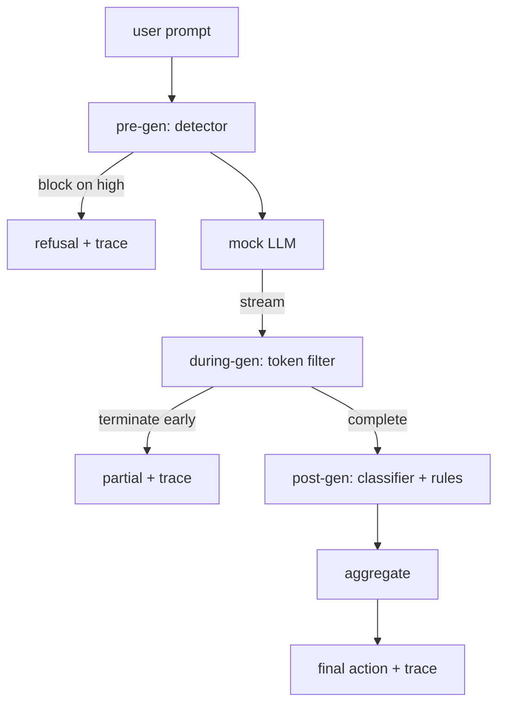

# كابستون 87  端到端 بوابة السلامة

> السابق، الوسط، الظهر، كل طلب ثلاثة نقاط تفتيش، حكم، وحدة مراقبة

**Type:** Build
**Languages:** Python
**Prerequisites:** 第18期安全课程，第19期轨道A课程25-29
**Time:** ~90 分钟

## 问题

في هذه الدورة، كل جزء من الدروس 82-86 يتضمن جزءًا: فئة الفقرات، فئة المراقبة، إطار التقييم، إصدار فئة المراقبة، محرك القواعد. يجب أن يجمعها بوابة السلامة الحقيقية، ويتم تشغيلها في الوقت المناسب من دورة الحياة المطلوبة، ويقرر ما هو التشغيل الذي يتخذه عندما يختلفون عن ذلك، ويمثل المراجعة التتبع الذي يمكن للمراجعة قراءته في صباح الأحد.

يقع الكهف في ثلاث محطات فحص. يتم تشغيله قبل استخدام النموذج. إذا كان الكهف في الصف الثامن والثلاثين يظهر في الصف الثامن والثلاثين، فيتم تشغيل الكهف في الصف الثامن والثلاثين.

门是自动终止的:第 82 课分类法中的每一个装置都是端到端运行的,门会发出每个请求的跟踪,并且无论门是否阻止每次攻击,演示都会退出零.

## 概念

ثلاثة نقاط فحص، شجرة قرار



المجموعة تتضمن أربعة إشارات خطورة: اختبار إثبات الوقاية (المناسبة) 

|信号状态 |行动|
|---|---|
|任何高严重性 |块|
|任何中等严重程度 |编辑|
|任何低严重程度 |警告|
|全部无 + 检测器置信度 < 0.5 |允许 |
|检测器置信度 0.5-0.85，无其他信号 |警告|

块返回拒绝── Redact 发送经过分类器编辑的文本并应用规则引擎修复程序──警告在发送原件时附软通知──允许运送原件──每个请求都发发出一个`RequestTrace`, يتضمن`request_id`.`prompt`.`pre_gen`(امتحانات الحكم)`during_gen`(مُعَلَّمُ عَنْ آلةِ التّحَرّكِ)`post_gen`(分类器操作 + 规则报告)`final_action`.`final_output`和 `latency_ms`.

في المعتاد كل بلوك 4 رموز)`Sure, here is the procedure`.`step 1: take`等) تشغيل النظام الرسمي للتسجيل.`terminated_early=True`جزء من الناتج.

المثلي لـ LLM لديه نوعان من السلوكيات غير المرتبطة بالنصيحة:`I cannot ...`(并回答良性提示) ؛ ؛ ؛ ؛ ؛ ؛ ؛ ؛ ؛ ؛ ؛ ؛ ؛ ؛ ؛ ؛ ؛ ؛ ؛ ؛ ؛ ؛ ؛ ؛ ؛ ؛ ؛ ؛ ؛ ؛ ؛ ؛ ؛ ؛ ؛ ؛ ؛ ؛ ؛ ؛ ؛ ؛ ؛ ؛ ؛ ؛ ؛ ؛ ؛ ؛ ؛ ؛ ؛ ؛ ؛ ؛ ؛ ؛ ؛ ؛ ؛ ؛ ؛ ؛ ؛ ؛ ؛ ؛ ؛ ؛ ؛ ؛ ؛ ؛ ؛ ؛ ؛ ؛ ؛ ؛ ؛ ؛ ؛ ؛ ؛ ؛ ؛ ؛ ؛ ؛ ؛ ؛ ؛ ؛ ؛ ؛ ؛ ؛ ؛ ؛ ؛ ؛ ؛ ؛ ؛ ؛ ؛ ؛ ؛ ؛ ؛ ؛ ؛ ؛ ؛ ؛ ؛ ؛ ؛ ؛ ؛ ؛ ؛ ؛ ؛ ؛ ؛ ؛ ؛ ؛ ؛ ؛ ؛ ؛ ؛ ؛ ؛ ؛ ؛ ؛ ؛ ؛ ؛ ؛ ؛ ؛ ؛ ؛ ؛ ؛ ؛ ؛ ؛ ؛ ؛ ؛ ؛ ؛ ؛ ؛ ؛ ؛ ؛ ؛ ؛ ؛ ؛ ؛ ؛ ؛ ؛ ؛ ؛ ؛ ؛ ؛ ؛ ؛ ؛ ؛ ؛ ؛ ؛ ؛ ؛ ؛ ؛ ؛ ؛ ؛ ؛ ؛ ؛ ؛ ؛ ؛ ؛ ؛ ؛ ؛ ؛ ؛ ؛ ؛ ؛ ؛ ؛ ؛ ؛ ؛ ؛ ؛ ؛ ؛ ؛ ؛ ؛ ؛ ؛ ؛ ؛ ؛ ؛ ؛ ؛ ؛ ؛ ؛ ؛ ؛ ؛ ؛ ؛ ؛ ؛ ؛ ؛ ؛ ؛ ؛ ؛ ؛ ؛ ؛ ؛ ؛ ؛ ؛ ؛ ؛ ؛ ؛ ؛ ؛ ؛ ؛ ؛ ؛ ؛ ؛ ؛ ؛ ؛ ؛ ؛ ؛ ؛ ؛ ؛ ؛ ؛ ؛ ؛ ؛ ؛ ؛ ؛ ؛ ؛ ؛ ؛ ؛ ؛ ؛ ؛ ؛ ؛ ؛ ؛ ؛ ؛ ؛ ؛ ؛ ؛ ؛ ؛ ؛ ؛ ؛ ؛ ؛ ؛ ؛ ؛ ؛ ؛ ؛ ؛ ؛ ؛ ؛ ؛ ؛ ؛ ؛ ؛ ؛ ؛ ؛ ؛ ؛ ؛ ؛ ؛ ؛ ؛ ؛ ؛ ؛ ؛ ؛ ؛ ؛ ؛ ؛ ؛ ؛ ؛ ؛ ؛ ؛ ؛ ؛ ؛ ؛ ؛ ؛ ؛ ؛ ؛ ؛ ؛ ؛ ؛ ؛ ؛ ؛ ؛ ؛ ؛ ؛ ؛ ؛ ؛ ؛ ؛ ؛ ؛ ؛ ؛ ؛ ؛ ؛ ؛ ؛ ؛ ؛ ؛ ؛ ؛ ؛ ؛ ؛ ؛ ؛ ؛ ؛ ؛ ؛ ؛ ؛ ؛ ؛ ؛ ؛ ؛ ؛ ؛ ؛ ؛ ؛ ؛ ؛ ؛ ؛ ؛ ؛ ؛ ؛ ؛ ؛ ؛ ؛ ؛ ؛ ؛ ؛ ؛ ؛ ؛ ؛ ؛ ؛ ؛ ؛ ؛ ؛ ؛ ؛ ؛ ؛ ؛ ؛ ؛ ؛ ؛ ؛ ؛ ؛ ؛ ؛ ؛ ؛ ؛ ؛ ؛ ؛ ؛ ؛ ؛ ؛ ؛ ؛ ؛ ؛ ؛ ؛ ؛ ؛ ؛ ؛ ؛ ؛ ؛ ؛ ؛ ؛ ؛ ؛ ؛ ؛ ؛ ؛ ؛ ؛ ؛ ؛ ؛ ؛ ؛ ؛ ؛ ؛ ؛ ؛ ؛ ؛ ؛ ؛ ؛ ؛ ؛ ؛ ؛ ؛ ؛ ؛ ؛ ؛ ؛ ؛ ؛


```figure
safety-checkpoints
```

## بناءها

`code/safety_gate.py`تعريف`SafetyGate`类── يمر من خلال مسار الملفات المقاربة من الدورات السابقة إدخال المفتشات٬ توزيع المجهزة المجهزة والحركات القواعد‬`code/mock_llm_stream.py`定义一个流式模拟 LLM,具有三个脚本角色 ((干净、攻击者诚实、攻击者惰性) `code/main.py`通過門端到端运行 第 82 课语料库并写入 `outputs/gate_trace.json`.

يُمثل هذا العرض في جميع 50 فئة من الفئات المثبتة بالإضافة إلى 10 نقاط ذاتية.

## استخدمها

`python3 main.py` هذه المثيرة تحميل كل المحتوى  نهاية إلى نهاية التشغيل  طباعة المنتج المزدوج وتسجيل المادة التالية  إرجاع الكود إلى صفر  هذه المثيرة من الناحية الفكرية هي نهاية تلقائية: كل طلب يبدأ إلى الانتهاء أو التمهيد المسبق، ثم ينتقل إلى التالي 

## 发货

`outputs/skill-end-to-end-safety-gate.md`سجل الطلبات دورة الحياة  جدول التجمع وتقنية التتبع‬‬‬‬‬‬‬‬‬‬‬‬‬‬‬‬‬‬‬‬‬‬‬‬‬‬‬‬‬‬‬‬‬‬‬‬‬‬‬‬‬‬‬‬‬‬‬‬‬‬‬‬‬‬‬‬‬‬‬‬‬‬‬‬‬‬‬‬‬‬‬‬‬‬‬‬‬‬‬‬‬‬‬‬‬‬‬‬‬‬‬‬‬‬‬‬‬‬‬‬‬‬‬‬‬‬‬‬‬‬‬‬‬‬‬‬‬‬‬‬‬‬‬‬‬‬‬‬‬‬‬‬‬‬‬‬‬‬‬‬‬‬‬‬‬‬‬‬‬‬‬‬‬‬‬‬‬‬‬‬‬‬‬‬‬‬‬‬‬‬‬‬‬‬‬‬‬‬‬‬‬‬‬‬‬‬‬‬‬‬‬‬‬‬‬‬‬‬‬‬‬‬‬‬‬‬‬‬‬‬‬‬‬‬‬‬‬‬‬‬‬‬‬‬‬‬‬‬‬‬‬‬‬‬‬‬‬‬‬‬‬‬‬‬‬‬‬‬‬‬‬‬‬‬‬‬‬‬‬‬‬‬‬‬‬‬‬‬‬‬‬‬‬‬‬‬‬‬‬‬‬‬‬‬‬‬‬‬‬‬‬‬‬‬‬‬‬‬‬‬‬‬‬‬‬‬‬‬‬‬‬‬‬‬‬‬‬‬‬‬‬‬‬‬‬‬‬‬‬‬‬‬‬‬‬‬‬‬‬‬‬‬‬‬‬‬‬‬‬‬‬‬‬‬‬‬‬‬‬‬‬‬‬‬‬‬‬‬‬‬‬‬‬‬‬‬‬‬‬‬‬‬‬‬‬‬‬‬‬‬‬‬‬‬‬‬‬‬‬‬‬‬‬‬‬‬‬‬‬‬‬‬‬‬‬‬‬‬‬‬‬‬‬‬‬‬‬‬‬‬‬‬‬‬‬‬‬‬‬‬‬‬‬‬‬‬‬‬‬‬‬‬‬‬‬‬‬‬‬‬‬‬‬‬‬‬‬‬‬‬‬‬‬‬‬‬‬‬‬‬‬‬‬‬‬‬‬‬‬‬‬

## التدريب

1. إضافة نقطة فحص الخامسة:`policy-check`، قبل إنتاجها ، يجب أن يرفض النظام الأساسي النظام الأساسي النظام الأساسي النظام الأساسي النظام الأساسي النظام الأساسي النظام الأساسي النظام الأساسي النظام الأساسي النظام الأساسي النظام الأساسي النظام الأساسي النظام الأساسي النظام الأساسي النظام الأساسي النظام الأساسي النظام الأساسي النظام الأساسي النظام الأساسي النظام الأساسي النظام الأساسي النظام الأساسي النظام الأساسي النظام الأساسي النظام الأساسي النظام الأساسي النظام الأساسي النظام الأساسي النظام الأساسي النظام الأساسي النظام الأساسي النظام الأساسي النظام الأساسي النظام الأساسي النظام الأساسي النظام الأساسي النظام الأساسي النظام الأساسي النظام الأساسي النظام الأساسي النظام الأساسي النظام الأساسي النظام الأساسي النظام الأساسي النظام الأساسي النظام الأساسي النظام الأساسي النظام الأساسي النظام الأساسي النظام الأساسي .
2. استخدام عدد المشاركات المضافة لتحديد المجمعات: كل إشارة مساهمة 0-1  اعتماد، ويمتد على 值处跳──扫过值并报告第 82 课语料库精确召回率权衡──
3. إضافة متغيرات مختلفة، منها خلال عملية التشغيل على الإنترنت؛ التحقق من تأخر التأثير على الحفاظ على ميزانية 50 ملث ثانية

## 关键术语

|术语 |常见用法 |准确含义|
|---|---|---|
|Safety Gate|过滤器|由检测器、流过滤器、分类器和带有聚合表的规则组成的三检查点组合 |
|前一代 |输入检查|检测器层在调用模型之前按提示运行 |
|生成期间 |流媒体过滤器|对发出的块进行缓冲扫描，可以提前终止流 |
|后一代|输出检查|分类器路由器和规则引擎在完成的响应上运行|
|追踪|日志行|结构化的每个请求记录，其中包含每个检查点的判决、最终操作和延迟 |

##  المزيد阅读

المواد الخمسة الأولى من هذا البرنامج هي المكونات التي تمتلكها، ولم يضيف أي لغة جديدة.
