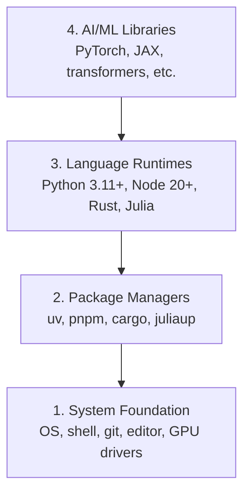

# Medio ambiente de desarrollo

> Tu herramienta te moldeará el modo de pensar.

**Type:** Build
**Languages:** Python, Node.js, Rust
**Prerequisites:** None
**Time:** ~45 分钟

## El objetivo del aprendizaje

- Desde零 construir Python 3.11+、Node.js 20+ 和 Rust 工具链
- 配置虚拟环境和包管理器, asegurar la construcción de la capacidad de reproducción
- Usar CUDA/MPS 验证 GPU 访问,并跑一次测试张量运算
- Comprender cuatro niveles de tecnología: sistemas, gestión de paquetes, operaciones, inteligencia artificial

##  problemas

Usted va a usar Python, TypeScript, Rust y Julia para completar 500+ sesiones de ingeniería de IA. Si el ambiente está mal, cada sección se convertirá en un sistema de herramientas, en lugar de en el aprendizaje.

La mayoría de la gente saltará el ambiente construido. Luego pasará unas horas desactivando la importación de errores.

## 概念

Una ingeniería de IA  medio ambiente tiene cuatro niveles:



Nos instalamos de abajo a arriba. Cada uno de ellos depende de la otra.

```figure
s0-env-stack
```

## Construirlo

### Paso 1: Sistema de base

Check your system并安装基础组件──

```bash
# macOS
xcode-select --install
brew install git curl wget

# Ubuntu/Debian
sudo apt update && sudo apt install -y build-essential git curl wget unzip

# Windows (use WSL2)
wsl --install -d Ubuntu-24.04
```

### Paso 2: Us uv instalar Python

Nosotros usamos`uv`Es 10 100 veces más rápido que el pip, y se procesará automáticamente el ambiente virtual

```bash
curl -LsSf https://astral.sh/uv/install.sh | sh

uv python install 3.12

uv venv
source .venv/bin/activate  # or .venv\Scripts\activate on Windows

uv pip install numpy matplotlib jupyter
```

验证:

```python
import sys
print(f"Python {sys.version}")

import numpy as np
print(f"NumPy {np.__version__}")
a = np.array([1, 2, 3])
print(f"Vector: {a}, dot product with itself: {np.dot(a, a)}")
```

### Paso 3: con pnpm instalar Node.js

Utilizado en el tipo de escritura  cursos  agentes  MCP servidores  aplicaciones web) 

```bash
curl -fsSL https://fnm.vercel.app/install | bash
fnm install 22
fnm use 22

npm install -g pnpm

node -e "console.log('Node', process.version)"
```

Fnm Instalación de los procedimientos`unzip`, falta de tiempo`Not installing fnm due to missing dependencies.`退出: en Linux arriba tiene que desprender un archivo de archivo, en macOS arriba por medio de Homebrew instalación.`unzip`Ubuntu、Debian 和 WSL2 会通过步骤 1 的 apt 命令安装它(si saltas ese paso, ejecutar `sudo apt install -y unzip`)。

**macOS / Apple Silicon（M1/M2/M3/M4）：**Si se instala el procedimiento`Error: Cannot install under Rosetta 2 in ARM default prefix (/opt/homebrew)`停止, explicar tu terminal de operar en Rosetta 2 abajo`arch`                                                                                                                                                                                                                                                                                                                                                                                                                                                                                                                             `i386`), mientras que Homebrew es un arm64 original.`fnm install 22`开始重新运行:

```bash
arch -arm64 brew install fnm
echo 'eval "$(fnm env --use-on-cd)"' >> ~/.zshrc
source ~/.zshrc
```

### Paso 4:Rusto

Se utiliza para clases sensibles a la performance (inferencia, sistemas)

```bash
curl --proto '=https' --tlsv1.2 -sSf https://sh.rustup.rs | sh

rustc --version
cargo --version
```

### 步骤 5: Julia(可选)

Con el curso de matemáticas de Julia.

```bash
curl -fsSL https://install.julialang.org | sh

julia -e 'println("Julia ", VERSION)'
```

### 步骤 6:GPU 设置( si tienes)

**NVIDIA（Linux / Windows）：**

```bash
nvidia-smi

# Install PyTorch with CUDA
uv pip install torch torchvision torchaudio --index-url https://download.pytorch.org/whl/cu124
```

**macOS / Apple Silicon（M1/M2/M3/M4）：**Mac 上 no tiene CUDA esta es la situación esperada, no es fallo.**不要**传入 `--index-url .../cuXXX`(Estas ruedas sólo se aplican a Linux / Windows, instalación es imposible)

```bash
uv pip install torch torchvision torchaudio
```

验证( se aplica a cualquier plataforma):

```python
import torch
print(f"CUDA available: {torch.cuda.is_available()}")           # False on macOS — expected
print(f"MPS available:  {torch.backends.mps.is_available()}")   # True on Apple Silicon
if torch.cuda.is_available():
    print(f"GPU: {torch.cuda.get_device_name(0)}")
```

没有GPU?没有问题──大多数课程可在CPU上运行──对训练很重课程,使用Google Colab或云GPU──

### Paso 7: Verifique el camino que quiere comenzar

Cada orden de esta clase se ejecuta desde el registro de almacenamiento, es decir, contiene.`README.md`Y `phases/`El nuevo estudiante puede ver una conclusión clara, no una advertencia.

开始完整的入门序列:

```bash
python3 phases/00-setup-and-tooling/01-dev-environment/code/verify.py --route beginner
```

O sólo revisar la ruta que quieres ir:

```bash
python3 phases/00-setup-and-tooling/01-dev-environment/code/verify.py --route ml-foundations
python3 phases/00-setup-and-tooling/01-dev-environment/code/verify.py --route llm-engineering
python3 phases/00-setup-and-tooling/01-dev-environment/code/verify.py --route agents
python3 phases/00-setup-and-tooling/01-dev-environment/code/verify.py --route mcp
python3 phases/00-setup-and-tooling/01-dev-environment/code/verify.py --route agent-skills
python3 phases/00-setup-and-tooling/01-dev-environment/code/verify.py --route certification
```

Si quieres que el mismo pre-examen y el examen posterior de los cursos se utilicen para herramientas y dependencias, además `--show-later`                                                                                                                                                                                                                                                              

Cada examen obligatorio fallido dará un camino de prueba o un error de importación, así como una orden de reparación precisa. Las habilidades y certificaciones de los agentes también mostrarán que el examen del anfitrión debe ser realizado manualmente, ya que Python no puede demostrar que el anfitrión de la IA haya descubierto alguna habilidad, ni puede demostrar la habilidad de su elección.

Cuando se entre en el examen previo, se imprimirá la primera orden de curso ejecutable:

```text
Ready to start Beginner course.
Next: python3 phases/01-math-foundations/01-linear-algebra-intuition/code/vectors.py
```

## Usalo

Su entorno ya puede comenzar a revisar el camino. Las herramientas posteriores, etc. reinstalar el tiempo, no hay que dejar que todo el conjunto de técnicas se bloquee en su primera clase.

| Language | Used In | Package Manager |
|----------|---------|-----------------|
| Python | Phases 1-12 (ML, DL, NLP, Vision, Audio, LLMs) | uv |
| TypeScript | Phases 13-17 (Tools, Agents, Swarms, Infra) | pnpm |
| Rust | Phases 12, 15-17 (Performance-critical systems) | cargo |
| Julia | Phase 1 (Math foundations) | Pkg |

##  entregarlo

Este curso se produce un libro de verificación que cualquier persona puede usar para examinar su propio entorno.

¿ Qué pasa ?`outputs/prompt-env-check.md`, uno de ellos es un problema de diagnóstico de la IA.

##  ejercicios

1. 运行验证脚本并修复 cualquier fallo
2. Para este curso crea un Python  virtual ambiente, y instala PyTorch
3. Usando todos los cuatro idiomas escribe un "hola mundo", y cada uno de ellos se ejecuta.

### 提示

**练习 1。**En el registro de almacenamiento`python3 phases/00-setup-and-tooling/01-dev-environment/code/verify.py --route beginner`, primero revisar el primer error, volver a ver el siguiente, volver a ejecutar el guión, todos los controles necesarios son pasados, sólo se puede completar.

**练习 2。**En el registro de almacenamiento`uv venv`Crear ambiente y activar, volver a usar paso 6                                                                                                                                                                                                                                                                                                                                                                                                                                                                                                                 `python -c "import torch; print(torch.__version__)"`Por lo tanto, el proyecto de ley no tiene ningún efecto.

**练习 3。**Utiliza concept部分技术中的四种运行时:Python、运行到 Node.js' TypeScript、Rust 和 Julia──分别编写一个小文件,用`python3`¿Qué es esto?`npx tsx`(Node.js 不能直接运行 `.ts`文件) 、`cargo run`O `rustc`¿Qué es esto?`julia`运行──每次运行都必须打印你的消息,并以退出码 0 结束──
