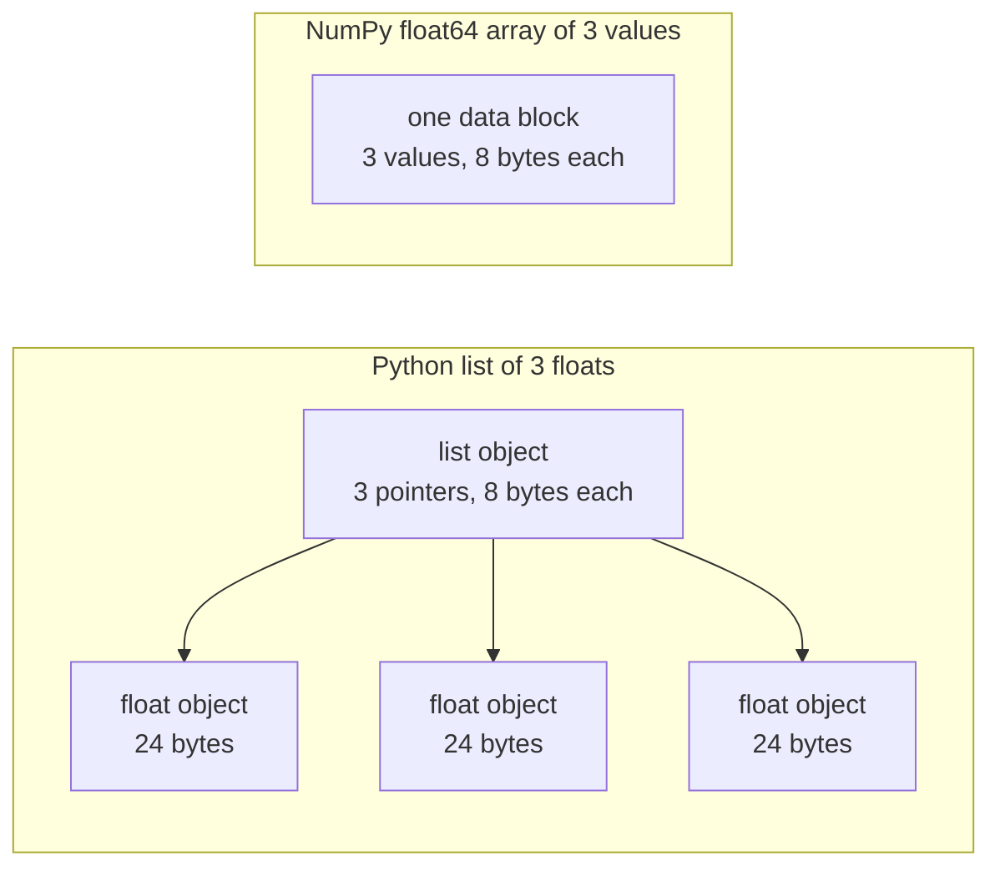

# 面向 AI 工程的Python

> La mayoría de los códigos de este curso utilizan el mismo grupo de Python habitual usufructo. Antes de que los siguientes cursos de matemáticas y modelos dependen de ellos, primero aprendan a aprenderlos.

**Type:** Build
**Languages:** Python
**Prerequisites:** 开发环境、Python 环境
**Time:** ~120 分钟

## El objetivo del aprendizaje

- 阅读课程代码中最常见的习惯使用法, desde el desembolso y los f 字符串 hasta los datos y los métodos de introducción.
-  encontrar tres tipos de Python  que no reportarán errores pero generarán errores  problema: lista de compartimiento  valores predeterminados y generadores agotados 
-  sólo utilizar bases de datos, construir CSV y JSON cargador  llevar la distribución de datos de las semillas con el tiempo, así como generadores de pequeñas cantidades
- Utiliza Python para escribir puntos, valores medios y valores de cálculo, y mide velocidad y cantidad de memoria.
- Explicar por qué el ciclo puro de Python en el número de valores es más lento, así como cómo NumPy 广播 va a mover el ciclo en el código después de la compilación.

##  problemas

En el curso de este período, el programa utiliza Python para realizar cálculos y modelos matemáticos. En el curso, 541 archivos Python se incluyen 276 archivos.`dataclasses` Además, 187 documentos se han utilizado `random.seed`O crear`random.Random`Si no estás familiarizado con estas costumbres, estarás ocupado en entender el lenguaje cuando quieres entender matemáticas.

Python también tiene algunos que no dan información errónea, sino que conducen a errores de resultados. Dos nombres pueden referirse a la misma lista, por lo que a través de un nombre modificado la lista, también cambiará el contenido de otro nombre visto.

El último problema es la velocidad. En nuestro ordenador de prueba, un ciclo de Python puro para calcular un millón de puntos de movimiento requiere aproximadamente 30 milisegundos.

## 概念

### 课程代码使用哪些写法

Nosotros usamos`ast`模块解析了                                                                                                                                                                                                                                                                                                                                                                                                                                                                                                                         `phases/*/*/code/`En el medio de todos los 541 Python 文件──下表统计至少曾经使用过相应结构的文件数──统计来自编写本课当天,将随着新课加入而变化──

| 结构 | 文件数 | 占比 |
|-----------|-------|-------|
| 函数定义 | 541 | 100% |
| `if __name__ == "__main__":` | 529 | 98% |
| f 字符串 | 517 | 96% |
| 元组解包 | 448 | 83% |
| 类 | 379 | 70% |
| 列表推导式 | 375 | 69% |
| 函数类型标注 | 342 | 63% |
| 生成器表达式 | 326 | 60% |
| 切片 | 314 | 58% |
| `lambda` | 175 | 32% |
| `try` 与 `except` | 120 | 22% |
| `with` 语句 | 96 | 18% |
| 字典推导式 | 93 | 17% |
| 使用 `yield` 的生成器函数 | 14 | 3% |

La situación de la importación refleja cuáles son los módulos de normas más importantes.`from __future__ import annotations`En primer lugar, 276`dataclasses`¿Qué es eso?`math`¿Qué es esto?`random`Y `json`模块分别出现在187、175 和 126 文件中──`collections`Aparecen en 70 archivos, y...`itertools`Sólo aparece en 4 documentos.

没有课程调用 `map()`O `filter()`• las actividades de la Comisión se han llevado a cabo en más de 140 documentos.`sorted`¿Qué es esto?`min`¿Qué es esto?`max`O `.sort`时使用了                                                                                                                                                                                                                                                                                                                                                                                                                                                                                                                          `key=`函数── Este curso pasará más tiempo en las listas de clasificación por las costumbres de uso anterior.

### 名称引用对象

En Python, la variación es la referencia al nombre de un objeto. El valor de variación se fija en el nombre de un objeto, no se reproduce en el objeto. Cuando dos nombres se refieren a la misma lista, se puede ver a ambos nombres mediante una modificación de nombre.

### 列表保存指针,数组保存数值

La lista de Python no es un valor de almacenamiento numérico directo, sino un índice de almacenamiento, cada índice cita un objeto completo de Python. En el CPython de 64 bits, cada índice ocupa 8 字节, cada uno.`float`En el caso de los animales, el número de animales es de 24 字节──NumPy `float64`El número de números se almacenará en un bloque de memoria.



Para cada elemento, se encuentra un objeto, se revisa el tipo de cada operación, se vuelve a utilizar el código de flows y multiplications, y se crea un objeto de flows para guardar los resultados.

NumPy para el ciclo de la operación de valores originales, después de la compilación, completa el mismo cálculo. Sólo se verifica una vez el tipo de datos de todo el conjunto de datos, no se crea un código de dimensionamiento para cada elemento de Python a un objeto.`(x - mean) / std`, re by library execution cycle. La función de velocidad de esta clase también sigue este principio: cada función sólo realiza una operación de la matriz, después se puede reemplazarla por una vez NumPy 调用.

### 列表保存全部元素, generador por guardar uno

La lista de inducciones se ejecutará en la siguiente línea antes de construir todos los elementos. Cuando el generador realiza una petición de cada usuario, sólo se construye un elemento. El uso de memoria de la lista aumenta con el número de elementos; sin importar cuántos elementos hay, el uso de memoria del generador es casi invariable.

El aparato sólo puede atravesar una vez. Después del último elemento, cada petición se dispara.`StopIteration`, por lo tanto, el segundo lo atravesó.`for`循环拿不到任何元素──训练代码每轮都会读取一次数据集, por lo que debe crear un nuevo generador para cada ronda──

 En el código de clases se presentan pocas funciones de generador, pero los cargadores de datos que utilizan los cursos de aprendizaje profundo son objetos de entrega de datos en serie, por lo que esta idea existe en cada ciclo de entrenamiento.

```figure
s0-list-vs-generator
```

## Necesitas aprender las costumbres

Cada código en este apartado puede funcionar de forma independiente.`python3`运行──代码块需要Python 3.11或更新版本, esto es también la versión que hemos instalado en el desarrollo de los cursos de entorno──

### 1. √ Contenedor y desembarazo

Python tiene cuatro tipos de contenedores en juego.

| 类型 | 示例 | 有序 | 可变 | 在课程中的典型用途 |
|------|---------|---------|------------|---------------------------|
| `list` | `[0.5, 1.2]` | 是 | 是 | 样本、损失、权重 |
| `tuple` | `(32, 784)` | 是 | 否 | 形状、固定记录、字典键 |
| `dict` | `{"lr": 0.01}` | 按插入顺序 | 是 | 配置、词表、JSON 行 |
| `set` | `{"cat", "dog"}` | 否 | 是 | 唯一 token、重叠检查 |

Los siguientes códigos muestran que el valor de asignación no se copiará la lista.

```python
weights = [0.5, -1.2, 3.0]
alias = weights
alias[0] = 99.0
print(weights)

independent = list(weights)
independent[1] = 0.0
print(weights, independent)

grid = [[0] * 3] * 2
grid[0][0] = 1
print(grid)

grid = [[0] * 3 for _ in range(2)]
grid[0][0] = 1
print(grid)
```

```text
[99.0, -1.2, 3.0]
[99.0, -1.2, 3.0] [99.0, 0.0, 3.0]
[[1, 0, 0], [1, 0, 0]]
[[1, 0, 0], [0, 0, 0]]
```

Expreso `[[0] * 3] * 2` Crea una lista de nivel externo, de la cual dos citas se dirigen a la misma lista de nivel interno                                                                                                                                                                                                                                                  

解包在一行中将序列元素赋予多个名称──带星号的名称收集剩余元素──f 字符串将表达的值嵌入字符串, también puede especificarse en formato después de la iniciación──

```python
shape = (32, 784)
batch_size, n_features = shape
first, *middle, last = [1, 2, 3, 4, 5]
x, y = 1.0, 3.0
x, y = y, x

config = {"lr": 0.01, "epochs": 5}
config["seed"] = 7
tokens = ["the", "cat", "sat", "on", "the", "mat"]
vocab = set(tokens)

print(batch_size, n_features, first, middle, last, x, y)
print(config.get("momentum", 0.9), "cat" in vocab, len(vocab))
print(f"lr={config['lr']:.0e} loss={0.123456:.3f} n={60_000:,} {batch_size=}")
```

```text
32 784 1 [2, 3, 4] 5 3.0 1.0
0.9 True 5
lr=1e-02 loss=0.123 n=60,000 batch_size=32
```

键不存在时,`dict.get`返回默认值── independientemente de la gran cantidad de los conjuntos, en el conjunto `in`El tiempo de inspección es el mismo.`{batch_size=}`Forma simultánea de imprimir nombre y valor, ayuda a la modificación.

切片                                                                                                                                                                                                                                                                                                                                                                                                                                                                                                                           `a[start:stop:step]`包含 `start`, no incluye`stop` Inversiones negativas desde finales de comienzo de la cuenta.  Las cuentas de la lista son una nueva lista, por lo que todas las indicaciones en el ámbito de la lista de cuentas se aplican a las cuentas de la lista de grandes cuentas.

```python
tokens = ["<s>", "the", "cat", "sat", "on", "the", "mat", "</s>"]
print(tokens[1:-1])
print(tokens[:3], tokens[-3:])
print(tokens[::2])
print(tokens[::-1][:2])
windows = [tokens[i:i + 3] for i in range(len(tokens) - 2)]
print(len(windows), windows[0])
```

```text
['the', 'cat', 'sat', 'on', 'the', 'mat']
['<s>', 'the', 'cat'] ['the', 'mat', '</s>']
['<s>', 'cat', 'on', 'mat']
['</s>', 'mat']
6 ['<s>', 'the', 'cat']
```

### 2. 推导式

推导式通过一个表达式, de los objetos de la generación de la construcción de una lista, un guión o un conjunto. Su lectura se aproxima al cálculo matemático descrito.

```python
scores = [0.91, 0.42, 0.77, 0.15, 0.66]
labels = [1 if s >= 0.5 else 0 for s in scores]
high = [s for s in scores if s > 0.6]
squares = {i: i * i for i in range(4)}
lengths = {len(word) for word in ["a", "bb", "cc", "ddd"]}
sum_sq = sum(s * s for s in scores)

matrix = [[1, 2, 3], [4, 5, 6]]
transposed = [list(column) for column in zip(*matrix)]
flat = [v for row in matrix for v in row]

print(labels, high, squares, lengths, round(sum_sq, 4))
print(transposed, flat)
```

```text
[1, 0, 1, 0, 1] [0.91, 0.77, 0.66] {0: 0, 1: 1, 2: 4, 3: 9} {1, 2, 3} 2.0555
[[1, 4], [2, 5], [3, 6]] [1, 2, 3, 4, 5, 6]
```

末尾的 `if`Sólo se quedan algunos elementos.`for`La expresión anterior puede ser una expresión condicional, es decir:`a if condition else b`Dos .`for`Sección de ejecuciones, con dos ensamblajes de ciclo mismo.

圆括号创建生成器表达式──在 `sum(s * s for s in scores)`En el medio,`sum`Cada vez que se lee un valor cuadrado, Python no construye una lista.`zip(*matrix)`En el medio, el número de estrellas se introducirá cada una de las líneas como un elemento independiente,`zip`Los elementos de la misma posición se parecen.

### 3. Función ∞ Parámetro y cierre

默认值让参数变为可选. 关键字实参在调用时明确指定形参名称. 参数列表中单独的. 默认值让参数变为可选. 默认值`*`, se establecerán los siguientes parámetros para que sólo puedan ser transmitidos a través de un código clave.

```python
def clip(value, low=0.0, high=1.0):
    return max(low, min(high, value))


def train(data, *, lr=0.01, epochs=3):
    return f"{len(data)} samples, lr={lr}, epochs={epochs}"


def make_scaler(factor):
    def scale(values):
        return [v * factor for v in values]
    return scale


print(clip(1.7), clip(-3.0, low=-1.0), clip(0.4, high=0.3))
print(train([1, 2, 3], lr=0.1))
to_percent = make_scaler(100)
print(to_percent([0.25, 0.5]))
```

```text
1.0 -1.0 0.3
3 samples, lr=0.1, epochs=3
[25.0, 50.0]
```

Usando sólo los parámetros de los clave,`train(data, 0.1, 3)`Así que el uso se hace.`TypeError`◊ el usuario debe escribir`lr=0.1`, por lo tanto, dos valores no significan cambios de posición.

内部函数                                                                                                                                                                                                                                                                                                                                                                                                                                                                                                                          `scale`Utilize crear en su función `factor`Sólo que...`scale`Todavía existe, Python se queda.`factor` La función de conservación de la variación del creador se llama clausura.

`lambda`No tiene nombre, sólo contiene una función expresada.`key=`函数,第 8 部分会介绍这种用法──

Python en ejecución`def`语句时, sólo calcula una vez el valor de la memoria.

```python
def add_bad(item, bucket=[]):
    bucket.append(item)
    return bucket


def add_good(item, bucket=None):
    if bucket is None:
        bucket = []
    bucket.append(item)
    return bucket


add_bad("a")
print(add_bad("b"))
add_good("a")
print(add_good("b"))
```

```text
['a', 'b']
['b']
```

列表、字典或集合的默认值应使用 `None`, y crear nuevos objetos dentro de la función.

### 4. 类与数据类

`@dataclass`装饰器根据带类型标注的字段, generar `__init__`¿Qué es esto?`__repr__`Y `__eq__`◊ configuración `frozen=True`后, objetos creados después son irreversibles, pueden usarse como un guión o poner en la colección.

```python
from dataclasses import dataclass, field


@dataclass(frozen=True)
class Example:
    features: tuple[float, ...]
    label: int


@dataclass
class TrainConfig:
    lr: float = 0.01
    epochs: int = 5
    hidden: list[int] = field(default_factory=lambda: [64, 32])

    def describe(self):
        return f"lr={self.lr} epochs={self.epochs} hidden={self.hidden}"


ex = Example((1.5, 2.0), 1)
print(ex)
print(ex == Example((1.5, 2.0), 1), len({ex, Example((1.5, 2.0), 1)}))
print(TrainConfig(epochs=10).describe())
try:
    ex.label = 0
except AttributeError as err:
    print(type(err).__name__)
```

```text
Example(features=(1.5, 2.0), label=1)
True 1
lr=0.01 epochs=10 hidden=[64, 32]
FrozenInstanceError
```

`field(default_factory=...)`Para cada caso se proporciona una nueva lista. Se resuelve el problema de valores parciales similares a los datos de la clase interna y la parte 3.

特殊方法将类与Python 语法连接起来──`len(ds)`调用                                                                                                                                                                                                                                                                                                                                                                                                                                                                                                                           `__len__`¿ Qué ?`ds[2]`调用                                                                                                                                                                                                                                                                                                                                                                                                                                                                                                                           `__getitem__`¿Qué es eso?

```python
class SquaresDataset:
    def __init__(self, n):
        self.n = n

    def __len__(self):
        return self.n

    def __getitem__(self, index):
        if not 0 <= index < self.n:
            raise IndexError(index)
        return index, index * index


ds = SquaresDataset(4)
print(len(ds), ds[2])
print(list(ds))
```

```text
4 (2, 4)
[(0, 0), (1, 1), (2, 4), (3, 9)]
```

Incluso no hay `__iter__`¿Cómo?`list(ds)` interno `for`循环也能工作──Python según el uso de 0、1、2 等索引调用 `__getitem__`, hasta que reciba .`IndexError`El conjunto de datos de mapeo de PyTorch también utiliza dos métodos similares:`__len__`Y `__getitem__`¿Qué es eso?

### 5. 代器与生成器 代器 y generadores

El objeto es cualquier cosa que pueda ser`for`循环接受的对象──`iter()`Desde el medio de la obtención de la máquina,`next()`Cuando el generador no tiene más elementos, se desencadena.`StopIteration`¿Qué es eso?`for`循环替你调用   ciclo para cambiar el uso`next()`, y se encontró .`StopIteration`时停止.

```python
numbers = [10, 20, 30]
it = iter(numbers)
print(next(it), next(it), next(it))
try:
    next(it)
except StopIteration:
    print("no more items")


def countdown(n):
    while n > 0:
        yield n
        n -= 1


gen = countdown(3)
print(type(gen).__name__)
print(list(gen))
print(list(gen))
```

```text
10 20 30
no more items
generator
[3, 2, 1]
[]
```

函数体中包含 `yield`La función es la función del generador. No ejecutará ningún código en el cuerpo de la función, sino que regresará a un objeto del generador.`next()`La ciudad va a funcionar hasta el siguiente .`yield`,并暂停在那里.`list(gen)`Por el tiempo, ya que la primera vez que se utiliza el generador ha terminado.

Se puede hacer un proceso de lectura de documentos.

```python
import os
import tempfile


def read_rows(path):
    with open(path, encoding="utf-8") as fh:
        header = fh.readline().rstrip("\n").split(",")
        for line in fh:
            yield dict(zip(header, line.rstrip("\n").split(",")))


with tempfile.TemporaryDirectory() as tmp:
    path = os.path.join(tmp, "rows.csv")
    with open(path, "w", encoding="utf-8") as fh:
        fh.write("x,label\n")
        fh.writelines(f"{i * 0.5},{i % 2}\n" for i in range(5))
    rows = read_rows(path)
    print(next(rows))
    print(sum(1 for _ in rows))
```

```text
{'x': '0.0', 'label': '0'}
4
```

`read_rows`Cada vez que sólo hay una línea de archivo en la memoria.`read_rows`◊ Para hacer el ejemplo breve, aquí directamente pulsar la nota de la página de archivo CSV                                                                                                                                                                                                                                                                                                                                                                                                                                                                                                        `csv`¿Qué es eso?

```python
import sys

as_list = [i * i for i in range(1_000_000)]
as_generator = (i * i for i in range(1_000_000))
print(sys.getsizeof(as_list), sys.getsizeof(as_generator))
print(sum(as_list) == sum(as_generator))
```

En 64 sitios CPython, el informe de la lista es de aproximadamente 8 MB, generador es de aproximadamente 200 字节──`sys.getsizeof`Sólo se puede calcular la lista de los propios puntos de referencia, el número total de objetos también ocupará el extra-in-memoria.`tracemalloc` Medir el máximo real, lo hemos usado en los cursos de análisis de rendimiento y de prueba.

### 6. 上下文 gerente y las anomalías

`with`语句先执行准备代码,再运行语句体,最后执行清理代码──即使语句体抛出异常,清理也会执行──`open()`El objeto de los archivos devueltos es un administrador de archivos en el que se encuentra el archivo cerrado.

En el curso de análisis de rendimiento, escribimos una banda.`__enter__`Y `__exit__`de la `Timer`类──`contextlib.contextmanager`装饰器 puede crear objetos de este tipo desde el generador.`yield`之前的代码负责准备,`finally`块 responsable de la limpieza.

```python
import time
from contextlib import contextmanager


@contextmanager
def timer(label):
    start = time.perf_counter()
    try:
        yield
    finally:
        print(f"{label}: {(time.perf_counter() - start) * 1000:.1f} ms")


def parse_label(text):
    try:
        return int(text)
    except ValueError:
        raise ValueError(f"label must be an integer, got {text!r}") from None


with timer("sum of squares"):
    total = sum(i * i for i in range(200_000))

print(parse_label("3"))
try:
    parse_label("cat")
except ValueError as err:
    print("rejected:", err)
```

```text
sum of squares: 9.4 ms
3
rejected: label must be an integer, got 'cat'
```

El tiempo que mide tu máquina será diferente.`except`En el contexto de la política de la economía, la economía de la Unión Europea se ha convertido en un mercado único.`ValueError`O `KeyError` No especificado tipo de anomalías `except:`También será capturado.`KeyboardInterrupt`, por lo tanto Ctrl+C puede no parar de contener su ciclo. Cuando se introduce un error, debe dejarse con una clara información de las anomalías.`from None`¿Qué es eso?

### 7. Tipo de etiquetas 模块 y protección del programa principal

类标记告诉读者函数接受什么、返回什么──Python 运行代码时不会检查这些标记──mypy 等类标记器会在代码运行前读取它们──

```python
from __future__ import annotations

from collections.abc import Iterable, Sequence


def mean(values: Sequence[float]) -> float:
    if not values:
        raise ValueError("mean() needs at least one value")
    return sum(values) / len(values)


def count_tokens(docs: Iterable[str]) -> int:
    return sum(len(doc.split()) for doc in docs)


def main() -> None:
    print(mean([1.0, 2.0, 4.0]))
    print(count_tokens(["the cat sat", "on the mat"]))
    print(mean.__annotations__)


if __name__ == "__main__":
    main()
```

```text
2.3333333333333335
6
{'values': 'Sequence[float]', 'return': 'float'}
```

Uso `from __future__ import annotations`时,Python guardará cada etiqueta para un string, como se muestra en la última línea.`Sequence`Muestra cualquier apoyo `len()`y los objetos de la indicación, por ejemplo, la lista o el grupo;`Iterable`Indicar cualquier cosa que pueda ser `for`循环接受的对象── muchos documentos de los cursos de `typing`导入这些同名,也同样有效──

Cada uno .`.py`Los documentos son un módulo.`python3 file.py`运行文件时,Python generalizó `__name__`设置为 `"__main__"`Cuando otro documento lo introdujo,`__name__`则是模块名称──保护条件只在第一种情况下调用 `main()`Por lo tanto,`code/tests/`El examen puede ser importado.`main.py`, y no se inicia la demostración.

### 8. 文件、JSON、CSV y la clasificación

`pathlib.Path`¿ Qué ?`/`拼接路径,并能通过一次调用读取或写入整个文件──请始终指定 `encoding="utf-8"`, porque el código por defecto depende del sistema operativo.

```python
import csv
import json
import tempfile
from pathlib import Path

rows = [
    {"text": "great movie", "label": 1, "score": 0.93},
    {"text": "boring plot", "label": 0, "score": 0.12},
    {"text": "fine acting", "label": 1, "score": 0.58},
]

with tempfile.TemporaryDirectory() as tmp:
    json_path = Path(tmp) / "reviews.json"
    json_path.write_text(json.dumps(rows, indent=2), encoding="utf-8")
    from_json = json.loads(json_path.read_text(encoding="utf-8"))

    csv_path = Path(tmp) / "reviews.csv"
    with csv_path.open("w", newline="", encoding="utf-8") as fh:
        writer = csv.DictWriter(fh, fieldnames=["text", "label", "score"])
        writer.writeheader()
        writer.writerows(rows)
    with csv_path.open(newline="", encoding="utf-8") as fh:
        from_csv = list(csv.DictReader(fh))

print(from_json == rows)
print(from_csv[0])

by_score = sorted(rows, key=lambda r: r["score"], reverse=True)
print([r["text"] for r in by_score])
print(max(rows, key=lambda r: r["score"])["text"])
print([r["text"] for r in sorted(rows, key=lambda r: (-r["label"], r["text"]))])
```

```text
True
{'text': 'great movie', 'label': '1', 'score': '0.93'}
['great movie', 'fine acting', 'boring plot']
great movie
['fine acting', 'great movie', 'boring plot']
```

JSON 会将数值保留为数值──CSV 返回的每个字段都是字符串, por lo que debes convertir cada字段──按照`csv`文档的要求,打开 CSV文件时应指定 `newline=""`¿Qué es eso?

`key=`Funtura regresa a Python para comparar el valor de cada elemento.`sorted`¿Qué es esto?`min`Y `max`Todos aceptan esta función. Los elementos de la base de Python se mantienen en la orden original.

### 9. 计数,分组与代代工具 (incluyendo las herramientas de cálculo y cálculo)

Estos dos módulos proporcionan una lista ordinaria y una estructura de datos y herramientas de generación sin diccionario.

```python
from collections import Counter, defaultdict, deque
from itertools import chain, islice, product

labels = ["cat", "dog", "cat", "bird", "cat", "dog"]
counts = Counter(labels)
print(counts.most_common(2))

positions = defaultdict(list)
for i, label in enumerate(labels):
    positions[label].append(i)
print(dict(positions))

recent = deque(maxlen=3)
for loss in [2.0, 1.5, 1.2, 1.1, 0.9]:
    recent.append(loss)
print(list(recent), round(sum(recent) / len(recent), 3))

print(list(product([0.1, 0.01], [16, 32])))
print(list(chain([1, 2], [3], [4, 5])))
print(list(islice(range(100), 5, 10)))
```

```text
[('cat', 3), ('dog', 2)]
{'cat': [0, 2, 4], 'dog': [1, 5], 'bird': [3]}
[1.2, 1.1, 0.9] 1.067
[(0.1, 16), (0.1, 32), (0.01, 16), (0.01, 32)]
[1, 2, 3, 4, 5]
[5, 6, 7, 8, 9]
```

`Counter`统计标签、tōken 等可哈希元素──首次使用新键时,`defaultdict(list)`Se creará una lista de espacio libre, por lo que el ciclo de la división no necesita comprobar si existe un elemento clave.`deque(maxlen=3)`Cuando se añade el cuarto elemento, se elimina el elemento más antiguo, formando así una ventana de escape para guardar el valor de pérdida reciente.`enumerate`Para cada elemento se proporciona una pista.

`product`El conjunto de las entradas de producción, es decir, la red de superparámetros.`chain`Se puede cambiar el objeto de la primera fase siguiente.`islice`Se puede utilizar un generador de pequeñas cantidades de cualquier generador, incluyendo el generador.`islice`¿Qué es eso?

### 10. ¿Por qué el ciclo de valores es lento?

`dis`模块打印解释器 ejecutar una función cuando se ejecuta una instrucción de código de código.

```python
import dis


def dot(a, b):
    total = 0.0
    for x, y in zip(a, b):
        total += x * y
    return total


dis.dis(dot)
```

Desde`FOR_ITER`Para saltar de nuevo su instrucción, se ejecutará una vez para cada elemento.

En el ciclo, cada vez que los pasos de ejecución son más pequeños, la velocidad es más rápida.`sum`¿Qué es esto?`map`Y `zip`Las funciones de configuración se pueden medir en Python; el ciclo completo se puede mover en NumPy.

## 动手构建 动手构建

Ahora se construye después de los cursos necesarios componentes.`code/main.py`, por`code/tests/test_main.py`测试──下方 Cada código de bloque puede funcionar independientemente──

### Paso 1: Tipo de registro y cargador de datos

El cargador se basa en un CSV o JSON 文件读取为同样结构:浮点特征元组,加一个整数标签.

```python
import csv
import json
import tempfile
from dataclasses import dataclass
from pathlib import Path


@dataclass(frozen=True)
class Record:
    features: tuple[float, ...]
    label: int


def row_to_record(row, names, label_field="label"):
    if label_field not in row:
        raise ValueError(f"row has no {label_field!r} field: {row}")
    if set(row) != {*names, label_field}:
        raise ValueError(f"row fields {list(row)} do not match {[*names, label_field]}")
    return Record(tuple(float(row[name]) for name in names), int(row[label_field]))


def load_records(path, label_field="label"):
    path = Path(path)
    if path.suffix == ".json":
        rows = json.loads(path.read_text(encoding="utf-8"))
    elif path.suffix == ".csv":
        with path.open(newline="", encoding="utf-8") as fh:
            rows = list(csv.DictReader(fh))
    else:
        raise ValueError(f"unsupported file type: {path.suffix!r}")
    if not rows:
        return []
    names = [key for key in rows[0] if key != label_field]
    return [row_to_record(row, names, label_field) for row in rows]


with tempfile.TemporaryDirectory() as tmp:
    csv_path = Path(tmp) / "data.csv"
    csv_path.write_text("x1,x2,label\n1.5,60,1\n1.8,82.5,0\n", encoding="utf-8")
    json_path = Path(tmp) / "data.json"
    json_path.write_text('[{"x1": 1.5, "x2": 60, "label": 1}]', encoding="utf-8")
    print(load_records(csv_path))
    print(load_records(json_path))
```

```text
[Record(features=(1.5, 60.0), label=1), Record(features=(1.8, 82.5), label=0)]
[Record(features=(1.5, 60.0), label=1)]
```

Primera línea determina la característica nombre y su orden.`DictReader`Y `json.loads`El código de código de JSON no define el código de código de código de código de JSON.`row_to_record`按第一行确定的顺序,按名称读取每一行. 标签缺失,特征缺失或多余,或文件类型未知时,将抛出带消息的.`ValueError`, hacer que los documentos sin efecto en el inicio de la operación para detener el procesamiento posterior.`main.py`También ofrecemos`save_records`, para escribir dos tipos de formaciones similares.

### Paso 2: Separar los grupos de entrenamiento y los grupos de pruebas de las semillas

```python
import random


def train_test_split(items, test_fraction=0.2, seed=0):
    if not 0.0 < test_fraction < 1.0:
        raise ValueError(f"test_fraction must be between 0 and 1, got {test_fraction}")
    if len(items) < 2:
        raise ValueError(f"need at least 2 items to split, got {len(items)}")
    order = list(range(len(items)))
    random.Random(seed).shuffle(order)
    n_test = min(max(1, round(len(items) * test_fraction)), len(items) - 1)
    test = [items[i] for i in order[:n_test]]
    train = [items[i] for i in order[n_test:]]
    return train, test


items = list(range(10))
print(train_test_split(items, seed=1))
print(train_test_split(items, seed=1) == train_test_split(items, seed=1))
print(train_test_split(items, seed=2)[1])
print(items)
```

```text
([9, 7, 5, 3, 0, 4, 1, 2], [6, 8])
True
[5, 9]
[0, 1, 2, 3, 4, 5, 6, 7, 8, 9]
```

`random.Random(seed)`创建私有随机数生成器──`random.seed(seed)`Reponga todos los módulos de generación de la totalidad compartida, por lo que una sola modificación en otras bibliotecas puede cambiar tu secuencia.`random.seed`,96 个   fue creado`random.Random`△新代码中应使用私有生成器──

La función打乱 es una lista de índices, por lo que la lista de entrada permanece invariable. La misma semilla generará la misma división.`ValueError` Antes de cualquier paso de aprendizaje de datos, como la estandarización, primero se divide el dato. En los cursos de análisis de rendimiento y de prueba, ya hemos visto que la superposición de datos de entrenamiento y datos de prueba conduce a un número de puntos de prueba elevado.

### Paso 3: pequeño generador de cantidades

```python
from itertools import islice


def batches(items, batch_size, drop_last=False):
    if batch_size < 1:
        raise ValueError(f"batch_size must be at least 1, got {batch_size}")
    return _batch_iter(iter(items), batch_size, drop_last)


def _batch_iter(iterator, batch_size, drop_last):
    while True:
        batch = list(islice(iterator, batch_size))
        if not batch or (drop_last and len(batch) < batch_size):
            return
        yield batch


print(list(batches(range(10), 4)))
print(list(batches(range(10), 4, drop_last=True)))
squares = (i * i for i in range(7))
print([len(b) for b in batches(squares, 3)])

for epoch in range(2):
    sizes = [len(b) for b in batches(range(10), 4)]
    print(f"epoch {epoch}: {sizes}")
```

```text
[[0, 1, 2, 3], [4, 5, 6, 7], [8, 9]]
[[0, 1, 2, 3], [4, 5, 6, 7]]
[3, 3, 1]
epoch 0: [4, 4, 2]
epoch 1: [4, 4, 2]
```

`islice`De los tiempos de los tiempos de los tiempos de los tiempos de los tiempos de los tiempos`batch_size`个元素── es el mismo.`batches`Sólo necesito`iter()`, por lo tanto, acepta listas, documentos y otros generadores. Cuando la longitud total no es el número completo de la gran cantidad de lotes, el último lote será más pequeño.`drop_last=True`Se me ha movido esta parte.

Esto se va a trabajar separado en dos funciones, porque la función del generador en la primera.`next()`之前不会 ejecutar ningún código... Si se coloca la inspección dentro del generador,`batches(data, 0)`Cuando no se informa de errores, el error debe aparecer en el ciclo de entrenamiento.`batches()`, porque el generador sólo proporciona un elemento.

### Paso 4: Matemáticas y estandarización de la masa

```python
import math


def dot(a, b):
    return sum(x * y for x, y in zip(a, b, strict=True))


def mean(values):
    if not values:
        raise ValueError("mean() needs at least one value")
    return sum(values) / len(values)


def std(values):
    mu = mean(values)
    return math.sqrt(sum((v - mu) ** 2 for v in values) / len(values))


def make_standardizer(rows):
    columns = list(zip(*rows))
    means = [mean(c) for c in columns]
    scales = [s if s > 0 else 1.0 for s in (std(c) for c in columns)]

    def standardize(row):
        return [(v - m) / s for v, m, s in zip(row, means, scales, strict=True)]

    return standardize


print(dot([1.0, 2.0, 3.0], [4.0, 5.0, 6.0]))
values = [2.0, 4.0, 4.0, 4.0, 5.0, 5.0, 7.0, 9.0]
print(mean(values), std(values))

train_rows = [(1.0, 100.0), (2.0, 300.0), (3.0, 500.0)]
standardize = make_standardizer(train_rows)
print([[round(v, 3) for v in standardize(r)] for r in train_rows])
print([round(v, 3) for v in standardize((4.0, 700.0))])
```

```text
32.0
5.0 2.0
[[-1.225, -1.225], [0.0, 0.0], [1.225, 1.225]]
[2.449, 2.449]
```

 configuración `strict=True`后, dos direcciones de longitud diferentes,`zip`¡ Me voy a dejar !`ValueError`No hay nada.`zip`Cuando termina la entrada, el tiempo de entrada se detiene, y el tiempo de entrada se vuelve a la respuesta equivocada.`strict`参数 necesita Python 3.10 o una versión actualizada.

`std`Además de`n`, por lo tanto, se da el estándar general de diferencia, con`statistics.pstdev`Una aproximación. Cuando se calcula la dispersión del cuerpo en un tamaño más grande, se debe deducir que`n - 1`¿Qué es eso?

`make_standardizer`Es un cierre. Sólo calcula una vez el promedio y el estándar de diferencia, de nuevo.`standardize`保存这些统计量──将同一个函数应用于测试行,测试数据就不会影响统计量──常量列的标准差为0,因此标准化器对它使用1作为缩小因子──

### Sección 5: Completo funcionamiento

`code/main.py`Se conectan estos componentes. Se generan 400 artículos de dos archivos, se guardan para CSV y JSON, se vuelven a cargar dos archivos. Luego se dividen los archivos, se adaptan a los estandarizadores en el conjunto de entrenamiento, y se utilizan 48 unidades de los tipos de cálculo.

Recent Quality Separator Preserva el valor medio de cada categoría, y predice el valor medio de la distancia entre las categorías más cercanas.`fit_centroids`批累加各行, por lo tanto no es necesario poner en memoria el entrenamiento completo.`predict`Uso de la mano`key=`函数 de `min()`, encontrar el último calidad-centro.

```bash
python3 phases/00-setup-and-tooling/13-python-for-ai-engineering/code/main.py
```

```text
Python for AI engineering: a standard-library toolkit
data     400 records, CSV and JSON load back unchanged: True
split    320 train, 80 test, records in both: 0
batches  size 48: [48, 48, 48, 48, 48, 48, 32]
scale    train feature means after standardizing: [0.0, 0.0]
model    nearest-centroid test accuracy: raw 0.86, standardized 0.89
speed    dot product of 200,000 floats, best of 5:
           index loop         6.60 ms
           zip generator      5.93 ms
           map + mul          2.89 ms
memory   peak bytes to sum 100,000 squares:
           list              4,000,616
           generator               472
```

La diferencia de magnitud de los dos rasgos es muy grande. La diferencia de dispersión de la segunda característica es diez veces mayor que la primera, por lo que domina la distancia original, lo que hace que la precisión en la normalización sea más baja.

### Paso 6: Medir la velocidad y la memoria

```python
import operator
import random
import time
import tracemalloc


def dot_index_loop(a, b):
    total = 0.0
    for i in range(len(a)):
        total += a[i] * b[i]
    return total


def dot_zip(a, b):
    return sum(x * y for x, y in zip(a, b, strict=True))


def dot_map(a, b):
    return sum(map(operator.mul, a, b))


def best_time(fn, *args, repeat=5):
    times = []
    for _ in range(repeat):
        start = time.perf_counter()
        fn(*args)
        times.append(time.perf_counter() - start)
    return min(times)


def peak_bytes(fn):
    tracemalloc.start()
    try:
        fn()
        return tracemalloc.get_traced_memory()[1]
    finally:
        tracemalloc.stop()


rng = random.Random(0)
a = [rng.random() for _ in range(1_000_000)]
b = [rng.random() for _ in range(1_000_000)]
for fn in (dot_index_loop, dot_zip, dot_map):
    print(f"{fn.__name__:15} {best_time(fn, a, b) * 1000:7.2f} ms")

print(peak_bytes(lambda: sum([i * i for i in range(100_000)])))
print(peak_bytes(lambda: sum(i * i for i in range(100_000))))
```

`best_time`报告多次运行中最快一次―― otros programas en la máquina sólo aumentarán el tiempo de consumo, por lo que el valor mínimo se acerca más al costo real―.`timeit`模块文档 también dio las mismas sugerencias.

En la instalación de Python 3.11 en el ordenador, el ciclo de índice toma aproximadamente 33 ms, la versión zip toma aproximadamente 30 ms,`map`版本约14 ms──三者完成相同运算──`map`版本更快, es porque `map`Y `operator.mul`Utilizando C 编写, cada elemento ejecutado de字节码指令更少──内存结果也与图表一致:列表约4 MB,生成器不到1 KB──

## Utiliza el instrumento

### 标准库版本

La mayoría de los componentes que construye, en la biblioteca de estándares, tienen versiones probadas.

| 自己构建的组件 | 标准库 | 说明 |
|-----------|------------------|------|
| `mean`、`std` | `statistics.fmean`、`statistics.pstdev` | 测试会与这些函数比较 |
| `dot` | `math.sumprod` | Python 3.12 或更新版本 |
| `batches` | `itertools.batched` | Python 3.12 或更新版本，返回元组 |
| `best_time` | `timeit.repeat` | 运行期间还会关闭垃圾回收 |
| `peak_bytes` | `tracemalloc` | 相同模块，支持快照和逐行统计 |

```python
import statistics
import sys

values = [2.0, 4.0, 4.0, 4.0, 5.0, 5.0, 7.0, 9.0]
print(statistics.fmean(values), statistics.pstdev(values))

if sys.version_info >= (3, 12):
    import math
    from itertools import batched

    print(math.sumprod([1.0, 2.0, 3.0], [4.0, 5.0, 6.0]))
    print(list(batched(range(10), 4)))
```

```text
5.0 2.0
32.0
[(0, 1, 2, 3), (4, 5, 6, 7), (8, 9)]
```

课程支持 Python 3.11, por lo tanto `main.py`Usando el propio logro `dot`Y `batches`En Python 3.11 arriba, el bloque de código sólo imprimirá la primera línea.

### Usar el mismo cálculo matemático para ejecutar el mismo número de números después de la composición

En Python  ambiente de clases se establece en el ambiente virtual instalar NumPy, por ejemplo, el uso `uv pip install numpy`◊ cursos y pruebas no lo necesitan.

```python
import time

import numpy as np

n = 1_000_000
rng = np.random.default_rng(0)
a = rng.random(n)
b = rng.random(n)
a_list, b_list = a.tolist(), b.tolist()

start = time.perf_counter()
slow = sum(x * y for x, y in zip(a_list, b_list))
python_ms = (time.perf_counter() - start) * 1000

start = time.perf_counter()
fast = float(a @ b)
numpy_ms = (time.perf_counter() - start) * 1000

print(f"pure Python {python_ms:8.2f} ms")
print(f"NumPy       {numpy_ms:8.2f} ms")
print(f"difference  {abs(slow - fast):.1e}")
print(a.dtype, a.itemsize, a.nbytes)
```

En el ordenador de prueba, NumPy se utiliza en menos de 1 ms, la versión de Python pura es de aproximadamente 30 ms. Los dos resultados son diferentes, ya que las dos versiones de acuerdo con diferentes órdenes de acumulación multiplicada.

Hay tres razones:

- Número de personas`float64` El valor garantizado existe en el mismo bloque de memoria, cada valor es de 8 字节──浮点数列表的每一个值则需要一个8 字节指针和一个24 字节浮点对象──
- 循环在编译后的代码中运行――NumPy sólo se realiza para todo el conjunto de datos de un tipo de análisis, no para cada elemento de Python para crear objetos―
- En el interior de la memoria, el número de nombres se puede utilizar como orden de SIMD, una orden para procesar varios valores.

Para un número muy pequeño, una vez que NumPy 调用 固定开销可能超过一个简短的Python 循环──练习 4 会找到 NumPy 调用一次的定销量.

### 广播

广播让NumPy 能够组合不同形状数组,而无需在你的代码中写循环―― este bloque de código completó el trabajo, con el cuarto paso de `make_standardizer`Lo mismo.

```python
import numpy as np

X = np.array([[1.0, 100.0], [2.0, 300.0], [3.0, 500.0]])
mu = X.mean(axis=0)
sigma = X.std(axis=0)
Z = (X - mu) / sigma
print(X.shape, mu.shape, Z.shape)
print(Z.round(3))

norms = np.sqrt((X ** 2).sum(axis=1, keepdims=True))
print(norms.shape, (X / norms).shape)
```

```text
(3, 2) (2,) (3, 2)
[[-1.225 -1.225]
 [ 0.     0.   ]
 [ 1.225  1.225]]
(3, 1) (3, 2)
```

NumPy desde la última dimensión hacia adelante compara dos formas. Dos dimensiones de la misma dimensión, o una de ellas para 1 时, que están en composición.

| `X` 的形状 | 另一个数组的形状 | 结果 |
|--------------|--------------------------|--------|
| `(3, 2)` | `(2,)`，各列均值 | `(3, 2)` |
| `(3, 2)` | `(3, 1)`，使用 `keepdims=True` 的各行范数 | `(3, 2)` |
| `(3, 2)` | `(3,)`，未使用 `keepdims` 的各行范数 | `ValueError` |

La última línea es un error común. Si se trata de un resultado con el conjunto de números originales, se puede reservar.`keepdims=True`                                                                                                                                                                                                                                                              

##  entregarlo

本课产 出  `outputs/prompt-python-review.md` Es un proyecto de análisis de código Python orientado a la IA y a los datos.  Le proporciona documentos o diferencias, que revisan las costumbres y errores de uso de esta introducción:

- 共享引用与可变默认参数 (en inglés)
- Segunda ronda de lectura de generadores agotados
- Sección sin establecer, o sólo utilizar la cantidad de semillas de la totalidad
- Estadísticas de los ensayos de pruebas
- Círculo puro de Python de grandes números de valores

Se informará de cada problema encontrado, su posición, su explicación y su método de reparación.

##  ejercicios

1. 运行                                                                                                                                                                                                                                                                                                                                                                                                                                                                                                                           `main.py`En el centro`run_demo(seed=8)` Averiguar qué cambios en las salidas, qué no han cambiado y explicar por qué no han cambiado en la distribución.
2. Usando Python 编写 `median(values)` Usar la lista de longitudes y longitudes de números impares, con`statistics.median`Para hacer pruebas.
3. 编写 `stream_records(path)`, como generador de un CSV en los archivos de cada producción`Record`Crear un archivo que contenga 200.000 páginas, con`tracemalloc`Comparación`stream_records`Y `load_records`De la máxima de la memoria.
4. Se divide en Python y NumPy`matvec(matrix, vector)` Uso`best_time`∆ Measure en tamaño de 4 ̊64 y 1024                                                                                                                                                                                                                                                        
5. 编写概念部分所述的语法结构扫描机──对 `phases/*/*/code/*.py`Medio de cada documento de uso `ast.parse`Y `ast.walk`, estadísticas`ast.ListComp`¿Qué es esto?`ast.Yield`Y `ast.With`El número de documentos,并与表格比较.

### 提示

**练习 1。**Desde`code/main.py`导入   en el`run_demo`,分分使用 `seed=7`Y `seed=8`调用,再通过 `format_report`Imprimir dos resultados. De los datos de cambio de valor; la división de tamaño sólo depende de`n`Y `test_fraction`, por lo tanto mantenerse invariable.

**练习 2。**La primera secuencia de la lista de los elementos de la serie, que tiene una longitud extraña, tiene un valor medio de los dos elementos.`[3, 1, 2]`¿Qué es esto?`[4, 1, 3, 2]`                                                                                                                                                                                                                                                                                                                                                                                                                                                                                                                             `statistics.median`En comparación, ambos deben dar el mismo valor numérico.

**练习 3。**阅读   Cómo es`code/main.py`En el centro`load_records`, mantener el análisis de los pasos, pero no se va cada `Record`添加到列表,而是使用 `yield`产出它. `make_dataset(200_000)`                                                                                                                                                                                                                                                                                                                                                                                                                                                                                                                             `save_records`创建文件,再比较 `peak_bytes(lambda: load_records(path))`Y `peak_bytes(lambda: sum(1 for _ in your_generator(path)))` debe estar en el generador de consumo interno de los objetos admisibles de transmisión, de lo contrario `peak_bytes`量只是生成器的创建──生成器版本应报告小得多的峰值──

**练习 4。**纯Python 版本以 `dot`Por ejemplo, para cada línea se utiliza una vez; NumPy  versión de uso `np.array(matrix) @ np.array(vector)`。 Usado `best_time`Se divide el tiempo, y se imprime una línea de gráficos para cada escala. Antes de que el tiempo de comparación se acabe, los dos resultados deben ser iguales.

**练习 5。**¿ Qué ?`Path.read_text`读取每个文件,通过 `ast.parse`解析, reutilización `any(isinstance(node, ast.ListComp) for node in ast.walk(tree))`检测一种结构── cada documento sólo cuenta una vez, ya que el formato de la concepción de la parte estadística es el número de documentos──

## 关键术语: "El hombre es un hombre"

| 术语 | 人们常说 | 含义 |
|------|----------------|----------------------|
| 可迭代对象 | “可以循环遍历的东西” | `iter()` 接受的对象，例如列表、文件或生成器 |
| 迭代器 | “游标” | `__next__` 方法每次调用返回一个元素，并在结束时抛出 `StopIteration` 的对象 |
| 生成器 | “惰性列表” | 来自 `yield` 函数或生成器表达式的迭代器，按需生成每个元素，且只能遍历一次 |
| 推导式 | “单行循环” | 从可迭代对象构建列表、字典或集合的表达式，可以附带筛选条件 |
| 闭包 | “函数里的函数” | 保留创建它的函数中变量的函数 |
| 数据类 | “结构体” | Python 根据带类型标注的字段，生成 `__init__`、`__repr__` 和 `__eq__` 方法的类 |
| 上下文管理器 | “with 块” | 在 `with` 块开始时运行准备代码、结束时运行清理代码的对象，即使发生异常也会清理 |
| 种子 | “随机数” | 伪随机生成器的起始值；相同种子产生相同序列 |
| 向量化代码 | “快速代码” | 将一个操作应用于整个数组，由编译后的代码执行循环的代码 |
| 广播 | “自动形状匹配” | NumPy 通过重复使用大小为 1 的维度、无需复制数据，来组合不同形状数组的规则 |

## 延伸阅读

- [Python 教程：数据结构](https://docs.python.org/3/tutorial/datastructures.html)El grupo de grupos de grupos de grupos de grupos de grupos de grupos de grupos de grupos de grupos de grupos de grupos de grupos de grupos de grupos de grupos de grupos de grupos de grupos de grupos de grupos de grupos de grupos de grupos de grupos de grupos de grupos de grupos de grupos de grupos de grupos de grupos de grupos de grupos de grupos de grupos de grupos de grupos de grupos de grupos de grupos de grupos de grupos de grupos de grupos de grupos de grupos de grupos de grupos de grupos de grupos de grupos de grupos de grupos de grupos de grupos de grupos de grupos de grupos de grupos de grupos de grupos de grupos de grupos de grupos de grupos de grupos de grupos de grupos de grupos de grupos de grupos de grupos de grupos de grupos de grupos de grupos de grupos de grupos de grupos de grupos de grupos de grupos de grupos de grupos de grupos de grupos de grupos de grupos de grupos de grupos de grupos de grupos de grupos de grupos de grupos de grupos de grupos de grupos de grupos de grupos de grupos de grupos de grupos de grupos de grupos de grupos de grupos de grupos de grupos de grupos de grupos de grupos de grupos de grupos de grupos de grupos de grupos de grupos de grupos de grupos de grupos de grupos de grupos de grupos de grupos de grupos de grupos de grupos de grupos de grupos de grupos de grupos de grupos de grupos de grupos de grupos de grupos de grupos de grupos de grupos de grupos de grupos de grupos de grupos de grupos de grupos de grupos de grupos de grupos de grupos de grupos de grupos de grupos de grupos de grupos de grupos de grupos de grupos de grupos de grupos de grupos de grupos de grupos de grupos de grupos de grupos de grupos de grupos de grupos de grupos de grupos de grupos de grupos de grupos de grupos de grupos de grupos de grupos de grupos de grupos de grupos de grupos de grupos de grupos de grupos de grupos de grupos de grupos de grupos de grupos de grupos de grupos de grupos de grupos de grupos de grupos de grupos de grupos de grupos de grupos de grupos de grupos de grupos de grupos de grupos de grupos de grupos de grupos de grupos de grupos de grupos de grupos de grupos de grupos de grupos de grupos de grupos de grupos de grupos de grupos de grupos de grupos de grupos de grupos de grupos de grupos de grupos de grupos de grupos de grupos de grupos de grupos de grupos de grupos de grupos de grupos de grupos de grupos de grupos de grupos de grupos de grupos de grupos de grupos de grupos de grupos de grupos de grupos de grupos de grupos de grupos de grupos de grupos de grupos
- [Python 教程：类](https://docs.python.org/3/tutorial/classes.html):作用域、类、代器与生成器──
- [dataclasses](https://docs.python.org/3/library/dataclasses.html): todas las opciones de los dispositivos de decoración, incluyendo`frozen`Y `field`¿Qué es eso?
- [collections](https://docs.python.org/3/library/collections.html)¿Qué es esto ?`Counter`¿Qué es esto?`defaultdict`¿Qué es esto?`deque`及其他 tipos de contenedores。
- [itertools](https://docs.python.org/3/library/itertools.html)¿Qué es esto ?`islice`¿Qué es esto?`chain`¿Qué es esto?`product`¿Qué es esto?`batched`, y la combinación de los mismos.
- [排序技巧](https://docs.python.org/3/howto/sorting.html): clave de función, de la clasificación y de la clasificación de varios tipos de clave.
- [timeit](https://docs.python.org/3/library/timeit.html)Como medir el código de pequeño segmento y por qué reportar el valor mínimo.
- [random](https://docs.python.org/3/library/random.html): la generación de la totalidad`random.Random`ejen­tos y la capacidad de reactiva­ción:
- [PEP 255：简单生成器](https://peps.python.org/pep-0255/): introducción `yield`La propuesta y sus motivos de diseño.
- [NumPy：广播](https://numpy.org/doc/stable/user/basics.broadcasting.html): completa de la forma de la regla y el dibujo.
- [Harris 等，Array programming with NumPy，Nature 585，2020](https://doi.org/10.1038/s41586-020-2649-2): Número de números de diseño y sus razones de velocidad
