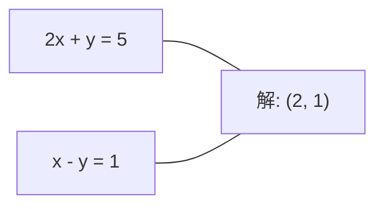
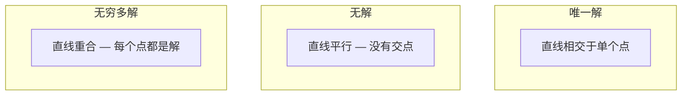

# Sistemas lineales

> 求解   ¿ Qué es esto ?$Ax = b$Es uno de los problemas más antiguos de las matemáticas, y todavía funciona en tu red neuronal.

**Type:** Build
**Language:**Python
**前置要求：**Fase 1, Lecciones 01 (Intucción de álgebra lineal),02 (Vectores y matrices),03 (Transformaciones de matriz)
**Time:** ~120 minutes

## El objetivo del aprendizaje
- Uso con pivotamiento parcial y sustitución de retroceso de eliminación gaussiana 求解 $Ax = b$
- Utiliza LU、QR 和 Cholesky descompuestas 分解 Matrix,并解释每种方法适用场景
- 推导 mínimos cuadrados de las ecuaciones normales,并将其与线性回归和脊回归 联系起来
- Uso de la condición número  diagnóstico de sistemas mal condicionados,并 aplicar regularización 使其稳定

##  problemas
Cada vez que se practica la regresión lineal, se trata de resolver un sistema lineal. Cada vez que se calcula el tamaño de los cuadrados mínimos, se trata de resolver un sistema lineal.`y = Wx + b`Cuando, está en el lado de evaluar el sistema lineal. Cuando se une a la regularización, usted está modificando este sistema. Cuando utiliza procesos de Gaussian. Cuando se descompone una matriz.

方程   Cómo es$Ax = b$No está en ninguna parte.$A$Es una matriz de componentes de números ya conocidos.$b$Es un vector de la configuración de salida ya conocida.$x$Es que quieres encontrar un vector de cantidad desconocida en el regreso en línea.$A$Es tu matriz de datos,$b$Es tu vector objetivo,$x$Es un vector de peso. Todo el modelo puede ser concluido en: encontrar.$x$,使 $Ax$尽可能接近 $b$¿Qué es eso?

En esta clase se entenderán todos los métodos principales para resolver esta ecuación desde cero. Usted entenderá por qué algunos métodos son más rápidos y otros más estables, por qué algunos métodos sólo se aplican a sistemas cuadrados y otros pueden tratar sistemas sobredeterminados, y por qué el número de condiciones de la matriz decide si su respuesta tiene sentido.

## 概念
### Ax = b en la geometría significa qué

Un sistema de ecuaciones lineales 具有几何解释── cada ecuación 定义一个超平面──解就是所有超平面相交的点(或点集)──

```
2x + y = 5          2D 中的两条直线。
x - y  = 1          它们相交于 x=2, y=1。
```



Se pueden presentar tres situaciones:



En Matrix 形式中, "una solución" significa$A$es invertible. "No hay solución" significa que el sistema es inconsistente.$A$tiene un espacio nulo. La mayoría de los problemas de ML pertenecen a la clase de  no tiene una definición exacta, porque tus ecuaciones (punto de datos) son más grandes que los parámetros desconocidos.

### imagen de columna vs imagen de fila

Hay dos formas de entender.$Ax = b$¿Qué es eso?

**Row picture.** $A$Cada línea define una ecuación. Cada ecuación es un hiperplano.

**Column picture.** $A$Cada uno de los rangoes es un vector.$A$¿Qué combinación lineal de columnas puede producirse?$b$¿ Qué ?

```
A = | 2  1 |    b = | 5 |
    | 1 -1 |        | 1 |

Row picture: 同时求解 2x + y = 5 和 x - y = 1。

Column picture: 找到 x1, x2，使得：
  x1 * [2, 1] + x2 * [1, -1] = [5, 1]
  2 * [2, 1] + 1 * [1, -1] = [4+1, 2-1] = [5, 1]   check.
```

Foto de columna 更根本──如果 $b$ en el$A$En el espacio de columna del sistema, el sistema se encuentra en el centro.$b$No entre ellos, encontrará el espacio de columna en el punto más cercano. Este punto más cercano es la solución de los cuadrados más pequeños.

### Eliminación gaussiana

La eliminación de Gaussian$Ax = b$转换为 sistema triangular superior $Ux = c$, y luego con la sustitución de atrás  buscar la solución.

算法:

```
1. 对每一列 k（pivot column）：
   a. 在第 k 行及其下方，找到 column k 中最大的 entry（partial pivoting）。
   b. 将该行与第 k 行交换。
   c. 对 k 下方的每一行 i：
      - 计算 multiplier m = A[i][k] / A[k][k]
      - 从第 i 行中减去 m 倍的第 k 行。
2. Back substitute：从最后一个 equation 向上求解。
```

Muestras:

```
Original:
| 2  1  1 | 8 |       R2 = R2 - (2)R1     | 2  1   1 |  8 |
| 4  3  3 |20 |  -->  R3 = R3 - (1)R1 --> | 0  1   1 |  4 |
| 2  3  1 |12 |                            | 0  2   0 |  4 |

                       R3 = R3 - (2)R2     | 2  1   1 |  8 |
                                       --> | 0  1   1 |  4 |
                                           | 0  0  -2 | -4 |

Back substitute:
  -2 * x3 = -4    -->  x3 = 2
  x2 + 2  = 4     -->  x2 = 2
  2*x1 + 2 + 2 = 8 --> x1 = 2
```

El costo de cálculo de la eliminación de Gaussian$O(n^3)$  $1000 \times 1000$sistema, esto es aproximadamente mil millones de veces operaciones de punto flotante.$A$Buscar más sistemas, también podemos hacerlo mejor.

### Pivotado parcial: ¿Por qué es importante?

 sin pivot, eliminación gaussiana puede fracasar o producir resultados basura Si el elemento pivot es para cero, se separará para cero Si es muy pequeño, se aumentará los errores de redondeo

```
Bad pivot:                       With partial pivoting:
| 0.001  1 | 1.001 |            先交换行：
| 1      1 | 2     |            | 1      1 | 2     |
                                 | 0.001  1 | 1.001 |
m = 1/0.001 = 1000              m = 0.001/1 = 0.001
R2 = R2 - 1000*R1               R2 = R2 - 0.001*R1
| 0.001  1     | 1.001   |      | 1      1     | 2     |
| 0     -999   | -999.0  |      | 0      0.999 | 0.999 |

x2 = 1.000（正确）              x2 = 1.000（正确）
x1 = (1.001 - 1)/0.001          x1 = (2 - 1)/1 = 1.000（正确）
   = 0.001/0.001 = 1.000        稳定，因为 multiplier 很小。
```

En la aritmética de puntos flotantes de precisión limitada, la versión de un pivot no tiene un pivot puede perder cifras significativas.

### Descomposición de las LU

La descomposición de LU$A$分解为 matriz triangular inferior $L$和 matriz triangular superior $U$¿Qué es esto ?$A = LU$¿Qué es eso?$L$Matriz  almacenamiento de la eliminación Gaussian 中的乘法──$U$La matriz es el resultado de la eliminación.

```
A = L @ U

| 2  1  1 |   | 1  0  0 |   | 2  1   1 |
| 4  3  3 | = | 2  1  0 | @ | 0  1   1 |
| 2  3  1 |   | 1  2  1 |   | 0  0  -2 |
```

¿Por qué tener un factor y no eliminarlo directamente?$L$Y $U$, en cualquier nuevo .$b$求解   ¿ Qué es esto ?$Ax = b$Sólo necesito$O(n^2)$¿Qué es esto ?

```math
\begin{aligned}
Ax &= b \\
LUx &= b \\
&\text{令 } y = Ux\text{:} \\
Ly &= b \quad \text{（前代，} O(n^2)\text{）} \\
Ux &= y \quad \text{（回代，} O(n^2)\text{）}
\end{aligned}
```

$O(n^3)$El costo sólo se paga una vez en la facturación.$O(n^2)$Si necesitas usar lo mismo.$A$、 diferentes $b$Los vectores buscan resolver 1000 sistemas, LU hará que el total de trabajo se ahorra aproximadamente 1000/3 veces.

Usando la rotación parcial, lo consigues.$PA = LU$, entre ellos $P$Es la matriz de permutación de los swaps de filas de registro.

### Descomposición de las QR

Descomposición de QR$A$分解为 matriz ortogonales $Q$和 matriz triangular superior $R$¿Qué es esto ?$A = QR$¿Qué es eso?

Matriz ortogonal 具有 $Q^T Q = I$Su naturaleza. Sus columnas son vectores ortónormales.$Q$会保持 lengths 和 angles。

```
A = Q @ R

Q has orthonormal columns: Q^T Q = I
R is upper triangular

To solve Ax = b:
  QRx = b
  Rx = Q^T b    (只需乘以 Q^T，不需要 inversion)
  Back substitute to get x.
```

En la búsqueda de solucionar los problemas de cuadrados mínimos 时,QR比 LU en estabilidad numérica 上更好──Gram-Schmidt proceso 逐列构建 $Q$¿Qué es esto ?

```
Given columns a1, a2, ... of A:

q1 = a1 / ||a1||

q2 = a2 - (a2 . q1) * q1        (减去到 q1 上的 projection)
q2 = q2 / ||q2||                (normalize)

q3 = a3 - (a3 . q1) * q1 - (a3 . q2) * q2
q3 = q3 / ||q3||

R[i][j] = qi . aj    for i <= j
```

Cada paso se moverá junto a todo lo anterior.$q$Componente de los vectores, sólo deja una nueva dirección ortogonal.

### Descomposición de Cholesky

Cuando$A$Es simétrico.$A = A^T$) y positivo definido (todos los valores propios están en forma) cuando se puede desglosar en$A = L L^T$, entre ellos $L$Es triangular inferior. Ésta es la descomposición de Cholesky.

```
A = L @ L^T

| 4  2 |   | 2  0 |   | 2  1 |
| 2  5 | = | 1  2 | @ | 0  2 |

L[i][i] = sqrt(A[i][i] - sum(L[i][k]^2 for k < i))
L[i][j] = (A[i][j] - sum(L[i][k]*L[j][k] for k < j)) / L[j][j]    for i > j
```

Cholesky es casi dos veces más grande que LU, y sólo necesita la mitad del espacio de almacenamiento.

- Las matrices de covarianza son semidefinidas simétricas positivas (a través de la regularización, se pueden cambiar por definidas positivas)
- La matriz del núcleo de procesos gaussianos en el medio es una definición positiva simétrica.
- La función convexa en el mínimo de la posición de Hessian es un definido positivo simétrico.
- $A^T A$总是 simétrico positivo semi-definido

En procesos gaussianos, usas Cholesky para descifrar la matriz del núcleo.$K$, y luego buscar la solución .$K \alpha = y$Para obtener un significado predictivo, el factor Cholesky también da un determinante de probabilidad marginal:$\log \det(K) = 2 \sum \log(\mathop{\mathrm{diag}}(L))$¿Qué es eso?

### Cuadrados mínimos:当 Ax = b 没有精确解时

Si es que$A$Sí $m \times n$且 $m > n$(equaciones 多于未知), el sistema es sobredeterminado.

```
minimize ||Ax - b||^2

这是 squared residuals 的总和：
  sum((A[i,:] @ x - b[i])^2 for i in range(m))
```

Minimizar  satisfagan las ecuaciones normales:

```math
A^T A x = A^T b
```

推导:展开 $\lVert Ax - b \rVert^2 = (Ax - b)^T (Ax - b) = x^T A^T A x - 2 x^T A^T b + b^T b$¿Qué es esto?$x$求 Gradiente,并令其为零:$2 A^T A x - 2 A^T b = 0$¿Qué es eso?

```
Original system (overdetermined, 4 equations, 2 unknowns):
| 1  1 |         | 3 |
| 1  2 | x     = | 5 |       没有精确的 x 能满足全部 4 个 equations。
| 1  3 |         | 6 |
| 1  4 |         | 8 |

Normal equations:
A^T A = | 4  10 |    A^T b = | 22 |
        | 10 30 |            | 63 |

Solve: x = [1.5, 1.7]

这就是 linear regression。x[0] 是 intercept，x[1] 是 slope。
```

### Equaciones normales = regresión lineal

Este tipo de conexión es preciso. En la regresión lineal, la matriz de datos.$X$Cada línea se enfrenta a una muestra, cada línea se enfrenta a una característica.$y$Cada entrada corresponde a una muestra.$w$满足:

```math
\begin{aligned}
X^T X w &= X^T y \\
w &= (X^T X)^{-1} X^T y
\end{aligned}
```

Esta es una solución de forma cerrada de regresión lineal.`sklearn.linear_model.LinearRegression.fit()`Ciudad calcular este resultado (o a través de QR o SVD  calcular resultados similares)

hacia Matrix 添加 regularisation término $\lambda I$, tienes regresión de la cresta:

```math
\begin{aligned}
(X^T X + \lambda I) w &= X^T y \\
w &= (X^T X + \lambda I)^{-1} X^T y
\end{aligned}
```

La regularización hará que la matriz esté condicionada mejor (más fácilmente se puede obtener la inversa), y a través de la contracción de los pesos hacia el cero para evitar el sobreajuste.$\lambda > 0$时,Matrix $X^T X + \lambda I$总是对称正确, por lo tanto se puede utilizar Cholesky 求解──

### Pseudoinverso (Moore-Penrose)

Pseudoinversión $A^+$La inversión de la matriz 推广到非平方 和 singular matrices──对任意 Matrix $A$¿Qué es esto ?

```math
\begin{aligned}
x &= A^+ b \\[4pt]
\text{其中 } A^+ &= V \Sigma^+ U^T \quad \text{（通过 SVD 计算）}
\end{aligned}
```

$\Sigma^+$通过对每个非零单数值 取相互并转置结果构成──如果 $A = U \Sigma V^T$Entonces ...$A^+ = V \Sigma^+ U^T$¿Qué es eso?

```
A = U Sigma V^T        (SVD)

Sigma = | 5  0 |       Sigma+ = | 1/5  0  0 |
        | 0  2 |                | 0  1/2  0 |
        | 0  0 |

A+ = V Sigma+ U^T
```

Pseudoinverso                                                                                                                                                                                                                                                                                                                                                                                                                                                                                                                          
- 唯一解:$A^+ b$¿Qué quieres decir?
- 无解:$A^+ b$给出最小平方的解决方案──
- 无穷多解:$A^+ b$- ¿ Qué ?$\lVert x \rVert$La última de las soluciones.

NumPy de `np.linalg.lstsq`Y `np.linalg.pinv`内部都使用 SVD。

### Número de condición

Número de condición  Solución de medida                                                                                                                                                                                                                                                                                                                                                                                                                                                                                                                     $A$,número de condición es:

```math
\kappa(A) = \lVert A \rVert \cdot \lVert A^{-1} \rVert = \frac{\sigma_{\max}}{\sigma_{\min}}
```

Entre ellos $\sigma_{\max}$Y $\sigma_{\min}$Se diferencian los valores mayores y menores de singularidad.

```
Well-conditioned (kappa ~ 1):        Ill-conditioned (kappa ~ 10^15):
b 中的小变化 -->                    b 中的小变化 -->
x 中的小变化                         x 中的巨大变化

| 2  0 |   kappa = 2/1 = 2          | 1   1          |   kappa ~ 10^15
| 0  1 |   safe to solve            | 1   1+10^(-15) |   solution is garbage
```

经验法则:
- $\kappa < 100$: seguridad, solución 准确。
- $\kappa \approx 10^k$¿Cómo se puede ver la diferencia entre los números de los puntos flotantes y los números de los puntos flotantes ?$k$位精度──
- $\kappa \approx 10^{16}$(Para float64):solución 没有意义──Matrix 实际上是单一──

En el ML, mal-condicionamiento ocurre en características quasi colinear 时──regularización 添加 $\lambda I$) se va a poner el número de condición de$\sigma_{\max} / \sigma_{\min}$ mejoramiento $(\sigma_{\max} + \lambda) / (\sigma_{\min} + \lambda)$¿Qué es eso?

### Métodos iterativos: gradiente conjugado

Para sistemas muy grandes y raros, millones de desconocidos, métodos directos como LU o Cholesky, métodos iterativos, que pueden ser utilizados en varias ocasiones, pueden mejorar una conjetura para una solución similar.

Gradiente conjugado (CG) en$A$Es simétrico positivo definido 时求解 $Ax = b$◊ Es en la aritmética exacta $n$Luego encontraré una solución, pero si$A$Los valores propios   reunir, normalmente                                                                                                                                                                                                                                                                                                                                                                                                                                                                                                                      

```
Algorithm sketch:
  x0 = initial guess (often zero)
  r0 = b - A x0           (residual)
  p0 = r0                 (search direction)

  For k = 0, 1, 2, ...:
    alpha = (rk . rk) / (pk . A pk)
    x_{k+1} = xk + alpha * pk
    r_{k+1} = rk - alpha * A pk
    beta = (r_{k+1} . r_{k+1}) / (rk . rk)
    p_{k+1} = r_{k+1} + beta * pk
    if ||r_{k+1}|| < tolerance: stop
```

CG Usado para:
- Optimización a gran escala (método Newton-CG)
- 求解 Discretizations de la PDE
- Métodos del núcleo, entre los cuales la matriz del núcleo 太大无法 factor
-  Como precondicionamiento de otros solventes iterativos

La tasa de convergencia depende del número de condiciones.

### El cuadro completo:何时使用哪种方法

| Method | Requirements | Cost | Use case |
|--------|-------------|------|----------|
| Gaussian elimination | Square, nonsingular $A$ | $O(n^3)$ | 对 square system 的一次性求解 |
| LU decomposition | Square, nonsingular $A$ | $O(n^3)$ factor + $O(n^2)$ solve | 使用相同 $A$ 的多次求解 |
| QR decomposition | Any $A$ ($m \ge n$) | $O(mn^2)$ | Least squares，numerically stable |
| Cholesky | Symmetric positive definite $A$ | $O(n^3/3)$ | Covariance matrices，Gaussian processes，ridge regression |
| Normal equations | Overdetermined ($m > n$) | $O(mn^2 + n^3)$ | Linear regression（小 $n$） |
| SVD / pseudoinverse | Any $A$ | $O(mn^2)$ | Rank-deficient systems，minimum-norm solutions |
| Conjugate gradient | Symmetric positive definite, sparse $A$ | $O(n \cdot k \cdot \text{nnz})$ | Large sparse systems，$k$ = iterations |

### Conexión a ML

Cada método de esta clase se encuentra en el ML de producción:

**Linear regression.**Solución de forma cerrada 求解 ecuaciones normales $X^T X w = X^T y$Esto puede pasar por Cholesky si$n$很小) 、QR(si la estabilidad numérica 很重要) o SVD(si la matriz puede ser deficiente en rango)完成。

**Ridge regression.**¿ Qué ?$X^T X$添加                                                                                                                                                                                                                                                                                                                                                                                                                                                                                                                           $\lambda I$ Sistema regularizado$(X^T X + \lambda I) w = X^T y$Siempre puedo pasar por Cholesky, porque ahora.$\lambda > 0$时,$X^T X + \lambda I$Es un positivo simétrico definido.

**Gaussian processes.**Medios predictivos 需要求解 $K \alpha = y$, entre ellos $K$Es la matriz del núcleo.$K$Hacer la factorization de Cholesky es el método estándar. Logar probabilidad marginal.$\log \det(K) = 2 \sum \log(\mathop{\mathrm{diag}}(L))$¿Qué es eso?

**Neural network initialization.**Inicialización ortogonal Utiliza la descomposición QR  Crea columnas para matrices de peso ortónormales― esto puede prevenir el colapso de señales en redes profundas―

**Preconditioning.**Optimizadores a gran escala Utilizan Cholesky incompleto o LU incompleto como precondiciones de solventes de gradientes conjugados。

**Feature engineering.** $X^T X$El número de condición  te dice las características si no colinear── si $\kappa$很大, eliminar características o añadir regularización.


```figure
linear-system-conditioning
```

## Construirlo
### 步骤 1: Eliminación gaussiana con pivotado parcial

```python
import numpy as np

def gaussian_elimination(A, b):
    n = len(b)
    Ab = np.hstack([A.astype(float), b.reshape(-1, 1).astype(float)])

    for k in range(n):
        max_row = k + np.argmax(np.abs(Ab[k:, k]))
        Ab[[k, max_row]] = Ab[[max_row, k]]

        if abs(Ab[k, k]) < 1e-12:
            raise ValueError(f"Matrix is singular or nearly singular at pivot {k}")

        for i in range(k + 1, n):
            m = Ab[i, k] / Ab[k, k]
            Ab[i, k:] -= m * Ab[k, k:]

    x = np.zeros(n)
    for i in range(n - 1, -1, -1):
        x[i] = (Ab[i, -1] - Ab[i, i+1:n] @ x[i+1:n]) / Ab[i, i]

    return x
```

### Paso 2: Descomposición de la LU

```python
def lu_decompose(A):
    n = A.shape[0]
    L = np.eye(n)
    U = A.astype(float).copy()
    P = np.eye(n)

    for k in range(n):
        max_row = k + np.argmax(np.abs(U[k:, k]))
        if max_row != k:
            U[[k, max_row]] = U[[max_row, k]]
            P[[k, max_row]] = P[[max_row, k]]
            if k > 0:
                L[[k, max_row], :k] = L[[max_row, k], :k]

        for i in range(k + 1, n):
            L[i, k] = U[i, k] / U[k, k]
            U[i, k:] -= L[i, k] * U[k, k:]

    return P, L, U

def lu_solve(P, L, U, b):
    n = len(b)
    Pb = P @ b.astype(float)

    y = np.zeros(n)
    for i in range(n):
        y[i] = Pb[i] - L[i, :i] @ y[:i]

    x = np.zeros(n)
    for i in range(n - 1, -1, -1):
        x[i] = (y[i] - U[i, i+1:] @ x[i+1:]) / U[i, i]

    return x
```

### Paso 3: Descomposición de Cholesky

```python
def cholesky(A):
    n = A.shape[0]
    L = np.zeros_like(A, dtype=float)

    for i in range(n):
        for j in range(i + 1):
            s = A[i, j] - L[i, :j] @ L[j, :j]
            if i == j:
                if s <= 0:
                    raise ValueError("Matrix is not positive definite")
                L[i, j] = np.sqrt(s)
            else:
                L[i, j] = s / L[j, j]

    return L
```

### 步骤 4: Cuadrados mínimos a través de ecuaciones normales

```python
def least_squares_normal(A, b):
    AtA = A.T @ A
    Atb = A.T @ b
    return gaussian_elimination(AtA, Atb)

def ridge_regression(A, b, lam):
    n = A.shape[1]
    AtA = A.T @ A + lam * np.eye(n)
    Atb = A.T @ b
    L = cholesky(AtA)
    y = np.zeros(n)
    for i in range(n):
        y[i] = (Atb[i] - L[i, :i] @ y[:i]) / L[i, i]
    x = np.zeros(n)
    for i in range(n - 1, -1, -1):
        x[i] = (y[i] - L.T[i, i+1:] @ x[i+1:]) / L.T[i, i]
    return x
```

### 步骤 5: Número de condición

```python
def condition_number(A):
    U, S, Vt = np.linalg.svd(A)
    return S[0] / S[-1]
```

## Usalo
Para combinar estas partes, realizar una regresión lineal y una regresión de la cresta en datos reales:

```python
np.random.seed(42)
X_raw = np.random.randn(100, 3)
w_true = np.array([2.0, -1.0, 0.5])
y = X_raw @ w_true + np.random.randn(100) * 0.1

X = np.column_stack([np.ones(100), X_raw])

w_ols = least_squares_normal(X, y)
print(f"OLS weights (ours):    {w_ols}")

w_np = np.linalg.lstsq(X, y, rcond=None)[0]
print(f"OLS weights (numpy):   {w_np}")
print(f"Max difference: {np.max(np.abs(w_ols - w_np)):.2e}")

w_ridge = ridge_regression(X, y, lam=1.0)
print(f"Ridge weights (ours):  {w_ridge}")

from sklearn.linear_model import Ridge
ridge_sk = Ridge(alpha=1.0, fit_intercept=False)
ridge_sk.fit(X, y)
print(f"Ridge weights (sklearn): {ridge_sk.coef_}")
```

##  entregarlo
本课产 出:
- `code/linear_systems.py`, contiene desde el zero la eliminación gaussiana de la realización, la descomposición de LU, la descomposición de Cholesky, los cuadrados mínimos y la regresión de la cresta
- Una demostración de una operación, que muestra las ecuaciones normales y la Regresión Lineal de los cálculos produce los mismos pesos

##  ejercicios
1. Utiliza tu eliminación gaussiana, tu solvente de LU y`np.linalg.solve`求解 sistema `[[1,2,3],[4,5,6],[7,8,10]] x = [6, 15, 27]`❖ Experimentación en tolerancia de punto flotante en en da la misma respuesta―

2. 生成一个50x5 matriz aleatoria X 和 objetivo y = X @ w_true + ruido──分别使用正常方程、QR(通过 `np.linalg.qr`)、SVD( a través de `np.linalg.svd`) y `np.linalg.lstsq`求解 w──比较四个解决方案──测量 $X^T X$¿Cómo puede afectar a tu confianza?

3. 通过让两列几乎相同来创建一个几乎单一矩阵 (例如, columna 2 = columna 1 + 1e-10 * ruido) ⋅ calcular su número de condición ⋅分别在有规律化和无规律化的情况下求解$Ax = b$(添加 $0.01 I$)― Comparar soluciones y residuos― Explicar por qué la regularización es útil―

4. Para una matriz positiva definida simétrica aleatoria 100x100  lograr algoritmo de gradiente conjugado―统计它收到容忍 1e-8 需要多少次反复──与 $n$El valor máximo de las iteraciones se compara.

5. En la matriz positiva definida de 10 50 200 500 en la matriz de la matriz, en la matriz de la matriz de la matriz de la matriz de la matriz de la matriz de la matriz de la matriz de la matriz de la matriz de la matriz de la matriz de la matriz de la matriz de la matriz de la matriz de la matriz de la matriz de la matriz de la matriz de la matriz de la matriz de la matriz de la matriz de la matriz de la matriz de la matriz de la matriz de la matriz de la matriz de la matriz de la matriz de la matriz de la matriz de la matriz de la matriz de la matriz de la matriz de la matriz de la matriz de la matriz de la matriz de la matriz de la matriz de la matriz de la matriz de la matriz de la matriz de la matriz de la matriz de la matriz de la matriz de la matriz de la matriz de la matriz de la matriz de la matriz de la matriz de la matriz de la matriz de la matriz de la matriz de la matriz de la matriz de la matriz de la matriz de la matriz de la matriz de la matriz de la matriz de la matriz de la matriz de la matriz de la matriz de la matriz de la matriz de la matriz de la matriz de la matriz de la matriz de la matriz de la matriz de la matriz de la matriz de la matriz de la matriz de la matriz de la matriz de la matriz de la matriz de la matriz de la matriz de la matriz de la matriz de la matriz de la matriz de la matriz de la matriz de la matriz de la matriz de la matriz de la matriz de la matriz de la matriz de la matriz de la matriz de la matriz de la matriz de la matriz de la matriz de la matriz de la matriz de la matriz de la matriz de la matriz de la matriz de la matriz de la matriz de la matriz de la matriz de la matriz de la matriz de`np.linalg.solve`计时――绘制结果――验证 Cholesky 大约比 LU 快 2倍――

### 提示

**练习 1。**调用                                                                                                                                                                                                                                                                                                                                                                                                                                                                                                                           `gaussian_elimination(A, b)`, re调用 `lu_decompose(A)`Y luego se puso a usar`lu_solve(P, L, U, b)`, última调用 `np.linalg.solve(A, b)` Uso`np.allclose(A @ x, b)`检查每个解,并用 `np.allclose`Comparar estas tres soluciones.

**练习 2。**Para las ecuaciones normales `least_squares_normal`, el resto de métodos utilizan las tres funciones de NUMPY                                                                                                                                                                                                                                                        `w_true` Compare `condition_number(X.T @ X)`Y `condition_number(X)`El primero es el cuadrado del segundo, por lo tanto, las ecuaciones normales pierden la mayor precisión.

**练习 3。**预期 condición número 会超过 $10^{9}$△分別使用 `np.linalg.solve`Y `ridge_regression(A, b, 0.01)`                                                                                                                                                                                                                                                              `np.linalg.norm(x)`Y norma residual. Dos residuos pueden ser muy pequeños, pero la solución de la regularización no suele contener una gran cantidad.

**练习 4。**Uso `B @ B.T + n * np.eye(n)`Construir una matriz positiva simétrica definida, garantizando que cada valor propio está en su lugar.`conjugate_gradient`En el ciclo de la cuenta, se incluye el contador, y luego se verifica si la norma residual final es menor que 1e-8, si el número de veces no supera los 100[6].

**练习 5。**Tres tipos de solventes`B @ B.T + n * np.eye(n)`矩阵,并用 `time.perf_counter`∆ medir el tiempo de cada búsqueda de solución, obtener el mejor resultado de varias operaciones¬¬¬¬¬¬¬¬¬¬¬¬¬¬¬¬¬¬¬¬¬¬¬¬¬¬¬¬¬¬¬¬¬¬¬¬¬¬¬¬¬¬¬¬¬¬¬¬¬¬¬¬¬¬¬¬¬¬¬¬¬¬¬¬¬¬¬¬¬¬¬¬¬¬¬¬¬¬¬¬¬¬¬¬¬¬¬¬¬¬¬¬¬¬¬¬¬¬¬¬¬¬¬¬¬¬¬¬¬¬¬¬¬¬¬¬¬¬¬¬¬¬¬¬¬¬¬¬¬¬¬¬¬¬¬¬¬¬¬¬¬¬¬¬¬¬¬¬¬¬¬¬¬¬¬¬¬¬¬¬¬¬¬¬¬¬¬¬¬¬¬¬¬¬¬¬¬¬¬¬¬¬¬¬¬¬¬¬¬¬¬¬¬¬¬¬¬¬¬¬¬¬¬¬¬¬¬¬¬¬¬¬¬¬¬¬¬¬¬¬¬¬¬¬¬¬¬¬¬¬¬¬¬¬¬¬¬¬¬¬¬¬¬¬¬¬¬¬¬¬¬¬¬¬¬¬¬¬¬¬¬¬¬¬¬¬¬¬¬¬¬¬¬¬¬¬¬¬¬¬¬¬¬¬¬¬¬¬¬¬¬¬¬¬¬¬¬¬¬¬¬¬¬¬¬¬¬¬¬¬¬¬¬¬¬¬¬¬¬¬¬¬¬¬¬¬¬¬¬¬¬¬¬¬¬¬¬¬¬¬¬¬¬¬¬¬¬¬¬¬¬¬¬¬¬¬¬¬¬¬¬¬¬¬¬¬¬¬¬¬¬¬¬¬¬¬¬¬¬¬¬¬¬¬¬¬¬¬¬¬¬¬¬¬¬¬¬¬¬¬¬¬¬¬¬¬¬¬¬¬¬¬¬¬¬¬¬¬¬¬¬¬¬¬¬¬¬¬¬¬¬¬¬¬¬¬¬¬¬¬¬¬¬¬¬¬¬¬¬¬¬¬¬¬¬¬¬¬¬¬¬¬¬¬¬¬¬¬¬¬¬¬¬¬¬¬¬¬¬¬¬¬¬¬¬¬¬¬¬¬

## 关键术语: "El hombre es un hombre"
| Term | What people say | What it actually means |
|------|----------------|----------------------|
| Linear system | "Solve for x" | 一组 linear equations $Ax = b$。找到 $x$ 意味着找到在 transformation $A$ 下产生 output $b$ 的 input。 |
| Gaussian elimination | "Row reduce" | 使用 row operations 系统性地将 diagonal 下方的 entries 置零，产生可通过 back substitution 求解的 upper triangular system。$O(n^3)$。 |
| Partial pivoting | "Swap rows for stability" | 在 column $k$ 中进行 elimination 前，将该 column 中 absolute value 最大的行交换到 pivot 位置。防止除以很小的数。 |
| LU decomposition | "Factor into triangles" | 写成 $A = LU$，其中 $L$ 是 lower triangular（存储 multipliers），$U$ 是 upper triangular（eliminated matrix）。将 $O(n^3)$ 成本摊销到多次求解中。 |
| QR decomposition | "Orthogonal factorization" | 写成 $A = QR$，其中 $Q$ 的 columns 是 orthonormal，$R$ 是 upper triangular。对于 least squares，比 LU 更稳定。 |
| Cholesky decomposition | "Square root of a matrix" | 对 symmetric positive definite $A$，写成 $A = LL^T$。成本是 LU 的一半。用于 covariance matrices、kernel matrices 和 ridge regression。 |
| Least squares | "Best fit when exact is impossible" | 当 system overdetermined（equations 多于 unknowns）时，最小化 squared residuals 的总和 $\lVert Ax - b \rVert^2$。 |
| Normal equations | "The calculus shortcut" | $A^T A x = A^T b$。将 $\lVert Ax - b \rVert^2$ 的 Gradient 设为零。这就是 linear regression 的 closed-form solution。 |
| Pseudoinverse | "Inversion for non-square matrices" | $A^+ = V \Sigma^+ U^T$ via SVD。对于任意 Matrix，无论 square 或 rectangular、singular 与否，给出 minimum-norm least-squares solution。 |
| Condition number | "How trustworthy is this answer" | $\kappa = \sigma_{\max} / \sigma_{\min}$。衡量对 input perturbations 的敏感性。大约损失 $\log_{10}(\kappa)$ 位精度。 |
| Ridge regression | "Regularized least squares" | 求解 $(X^T X + \lambda I) w = X^T y$。添加 $\lambda I$ 改善 conditioning，并将 weights 向零收缩。防止 overfitting。 |
| Conjugate gradient | "Iterative Ax=b for big matrices" | 用于 symmetric positive definite systems 的 iterative solver。最多 $n$ 步收敛。适合 factorization 成本过高的大型 sparse systems。 |
| Overdetermined system | "More data than parameters" | 在 $m\text{-by-}n$ system 中 $m > n$。不存在精确解。Least squares 找到最佳近似。这就是每个 regression problem。 |
| Back substitution | "Solve from the bottom up" | 给定 upper triangular system，先求解最后一个 equation，然后向后 substitute。$O(n^2)$。 |
| Forward substitution | "Solve from the top down" | 给定 lower triangular system，先求解第一个 equation，然后向前 substitute。$O(n^2)$。用于 LU solves 中的 L step。 |

## 延伸阅读
- [MIT 18.06: Linear Algebra](https://ocw.mit.edu/courses/18-06-linear-algebra-spring-2010/)(Gilbert Strang) --                                                                                                                                                                                                                                                                                                                                                                                                                                                                                                                      
- [Numerical Linear Algebra](https://people.maths.ox.ac.uk/trefethen/text.html)(Trefethen & Bau) -- Comprender la estabilidad numérica, el acondicionamiento y los algoritmos por qué no
- [Matrix Computations](https://www.cs.cornell.edu/cv/GolubVanLoan4/golubandvanloan.htm)(Golub & Van Loan) --  охватыва разных матричных алгоритмов 百科式参考
- [3Blue1Brown: Inverse Matrices](https://www.3blue1brown.com/lessons/inverse-matrices)- Para la solicitud$Ax = b$几何意义的可见化直觉 (en inglés)
