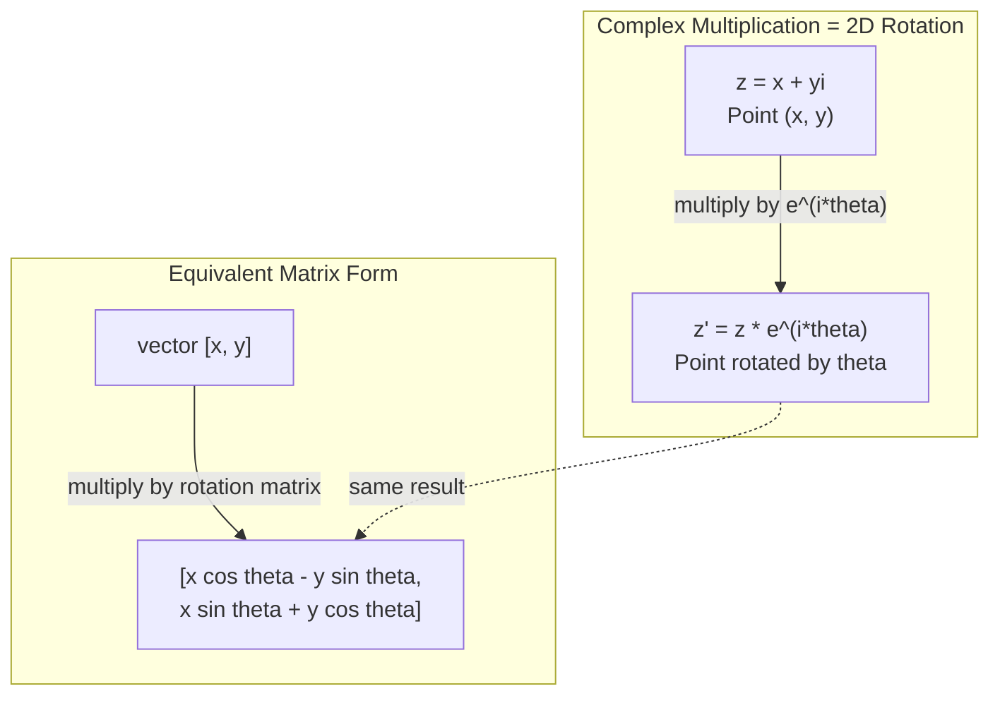
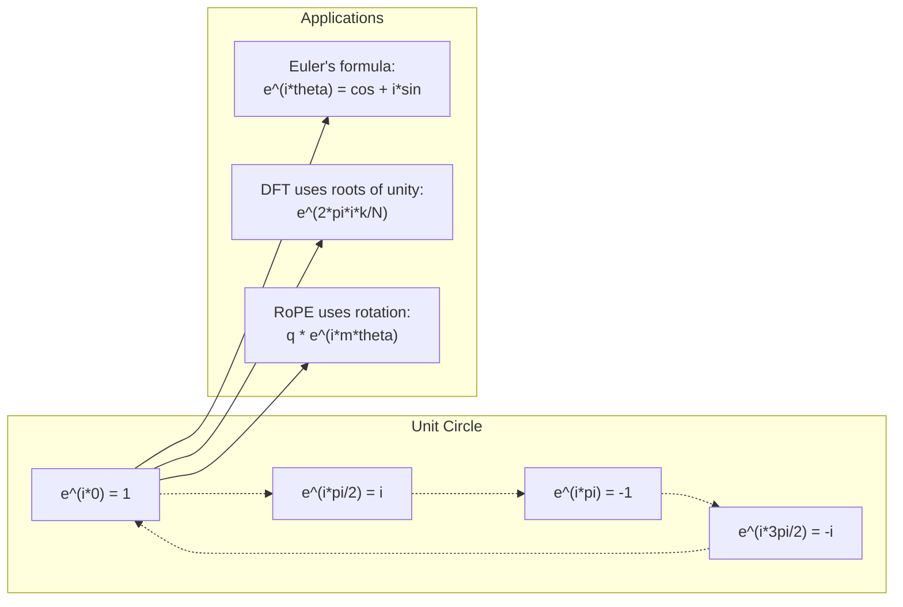

# Número de ejemplos

> La raíz cuadrada de -1 no es falsa. Es clave en el campo de la rotación, la frecuencia y la media de procesamiento de señales.

**Type:** Learn
**Language:**Python
**Prerequisites:** Phase 1, Lessons 01-04（linear algebra, calculus）
**Time:** ~60 分钟

## El objetivo del aprendizaje
- En forma directa y en forma de extremo de la posición ejecutar un número de operaciones (加法,乘法,除法,共)
-  aplicación de la fórmula de Euler en la resumen entre la función de la cuadro y la de la cuadro
- Utilizaciones de la base de datos para realizar la transformación discreta de Fourier
-  Explicar la cantidad de rotaciones cómo se compone Transformer 中 RoPE 和正弦位置编码的基础

##  problemas
¿Qué es esto? ¿Qué es esto?`i`△ Usted lee Transformer  ubicación  código, ver diferentes frecuencias `sin`Y `cos` 也就是复指数的实部和虚部──阅读量子计算, y encontrar todo con rép Vector 空间 para expresar──

El número de veces parece muy abstracto. Un sistema de números basado en la raíz cuadrada de -1 se siente como una especie de habilidad matemática. Pero no es una habilidad. Es el lenguaje natural de la rotación y la oscilación. Cada vez que algo gira, oscila o oscila, el número de veces es un instrumento adecuado.

Si no entiendes el número de números, no puedes entender la Transformación de Fourier Discreta.

Este curso se desarrollará desde la construcción de números complejos, conectándolos a la geometría, y mostrará exactamente la posición de los números complejos en el aprendizaje automático.

## 概念
### ¿Qué es el número?

El número de números tiene dos partes: el verdadero y el falso.

```
z = a + bi

where:
  a is the real part
  b is the imaginary part
  i is the imaginary unit, defined by i^2 = -1
```

Así es. Tú has hecho que el eje de números se expanda en una plana. El número real se encuentra en una línea de eje, el número virtual en otra línea de eje. Cada número complejo es un punto de esta línea de eje.

### 复数运算

**加法。**¿Qué es eso?

```math
\begin{aligned}
(a + bi) + (c + di) &= (a + c) + (b + d)i \\[4pt]
\text{示例：} (3 + 2i) + (1 + 4i) &= 4 + 6i
\end{aligned}
```

**乘法。**Uso de la ley de distribución,并记住 $i^2 = -1$¿Qué es eso?

```math
\begin{aligned}
(a + bi)(c + di) &= ac + adi + bci + bdi^2 \\
&= ac + adi + bci - bd \\
&= (ac - bd) + (ad + bc)i \\[8pt]
\text{示例：} (3 + 2i)(1 + 4i) &= 3 + 12i + 2i + 8i^2 \\
&= 3 + 14i - 8 \\
&= -5 + 14i
\end{aligned}
```

**共轭。**翻转虚部的符号──

```math
(a + bi)\text{ 的共轭} = a - bi
```

Un número multiplicado y su suma multiplicada son números reales:

```math
(a + bi)(a - bi) = a^2 + b^2
```

**除法。**分子 y分母 simultáneamente multiplicadas por la共──

```math
\frac{a + bi}{c + di} = \frac{(a + bi)(c - di)}{c^2 + d^2}
```

Esto se desvanece en la parte de la matriz, obtendrá un número de veces limpio.

### 复平面

复平面把每复数映射到一个2D点──水平轴是实轴,垂直轴是虚轴──

```
z = 3 + 2i  corresponds to the point (3, 2)
z = -1 + 0i corresponds to the point (-1, 0) on the real axis
z = 0 + 4i  corresponds to the point (0, 4) on the imaginary axis
```

复数同时是一个点, es también un vector de origen de un punto. Esta doble explicación es la razón por la cual el número es útil en la geometría.

### 极坐标形式 (en inglés)

Cualquier punto en la superficie puede ser utilizado para describir la distancia del punto de origen, así como el ángulo de su eje real en relación con el eje real.

```math
\begin{aligned}
z &= r (\cos\theta + i \sin\theta) \\[4pt]
\text{其中：} r &= |z| = \sqrt{a^2 + b^2} \quad \text{（magnitude，即模）} \\
\theta &= \mathop{\mathrm{atan2}}(b, a) \quad \text{（phase，即辐角）}
\end{aligned}
```

En forma directa$(a + bi)$适合加法──极坐标形式                                                                                                                                                                                                                                                                                                                                                                                                                                                                                                                    $(r, \theta)$¿Cómo es que no lo haces?

**极坐标形式下的乘法。**模长相乘, ángulo de la imagen

```math
\begin{aligned}
z_1 &= r_1 e^{i\theta_1} \\
z_2 &= r_2 e^{i\theta_2} \\[4pt]
z_1 z_2 &= (r_1 r_2) \, e^{i(\theta_1 + \theta_2)}
\end{aligned}
```

Es por eso que el número de veces es muy adecuado para dar una vuelta.

### La fórmula de Euler

Puente entre la función de la base y la de la base:

```math
e^{i\theta} = \cos\theta + i \sin\theta
```

Esta es la fórmula más importante de la clase.$\theta = \pi$时:

```math
\begin{aligned}
e^{i\pi} &= \cos\pi + i \sin\pi = -1 + 0i = -1 \\[4pt]
\text{因此：} e^{i\pi} + 1 &= 0
\end{aligned}
```

五个基本常数 (cualquier número de veces)$e$¿ Qué ?$i$¿ Qué ?$\pi$, 1, 0) se conectan en una misma manera.

### ¿Por qué la fórmula de Euler para ML es importante?

La fórmula de Euler indica,$e^{i\theta}$¿ Qué pasa ?$\theta$变化描绘单位圆──当 $\theta = 0$时, estás en $(1, 0)$¿Qué es esto?$\theta = \pi/2$时, estás en $(0, 1)$¿Qué es esto?$\theta = \pi$时, estás en $(-1, 0)$¿Qué es esto?$\theta = 3\pi/2$时, estás en $(0, -1)$ 完整一圈旋转是 $\theta = 2\pi$¿Qué es eso?

Esto significa que el índice de repetición es la rotación.

### Enlace con la rotación 2D

Se puede ver$(x + yi)$乘以                                                                                                                                                                                                                                                                                                                                                                                                                                                                                                                           $e^{i\theta}$, lo pondré en el punto$(x, y)$ Rondando el punto de rotación $\theta$¿Qué es eso?

```math
\begin{aligned}
&\text{通过复数乘法旋转：} \\
&\quad (x + yi)(\cos\theta + i \sin\theta) = (x \cos\theta - y \sin\theta) + (x \sin\theta + y \cos\theta)i \\[8pt]
&\text{通过矩阵乘法旋转：} \\
&\quad \begin{bmatrix} \cos\theta & -\sin\theta \\ \sin\theta & \cos\theta \end{bmatrix} \begin{bmatrix} x \\ y \end{bmatrix} = \begin{bmatrix} x \cos\theta - y \sin\theta \\ x \sin\theta + y \cos\theta \end{bmatrix}
\end{aligned}
```

它们 producen el mismo resultado. 复数乘法就是 2D 旋转. 旋转矩阵 只是用矩阵记法写出的复数乘法.



### Fázor y señal de rotación

复指数                                                                                                                                                                                                                                                                                                                                                                                                                                                                                                                          $e^{i\omega t}$Es una frecuencia de ángulo.$\omega$绕单位圆旋的点──随随 $t$增加, este punto se dibuja fuera de la red.

Esta es la parte real del punto de rotación.$\cos(\omega t)$虚部是 $\sin(\omega t)$△正弦信号就是旋转复数投下的影子──

```math
\begin{aligned}
e^{i\omega t} &= \cos(\omega t) + i \sin(\omega t) \\[4pt]
\text{实部：} & \cos(\omega t) \quad \text{，即 cosine wave} \\
\text{虚部：} & \sin(\omega t) \quad \text{，即 sine wave}
\end{aligned}
```

Éste es el modo de expresión de la fase. Deje de seguir una ola de cuerda de un descenso, pero sigue una flecha de rotación plana.

### Unidad de base

$N$La siguiente unidad es la unidad de círculo de distribución entre e igual.$N$¿Qué es eso ?

```math
w_k = e^{2\pi i k/N} \quad \text{其中 } k = 0, 1, 2, \ldots, N-1
```

Cuando$N = 4$时,根是:$1, i, -1, -i$(Cuatro rostros)
Cuando$N = 8$Cuando, obtendrás cuatro direcciones, y luego cuatro direcciones en contra de las esquinas.

La base de la transformación de Fourier discreta es la unidad.$N$个等间隔频率上的分量──

### Enlace con DFT

 señal $x[0], x[1], \ldots, x[N-1]$La Transformación de Fourier discreta es:

```math
X[k] = \sum_{n=0}^{N-1} x[n] \, e^{-2\pi i k n/N}
```

Cada uno .$X[k]$∆ Medir las señales y la$k$个单位根的相关程度,也就是与频率的相关程度,也就是与频率的相关程度$k$处一个复正弦波的相关程度──DFT 将信号分解为 $N$个旋转phasor,并告诉你每一个振幅和相位的每个振幅和相位的并告诉你每一个振幅和相位的并告诉你每一个相位的振幅和相位的并告诉你每一个振幅和相位的振幅和相位的并告诉你每一个相位的振幅和相位的振幅和相位的振幅和相位的每一个振幅和相位的振幅和相位的每一个振幅和相位的振幅和相位的

### ¿Por qué no estoy mintiendo?

Imaginario Este término es casualidad histórica―Descartes 曾带带着轻蔑的意思使用它―但$i$Y no compara el número negativo con el número negativo. Respuesta negativa es: ¿Qué se puede obtener de 3 por deducción de 5?

Más útil es entender:$i$Es un 90° de rotación de un número real multiplicado por un$i$Una vez, te giras 90° hasta el eje falso.$i$Una vez$i^2$), tu gira de nuevo 90 grados, ahora en dirección negativa en el eje real.$i^2 = -1$ Não é misterioso Está rodeado por dos semicirculares formados por dos cuartos de círculo

Por eso el complejo no está en el diseño. Cualquier cosa que se gire es natural para la descripción de la composición.

### 复指数 vs 三角函数

Antes de la fórmula de Euler, el ingeniero escribió una señal.$A \cos(\omega t + \phi)$ 振幅                                                                                                                                                                                                                                                                                                                                                                                                                                                                                                                         $A$、 frecuencia $\omega$、相位 $\phi$ Es factible, pero hará que el cálculo sea doloroso                                                                                                                                                                                                                                                       

Usando el índice de repetición, se puede escribir una señal.$A e^{i(\omega t + \phi)}$△相加两个信号只是相加两个复数──相乘(调制)只是模长相乘、角度相加──相位偏移变成角加法──频率偏移变成乘乘相──

Todo el campo del procesamiento de señales se ha vuelto a la memoria de números, ya que la matemática es más limpia.

### Enlace con Transformer

**正弦位置编码**(original Transformer 论文):

```math
\begin{aligned}
PE(pos, 2i) &= \sin\left(pos / 10000^{2i/d}\right) \\
PE(pos, 2i+1) &= \cos\left(pos / 10000^{2i/d}\right)
\end{aligned}
```

Sin y cos, se han convertido en partes reales y falsas de los índices de frecuencia diferentes. Cada una de ellas se basa en una posición codificada con una resolución diferente.

**RoPE（Rotary Position Embedding）**Más adelante―, se utiliza de forma evidente la matriz de repetición de la rotación  multiplicada por la consulta y el vector clave―, la posición relativa entre dos tokens se convierte en un ángulo de rotación―, la atención utiliza estos rotos  calcular vectores posteriores, haciendo que el modelo a través de la multiplicación de la cantidad de veces a la posición relativa sensible―,

| Operation | Algebraic Form | Geometric Meaning |
|-----------|---------------|-------------------|
| 加法 | $(a+c) + (b+d)i$ | 平面中的 Vector 加法 |
| 乘法 | $(ac-bd) + (ad+bc)i$ | 旋转并缩放 |
| 共轭 | $a - bi$ | 关于实轴反射 |
| 模长 | $\sqrt{a^2 + b^2}$ | 到原点的距离 |
| 相位 | $\mathop{\mathrm{atan2}}(b, a)$ | 相对正实轴的角度 |
| 除法 | multiply by conjugate | 反向旋转并重新缩放 |
| 幂 | $r^n e^{in\theta}$ | 旋转 $n$ 次，按 $r^n$ 缩放 |




```figure
roots-of-unity
```

## Construirlo
### Paso 1: Complejo

Construir una clase de números compleja, apoyar el cálculo 模长、相位, así como la transformación entre la forma de la línea recta y la forma de la línea de la línea de la línea de la línea de la línea de la línea de la línea de la línea de la línea de la línea de la línea de la línea de la línea de la línea de la línea de la línea de la línea de la línea de la línea de la línea de la línea de la línea de la línea de la línea de la línea de la línea de la línea de la línea de la línea de la línea de la línea de la línea de la línea de la línea de la línea de la línea de la línea de la línea de la línea de la línea de la línea de la línea de la línea de la línea de la línea de la línea de la línea de la línea de la línea de la línea de la línea de la línea de la línea de la línea de la línea de la línea de la línea de la línea de la línea de la línea de la línea de la línea de la línea de la línea de la línea de la línea de la línea de la línea de la línea de la línea de la línea de la línea de la línea de la línea de la línea de la línea de la línea de la línea de la línea de la línea de la línea de la línea de la línea de la línea de la línea de la línea de la línea de la línea de la línea de la línea de la línea de la línea de la línea de la línea de la línea de la línea de la línea de la línea de la línea de la línea de la línea de la línea de la línea de la línea de la línea de la línea de la línea de la línea de la línea de la línea de la línea de la línea de la línea de la línea de la línea de la línea de la línea de la línea de la línea de la línea de la línea de la línea de la línea de la línea de la línea de la línea de la línea de la línea de la línea de la línea de la línea de la línea de la línea de la línea de la línea de la línea de la línea de la línea de la línea de la línea de la línea de la línea de la línea de la línea de la línea de la línea de la línea de la línea de la línea de la línea de la línea de la línea de la línea de la línea de la línea de la línea de la línea de

```python
import math

class Complex:
    def __init__(self, real, imag=0.0):
        self.real = real
        self.imag = imag

    def __add__(self, other):
        return Complex(self.real + other.real, self.imag + other.imag)

    def __mul__(self, other):
        r = self.real * other.real - self.imag * other.imag
        i = self.real * other.imag + self.imag * other.real
        return Complex(r, i)

    def __truediv__(self, other):
        denom = other.real ** 2 + other.imag ** 2
        r = (self.real * other.real + self.imag * other.imag) / denom
        i = (self.imag * other.real - self.real * other.imag) / denom
        return Complex(r, i)

    def magnitude(self):
        return math.sqrt(self.real ** 2 + self.imag ** 2)

    def phase(self):
        return math.atan2(self.imag, self.real)

    def conjugate(self):
        return Complex(self.real, -self.imag)
```

### 步骤 2: 极坐标转换 con la fórmula de Euler

```python
def to_polar(z):
    return z.magnitude(), z.phase()

def from_polar(r, theta):
    return Complex(r * math.cos(theta), r * math.sin(theta))

def euler(theta):
    return Complex(math.cos(theta), math.sin(theta))
```

验证:`euler(theta).magnitude()`应始终为 1.0。`euler(0)`应给出 (1, 0)`euler(pi)`应给出 (-1, 0)

### Paso 3: Giro

¿ Qué ?$(x, y)$旋转 $\theta$Solo necesito una vez más.

```python
point = Complex(3, 4)
rotated = point * euler(math.pi / 4)
```

模长保持不变── sólo el ángulo cambia──

### Paso 4: DFT basado en el cálculo de números múltiples

```python
def dft(signal):
    N = len(signal)
    result = []
    for k in range(N):
        total = Complex(0, 0)
        for n in range(N):
            angle = -2 * math.pi * k * n / N
            total = total + Complex(signal[n], 0) * euler(angle)
        result.append(total)
    return result
```

Es el .$O(N^2)$De DFT.$X[k]$Todo es un ejemplo de señal multiplicado por el total de las unidades de base.

### 步骤 5: DFT inverso

En comparación con el DFT hacia la derecha, la única variación es el símbolo en el índice de transformación, y se elimina en$N$¿Qué es eso?

```python
def idft(spectrum):
    N = len(spectrum)
    result = []
    for n in range(N):
        total = Complex(0, 0)
        for k in range(N):
            angle = 2 * math.pi * k * n / N
            total = total + spectrum[k] * euler(angle)
        result.append(Complex(total.real / N, total.imag / N))
    return result
```

Esto dará una reconstrucción perfecta. Primero aplicando DFT, reaplicando IDFT, obtendrás la señal original en el rango de precisión de la máquina.

### Paso 6: Unidad de origen

```python
def roots_of_unity(N):
    return [euler(2 * math.pi * k / N) for k in range(N)]
```

验证 dos características:
- Cada raíz de la forma es estrictamente de 1.
- Todos los demás$N$个根的和为零 (se pueden borrar mutuamente por su semejanza)

Estas características hacen que DFT sea opuesto.

## Usalo
Python 内置支持复数──字面量 `j`Muestra la cantidad de unidades.

```python
z = 3 + 2j
w = 1 + 4j

print(z + w)
print(z * w)
print(abs(z))

import cmath
print(cmath.phase(z))
print(cmath.exp(1j * cmath.pi))
```

对于数组,numpy 原生支持复数:

```python
import numpy as np

z = np.array([1+2j, 3+4j, 5+6j])
print(np.abs(z))
print(np.angle(z))
print(np.conj(z))
print(np.real(z))
print(np.imag(z))

signal = np.sin(2 * np.pi * 5 * np.linspace(0, 1, 128))
spectrum = np.fft.fft(signal)
freqs = np.fft.fftfreq(128, d=1/128)
```

##  entregarlo
运行                                                                                                                                                                                                                                                                                                                                                                                                                                                                                                                           `code/complex_numbers.py`Para generar`outputs/skill-complex-arithmetic.md`¿Qué es eso?

##  ejercicios
1. **手算复数运算。**计算 $(2 + 3i)(4 - i)$,并用代码验证――然后计算 $(5 + 2i) / (1 - 3i)$把两个 resultados todos dibujados en la réplica,并检查乘法是否旋转并缩小第一数

2. **旋转序列。**Desde el punto$(1, 0)$开始──连续乘以 $e^{i\pi/6}$12 veces. Después volverás.$(1, 0)$Imprimir los estándares de cada paso, y confirmar que se dibujan en una forma de 12 lados.

3. **已知信号的 DFT。**Crear una señal, está en 32 puntos de la captación.$\sin(2\pi \cdot 3t)$Con$0.5 \sin(2\pi \cdot 7t)$之和──运行你的DFT──验证幅度频谱在频率 3和7处有峰值,并且频率 7处的峰值高度是频率 3处的一半──

4. **单位根可视化。**計算 8 次单位根──验证它们的和为零──验证任意根乘以本原根 $e^{2\pi i/8}$La ciudad tendrá la siguiente raíz.

5. **旋转 Matrix 等价性。**Para 10 ángulos y 10 puntos de la probabilidad, el resultado dado por la prueba de multiplicidad de números es el mismo que el resultado obtenido por la matriz de rotar 2x2 en un vector de matriz.

### 提示

**练习 1。**Uso $i^2 = -1$展开乘积; hacer descomposición,将分子和分母同时乘以结合 $1 + 3i$ Uso`Complex(2, 3) * Complex(4, -1)`检查乘积:其 `magnitude()`Tiene que ser igual a dos magnitudes.`phase()`必須等於兩相 之和──

**练习 2。**Uso `euler(math.pi / 6)` Construir cada paso de la rotación,并连续乘 12 veces.  Cada paso de la inspección magnitud si se mantiene en un ángulo o si se incrementa en 30 °.

**练习 3。**Uso $t = n/32$构建时间点,并调用 `dft` sólo mira los contenedores 0 a 15, porque la mitad superior es un espejo$A$De la onda senoidal, hijo.$k$La magnitud de la zona es$AN/2$, por lo tanto, el esperado de bin 3 处约为 16,bin 7 处约为 8.

**练习 4。**调用                                                                                                                                                                                                                                                                                                                                                                                                                                                                                                                           `roots_of_unity(8)`Y se va a tener todas las raíces en cada uno de ellos: la magnitud de la suma y la magnitud de la suma  debe acercarse a 0 ∙`euler(2 * math.pi / 8)`¿Qué es eso?

**练习 5。**La matriz de rotación es [[cos t, -sin t], [sin t, cos t]]──对每个角 和点,计算 `euler(t) * Complex(x, y)`Y la cuota de cuadros, re-registrar la mayor diferencia absoluta.$10^{-15}$¿Qué es eso?

## 关键术语: "El hombre es un hombre"
| Term | What it means |
|------|---------------|
| 复数 | 形如 $a + bi$ 的数，其中 $a$ 是实部，$b$ 是虚部，并且 $i^2 = -1$ |
| 虚数单位 | 数 $i$，定义为 $i^2 = -1$。它在哲学意义上并不“虚”——它是一个旋转算子 |
| 复平面 | x 轴为实轴、y 轴为虚轴的 2D 平面。也称为 Argand plane |
| 模长（模） | 到原点的距离：$\sqrt{a^2 + b^2}$。写作 $\lvert z \rvert$ |
| 相位（辐角） | 相对正实轴的角度：$\mathop{\mathrm{atan2}}(b, a)$。写作 $\arg(z)$ |
| 共轭 | 关于实轴的镜像：$a + bi$ 的共轭是 $a - bi$ |
| 极坐标形式 | 将 $z$ 表示为 $r e^{i\theta}$，而不是 $a + bi$。让乘法变得容易 |
| Euler's formula | $e^{i\theta} = \cos\theta + i \sin\theta$。连接指数函数与三角函数 |
| Phasor | 表示正弦信号的旋转复数 $e^{i\omega t}$ |
| 单位根 | $k = 0$ 到 $N-1$ 时的 $N$ 个复数 $e^{2\pi i k/N}$。单位圆上等间隔的 $N$ 个点 |
| DFT | Discrete Fourier Transform。使用单位根将信号分解为复正弦分量 |
| RoPE | Rotary Position Embedding。使用复数乘法在 Transformer Attention 中编码相对位置 |

## 延伸阅读
- [Visual Introduction to Euler's Formula](https://betterexplained.com/articles/intuitive-understanding-of-eulers-formula/)- Establecer una geometría directa en el caso de no utilizar el trabajo duro
- [Su et al.: RoFormer (2021)](https://arxiv.org/abs/2104.09864)-  proponer el uso de repetidas rotativas de posición rotaria
- [Vaswani et al.: Attention Is All You Need (2017)](https://arxiv.org/abs/1706.03762)-  proponer el original Transformer 论文
- [3Blue1Brown: Euler's formula with introductory group theory](https://www.youtube.com/watch?v=mvmuCPvRoWQ)- ¿ Por qué ?$e^{i\pi} = -1$La explicación de la visibilidad
- [Needham: Visual Complex Analysis](https://global.oup.com/academic/product/visual-complex-analysis-9780198534464)-                                                                                                                                                                                                                                                                                                                                                                                                                                                                                                                             
- [Strang: Introduction to Linear Algebra, Ch. 10](https://math.mit.edu/~gs/linearalgebra/)- Número de números y de caracteres en el contexto del lenguaje
