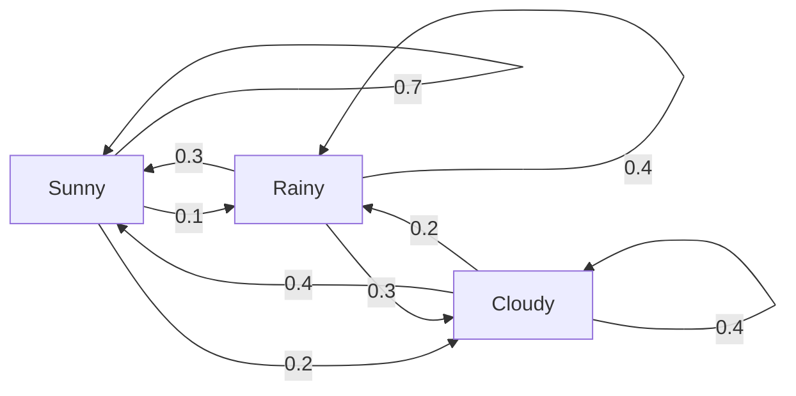
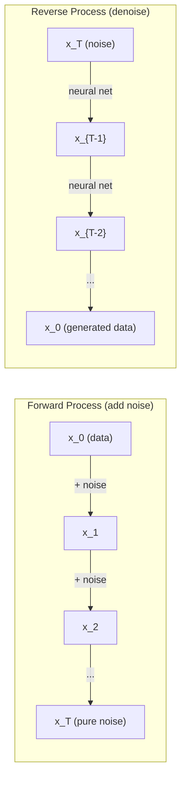

# Procesos estocásticos

> 具有结构的随机性──random walks、Markov chains 和 difusión modelos 背后的数学──

**Type:** Learn
**Language:**Python
**Prerequisites:** Phase 1, Lessons 06-07（probability, Bayes）
**Time:** ~75 分钟

## El objetivo del aprendizaje
- 模拟 1D y 2D paseos aleatorios,并验证位移的 $\sqrt{n}$缩放规律 (en inglés)
- Construir cadena Markov 模拟器,并通过自己的组合 计算其静止分布
- realizar la dinámica de Metropolis-Hastings MCMC y Langevin, para utilizarse desde la distribución de objetivos
- Para establecer el proceso de difusión hacia adelante con el movimiento browniano                                                                                                                                                                                                                                                                                                                                                                                                                                                                                                              

##  problemas
Muchos sistemas de IA están relacionados con la casualidad de la evolución a lo largo del tiempo. No son casuales estáticos, sino estructurados, secuencializados, cada uno de los cuales depende de lo que ocurrió antes.

Los modelos de lenguaje una vez generan un token. Cada token depende del contexto anterior. El modelo saca una distribución de probabilidad, de la muestra, y luego continúa.

Los modelos de difusión país a la imagen añaden ruido, hasta que se convierta en ruido puro en estado de estado. Luego, revirtieron este proceso, denociendo gradualmente, hasta que apareció una nueva imagen.

Los agentes de aprendizaje de refuerzo toman acciones en el ambiente. Cada acción con cierta probabilidad conduce a un nuevo estado.

El muestreo MCMC es el pilar de la inferencia bayesiana, que construye una cadena de Markov, su distribución estacionaria es la que quieres tomar posteriormente.

Todo esto se basa en cuatro ideas básicas:
1. Paseos aleatorios  最简单的estochastic proceso
2. Cadena de Markov  带有过渡矩阵的结构化随机性
3. Dinámica de Langevin  带噪声的渐进下降
4. Metrópolis-Hastings  de la distribución arbitraria

## 概念
### Paseos aleatorios

Desde la posición 0 开始── cada paso,抛一枚公平硬币──正面:向右移动(+1)──反面:向左移动(-1)──

                                                                                                                                                                                                                                                                                                                                                                                                                                                                                                                             $n$步后, tu posición es $n$个随机                                                                                                                                                                                                                                                                                                                                                                                                                                                                                                                          $\pm 1$值的总和──期望位置是0(这个行程是无偏的)──但距离原点的期望距离按 $\sqrt{n}$增长── en el mismo lugar.

Este paseo es justo, no hay deriva en las dos direcciones, pero con el tiempo, se aleja de su punto de partida y se aleja de él.$n$La desviación estándar de 步后 es $\sqrt{n}$¿Qué es eso?

```
Step 0:  Position = 0
Step 1:  Position = +1 or -1
Step 2:  Position = +2, 0, or -2
...
Step 100: Expected distance from origin ~ 10 (sqrt(100))
Step 10000: Expected distance from origin ~ 100 (sqrt(10000))
```

**在 2D 中**,caminar a la misma velocidad de probabilidad hacia arriba, hacia abajo, hacia izquierda o hacia derecha.$\sqrt{n}$缩放规律──路径会描绘出类似的分离的模式──

**为什么是 $\sqrt{n}$？**Cada paso tiene una probabilidad de +1 o -1$n$步后, posición $S_n = X_1 + X_2 + \cdots + X_n$, cada uno de ellos $X_i$Es una ciudad.$\pm 1$ Cada paso de la variación es 1, y cada paso es independiente de uno del otro, por lo que $\mathop{\mathrm{Var}}(S_n) = n$ Desviación estándar = $\sqrt{n}$ Según el teorema de límite central,$S_n / \sqrt{n}$收到 la distribución normal estándar

Esta clase de$\sqrt{n}$缩放在 ML 中随处可见──SGD 噪声按1/sqrt(batch_size) 缩放──Embedding 维度按 $\sqrt{d}$La raíz cuadrada es un signo independiente de la composición.

**与 Brownian motion 的联系。**取一个步骤尺寸 为 $1/\sqrt{n}$、 por cada unidad de tiempo $n$Paseo al azar.$n$Tendencia infinita, este paseo 会收n al movimiento browniano $B(t)$Un proceso continuo en el tiempo, entre ellos.$B(t)$服从平均值为 0 变量 为 $t$La distribución normal de la sangre.

El movimiento browniano es la base matemática de la difusión. El movimiento browniano representa el flujo de partículas en el cuerpo, así como el movimiento de los precios de las acciones, así como el proceso de ruido en los modelos de difusión.

**Gambler's ruin。**Un caminante aleatorio desde su posición.$k$开始,在 0 和 $N$Hay barreras de absorción.$N$¿Cuál es la probabilidad de llegar a 0?$P(\text{到达 } N) = k/N$                                                                                                                                                                                                                                                              

### Las cadenas de Markov

La cadena de Markov es un sistema que se transfiere según la probabilidad fija entre los estados. La naturaleza clave es: el siguiente estado depende sólo del estado actual, no de la historia.

```math
P(X_{t+1} = j \mid X_t = i, X_{t-1} = \ldots) = P(X_{t+1} = j \mid X_t = i)
```

Esta es la propiedad de Markov. Significa que puedes usar una matriz de transición.$P$ describir toda la dinámica:

```math
P[i][j] = \text{从状态 } i \text{ 转移到状态 } j \text{ 的概率}
```

$P$De cada una de las líneas de búsqueda y para 1 (tú tienes que ir a algún lugar)

**示例 —— Weather：**

```
States: Sunny (0), Rainy (1), Cloudy (2)

P = [[0.7, 0.1, 0.2],    (if sunny: 70% sunny, 10% rainy, 20% cloudy)
     [0.3, 0.4, 0.3],    (if rainy: 30% sunny, 40% rainy, 30% cloudy)
     [0.4, 0.2, 0.4]]    (if cloudy: 40% sunny, 20% rainy, 40% cloudy)
```

Desde cualquier estado 开始──经过多次过渡 之后, los estados de distribución se reciben a la distribución estacionaria $\pi$, entre ellos $\pi P = \pi$Es eso.$P$El valor propio de 为 1 es el vector propio izquierdo de ⋅

 长期来看, no importa el estado de inicio es lo que sea, el 53% del tiempo es soleado.



**计算 stationary distribution。**Hay dos métodos:

1. **Power method**:将任意初始分布反复乘以 $P$Después de haber pasado por muchas iteraciones, se va a recuperar.
2. **Eigenvalue method**: encontrar $P$El valor propio de 1 es el vector propio izquierdo.$P^T$El valor propio de 为 1 de un vector propio.

两种方法都要求链 满足收条件――

**收敛条件。**Si una cadena de Markov  satisface las siguientes condiciones, recibirá una distribución estacionaria única:
- **Irreducible**Cada estado puede llegar desde cualquier otro estado.
- **Aperiodic**: cadena no se fijará en un ciclo de ciclo

La mayoría de las cadenas que encuentras en ML cumplen con estas dos condiciones.

**Absorbing states。**Si una vez entras en un estado, nunca te irás.$P[i][i] = 1$), este estado es absorber de la. Absorción de cadenas de Markov se puede utilizar para construir con estados terminales.

**Mixing time。**¿Cuántos pasos necesita, cadena 才会 aproximarse a la distribución estacionaria?$P$La diferencia entre el tiempo de mezcla y el tiempo de mezcla es de un tamaño muy alto.

### Enlace con Modelos de idiomas

Modelo de lenguaje 中的代币生成 近似是一个马科夫过程──给定当前文本,模型输出下一个代币 上的分布──温度 控制敏度:

```math
P(\text{token}_i) = \frac{\exp(\text{logit}_i / \text{temperature})}{\sum_j \exp(\text{logit}_j / \text{temperature})}
```

- Temperatura = 1,0: estándar distribución
- Temperatura < 1,0: más尖(más determinista)
- Temperatura > 1,0:更平坦(更随机)
- Temperatura $\to 0$:argmax(compulsivo)

Muestreo de la parte superior de K  de la probabilidad máxima $k$个 tokens──Top-p(nucleus) muestreo 截断到累积概率 超过 $p$La menor cantidad de tokens 集合──两者都会修改马科夫过渡概率──

### Movimiento browniano

límite de tiempo continuo de caminar aleatorio.$B(t)$Tiene tres características:
1. $B(0) = 0$
2. $B(t) - B(s)$服从平均值为 0 变量 为 $t - s$La distribución normal de las especies$t > s$(en inglés)
3. Incresos en la superposición de zonas de separación

El movimiento browniano es continuo, pero es inminente. En cada medida está en movimiento. Su camino en la dimensión fractal del plano es de 2 .

En el movimiento de separación, puedes hacer esto:

```math
B(t + dt) = B(t) + \sqrt{dt} \, z, \quad \text{其中 } z \sim \mathcal{N}(0, 1)
```

$\sqrt{dt}$缩放很重要── proviene del teorema del límite central de las caminatas aleatorias.

### Dinámica de Langevin

Descenso gradual 寻找 funciones de valor mínimo。 Dinámica de Langhevin 寻找与 $\exp(-U(x)/T)$La distribución de probabilidades de la corrección, entre ellas $U$Es una función de energía,$T$Es la temperatura.

```math
x_{t+1} = x_t - dt \, \nabla U(x_t) + \sqrt{2 T \, dt} \, z_t
```

Hay dos tipos de acción en la partícula:
1. **Gradient force**(El artículo$-dt \cdot \nabla U$):推向低能量( similar a Descenso Gradiente)
2. **Random force**(El artículo$\sqrt{2T dt} \cdot z$): 推向随机方向 (exploración)

Cuando la temperatura$T = 0$时, ése es el puro Descenso Gradiente. Baja temperatura. Es casi un paseo aleatorio. En temperatura adecuada. Bajo, la partícula explorará el paisaje energético y se detendrá en regiones de baja energía.

**与 diffusion models 的联系。**El proceso de difusión del modelo hacia adelante es:

```math
x_t = \sqrt{\alpha_t} \, x_{t-1} + \sqrt{1 - \alpha_t} \cdot \text{noise}
```

Es una cadena de Markov que mezcla datos gradualmente con ruido.$x_T$Es un ruido gaussiano puro.

Proceso inverso  Desde el ruido Volver a los datos  También es una cadena de Markov, pero sus probabilidades de transición son obtenidas por la Red Neural ︎.



### MCMC: Cadena de Markov Monte Carlo

A veces necesitas un valor que puedes obtener, pero no puedes obtener una distribución directa.$p(x)$Los posteriores bayesianos son un ejemplo clásico.

**Metropolis-Hastings**Construir una distribución estacionaria $p(x)$La cadena de Markov:

1. Desde algún lugar.$x$ empezar
2. Desde la distribución de las propuestas $Q(x' \mid x)$提议 una nueva posición $x'$
3. 计算 aceptación ratio:$a = p(x') Q(x \mid x') / (p(x) Q(x' \mid x))$
4. Es probable que$\min(1, a)$ acepta $x'$否则留在 $x$¿Qué es eso?
5. ¿Qué es eso?

Si es que$Q$Es simétrico de ejemplo$Q(x' \mid x) = Q(x \mid x') = \mathcal{N}(x, \sigma^2){}$),ratio 可简化为 $a = p(x') / p(x)$                                                                                                                                                                                                                                                              

En condiciones templadas, esta cadena garantiza la recepción.$p(x)$, pero si la propuesta 太小(random walk) o demasiado grande(alto rechazo),收可能很慢──调节 propuesta es el arte de MCMC──

**为什么它有效。**Ratio de aceptación  asegurar el equilibrio detallado: situado $x$No se movió hasta$x'$La probabilidad de que se encuentre en la misma$x'$No se movió hasta$x$La probabilidad de equilibrio detallado significa$p(x)$Es la distribución estacionaria de la cadena.$p(x)$¿Qué es eso?

**实践注意事项：**
- **Burn-in**: abandonado $N$个样本――chain 需要时间从起点到到静止分布――
- **Thinning**: cada uno$k$个样本保留一个, para reducir la autocorrelación.
- **Multiple chains**Si las cadenas se encuentran en la misma distribución, hay evidencia de que se encuentran en la misma distribución.
- **Acceptance rate**Para:$d$维 Gaussian propuestas, mejor tasa de aceptación 大约是 23% 罗伯茨 & Rosenthal, 2001) 太高意味着链 几乎不移──太低意味着它几乎全部拒绝──

### Procesos estocásticos en IA

| Process | AI Application |
|---------|---------------|
| Random walk | RL 中的 exploration、Node2Vec embeddings |
| Markov chain | Text generation、MCMC sampling |
| Brownian motion | Diffusion models（forward process） |
| Langevin dynamics | Score-based generative models、SGLD |
| Markov decision process | Reinforcement learning |
| Metropolis-Hastings | Bayesian inference、posterior sampling |


```figure
random-walk-diffusion
```

## Construirlo
### Paso 1: Simulador de caminar aleatorio

```python
import numpy as np

def random_walk_1d(n_steps, seed=None):
    rng = np.random.RandomState(seed)
    steps = rng.choice([-1, 1], size=n_steps)
    positions = np.concatenate([[0], np.cumsum(steps)])
    return positions


def random_walk_2d(n_steps, seed=None):
    rng = np.random.RandomState(seed)
    directions = rng.choice(4, size=n_steps)
    dx = np.zeros(n_steps)
    dy = np.zeros(n_steps)
    dx[directions == 0] = 1   # right
    dx[directions == 1] = -1  # left
    dy[directions == 2] = 1   # up
    dy[directions == 3] = -1  # down
    x = np.concatenate([[0], np.cumsum(dx)])
    y = np.concatenate([[0], np.cumsum(dy)])
    return x, y
```

1D caminar  almacenamiento sumas acumuladas ⋅ cada paso es +1 o -1 ⋅$n$步后,位置就是总和──varianza 随 随 随 $n$线性增长, por lo tanto, la desviación estándar 按 $\sqrt{n}$增长── en el mismo lugar.

### Paso 2: cadena de Markov

```python
class MarkovChain:
    def __init__(self, transition_matrix, state_names=None):
        self.P = np.array(transition_matrix, dtype=float)
        self.n_states = len(self.P)
        self.state_names = state_names or [str(i) for i in range(self.n_states)]

    def step(self, current_state, rng=None):
        if rng is None:
            rng = np.random.RandomState()
        probs = self.P[current_state]
        return rng.choice(self.n_states, p=probs)

    def simulate(self, start_state, n_steps, seed=None):
        rng = np.random.RandomState(seed)
        states = [start_state]
        current = start_state
        for _ in range(n_steps):
            current = self.step(current, rng)
            states.append(current)
        return states

    def stationary_distribution(self):
        eigenvalues, eigenvectors = np.linalg.eig(self.P.T)
        idx = np.argmin(np.abs(eigenvalues - 1.0))
        stationary = np.real(eigenvectors[:, idx])
        stationary = stationary / stationary.sum()
        return np.abs(stationary)
```

distribución estacionaria es $P$El valor propio de 1 es el vector propio izquierdo.$P^T$Los vectores propios de la derecha para encontrarlo (transposar los vectores propios de la izquierda para convertirlos en vectores propios de la derecha)

### Paso 3: Dinámica de Langevin

```python
def langevin_dynamics(grad_U, x0, dt, temperature, n_steps, seed=None):
    rng = np.random.RandomState(seed)
    x = np.array(x0, dtype=float)
    trajectory = [x.copy()]
    for _ in range(n_steps):
        noise = rng.randn(*x.shape)
        x = x - dt * grad_U(x) + np.sqrt(2 * temperature * dt) * noise
        trajectory.append(x.copy())
    return np.array(trajectory)
```

Gradiente general$x$推向低能量──噪声 防止陷入局部停滞──在平衡时,$\exp(-U(x)/\text{temperature})$Es verdad.

### Paso 4: Metrópolis-Hastings

```python
def metropolis_hastings(target_log_prob, proposal_std, x0, n_samples, seed=None):
    rng = np.random.RandomState(seed)
    x = np.array(x0, dtype=float)
    samples = [x.copy()]
    accepted = 0
    for _ in range(n_samples - 1):
        x_proposed = x + rng.randn(*x.shape) * proposal_std
        log_ratio = target_log_prob(x_proposed) - target_log_prob(x)
        if np.log(rng.rand()) < log_ratio:
            x = x_proposed
            accepted += 1
        samples.append(x.copy())
    acceptance_rate = accepted / (n_samples - 1)
    return np.array(samples), acceptance_rate
```

El algoritmo propone un nuevo punto, comprueba si tiene una probabilidad más alta (o en relación con la probabilidad de la tasa de conversión), y luego repite: para obtener una buena mezcla, la tasa de aceptación debe ser de aproximadamente 23-50% entre:

## Usalo
En la práctica, usará una biblioteca madura para implementar estos algoritmos. Pero entender el mecanismo para el descomposición y ajuste es muy importante.

```python
import numpy as np

rng = np.random.RandomState(42)
walk = np.cumsum(rng.choice([-1, 1], size=10000))
print(f"Final position: {walk[-1]}")
print(f"Expected distance: {np.sqrt(10000):.1f}")
print(f"Actual distance: {abs(walk[-1])}")
```

### Usando matrices de transición de la numpy

```python
import numpy as np

P = np.array([[0.7, 0.1, 0.2],
              [0.3, 0.4, 0.3],
              [0.4, 0.2, 0.4]])

distribution = np.array([1.0, 0.0, 0.0])
for _ in range(100):
    distribution = distribution @ P

print(f"Stationary distribution: {np.round(distribution, 4)}")
```

Se distribuirá inicialmente$P$Después de haber pasado por suficientes iteraciones, se obtendrá una distribución estacionaria, sin importar de dónde comience.

### Conexión con el marco real

- **PyTorch diffusion：**Un rostro abrazador .`diffusers`En el centro`DDPMScheduler`实现了 hacia adelante y hacia atrás cadenas Markov
- **NumPyro / PyMC：**Utilizando el MCMC(NUTS muestreo, es una mejoría para Metropolis-Hastings) para realizar la inferencia bayesiana
- **Gymnasium (RL)：**Función de paso medioambiental  define un proceso de decisión de Markov

### 验证 Convergencia de la cadena de Markov

```python
import numpy as np

P = np.array([[0.9, 0.1], [0.3, 0.7]])

eigenvalues = np.linalg.eigvals(P)
spectral_gap = 1 - sorted(np.abs(eigenvalues))[-2]
print(f"Eigenvalues: {eigenvalues}")
print(f"Spectral gap: {spectral_gap:.4f}")
print(f"Approximate mixing time: {1/spectral_gap:.1f} steps")
```

La brecha espectral  te dice la cadena  olvidar su estado inicial de velocidad―la brecha es 0.2 significa aproximadamente 5 pasos即可混合―la brecha es 0.01 significa aproximadamente 100 pasos―la operación de la simulación 之前务必检查这一点  mixing 很慢的链 会浪费计算―

##  entregarlo
本课产 出:
- `outputs/prompt-stochastic-process-advisor.md` Un prompt, para ayudar a identificar determinados problemas adaptados a cualquier marco de proceso estocástico

## Las conexiones

| Concept | Where it shows up |
|---------|------------------|
| Random walk | Node2Vec graph embeddings、RL 中的 exploration |
| Markov chain | LLMs 中的 Token generation、MCMC sampling |
| Brownian motion | DDPM 中的 forward diffusion process、SDE-based models |
| Langevin dynamics | Score-based generative models、stochastic gradient Langevin dynamics (SGLD) |
| Stationary distribution | MCMC convergence target、PageRank |
| Metropolis-Hastings | Bayesian posterior sampling、simulated annealing |
| Temperature | LLM sampling、RL 中的 Boltzmann exploration、simulated annealing |
| Mixing time | MCMC 的 convergence speed、spectral gap analysis |
| Absorbing state | End-of-sequence token、RL 中的 terminal states |
| Detailed balance | MCMC samplers 的 correctness guarantee |

Modelos de difusión 值得特别关注──DDPM(Ho et al., 2020) definió una cadena de Markov hacia adelante:

```math
q(x_t \mid x_{t-1}) = \mathcal{N}\left(x_t; \sqrt{1-\beta_t} \, x_{t-1}, \beta_t I\right)
```

Entre ellos $\beta_t$Es un horario de ruido.$T$步后,$x_T$Como que me parezca$\mathcal{N}(0, I)$◊ proceso inverso por un pronóstico de ruido de la red neuronal 参数化:

```math
p_\theta(x_{t-1} \mid x_t) = \mathcal{N}\left(x_{t-1}; \mu_\theta(x_t, t), \sigma_t^2 I\right)
```

Cada paso de generación es un paso aprendido en la cadena de Markov. Comprender las cadenas de Markov significa entender los modelos de difusión cómo y por qué pueden generar datos.

SGLD(Stochastic Gradient Langevin Dynamics) combinará el mini-batch Gradient Descent con el ruido de Langevin 结起来──你不计算完整的 Gradient,而是使用 Stochastic estimate并添加校准的噪音──随着学习率 衰退,SGLD 会从优化 过渡到样本采样  你几乎免费得到近似的贝叶斯后面样本──这是从神经网络 获得不确定性估计的最简单方式之一──

穿穿这些联系的关键洞见是: los procesos estocásticos no son simplemente herramientas teóricas. Son mecanismos de cálculo de la IA moderna. Cuando ajustes la temperatura del LLM, estás ajustando una cadena de Markov. Cuando entrenas un modelo de difusión, estás aprendiendo a revertir un proceso similar al movimiento browniano. Cuando ejecutas la inferencia bayesiana, estás construyendo una cadena posterior de recepción.

##  ejercicios
1. **模拟 1000 条 10000 步的 random walks。**绘制最终位置的分布──验证它近似为平均0、标准偏差 $\sqrt{10000} = 100$De Gaussian.

2. **使用 Markov chain 构建 text generator。**En un pequeño corpus 上训练: para cada palabra,统计到下一个词的过渡――construir una matriz de transición――a través de la cadena de la cadena de la producción de nuevas frases――

3. **使用 Metropolis-Hastings 实现 simulated annealing。**Desde la alta temperatura 开始 (几乎接受所有内容), luego gradualmente降温 (仅接受改进) ⋅ Usarlo para buscar el mínimo de la función con muchos mínimos locales ⋅

4. **比较不同 temperatures 下的 Langevin dynamics。**Desde el potencial de doble pozo$U(x) = (x^2 - 1)^2$En el caso de los pozos, las muestras se agrupan en un pozo. En el caso de los pozos, se distribuyen en dos pozos.

5. **实现 forward diffusion process。**Desde una señal 1D (por ejemplo, onda seno) comienza a utilizar un horario de ruido lineal, en 100 pasos añade gradualmente ruido, mostrando cómo el señal se degrada en ruido puro, luego realiza un simple desinfectante para reversar este proceso, incluso una versión ingenua del ruido estimado también puede ser reducida.

### 提示

**练习 1。**Para 1000 semillas diferentes 调用 `random_walk_1d(10000, seed=i)`,并保留 cada vez la posición final. El control significa si se acerca a 0 o a 100 la desviación estándar, así como si el punto final es de aproximadamente un 68% entre -100 y 100.

**练习 2。**统计每次出现对相邻单词的次数,再将每行除以该行总和,使每行之和为1――将矩阵传入 统计每行之和为1――将矩阵传入`MarkovChain(transition_matrix, state_names)`,并调用 `simulate`◊ Check output en el corpus de cada uno de los términos de la palabra que se encuentra en el corpus.

**练习 3。**Es$\exp(-\Delta / T)$La probabilidad de aceptar puntos más difíciles y después de cada paso.$T$乘以 un factor, por ejemplo 0.99── en una función de un mínimo conocido, y el resultado de la búsqueda en la red se verifica──

**练习 4。**Gradiente es$4x(x^2 - 1)$, lo transmitiremos`langevin_dynamics(grad_U, x0, dt, temperature, n_steps)`¿Qué es eso?$x = 0$La barrera de la altura es de 1, por lo que las temperaturas de baja son de 0,05 a 1, según la estadística.$x$ modificar el número de veces, encontrar la cantidad de veces que comienza a subir rápidamente la temperatura.

**练习 5。**调用                                                                                                                                                                                                                                                                                                                                                                                                                                                                                                                           `diffusion_forward(signal, 100)`,并将所有 $(1 - \beta_t)$En el último paso.$\bar{\alpha}$Si es que$\bar{\alpha}$ todavía lejos de 0, el señal no es puro ruido, necesita aumentar `beta_end`△先使用真实噪音 测试 denoiser:此时 $(x_t - \sqrt{1 - \bar{\alpha}_t} \epsilon)/\sqrt{\bar{\alpha}_t}$必須精确還原原始信号──

## 关键术语: "El hombre es un hombre"
| Term | What people say | What it actually means |
|------|----------------|----------------------|
| Random walk | “抛硬币式移动” | 一个 position 在每一步按随机 increments 改变的过程 |
| Markov property | “无记忆性” | future 只依赖当前 state，而不依赖 history |
| Transition matrix | “概率表” | $P[i][j]$ = 从 state $i$ 移动到 state $j$ 的概率 |
| Stationary distribution | “长期平均” | 满足 $\pi P = \pi$ 的分布 $\pi$ —— chain 的 equilibrium |
| Brownian motion | “随机抖动” | random walk 的 continuous-time limit，$B(t) \sim \mathcal{N}(0, t)$ |
| Langevin dynamics | “带噪声的 Gradient Descent” | 结合 deterministic Gradient 与 random perturbation 的 update rule |
| MCMC | “向目标行走” | 构造一个 stationary distribution 为你想要的分布的 Markov chain |
| Metropolis-Hastings | “提议并接受/拒绝” | 使用 acceptance ratios 来确保收敛的 MCMC algorithm |
| Temperature | “随机性旋钮” | 控制 exploration 与 exploitation 之间权衡的参数 |
| Diffusion process | “噪声进，噪声出” | Forward：逐渐添加 noise。Reverse：逐渐移除 noise。生成 data。 |

## 延伸阅读
- **Ho, Jain, Abbeel (2020)** Denoying Diffusion Probabilistic Models.  Open diffusion model 革命的 DDPM 论文──清晰推导了前方和反转马科夫链──
- **Song & Ermon (2019)** Modelado generacional mediante la estimación de los gradientes de la distribución de datos. Utiliza la dinámica de Langevin  realizar muestreo  metodología basada en la puntuación 。
- **Roberts & Rosenthal (2004)** General estado espacio cadenas de Markov y algoritmos MCMC.   Sobre MCMC 何时以及为什么有效的理论──
- **Norris (1997)** Markov Chains. 标准教材──涵盖融合、静止分布 和击时──
- **Welling & Teh (2011)**  Aprendizaje bayesiano a través de la Dinámica de Langevin Gradiente Estocástica.                                                                                                                                                                                                                                                
