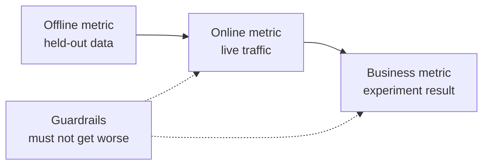

# 机器学习系统设计: desde el problema hasta el modelo ya desplegado

> 模型只是系统的一部分. 模型设计决定预测什么. 模型决定预测谁根据预测采取行动. 模型是系统的一部分. 模型决定预测什么. 模型决定谁根据预测采取行动. 模型是系统的一部分. 模型决定预测什么. 模型决定谁根据预测采取行动. 模型决定什么. 模型决定什么. 模型预测谁根据预测采取行动. 模型决定什么. 模型决定什么. 模型预测的价格是多少. 模型决定什么. 模型决定什么. 模型预测的价格是多少. 模型决定什么. 模型预测的价格是多少. 模型决定什么. 模型预测的价格是多少. 模型的价格是多少. 模型的价格是多少.

**Type:** Build
**Languages:** Python
**Prerequisites:** 阶段 2，第 09 课（模型评估）和第 13 课（ML 流水线）
**Time:** 约 110 分钟

## El objetivo del aprendizaje

- Definir los problemas de negocio como tareas de gestión de datos, determinar el contenido de las previsiones, tomar decisiones sobre el uso de las previsiones y determinar las causas de la falta de reglas para resolver los problemas.
- 区分离线,线上,业务和护标, y comparar cada modelo con simples líneas de base y líneas de base iniciales
- El coste diario de la estimativa de flujo de la cantidad de datos y la cantidad de datos en línea
- 选择发布方式(影子、金丝雀、A/B 测试),并为每种故障模式选择安全默认行为
- 识别模型如何通过决策改变下一版本训练数据的反循环
- 编写 ML 设计文档,并按固定检查清单评分

##  problemas

Una empresa de suscripción solicitó un modelo de predicción de flujo. Científicos de datos entrenaron un módulo de clasificación de gradiente, y reportaron que la AUC alcanzó 0.91 .

原因与算法无关──没有人决定分数应触发什么行动──分数每周才更新一次,但客户挽留团队每天都打电话──标签来自取消订阅表,而该表还存储取消原因,因此某特征直接包含答案──也没有人把模型与客户团队原始规则比较:给连续两周不活跃的客户打电话──

Estos fracasos ya se han enterrado antes de que comience el entrenamiento. Todos ellos son fracasos de diseño, y el archivo de diseño puede seguirse preguntando.

## 核心概念 核心概念 核心概念 核心概念

### Desde objetivos de negocio hasta tareas de ML

 Objetivo de negocio no es igual a tareas ML

1. ¿Qué tipo de objeto es el modelo de predicción?
2. ¿Qué decisiones se toman mediante previsión, por quién o qué sistema?
3. ¿Cuándo necesita una previsión, qué datos hay disponibles en ese momento?
4. ¿Cómo se ha mejorado la toma de decisiones?

| 业务目标 | 预测 | 使用预测的决策 | ML 任务 |
|---|---|---|---|
| 减少流失 | 用户未来 30 天取消订阅的概率 | 每晚向风险最高的 5% 用户发送挽留优惠 | 二分类 |
| 减少欺诈损失 | 一笔支付属于欺诈的概率 | 在 100 ms 内批准、送审或阻止 | 二分类 |
| 保持货架有货 | 下周各门店每天的销售件数 | 各门店订货量 | 预测 |
| 展示相关商品 | （用户，商品）对的相关性分数 | 信息流中的商品顺序 | 排序 |

La segunda es la que más necesita una definición detallada. No hay una ventana de tiempo clara, ni un objeto ni una acción.

### ¿ 何时不应使用 ML

Las reglas de Google Reglas de aprendizaje automático Regular 1                                                                                                                                                                                                                                                                                                                                                                                                                                                                                                          

- 简短规则可以实现目标,并能持续保持正确.
-  no hay etiquetas, ni hay métodos de recogida prácticos 
- Nadie actúa según la previsión, por lo que la previsión más precisa no traerá cambios
- 预测时可用数据不含所需信号──
- Un error no puede ser aceptado, y nadie puede revisar el producto.
- El coste de construcción y operación de sistemas es superior al valor que aporta una mejor decisión.

Cuando las reglas se vuelven extensas y frágiles, el ML sólo comienza a valer la pena de ser introducido. La misma regla 3 de la guía recomienda priorizar el uso del ML en lugar de las reglas de inicio complejas, ya que el modelo aprendido es más fácil de actualizar y mantener.

### Tres niveles de indicadores

En tres niveles de medir ML 系统, al mismo tiempo establecer un grupo de restricciones:

| 层面 | 何时能测量 | 流失预测示例 |
|---|---|---|
| 离线指标 | 上线前，在留出的历史数据上 | 优惠阈值处的 F1、风险最高 5% 中的精确率 |
| 在线指标 | 上线期间，在真实流量上 | 优惠接受率、已评分用户比例、分数分布 |
| 业务指标 | 上线数周后，通过实验 | 干预组与保留对照组的 30 天流失率 |
| 护栏指标 | 始终监测 | 每挽留一名用户的优惠成本、退订率、p99 延迟 |



Los niveles de los índices en línea suelen dar conclusiones diferentes. Los índices en línea evalúan datos históricos, mientras que el pasado no tiene su modelo. Los índices en línea dependen de la reacción de las personas a las decisiones.

选择与决策匹配的离线指标――如果任务联系风险最高的5%用户,就测量这个5%中的精确率――AUC对所有值综合评估,包括你从未使用的值――规则 2 要求先设计并实现指标,再决定ML系统具体做什么――

### 基线

孤立的指标没有意义――如果最佳替代方案只有0.30,F1 达到0.56就好;如果一条规则能达到0.60,就差很――每个模型都应与三类基线比较:

- **简单基线。**始终预测多数类别,或始终预测训练集平均值──模型评估课使用过这种检查──
- **启发式基线。**Las normas del conocimiento del campo o las características únicas que se adaptan a los datos de entrenamiento.
- **现有系统。**Método de toma de decisiones, incluso si es sólo un usuario de un formulario electrónico.

La cantidad de elevación es el número de puntos del modelo, menos el número de puntos de base más fuerte. Se establece el mínimo de elevación antes de que se vea el resultado, y se asegura de que cubra los costos extras del sistema.

### Datos y requisitos de etiquetas

训练前回答这些问题:

- **标签来源。**¿Cuál es el resultado de un evento definido? ¿Por quién es responsable?
- **标签延迟。**¿Cuánto tiempo tardará en saber el resultado real? ¿El fraude puede aparecer después de varias semanas de pago; ¿qué falta de etiquetas?
- **标签质量。**¿Quién lo ha señalado, con frecuencia de error?
- **预测时的可用性。**¿Existen todos los rasgos en la predicción? Los rasgos que se escriben después de que se produzcan se revelarán en el entrenamiento.
- **各类样本量。**¿Cuántos ejemplos reales hay? Sólo hay doscientos ejemplos reales, normalmente sólo se pueden usar modelos simples.
- **时间切分。**留出最近的一段时间──时间序列课按时间分分数据也出于同样的原因──

### 延迟、 volumen de producción y presupuesto de costes

Tres números de un servicio de diseño:

- **延迟预算。**P99 延迟是100 请求中99 低于耗时. 支付检查可能要求50 ms.
- **峰值吞吐量。**按最忙一分钟而非日均流量配置系统──峰值 QPS(每秒请求数) suele ser varias veces el valor promedio──
- **成本预算。**Con el costo diario de dólares o el costo de dólares de 1000 veces de pronóstico, es fácil comparar el esquema.

Se relacionarán las dos anteriores: el número de solicitudes en el procesamiento es igual a la cantidad de despliegue multiplicada por retraso. Si por segundo 400 solicitudes, cada una de ellas tarda 50 ms, entonces en promedio hay 20 solicitudes en el procesamiento.

###  Convocatoria por lotes y en línea

提供预测 Hay dos formas básicas:

- **批量推理。**定时任务为每实体评分,将分数写入表或键值存储――应用在收到请求时读取已存分――
- **在线推理。** aplicación en la solicitud hasta que llegue el tiempo de enviar el rasgo a la servidor modelo, esperar la cantidad de devolver.

| 属性 | 批量 | 在线 |
|---|---|---|
| 新鲜度 | 距离上次运行的时间，加上运行耗时 | 使用当前请求的数据 |
| 请求延迟 | 一次键值读取，几毫秒 | 特征获取时间加模型耗时 |
| 成本驱动因素 | 实体数乘以每天运行次数 | 按峰值 QPS 配置的副本数 |
| 新实体 | 下一次运行前没有分数 | 第一次请求时即可评分 |
| 故障时 | 旧分数仍可读取 | 请求失败或超时 |

Este libro de herramientas estimará los dos costes. El coste de la cantidad de toneladas se ajusta al número de unidades y al número de operaciones diarias. Permite que el tiempo viejo sea más corto, el tiempo de operación más frecuente. El coste en línea aumenta con el flujo de valores máximos, ya que las copias de las plazas entre los máximos también deben ser pagadas.

混合设计很常见: tareas de lote nocturno a los usuarios ya evaluados, en línea para procesar nuevos usuarios y requerir nuevos datos.

### 部署模式 (Modeo de implementación)

Nuevo modelo

1. **影子运行（Shadow）。**El nuevo modelo recibe la cantidad real de copias. El sistema registra la previsión, pero no la utiliza.
2. **金丝雀发布（Canary）。**El nuevo modelo se basa en una pequeña parte del flujo para tomar decisiones reales, generalmente desde el 1% al 5% ∞.
3. **A/B 测试。**随机分组的用户分别使用不同模型──使用统计检查测业务指标,需要足够的流量和时间才能清晰差异──

Cada etapa necesita completarse en pocos minutos.[影子与金丝雀发布课](../../../17-infrastructure-and-production/20-shadow-canary-progressive/docs/en.md)Y [A/B 测试课](../../../17-infrastructure-and-production/21-ab-testing-llm-features/docs/en.md)Se trata de un modelo de lenguaje que se basa en tres tipos de lenguaje.

### En el mismo sentido

Cuando la decisión del modelo cambia en la siguiente versión de los datos de entrenamiento, surge un ciclo contrario.

- **干预隐藏标签。**流失模型发送优惠,挽留了部分用户──下个月,高风险用户看起来很忠诚,重新训练的模型便学到这些特征不能预测流失──
- **被阻止的行动没有结果。** el modelo de fraude que impide un pago, este pago en absoluto no generará nunca un sello de rechazo.
- **曝光限制反馈。**排序模型 sólo muestra la clasificación de los productos, por lo que sólo estos productos obtienen un click.

El concepto común del método de reparación es conservar algunos datos no afectados por el modelo. Restar con el tiempo a un grupo de usuarios que no aceptan la intervención; tomar decisiones de distribución de flujo a tiempo; tomar decisiones con el número de registros y la cantidad de registros de cada muestra, para que la formación posterior pueda distinguir entre los datos afectados y los datos netos.

### El comportamiento de riesgo y seguridad

 Cada parte del sistema tardará en fallar.  Debe decidirse en la fase de diseño y no durante el accidente el comportamiento predeterminado de los tipos de fallos:

| 故障 | 没有预案时的结果 | 安全默认行为 |
|---|---|---|
| 模型服务超时 | 请求失败 | 使用启发式基线 |
| 夜间批任务失败 | 分数缺失或过旧 | 在固定期限内提供最近的正常分数，之后使用规则 |
| 特征缺失或越界 | 模型对坏输入评分 | 使用文档规定的默认值，并记录事件 |
| 新实体没有历史 | 没有分数 | 使用规则或总体均值 |
| 分数分布突然变化 | 大规模错误决策 | 暂停自动行动，并通知人工处理 |

El inicio de la línea de referencia de la parte de indicadores es también el default de la mayoría de los fallos, por lo que se debe implementarlo primero.

### 设计文档

设计文档在训练开始前集中记录上述决策――本课检查器为其 JSON 版本评分―― de los cuales seis proyectos de control tienen obstructividad, ya que cualquier falta de información hace que el sistema no sea seguro o inútil:

| 章节 | 回答的问题 | 阻塞条件 |
|---|---|---|
| 问题 | 预测什么，哪项决策使用它，为什么规则不够？ | 必须明确决策 |
| 指标 | 适用哪些离线、在线、业务和护栏指标？ | 必须明确业务指标 |
| 基线 | 适用哪些简单、启发式和现有系统基线？ | 必须有启发式或现有系统基线 |
| 数据 | 标签来自哪里、延迟多久，每个特征预测时是否可用？ | 不得泄露标签 |
| 预算与服务 | 有哪些延迟、峰值 QPS、成本和陈旧时间限制，哪种模式满足它们？ | 无 |
| 发布 | 使用哪些影子、金丝雀及 A/B 阶段，如何回滚？ | 必须有影子或金丝雀阶段，以及回滚 |
| 反馈循环 | 模型如何改变未来数据，如何保留干净数据？ | 无 |
| 故障模式 | 每种故障的默认行动是什么？ | 每种故障都必须有默认行为 |
| 监控 | 上线后观察什么？ | 无 |

```figure
mlprod-serving-cost
```

## Desde la construcción

`code/main.py` sólo utilizar la biblioteca de normas, que contiene tres herramientas: modelo de costes de servicio  base de comparación y revisador de documentos de diseño

### Paso 1: Descripción de la carga y el precio de trabajo

工作负载保存流量与预算数字,成本模型保存价格── estos precios son ejemplos de la numeración integral de la práctica, no de las ofertas de los proveedores──

```python
@dataclass(frozen=True)
class Workload:
    name: str
    entities: int
    requests_per_day: int
    peak_qps: float
    max_staleness_hours: float
    latency_budget_ms: float


@dataclass(frozen=True)
class CostModel:
    batch_dollars_per_million: float = 0.40
    batch_job_hours: float = 1.0
    lookup_dollars_per_million: float = 0.25
    lookup_latency_ms: float = 4.0
    replica_dollars_per_hour: float = 0.50
    replica_qps: float = 200.0
    min_replicas: int = 2
    online_latency_ms: float = 35.0
```

### Paso 2: Calculación de la cantidad y el coste del servicio en línea

 Las tareas de lote deben completarse dentro de los límites de tiempo anteriores                                                                                                                                                                                                                                                      

```python
def batch_plan(workload: Workload, costs: CostModel) -> ServingPlan:
    refresh_hours = workload.max_staleness_hours - costs.batch_job_hours
    if refresh_hours <= 0:
        return ServingPlan(
            "batch", False, math.inf, costs.lookup_latency_ms, math.inf, 0.0,
            "staleness limit is shorter than one batch job",
        )
    runs_per_day = 24.0 / refresh_hours
    predictions = workload.entities * runs_per_day
    dollars = (
        predictions / 1e6 * costs.batch_dollars_per_million
        + workload.requests_per_day / 1e6 * costs.lookup_dollars_per_million
    )
    ...
```

Los servicios en línea deben pagarse para mantener las copias suficientes para soportar el valor máximo, y mantener al menos dos copias para garantizar su disponibilidad:

```python
def online_plan(workload: Workload, costs: CostModel) -> ServingPlan:
    replicas = max(costs.min_replicas, math.ceil(workload.peak_qps / costs.replica_qps))
    dollars = replicas * costs.replica_dollars_per_hour * 24.0
    feasible = costs.online_latency_ms <= workload.latency_budget_ms
    ...
```

`choose_serving`sele satisfacer la demora y el viejo tiempo limitado de la oferta, regresar a los más económicos.`None`, te sugiero que necesitas ajustar el presupuesto.

### Paso 3: Comparación entre el modelo y la línea de base

Comparar el mismo indicador de evaluación del modelo con todos los componentes.

```python
def compare_to_baselines(
    y_true: list,
    model_pred: list,
    baselines: dict[str, list],
    metric,
    metric_name: str,
    higher_is_better: bool = True,
    min_lift: float = 0.02,
) -> BaselineReport:
    if not baselines:
        raise ValueError("a model needs at least one baseline")
    scores = {name: metric(y_true, pred) for name, pred in baselines.items()}
    pick = max if higher_is_better else min
    best_name = pick(scores, key=scores.get)
    model_score = metric(y_true, model_pred)
    lift = model_score - scores[best_name] if higher_is_better else scores[best_name] - model_score
    return BaselineReport(metric_name, {"model": model_score, **scores}, best_name, lift, min_lift)
```

La línea de inicio es una regla de características únicas.`fit_rule`En el entrenamiento de datos, cada valor de la característica se considera como valor, manteniendo el mejor valor F1.

### Paso 4: Por el diseño de archivos

Cada elemento de control contiene un clave, un peso, un signo de obstrucción, una señal de mensaje y una función de control.

```python
CheckItem("decision", 2, True, "name the action that uses each prediction", lambda d: _text(d, "problem.decision")),
CheckItem("baselines", 2, True, "add a heuristic or current-system baseline", check_baselines),
CheckItem("no_leakage", 2, True, "confirm every feature exists at prediction time",
          lambda d: get_path(d, "data.features_available_at_prediction_time") is True),
CheckItem("serving_fit", 1, False, "pick a serving mode that meets the staleness, latency, and cost budgets",
          check_serving_fit),
```

`check_serving_fit`复用成本模型,从文档读取负载数字,并估算选定模式的成本──如果该模式不能满足陈旧时间上限、延迟预算或每天成本预算,检查就失败──声明采用批但只允许三分钟陈旧时间的文档不能通过──成本模型没有混合方案,因此声明混合的文档也会失败,直到你加入该方案在练习1中──

`review_design_doc`Se aprobará el proyecto de la Comisión de Asuntos Exteriores, y se aplicará el mismo a los proyectos de la Comisión de Asuntos Exteriores y Exteriores.

### Sección 5:

```bash
python3 code/main.py
```

```console
nightly churn scores
  ok batch        $0.91/day      4 ms  1.0 runs per day over 2,000,000 entities
  ok online      $24.00/day     35 ms  2 replicas sized for 40 peak QPS
  choose: batch

feed ranking, 2-hour freshness
  ok batch       $48.50/day      4 ms  24.0 runs per day over 5,000,000 entities
  ok online      $24.00/day     35 ms  2 replicas sized for 120 peak QPS
  choose: online

=== Model versus baselines (churn, metric F1) ===
  model                    0.564
  days_idle > 12.8688      0.500
  random at base rate      0.232
  majority class           0.000
  model beats the strongest baseline (days_idle > 12.8688) by +0.064
```

La mayoría de las líneas de base de F1 es 0, ya que no prevé la pérdida. Las reglas posteriores son los competidores reales. El modelo es más alto que el 0.064, por lo que hay razones para usar el modelo. Si las características son más débiles, las reglas pueden ganar, entonces las reglas son el sistema que debe ser implementado.

设计文档评审会印发缺少六阻塞项的薄弱文档,以及 1.00分的完整文档──传入路径可评审您自己的文档:

```bash
python3 code/main.py my_design_doc.json
```

## Utiliza el instrumento

工具包 Los elementos del equipo deben ser utilizados en la producción.

**基线。**Scikit-learn implementará simples bases de datos como calculador, por lo que pueden colocarse en el mismo flujo de datos con el modelo:

```python
from sklearn.dummy import DummyClassifier, DummyRegressor
from sklearn.metrics import f1_score

majority = DummyClassifier(strategy="most_frequent").fit(X_train, y_train)
base_rate = DummyClassifier(strategy="stratified", random_state=0).fit(X_train, y_train)
mean_value = DummyRegressor(strategy="mean").fit(X_train, y_reg_train)

print(f1_score(y_test, majority.predict(X_test)))
```

`most_frequent`En el caso de la`majority_baseline`¿ Qué ?`stratified`En el caso de la`base_rate_baseline`◊ poco aprender   no se inicia la línea de base, porque las reglas de iniciación provienen de tu campo específico ◊

**批量服务。**Apache Airflow、Dagster 等工作流调度器运行评分任务,任务将分数写入数仓表,或 Redis、DynamoDB 等键值存储──

**在线服务。**KServe、BentoML、NVIDIA Triton、TorchServe etc. el modelo de servidor será el modelo envuelto en HTTP o gRPC 端点后── para el pequeño modelo, carga del modelo de la Web 服务也可行──

**发布。**Argo Rollouts y Kubernetes  herramientas para la publicación de la publicación de los libros de crecimiento Statsig y otros plataformas de experimentación distribuir a los usuarios en A / B 分组并计算统计量──

**设计评审。**Breck  et al. publicó ML Test Score  contiene 28 requisitos de prueba y control necesarios para la producción de sistemas ML ⋅ nuestro inspector más pequeño, se ocupa de los problemas de diseño que deberían responder antes de estos testes.

## 交付成果  交付成果                                                                                                                                                                                                                                                                                                                                                                                                                                                                                                                     

本课产 出  `outputs/skill-ml-design-review.md` El examen de las competencias de la docencia de diseño, priorizando la identificación de las deficiencias de obstáculos, y la selección de servicios de análisis de costes y de ensayos en línea.

##  ejercicios

1. Por lo tanto ,`choose_serving`添加混合方案: lote para los usuarios ya utilizados, en línea para los nuevos usuarios.
2. Modificar los datos, hasta que el modelo no haya superado las reglas.
3. En chequear el registro`budgets.max_dollars_per_1k_predictions`项,并编写缺少该项时会失败的测试──
4. Para pagar el chequeo de fraude redactar JSON  diseño de documentos。
5. 模拟流失反循环: Eliminación de los etiquetas de los usuarios beneficiados, reentrenamiento,并测量 de las variaciones de la F1.

## 关键术语: "El hombre es un hombre"

| 术语 | 常见说法 | 实际含义 |
|------|----------------|----------------------|
| ML 任务 | “做一个流失模型” | 预测目标、实体、时间窗口，以及使用预测的决策 |
| 离线指标 | “模型分数” | 上线前在留出的历史数据上计算的指标 |
| 在线指标 | “实时数据” | 模型运行时在真实流量上测量的指标 |
| 业务指标 | “目标” | 决策必须改变、通过实验测量的公司业务结果 |
| 护栏指标 | “不要造成损害” | 新模型上线时不能变差的指标 |
| 基线 | “简单模型” | 模型必须以规定幅度超越的简单、启发式或现有系统预测器 |
| 批量推理 | “预先算好的分数” | 定时任务为每个实体评分并存储结果，供查询使用 |
| 在线推理 | “实时模型” | 每个请求到达时由模型评分 |
| 影子部署 | “暗发布” | 新模型对真实流量评分，但无人使用输出 |
| 金丝雀发布 | “逐步上线” | 新模型为逐渐扩大的小部分流量决策，同时备好回滚 |
| 反馈循环 | “模型训练自己” | 模型决策改变下一版本的训练数据 |

## 延伸阅读

- [Sculley et al., Hidden Technical Debt in Machine Learning Systems (NeurIPS 2015)](https://papers.nips.cc/paper/2015/hash/86df7dcfd896fcaf2674f757a2463eba-Abstract.html): contrarrollo                                                                                                                                                                                                                                                             
- [Google, Rules of Machine Learning](https://developers.google.com/machine-learning/guides/rules-of-ml)Las normas prácticas de la concordancia entre el modelo, la orientación y el entrenamiento y el servicio
- [Breck et al., The ML Test Score (IEEE Big Data 2017)](https://research.google/pubs/the-ml-test-score-a-rubric-for-ml-production-readiness-and-technical-debt-reduction/): 28 pruebas para medir la producción
- [Kohavi, Tang, and Xu, Trustworthy Online Controlled Experiments (Cambridge University Press, 2020)](https://experimentguide.com/)Como se puede obtener conclusiones fiables de A/B 测试
- [Sato, Wider, and Windheuser, Continuous Delivery for Machine Learning (2019)](https://martinfowler.com/articles/cd4ml.html): versionamiento de datos, modelos y la implementación de flujo de agua
- [Google Cloud, MLOps: Continuous delivery and automation pipelines in machine learning](https://cloud.google.com/architecture/mlops-continuous-delivery-and-automation-pipelines-in-machine-learning)El desarrollo de la formación y la automatización de los servicios
