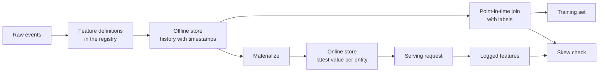

# Características de almacenamiento y formación  Servicio diferencia

> Una característica sólo tiene una definición, pero hay dos formas de leer. Entrenamiento de leer el valor histórico de cada etiqueta en el momento, servicio en línea de leer el valor más reciente. Cuando los dos no coinciden, el modelo se encuentra con entradas nunca vistas durante el entrenamiento.

**Type:** Build
**Languages:** Python
**Prerequisites:** Phase 2，第 08 课（特征工程）、第 13 课（机器学习流水线）、第 15 课（时间序列）和第 19 课（机器学习系统设计）
**Time:** ~100 分钟

## El objetivo del aprendizaje

- Explicar el significado del almacenamiento en línea, almacenamiento en línea, tiempo de eventos y TTL y sus respectivas responsabilidades
- 实现时点正确的关联,并展示简单关联 如何将未来值复制到训练数据中
- 列出训练服务偏差的四个原因: 两条代码路径、特征陈旧、默认值不同和时间穿越
- Construir un registro de características, hacer que la misma definición al mismo tiempo para el uso de los caminos de entrenamiento y caminos de servicio
- En el pasado, los días se llenan de nuevo, sin leer los datos de cada día después de los días.
- Para el mismo objeto y momento, comparar las características en el diario de servicio con las características que surgen de la ruta de entrenamiento, para así detectar la diferencia

##  problemas

Un equipo construyó un modelo de usuario perdido. Cada etiqueta indica si el usuario no compró en los 30 días siguientes al día de etiquetado.`user_id`Se relacionará el etiquetado con las características del usuario, y se basará en `days_since_last_purchase`訓練一条规则──离线准确率 0.948──

En el tráfico real, este modelo no es como una versión más antigua, más simple. La tabla de características conserva el valor más reciente de cada usuario, su tiempo es un poco más tarde que el día de etiqueta. Un usuario ha realizado su última compra en el 115o día, hasta el 175o día de la sesión de fotos, ya se ha colocado 60 días, por lo que el rasgo en sí mismo contiene la respuesta.

Estas dos carencias son las mismas: el entrenamiento y el servicio en línea se calculan de dos maneras diferentes con el mismo rasgo. Este curso se desarrollará desde cero construyendo cada parte del almacenamiento de rasgos.

## 概念

### Dos lecturas de la misma característica

 Formación y servicio en línea en forma de solicitud de características diferentes:

| 属性 | 训练（离线） | 服务（在线） |
|---|---|---|
| 问题 | “一千万个（实体，时间）组合各自对应的值是什么？” | “这个实体现在的值是什么？” |
| 时间 | 过去的多个时点 | 当前 |
| 数据量 | 每个任务数百万行 | 每次请求一行 |
| 延迟 | 可以接受数分钟 | 几毫秒 |
| 存储 | 离线存储：在列式文件或数据仓库中保存带时间戳的完整历史 | 在线存储：在键值数据库中保存每个实体的最新值 |

El archivo de datos de datos de datos de datos de datos de datos de datos de datos de datos de datos de datos de datos de datos de datos de datos de datos de datos de datos de datos de datos de datos de datos de datos de datos de datos de datos de datos de datos de datos de datos de datos de datos de datos de datos de datos de datos de datos de datos de datos de datos de datos de datos de datos de datos de datos de datos de datos de datos de datos de datos de datos de datos de datos de datos de datos de datos de datos de datos de datos de datos de datos de datos de datos de datos de datos de datos de datos de datos de datos de datos de datos de datos de datos de datos de datos de datos de datos de datos de datos de datos de datos de datos de datos de datos de datos de datos de datos de datos de datos de datos de datos de datos de datos de datos de datos de datos de datos de datos de datos de datos de datos de datos de datos de datos de datos de datos de datos de datos de datos de datos de datos de datos de datos de datos de datos de datos de datos de datos de datos de datos de datos de datos de datos de datos de datos de datos de datos de datos de datos de datos de datos de datos de datos de datos de datos de datos de datos de datos de datos de datos de datos de datos de datos de datos de datos de datos de datos de datos de datos de datos de datos de datos de datos de datos de datos de datos de datos de datos de datos de datos de datos de datos de datos de datos de datos de datos de datos de datos de datos de datos de datos de datos de datos de datos de datos de datos de datos de datos de datos de datos de datos de datos de datos de datos de datos de datos de datos de datos de datos de datos de datos de datos de datos de datos de datos de datos de datos de datos de datos de datos de datos de datos de datos de datos de datos de datos de datos de datos de datos de datos de datos de datos de datos de datos de datos de datos de datos de datos de datos de datos de datos de datos de datos de datos de datos de datos de datos de datos de datos de datos de datos de datos de datos de datos de datos de datos de datos de datos de datos de datos de datos de datos de datos de datos de datos de datos de datos de datos de datos de datos de datos de datos de datos de



### 实体、时间  y TTL

Cada línea de características puede ser descrita en cuatro términos:

- **实体（Entity）。**Características que describen los elementos clave, por ejemplo`user_id`O `card_id`¿Qué es eso?
- **事件时间戳（Event timestamp）。**El tiempo de la creación del valor. Hasta el 14 de enero, el tiempo de su evento es el 14 de enero.
- **创建时间戳（Created timestamp）。**系统写入该行时刻──今天执行的回填会写入事件时间早些时候、创建时间为当前时间的行──
- **TTL（time to live，生存时间）。**El valor permitido para alcanzar la edad máxima.

具有相同实体、数据源和 TTL的一组特征, normalmente llamado 特征视图(feature view) ⋅

### 时点正确的关联

Una línea de datos de entrenamiento debe emparejar las etiquetas con las características que ya existen en el momento de la etiqueta.

1. 找到同一实体的特征行──
2. Sólo retener el tiempo del evento  no tarde que el tiempo de etiqueta  de la ruta.
3. 取其中最新的一行──
4. Si el tiempo de etiqueta se reduce a más de TTL, se abandona este camino.

A continuación se muestra un usuario  16 天 标签, así como las características generadas por semana:

| 特征行日期 | `purchases_30d` | 时点关联 | 仅按 `user_id` 进行朴素关联 |
|---|---|---|---|
| 7 | 4 | | |
| 14 | 3 | 选中 | |
| 21 | 1 | 未来 | |
| 28 | 0 | 未来 | 选中 |

El etiquete debe juzgar si el usuario ha comprado algún producto en los días 17 a 46 de la semana. El 28 de la semana ya se han calculado los días en que no se ha comprado después del día de etiquetas. Muestra que el número de veces de compra es 0, porque el usuario ha dejado de comprar, y esto es el caso de la medición de etiquetas.

时间序列一课按时间分分数据, también por la misma razón. 时点关联 aplicará esta regla a cada línea, no sólo a un punto de tiempo de división.

###                                                                                                                                                                                                                                                               

Las reglas de aprendizaje automático de Google definen la diferencia de servicio como la diferencia de rendimiento entre el entrenamiento y el servicio en línea, y enumeran tres razones: las dos reglas de tratamiento de datos de flujo de agua diferentes entre el entrenamiento y el servicio, y la variación de datos entre el entrenamiento y el servicio.

| 原因 | 发生的情况 | 演示中的例子 |
|---|---|---|
| 两条代码路径 | 训练与服务使用不同代码计算特征 | 服务窗口包含 `now - 30` 这一天，训练窗口却不包含 |
| 特征陈旧 | 服务读取的值与训练所用值的年龄不同 | 训练读取每周快照，而新服务计算实时的新值 |
| 默认值不同 | 两条路径对缺失值的填充方式不同 | 对“尚未购买”，训练使用 365，服务使用 -1 |
| 时间穿越 | 训练读取了标签时刻之后的值 | 朴素关联为每个标签读取最新快照 |

La misma directiva, Artículo 32, requiere que el código se utilice de la misma manera posible entre la línea de entrenamiento y la línea de servicio.

### Títulos de registro

El registro es un catálogo definido de características. Cada artículo contiene nombre, entidad, fuente de datos, cambio, ventana, valor predeterminado, TTL, responsable, versión y descripción.

两条规则 puede garantizar su seguridad:

- 两条路径都从注册表读取定义―― ningún servicio puede ser privado de mantenimiento de cambios lógicos.
- 修改定义时创建新版本──旧版本继续保留,让旧模型仍能使用训练时的特征──

### ¿Qué pasa ?

El nuevo rasgo no tiene historia, pero el entrenamiento requiere que se ejecute en cada fecha de cada marca histórica.

El costo de cálculo de la carga de carga aumenta con el número de entidades y el número de días. También puede traer una fuga oculta: la carga de carga de carga de carga de carga de carga de carga de carga de carga de carga de carga de carga de carga de carga de carga de carga de carga de carga de carga de carga de carga de carga de carga de carga de carga de carga de carga de carga de carga de carga de carga de carga de carga de carga de carga de carga de carga de carga de carga de carga de carga de carga de carga de carga de carga de carga de carga de carga de carga de carga de carga de carga de carga de carga de carga de carga de carga de carga de carga de carga de carga de carga de carga de carga de carga de carga de carga de carga de carga de carga de carga de carga de carga de carga de carga de carga de carga de carga de carga de carga de carga de carga de carga de carga de carga de carga de carga de carga de carga de carga de carga de carga de carga de carga de carga de carga de carga de carga de carga de carga de carga de carga de carga de carga de carga de carga de carga de carga de carga de carga de carga de carga de carga de carga de carga de carga de carga de carga de carga de carga de carga de carga de carga de carga de carga de carga de carga de carga de carga de carga de carga de carga de carga de carga de carga de carga de carga de carga de carga de carga de carga de carga de carga de carga de carga de carga de carga de carga de carga de carga de carga de carga de carga de carga de carga de carga de carga de carga de carga de carga de carga de carga de carga de carga de carga de carga de carga de carga de carga de carga de carga de carga de carga de carga de carga de carga de carga de carga de carga de carga de carga de carga de carga de carga de carga de carga de carga de carga de carga de carga de carga de carga de carga de carga de carga de carga de carga de carga de carga de carga de carga de carga de carga de carga de carga de carga de carga de carga de carga de carga de carga de carga de carga de carga de carga de carga de carga de carga de carga de carga de carga de carga de carga de carga de carga de carga de carga de carga de carga de carga de carga de carga de carga de carga de carga de carga de carga de carga de carga de carga de

### 检测偏差

La misma regla del artículo 29 de la Directriz requiere que se registren las características utilizadas en el servicio, y se utilizan para el entrenamiento. Incluso si se registra una pequeña cantidad de muestras, también se puede comprobar la conformidad.

为了定位原因, comparar las siguientes tres grupos de resultados:

1. En línea, el resultado de la lectura se relaciona con el resultado del entrenamiento.
2. 实时重新计算的结果与训练相关结果―― esto puede identificar de forma individual la situación de la experiencia−.
3. Artículo 2 El camino del código y los resultados de la recalculación en tiempo real.

```figure
mlprod-pit-join
```

## 动手构建 动手构建

`code/main.py`El código medio sólo utiliza la base de datos. Tiempo en días completos.

### Paso 1: Características definidas y registro

`FeatureDefinition`Se puede decir que el valor de la información es el valor de la información.`compute`方法绝不会读取  Cómo hacerlo`as_of`后的事件── después de eso.

```python
@dataclass(frozen=True)
class FeatureDefinition:
    name: str
    entity: str
    aggregate: str
    window_days: int | None
    default: float
    version: int = 1
    owner: str = "growth-team"
    description: str = ""

    def compute(self, events: list[Event], as_of: int) -> float:
        visible = [e for e in events if e.day <= as_of]
        if self.window_days is not None:
            visible = [e for e in visible if e.day > as_of - self.window_days]
        if self.aggregate == "count":
            return float(len(visible))
        if self.aggregate == "sum":
            return round(sum(e.amount for e in visible), 2)
        if self.aggregate == "days_since_last":
            return float(as_of - max(e.day for e in visible)) if visible else self.default
        raise ValueError(f"unknown aggregate {self.aggregate!r}")
```

`FeatureRegistry.register`允许重复注册相同定义, pero rechazar el nombre y la versión idéntica, contenido pero diferente definición.`fill_defaults`Por lo tanto, el valor de la falta de los dos caminos es el mismo.

模型通过 `spend_30d@1`Este tipo de cita fija definición.`compute`Y `fill_defaults`会解析引用,不含 `@`Su nombre se encuentra en la versión más reciente.`@`No hay ninguna versión de la citación.`ValueError`, por lo tanto, el error de escritura no se leerá sin advertencia hasta la última versión.

### Paso 2: Rellenar el almacenamiento en línea

```python
def backfill(registry: FeatureRegistry, names: list[str], events: list[Event], days: list[int]) -> list[FeatureRow]:
    rows = []
    for entity, entity_events in sorted(group_events(events).items()):
        for day in days:
            rows.append(FeatureRow(entity, day, registry.compute(names, entity_events, day)))
    return rows
```

演示为 299 个用户在 25 个快照日回填三个特征,共生成 7475 行──

### 步骤 3: el tiempo

Previo a fecha para cada entidad de la línea de orden una vez.`bisect_right`找到标签日当天或之前的最后一行. TTL 检查会丢弃过旧行.

```python
def point_in_time_join(labels: list[LabelRow], rows: list[FeatureRow], ttl_days: int | None = None) -> list[JoinedRow]:
    by_entity: dict[str, list[FeatureRow]] = defaultdict(list)
    for row in rows:
        by_entity[row.entity].append(row)
    days_index = {}
    for entity, entity_rows in by_entity.items():
        entity_rows.sort(key=lambda r: r.day)
        days_index[entity] = [r.day for r in entity_rows]
    joined = []
    for label in labels:
        days = days_index.get(label.entity, [])
        pos = bisect.bisect_right(days, label.day) - 1
        match = by_entity[label.entity][pos] if pos >= 0 else None
        if match is not None and ttl_days is not None and label.day - match.day > ttl_days:
            match = None
        joined.append(JoinedRow(
            label.entity, label.day, label.label,
            match.day if match else None, match.values if match else None,
        ))
    return joined
```

### Paso 4: Medir las fugas causadas por la simple conexión

`naive_latest_join`Sólo según el cuerpo, por lo tanto, para cada etiqueta volver a la línea más reciente. Presentación en las secciones 100、120 y 140 para construir etiquetas, y para preparar una regla de características únicas en cada ensayo.

```console
  naive join used a snapshot from after the label day for 100% of rows
  offline accuracy, naive join: 0.948 (rule: idle > 53 days)
  offline accuracy, PIT join:   0.893 (rule: idle > 19 days)
  accuracy on day 145, trained with naive join: 0.763
  accuracy on day 145, trained with PIT join:   0.876
```

El rendimiento de la descarga de datos de la red de Internet fue mejor: 0.948 contra 0.893..., pero en los nuevos datos fue peor: 0.763 contra 0.876..., y las características de la fugas se adaptaron a la cantidad de datos disponibles desde 19 hasta 53 días.

### Paso 5: almacenamiento en línea y materialización

En línea de almacenamiento para cada cuerpo retener una línea, y rechazar exceder las líneas de TTL.`materialize`Sólo escribe en el día no tarde en el tiempo de la tarea.

```python
class OnlineStore:
    def __init__(self, ttl_days: int):
        self.ttl_days = ttl_days
        self._latest: dict[str, FeatureRow] = {}

    def write(self, row: FeatureRow) -> None:
        current = self._latest.get(row.entity)
        if current is None or row.day >= current.day:
            self._latest[row.entity] = row

    def read(self, entity: str, now: int) -> dict[str, float] | None:
        row = self._latest.get(entity)
        if row is None or row.day > now or now - row.day > self.ttl_days:
            return None
        return dict(row.values)
```

TTL para 10 天时, la lectura de 145 天返回第140 天的行──en caso de no haber una nueva materialización, la lectura de 160 天返回默认值, ya que la行 ya tiene 20 天的历史──

### Paso 6: Inspección de diferencias

`detect_skew`Comparar con dos`(entity, day)`Se informa de la proporción de disparidades entre cada característica y la diferencia absoluta media, cuando el valor de más del 1% difiere, marcando la característica. Si dos de las claves de la vista difieren o no tienen ninguna clave, se desencadena.`ValueError` La falta de solicitud puede ocultar la diferencia, mientras que la inspección sin solicitud no puede explicar ningún problema.

```python
def detect_skew(
    training: dict[tuple[str, int], dict[str, float]],
    serving: dict[tuple[str, int], dict[str, float]],
    features: list[str],
    tolerance: float = 1e-6,
    max_mismatch_rate: float = 0.01,
) -> list[SkewReport]:
    if set(training) != set(serving):
        raise ValueError(f"{len(set(training) ^ set(serving))} keys are in only one view: log and compare the same requests")
    if not training:
        raise ValueError("no requests to compare")
    keys = sorted(training)
    reports = []
    for feature in features:
        diffs = [abs(training[k][feature] - serving[k][feature]) for k in keys]
        mismatches = sum(1 for d in diffs if d > tolerance)
        rate = mismatches / len(keys)
        mean_diff = sum(diffs) / len(keys)
        reports.append(SkewReport(feature, len(keys), rate, mean_diff, rate > max_mismatch_rate))
    return reports
```

演示记录第141到第150天的请求,并运行概念部分介绍的三组比较――请求池中包含了20 nuevos usuarios sin registro histórico――

```bash
python3 code/main.py
```

```console
=== Skew checks on 383 logged requests, days 141 to 150 ===
  online store read  vs  training join (one definition, same snapshots)
    ok   days_since_last_purchase   mismatch   0.0%  mean |diff|    0.00
    ok   purchases_30d              mismatch   0.0%  mean |diff|    0.00
    ok   spend_30d                  mismatch   0.0%  mean |diff|    0.00
  fresh compute      vs  training join (staleness only)
    SKEW days_since_last_purchase   mismatch  83.0%  mean |diff|    2.77
    SKEW purchases_30d              mismatch  30.5%  mean |diff|    0.38
    SKEW spend_30d                  mismatch  37.1%  mean |diff|   16.77
  second code path   vs  fresh compute (code differences only)
    SKEW days_since_last_purchase   mismatch   5.5%  mean |diff|   20.07
    SKEW purchases_30d              mismatch  12.5%  mean |diff|    0.13
    SKEW spend_30d                  mismatch  12.5%  mean |diff|    5.09
```

Encuentra estos tres bloques de salida:

- **同一定义、相同快照。**En línea almacenamiento y entrenamiento relacionados lectura de la misma materialización, por lo tanto, la diferencia es de cero.
- **陈旧性。**En la mayoría de las solicitudes, el valor de cálculo en tiempo real es diferente al de la rapidez semanal.
- **代码差异。**El segundo código de ruta es diferente en el 12,5% de las ventanas, ya que su ventana contiene más de un día.`days_since_last_purchase`La diferencia es grande: 1 a 365

## Utiliza herramientas existentes

La fiesta es un recurso abierto de almacenamiento. Desde el principio de la realización, cada parte de la fiesta puede encontrar en la fiesta los siguientes aspectos:

| 从零实现 | Feast |
|---|---|
| `FeatureDefinition`、`FeatureRegistry` | 特征仓库中的 `Entity`、`FeatureView` 和 `Field`，通过 `feast apply` 注册 |
| `FeatureRow` 历史记录 | 离线存储，例如基于 Parquet 文件的 `FileSource` 或数据仓库表 |
| 带 TTL 的 `point_in_time_join` | `store.get_historical_features(entity_df=..., features=[...])` |
| `materialize` | `feast materialize-incremental <end time>` |
| `OnlineStore.read` | `store.get_online_features(features=[...], entity_rows=[...])` |
| 创建时间戳检查 | 数据源上的 `created_timestamp_column` 和 `filter_by_created_timestamp=True` |

定义如下──这些代码遵循节日快速入门指南,运行本课不需要它们──

```python
from datetime import timedelta

from feast import Entity, FeatureView, Field, FileSource
from feast.types import Float32, Int64

user = Entity(name="user", join_keys=["user_id"])

user_activity_source = FileSource(
    name="user_activity_source",
    path="data/user_activity.parquet",
    timestamp_field="event_timestamp",
    created_timestamp_column="created",
)

user_activity = FeatureView(
    name="user_activity",
    entities=[user],
    ttl=timedelta(days=10),
    schema=[
        Field(name="purchases_30d", dtype=Int64),
        Field(name="spend_30d", dtype=Float32),
        Field(name="days_since_last_purchase", dtype=Int64),
    ],
    source=user_activity_source,
)
```

Luego, entrenamiento y servicio en línea se leyeron con la misma característica:

```python
from feast import FeatureStore

store = FeatureStore(repo_path=".")

training_df = store.get_historical_features(
    entity_df=labels_df,
    features=["user_activity:purchases_30d", "user_activity:days_since_last_purchase"],
    filter_by_created_timestamp=True,
).to_df()

online = store.get_online_features(
    features=["user_activity:purchases_30d", "user_activity:days_since_last_purchase"],
    entity_rows=[{"user_id": 42}],
).to_dict()
```

`labels_df`Para cada etiqueta guardar una línea, contiene `user_id`¿Qué es esto?`event_timestamp`Y etiquetado. Fiestas  documentación señala, TTL relativa a cada tiempo en el marco de datos físicos, en lugar de la consulta.`point_in_time_join`En el medio de TTL 检查一致──`filter_by_created_timestamp=True`, puede evitar la filtración de datos de la capacitación. No todos los almacenes fuera de línea apoyan esta opción.

Tecton、Hopsworks 和 las características de almacenamiento en las plataformas de aprendizaje de la nube grande, también adoptan el mismo tipo de almacenamiento en línea y en línea.

## 交付成果  交付成果                                                                                                                                                                                                                                                                                                                                                                                                                                                                                                                     

本课产 出  `outputs/skill-feature-skew-audit.md` La capacidad de auditoría de características de la línea de flujo de agua en el tiempo de paso y entrenamiento  de la diferencia de servicio, de la siguiente manera de revisar la lógica relacionada  definición  valores predeterminados  la novedad de los datos de los diferentes caminos, así como los registros necesarios para revisar la diferencia 

##  ejercicios

1. 将快照间隔从 7 天改为 1 天──重新运行陈旧性比较,并解释结果──
2. Para el cálculo, el valor de la TTL se ha establecido en 3 días.
3. Por lo tanto ,`FeatureRow`添加创建日期──让关联忽略标签日后写入的行──
4. ¿ Qué ?`spend_7d`Registrarse para`spend_30d`La versión 2... se completa y se imprime en dos versiones.
5. 修复                                               `legacy_serving_features`, hasta que el tercer grupo de la revisión de diferencias pase.

## 关键术语: "El hombre es un hombre"

| 术语 | 常见说法 | 实际含义 |
|------|----------------|----------------------|
| 特征存储 | “存特征的数据库” | 根据同一组定义计算特征，并同时提供给训练与在线服务的系统 |
| 离线存储 | “训练数据” | 带事件时间戳的完整特征历史，由训练任务和回填任务读取 |
| 在线存储 | “特征缓存” | 每个实体的最新值，供服务路径以毫秒级延迟读取 |
| 实体 | “ID” | 特征所描述对象的键，例如用户或银行卡 |
| 事件时间戳 | “何时发生” | 特征值成立的时刻 |
| 时点关联 | “截至某时刻的关联” | 为每个标签匹配标签时刻当天或之前的最新特征行 |
| TTL | “有效期” | 特征值在被读取方视为缺失之前允许达到的最大年龄 |
| 物化 | “同步到线上” | 将最新特征值从离线存储复制到在线存储的任务 |
| 回填 | “计算历史” | 在过去的日期执行特征定义，以生成其历史记录 |
| 训练—服务偏差 | “离线时明明有效” | 训练与在线服务中的特征或行为差异 |

## 延伸阅读

- [Feast：时点关联](https://docs.feast.dev/getting-started/concepts/point-in-time-joins)TTL 语义与创建时间 过
- [Feast 文档](https://docs.feast.dev/): Características de la información, almacenamiento y materialización
- [Google：《机器学习规则》](https://developers.google.com/machine-learning/guides/rules-of-ml)Artículo 29 a Artículo 37 de la Ley de Previación de Servicios
- [Breck 等：《机器学习的数据验证》（SysML 2019）](https://research.google/pubs/data-validation-for-machine-learning/)Google: Verificación de datos, incluyendo la formación de los servicios
- [TensorFlow Data Validation 指南](https://www.tensorflow.org/tfx/guide/tfdv): mode checks, prefijcance checks y drift checks
- [Sculley 等：《机器学习系统中隐藏的技术债》（NeurIPS 2015）](https://papers.nips.cc/paper/2015/hash/86df7dcfd896fcaf2674f757a2463eba-Abstract.html)Modelo de datos alrededor de la línea de flujo de la tecnología de la deuda
