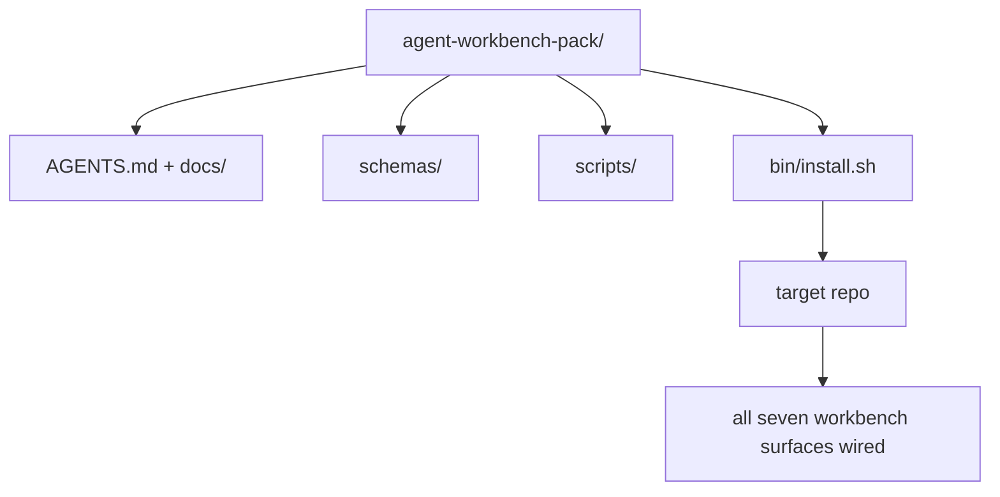

# Capstone: entregar un paquete de trabajo de agente de uso repetible

> Esta mini-track es una que puedes colocar en cualquier paquete de repositorios.`cp -r`Y luego, al día siguiente, vamos a hacer que el agente haga un trabajo estable. Este es el artefacto que realmente entregó el curso.

**类型：**Construir
**语言：**Python (stdlib)
**前置要求：**Fases 14 · 31 hasta 14 · 41
**时间：**~ 75 minutos

## El objetivo del aprendizaje

- Envasar siete superficies de escritorio en un directorio que se pueda colocar directamente.
- Fixed schema、script 和 template, hacer que un nuevo repo  obtenga una línea de base ya disponible―
- Añade un script de instalación, coloca este paquete de la misma manera.
- Decide qué contenido queda en el paquete, qué contenido queda en el exterior, y para cada uno de ellos.
-  demostrar una vez que el agente  asistido a la realización de cambios en el almacén, y proporcionar pruebas de que el revisor pueda volver a la práctica 

##  problemas

Una de las versiones de un workbench que existe en Google Doc, chat history y tres escritos que sólo se han olvidado, es un workbench que se reconstruye cada trimestre. La solución es un paquete con una versión: un repositorio o un catálogo, que contiene superficie, esquema, script, así como un instalador de orden que se puede ejecutar.

Al final de la clase, se entregará en disco.`outputs/agent-workbench-pack/`, y uno que puede ponerlo en cualquier repo objetivo .`bin/install.sh`¿Qué es eso?

## 概念



### Diseño del paquete

```
outputs/agent-workbench-pack/
├── AGENTS.md
├── docs/
│   ├── agent-rules.md
│   ├── reliability-policy.md
│   ├── handoff-protocol.md
│   └── reviewer-rubric.md
├── schemas/
│   ├── agent_state.schema.json
│   ├── task_board.schema.json
│   └── scope_contract.schema.json
├── scripts/
│   ├── init_agent.py
│   ├── run_with_feedback.py
│   ├── verify_agent.py
│   └── generate_handoff.py
├── bin/
│   └── install.sh
└── README.md
```

### ¿Qué dejar, qué poner afuera?

¿Qué es eso ?

- Esquema de superficie.
- Los cuatro guiones de arriba... son el tiempo de ejecución.
- Cuatro documentos... son la regla y la rúbrica...

 poner fuera:

- 项目特定任务──任务属于目标 repo 的董事会, no pertenece al paquete──
- 供应商 SDK 调用──这个包与框架无关──
- Embordaje 文案── este paquete  colocar el equipo ya ha embarcado 旁边, en lugar de colocar en ella──

### Instalador

Un breve `bin/install.sh`(o `bin/install.py`):

1. No hay .`--force`时, rechazar la instalación hasta que haya un paquete arriba.
2. Se va a empacar en el reporte de la meta.
3. Si existe`.github/workflows/`, entonces se conecta con CI.
4. 打印后续步骤: rellenar el tablero 设置接受命令 运行 init script──

### 版本管理

Este paquete lleva uno .`VERSION`文件──需要迁移的 schema bump 和脚本 变更会出现重大突破──仅 doc 的变更会出现突破补丁──目标 repo 的 文件──需要迁移的 schema bump 和脚本 变更会出现重大突破──仅 doc 的变更会出现突破补丁──目标 repo 的 文件──需要迁移的 schema bump 和脚本──变更会出现重大突破──只有 doc 的变更会出现突破补丁──目标 repo 的 文件──目标 repo 的 文件──`agent_state.json`记录它初始化时对应的包版──


```figure
wb-pack-install
```

## Construirlo

`code/main.py`Me gustaría hacer un paquete junto a la clase.`outputs/agent-workbench-pack/`En el medio, no usas este mini-track como un secuestro de la primera clase y el guión, así como el documento que ya has escrito.

¿Qué es eso ?

```
python3 code/main.py
```

Este script se copia y fija la superficie, se escribe en README, se imprime en el árbol de paquete, y luego se retira a cero.

## Modelo en la producción real

Un paquete sólo tiene valor cuando puede soportar una correa, actualizar y no ser amigable en el aguas arriba.

**`VERSION` 是 contract，不是 marketing。**Gran embrague  necesita migración de estado ∙∙ Embrague menor                                                                                                                                                                                                                                                                                                                                                                                                                                                                                                             `.workbench-version`写入目标 repo; si el objetivo de bloqueo y el paquete de `VERSION`No coincide,`lint_pack.py`¡Me rechazará la entrega!`npm`¿Qué es esto?`Cargo`Y `pyproject.toml`能经受 10 años churn; agente no cambiará estas reglas.

**跨工具分发的单一来源。**No te lo puedo dar .`nx ai-setup`, desde un solo configurado  colocación `AGENTS.md`¿Qué es esto?`CLAUDE.md`¿Qué es esto?`.cursor/rules/`¿Qué es esto?`.github/copilot-instructions.md`Y un servidor MCP. Este paquete también debería hacerlo.`ln -s AGENTS.md CLAUDE.md`), hacer que un solo hecho se despliegue a cada agente de codificación―para apoyar un instrumento y un fork este paquete, es un modo de fracaso―

**`uninstall.sh` 会在存在非平凡 state 时拒绝执行。** Descargar este paquete no puede eliminar el usuario `agent_state.json`¿Qué es esto?`task_board.json`O `outputs/`❖ Uninstaller 会 eliminar esquema, guión, documento y `AGENTS.md`(带 `--keep-agents-md`Opt-out), y si el archivo de estado tiene cualquier cambio no presentado, se niega a continuar.

**Skill-as-publishable。SkillKit-style 分发。**Este paquete  como habilidad de SkillKit 交付:`skillkit install agent-workbench-pack`Se puede colocar en un solo sitio a 32 agentes de IA. En el centro, el paquete de repos es la fuente de datos.

## Usalo

El paquete se entrega en tres lugares:

- **作为一个你放进 repo 的目录。** `cp -r outputs/agent-workbench-pack /path/to/repo`¿Qué es eso?
- **作为一个公开 template repo。**Forja y personalización,并用 `VERSION`Controlando la deriva.
- **作为一个 SkillKit skill。**Entra en tu agente, haz que una orden se complete y coloque.

El paquete es una receta. Cada vez que se instala es una porción.

##  entregarlo

`outputs/skill-workbench-pack.md`Se generará un paquete de ajustes de proyectos: reglas, en función de la historia del equipo, se hará más claro, el alcance global, la dimensión rubrica, se ampliará un ámbito específico.

##  ejercicios

1. Decidir cuál es el quinto documento que vale la pena elevar en el paquete canónico.
2. Usó Python para volver a escribir el instalador,并添加 `--dry-run`La bandera, la ergonomía y el bash.
3. Añade uno.`bin/uninstall.sh`¿Qué es lo que es extraordinario?
4. Añade uno.`lint_pack.py`, envasado  alejamiento `VERSION`时失败──把它连接到包 自身 repo 的CI──
5. ¿Qué orden de operación puede minimizar el tiempo de inactividad?

## 职业实践: demostrar una vez que el almacén cambia

打包演示证明组装程序能够运行并生成文件──它不能证明你的代理能完成新任务──生成的检查能够验证该任务,或已部署的系统能正常工作──请区分这些结论──

En el almacén que poseas o obtienes permiso para modificar, selecciona una verdadera pequeña tarea―, utilizando un agente de programación que ya has podido visitar―, incluso puede―, reparar las deficiencias―, lograr funciones definidas por fronteras, o mejorar el funcionamiento y el proceso de la instalación de varios agentes, no es el contenido del ejercicio―.

Además de la experiencia de trabajo, otra reserva una vez en el trabajo.`learning-artifacts/`Preservar los modelos y paquetes existentes en el almacén, como referencia.

### 1. 明确任务并选择自主程度

Utilice el marco de tareas de la clase 43 y el plan de pruebas de la clase 44.

 seleccionar un modelo de trabajo: guiar paso a paso 带检查点的实现, o ejecutar de forma autónoma una clara frontera  explicar por qué apoyan esta opción la incertidumbre  los posibles efectos y la reversibilidad  Reconstruir localmente una pequeña gama, puede requerir menos controles que los cambios de control de visita 

 Establecer un presupuesto de tiempo real; si el agente  proporciona funciones relacionadas, también debe establecer un token o un límite de gastos  para datos de medida no accesibles, como registros reales para la reincidencia de fracasos  nuevas necesidades de derechos  El presupuesto  se agota o no resuelve  para el trabajo 

### 2.  Preparar el ambiente mínimo y útil

查找相关实现、调用方、测试和本地指令──记录每一个来源为什么应进入上下文,以及哪些现有证据能够推翻过时的笔记──不要默认加载整个仓库──

Para cada tipo de expansión, se debe determinar la capacidad de: habilidad: habilidad: proporcionar un proceso de uso repetible; MCP: herramienta: proporcionar capacidad de acceso; 子: habilidad de ejecutar un control de determinación;

registrar un nuevo proyecto que usted rechazó conllevará un costo de mantenimiento o de continuación. Reverificar un recuerdo o instrucción pasada. Si la evidencia apoya la retirada o sustitución, se ejecuta en un entorno de aprendizaje administrado por usted mismo.

### 3. 记录基线并实现

 editar antes, ejecutar los controles existentes más relevantes, mostrar el estado actual del comportamiento requerido, mantener órdenes, versiones, resultados y posiciones de pruebas, funciones que aún no existen, también tienen bases: registrar las respuestas observadas o operaciones no apoyadas.

让代理在任务约定内实现变更――保留干预日志,说明每次纠正、权限变更或计划调整的原因――委派是可选的; si es realmente útil, primero aplicar la responsabilidad de la clase 45 de la atribución y integración de la obligación, antes de agregar otro ejecutor―

### 4. 质疑证据 (problema de seguridad)

选择能够观察变更界面的验证方式――对 UI,重建,并对相关视口宽度下检查实际提供服务的用户流程――对 API,检查请求和序列化后的响应――对 CLI,运行构建后的命令,检查退出码和输出――select任务所需的检查,并说明它们的局限性――

Según la tarea, no se escriba el resultado esperado, no se introduce un resultado de error específico en la copia de una vez, por ejemplo, aceptar la ineficacia o la falta de respuesta necesaria.

Si el control sigue siendo aprobado, primero se fortalece el método de observación, vuelve a creer en él, vuelve a realizarse correctamente, y vuelve a ejecutarse hasta que se haya aprobado, conservando dos veces el título de ejecución, no importa si el sistema de prueba ha sido revisado o ha sido destruido.

En el caso de los objetivos originales y de la vía de modificación, la diferencia final de la evaluación, incluidos los cambios en la evaluación.

### 5. 演练运行与恢复

En el entorno local o en el entorno de la publicación previa de una vez, se realizarán entregas posteriores a cambios.`local`¿Qué es esto?`staging`O `live`,并注明确版本或交付物标识──本地演练只支持本地结论;本地演练不要求部署到生产环境──

 seleccionar una señal de fracaso relacionada con la tarea, establecer value、observation window y responsibilityperson──explicar cómo debe responder a la sobrevaluación

演练回滚到已知可用交付物件,并检查是否恢复前行为. 应考虑持久化数据:只替换二进制文件不一定能撤销数据变更. 记录任何未经验证的恢复步骤. 转移到已知可用交付物件,并检查是否恢复前行为. 应考虑持久化数据:只替换二进制文件不一定能撤销数据变. 记录任何未经验证的恢复步骤.

### 6. 改进 próxima vez ejecutar并交接

Los resultados se compararán con los resultados de la base, incluyendo el tiempo de consumo real, la cantidad de datos disponibles y la intervención artificial. Una misión sólo puede explicar lo que ocurrió en la misión, no puede demostrar que un agente es más rápido o más fiable en general.

 En el curso 46  , se transformará una corrección real en prueba ∞, menor límite de poder ∞, proceso de automatización o ejemplos más claros ∞, reutilización de los controles afectados ∞, eliminación de los cambios de la introducción temporal, y para la próxima reunión, la división final del documento ∞, el riesgo no resuelto y el siguiente paso de acción ∞.

### Sector de trabajo

Por favor, revise el documento de prueba del auditor, y al menos repite el examen de aceptación más débil.`demonstrated`(ha demostrado)`needs revision`(necesita modificación) o `unverified`(未验证) Como estado, al mismo tiempo que se da evidencia de la posición y el motivo.

| 维度 | 评审者应质疑的证据 |
|---|---|
| 任务与自主程度 | 初始行为、边界明确的目标、合理的权限与预算，以及可执行的停止规则 |
| 上下文与环境 | 相关来源、合理的工具访问权限，以及经过重新核查的退役决定 |
| 验证 | 变更前后的实际行为，以及相同检查能够拒绝的、刻意引入的错误结果 |
| 评审与运行 | 已检查的差异、独立质疑、标明环境的运行观测，以及演练过的恢复流程 |
| 迭代与交接 | 一项经过验证的改进、如实说明的局限、干净的最终状态，以及可复现的下一步行动 |

En la declaración de tareas antes de completar, resolver el marcador para`needs revision`Las pruebas de que no se puede obtener deben conservarse.`unverified`,并相应缩小结论的范围── los trabajos del conjunto muestran que el ingeniero puede juzgar en una tarea definida en una frontera, no garantiza obtener un empleo o tener condiciones de despliegue―

## 交付物  entrega

Mantenga el paquete de uso repetible, así como lo que haya terminado.[career-agent-evidence.md](https://github.com/rohitg00/ai-engineering-from-scratch/blob/main/phases/14-agent-engineering/42-agent-workbench-capstone/outputs/career-agent-evidence.md)副本──该模板将任务框架、执行计划、运行证书、评审、恢复演习和交互整合为一个可评审的案例研究──

## 关键术语: "El hombre es un hombre"

| 术语 | 人们常说 | 它实际含义 |
|------|----------------|------------------------|
| Workbench pack | “starter kit” | 一个带版本的目录，携带全部七个 surface |
| Installer | “Setup script” | 以幂等方式放置 pack 的 `bin/install.sh` |
| Pack version | “VERSION” | schema/script 变更使用 major bump，仅 doc 变更使用 patch |
| Drop-in pack | “cp -r and go” | Pack 在第一天无需按 repo 定制即可工作 |
| Forkable template | “GitHub template” | GitHub 的 “Use this template” 可以从中 clone 的公开 repo |

## 延伸阅读

- Fases 14 · 31 a 14 · 41  Este paquete 打包 de cada superficie
- [SkillKit](https://github.com/rohitg00/skillkit) En 32 agentes de IA instalar esta habilidad
- [Nx Blog, Teach Your AI Agent How to Work in a Monorepo](https://nx.dev/blog/nx-ai-agent-skills) 跨六种工具的单一来源发电机
- [agents.md — the open spec](https://agents.md/) El router de su paquete debe implementar el contenido
- [HKUDS/OpenHarness](https://github.com/HKUDS/OpenHarness) paquete equivalente de referencia de realización
- [andrewgarst/agentic_harness](https://github.com/andrewgarst/agentic_harness) 带 eval suite de Redis respaldado 参考实现
- [Augment Code, A good AGENTS.md is a model upgrade](https://www.augmentcode.com/blog/how-to-write-good-agents-dot-md-files) empaque doc 的质量门
- [Anthropic, Effective harnesses for long-running agents](https://www.anthropic.com/engineering/effective-harnesses-for-long-running-agents)
- [Anthropic, Harness design for long-running application development](https://www.anthropic.com/engineering/harness-design-long-running-apps)
- Fase 14 · 30  消费这个包的验证门的评估驱动代理开发
- Fase 14 · 41  Este paquete debe ser mejorado antes/después de la referencia
