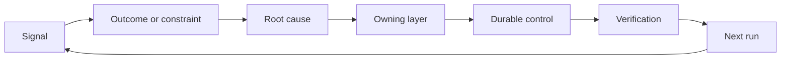

#  Construir una rueda de reincorporation and retirement mechanism

> La publicación de código termina el ciclo de construcción de la época, al mismo tiempo que abre un ciclo de aprendizaje de larga duración.

**Type:** Learn + Build
**Languages:** Python (stdlib)
**Prerequisites:** Phase 14 lessons 46 and 53
**Time:** ~75 minutes

## El objetivo del aprendizaje

- Los eventos de fallas, los datos de evaluación, el comportamiento de los usuarios y la corrección de los errores se transforman en acciones de responsabilidad.
- Se puede utilizar un sistema de control de datos de datos de datos de datos de datos de datos de datos de datos de datos de datos de datos de datos de datos de datos de datos de datos de datos de datos de datos de datos de datos de datos de datos de datos de datos de datos de datos de datos de datos de datos de datos de datos de datos de datos de datos de datos de datos de datos de datos de datos de datos de datos de datos de datos de datos de datos de datos de datos de datos de datos de datos de datos de datos de datos de datos de datos de datos de datos de datos de datos de datos de datos de datos de datos de datos de datos de datos de datos de datos de datos de datos de datos de datos de datos de datos de datos de datos de datos de datos de datos de datos de datos de datos de datos de datos de datos de datos de datos de datos de datos de datos de datos de datos de datos de datos de datos de datos de datos de datos de datos de datos de datos de datos de datos de datos de datos de datos de datos de datos de datos de datos de datos de datos de datos de datos de datos de datos de datos de datos de datos de datos de datos de datos de datos de datos de datos de datos de datos de datos de datos de datos de datos de datos de datos de datos de datos de datos de datos de datos de datos de datos de datos de datos de datos de datos de datos de datos de datos de datos de datos de datos de datos de datos de datos de datos de datos de datos de datos de datos de datos de datos de datos de datos de datos de datos de datos de datos de datos de datos de datos de datos de datos de datos de datos de datos de datos de datos de datos de datos de datos de datos de datos de datos de datos de datos de datos de datos de datos de datos de datos de datos de datos de datos de datos de datos de datos de datos de datos de datos de datos de datos de datos de datos de datos de datos de datos de datos de datos de datos de datos de datos de datos de datos de datos de datos de datos de datos de cuyo de cuyo de cuyo de cuyo cuyo cuyo cuyo cuyo cuyo cuyo cuyo cuyo cuyo cuyo cuyo cuyo cuyo cuyo cuyo cuyo cuyo cuyo cuyo cuyo cuyo cuyo cuyo cuyo cuyo cuyo cuyo cuyo cu
- Se clasificará el riesgo de recaída en primer lugar en función de la gravedad y la frecuencia de la situación.
- Para cada sistema de control del mecanismo de fijar las condiciones de retiro definidas (Condición de retiro)
- 沟通交付决策, proveer pruebas, evaluar y determinar quiénes son los responsables de la toma de decisiones.

## La infraestructura también es la misma.

Un equipo puede recopilar una gran cantidad de sistemas de enlace de seguimiento de rastros, registros de evaluación, registros de apoyo y diarios de errores, pero no puede aprender nada de ellos.**晋级通道（Promotion）**En el caso de los datos de la investigación, el análisis de la información y la evaluación de los datos de los datos de la investigación y la investigación de los datos de la investigación y la investigación de los datos de la investigación y la investigación de los datos de la investigación y la investigación de los datos de la investigación y la investigación de los datos de la investigación y la investigación de los datos de la investigación y la investigación de los datos de la investigación y la investigación de la investigación, se puede observar que los datos de la investigación de la investigación de la investigación de la investigación y la investigación de la investigación de la investigación de la investigación de la investigación de la investigación de la investigación de la investigación de la investigación de la investigación de la investigación de la investigación de la investigación de la investigación de la investigación de la investigación de la investigación de la investigación de la investigación de la investigación de la investigación de la investigación de la investigación de la investigación de la investigación de la investigación de la investigación de la investigación de la investigación de la investigación de la investigación de la investigación de la investigación de la investigación de la investigación de la investigación de la investigación de la investigación de la investigación de la investigación de la investigación de la investigación de la investigación de la investigación de la investigación de la investigación de la investigación de la investigación de la investigación de la investigación de la investigación de la investigación de la investigación de la investigación de la investigación de la investigación de la investigación de la investigación de la investigación de la investigación de la investigación de la investigación de la investigación de la investigación de la investigación de la investigación de la investigación de la investigación de la investigación de la investigación de la investigación de la investigación de la investigación de la investigación de la investigación de la investigación de la investigación de la investigación de la investigación de la investigación de la investigación de la investigación de la investigación de la investigación de la investigación de la investigación de la ciencia de los resultados de la investigación de la investigación de la investigación de la investigación de la investigación de la investigación de la investigación de la investigación de la investigación de la investigación de la investigación de la investigación de la investigación de la investigación de la investigación de la investigación de la ciencia de los resultados de la investigación de la investigación de la investigación de la investigación de la investigación de la investigación de la investigación de la ciencia de la ciencia de la ciencia de los resultados de la ciencia de la ciencia de la ciencia de los resultados de la ciencia de la ciencia de la ciencia de la ciencia de la ciencia de la ciencia de los científicos de la ciencia de la ciencia de la ciencia de la

El último ciclo de la serie de reacciones es:

1. 观测到具体实测信号;
2. Relacionar a los resultados de la producción prevista, condiciones de restricción o hipótesis de prepuestos;
3. Identificar los niveles sistémicos más bajos de la responsabilidad de la incidencia;
4. 实施受控的持久化改进;
5. 验证 la probabilidad de que se produzca un fallo de nuevo ha sido reducida;
6. 定期复审该控制机制是否应继续保留──

## 精准路由至应对责任层级 精准路由至应对责任层级

| 信号类型 | 归属目的地 |
|---|---|
| 误报、功能倒退、错误输出结果 | 评测集（Evaluation）或自动化测试 |
| 上下文缺失、重复劳动、过时事实 | 上下文数据源或检索路由策略 |
| 不安全操作或越权漏洞 | 安全策略（Policy）或权限硬边界 |
| 超时、重试风暴、依赖服务不可用 | 运行时控制（Runtime Control） |
| 新的产品需求或尚未决断的权衡取舍 | 经过规范成型（Shaped）的待办项 |

Cuando los controles de automatización o la dureza son suficientes para que el error sea completamente imposible, no hay que añadir un punto de sugerencia en el Prompt.



## La responsabilidad de la pertenencia en sí misma es parte del mecanismo de control.

Cada uno de los proyectos de acción de rotación debe tener claramente:

- 唯一的人类责任人 (propietario único de la empresa);
-  las prioridades basadas en la evaluación integral de los efectos de la destrucción y la frecuencia de repetición;
- 拟修改的目标系统组件 (se puede modificar el objeto objeto objeto de arte)
- provar el programa de verificación de la modificación y su efectividad;
- la ventana de revisión o de pérdida automática;
- 明确的退役条件 (condición de jubilación)

Un llamado programa de mejoras de nadie, lleno de su cantidad es sólo un fragmento de la versión de un pequeño comentario.

## 果断退役过时的控制机制 果断退役过时的控制机制 果断退役过时的控制机制 果断退役过时的控制机制 果断退役过时的控制机制

En el caso de los sistemas de control, las reglas de los sistemas de control deben ser activas y reexaminadas en los siguientes casos:

-  cambios fundamentales en la estructura del sistema o en el flujo de trabajo de las empresas;
- El mecanismo de invariabilidad de la capa inferior ha reemplazado completamente las instrucciones de texto de la capa superior;
- En el período de tiempo previsto, el fallo de prevención nunca se volvió a producir;
- La regulación del control obstaculiza la frecuencia de la realización normal de las actividades, ya superando los beneficios que trae su prevención de los peligros.

El control de la retirada también necesita pruebas, no puede ser sólo porque se ve demasiado tiempo atrás.

## 打通 producto construcción y el bloqueo de agente de codificación

Un mecanismo de rotura similar puede servir simultáneamente a la empresa de productos y el desarrollo de inteligencia en dos trayectorias:

- 产品业务实证驱动预期产出框架、假设图谱、最小切片或量度计划的演化;
- El funcionamiento de un agente de codificación corrección o automatización de pruebas, carga de datos, alcance de operación, optimización de guiones o mecanismos de comunicación de automatización;
- 线上真故障既能促成产品功能边界调整,也能促成代理工作台的加固──

Por eso el marco de tareas no se encuentra en la fase final del código, sino en la fase final de la declaración, que se transfiere en cada cambio que el sistema adopta.

## 动手实现

Este experimento se realiza en el segmento de señales de prueba, se crea un ciclo de acciones de la clasificación de la prioridad, y se produce.`outputs/feedback-backlog.json`¿Qué es eso?

```bash
python3 code/main.py
python3 -m unittest discover code/tests -v
```

尝试添加一个运行时超时信号,验证它将被正确路由至运行时控制层,而不是 generalizarse en la lista de espera de necesidades generales.

## 实践实验: responsable de la toma de decisiones después de sufrir

En el proyecto de trabajo que se encuentra en el camino de tu aprendizaje profesional, elige un flujo de trabajo.[职业交付模板](https://github.com/rohitg00/ai-engineering-from-scratch/blob/main/phases/14-agent-engineering/54-build-the-feedback-ratchet/outputs/career-delivery-evidence.md)En el medio.

Python  experimentación generará ejemplos de acciones de espera. No observará a los usuarios, no medirá los efectos de intervención, ni demostrará que ya tienes un poder de trabajo.

### 1. Mien claro lo que pasó

记录用户,任务,当前工作流,以及你希望改进的结果――链接到经过同意的观察记录,已脱敏的支持记录,或可复制的任务轨迹――区分你直接观察的事实,他人报告情况,以及你的推论――

 encontrar una fracasada: hipótesis de fracaso  resultados inusables  costes inesperados, o retraso de comunicación  explicar qué pruebas cambiaron tu comprensión  La fracasada necesita respuesta y decisión, en lugar de ser envasada en una historia de éxito

Si no puede contactar al usuario, por favor, realice una simulación de marcación clara con el compañero, o una simulación basada en una situación clara.

### 2. En el alcance de los derechos

列出未知项目,选择成本最低,可逆,且有望解决影响最重大未知项目行动――说明哪些事项可以由你决定,哪些选择受到既有约束,哪些操作需要先获得授权才能执行――

Por ejemplo, mientras espera el permiso para usar los datos de los clientes, puede prepararse para una descarga de línea desactiva. Avanzar activamente significa completar el trabajo de autorización, y la decisión será bloqueada.

### 3. Comparar el esquema y la responsabilidad de la decisión

Por no necesitar saber los detalles de la implementación, escribe un breve informe de decisión.

- Problemas de usuario y pruebas de cambios en el plan;
- Al menos dos tipos de programas; cuando sea razonablemente posible, incluir programas de mano de obra o de desarrollo sin coste inferior;
- 质量"",interaction design"",work volume"",costes de operación y riesgo de peso;
- Las recomendaciones, las incertidumbres y las decisiones que se deben tomar;
-  Responsabilidad de la toma de decisiones  Los interesados afectados y la fecha de toma de decisiones 

Por favor, acompañante en representación de una de las partes interesadas afectadas, cuestione uno de estos puntos de vista. Registra el asunto, y explica cómo cambió, o por qué no cambió tu sugerencia.

### 4.  llevar a cabo experimentaciones de límites claros

En función de la necesidad de responder a la pregunta, seleccionar el tipo original, el punto de prueba o la fase de producción de trabajo. Antes de que los resultados de la recopilación, especificar el público, los datos, la autorización, el tiempo de duración, el programa de rodaje, así como las condiciones de continuar, ajustar o detener.

Desde el inicio del usuario hasta la finalización de la tarea, explorar todo el proceso de interacción.

El tiempo de auditoría y corrección artificial se incluye en todo el proceso de trabajo. El modelo responde más rápido, puede hacer que la tarea completa se ralentice o que sea más difícil obtener confianza.

### 5. Comparar los resultados con la economía

Utilice los mismos indicadores definidos, el conjunto de tareas, los métodos de recopilación y las ventanas de observación comparables, los registros de la base y los resultados posteriores.

Encluir un resultado de usuario  un índice de calidad o seguridad , así como el total de trabajo de auditoría artificial

Evaluación del coste de cada tarea realizada con éxito, incluida la recopilación de modelos, los retestamientos, los servicios de apoyo y la auditoría artificial,  explicación de la hipótesis de un solo precio de la capacidad humana, la diferencia entre el uso real y el valor de la estimación  Comparar el coste con el programa de sustitución artificial o la hipótesis de valor detrás del proyecto 

 A través de lo que ya hay [LLM FinOps 课程](https://aiengineeringfromscratch.com/lesson?path=phases/17-infrastructure-and-production/27-finops-llms), más de aprendizaje de los costos de la atribución y la economía de la unidad. El cambio de modelo es sólo una de las formas posibles de respuesta; reducir el alcance del flujo de trabajo o retener los pasos artificiales, puede ser una mejor decisión de producto.

### 6. 完成闭环

Según los estándares de la declaración previa, la recomendación de continuar, ajustar o detenerse se puede realizar si la evidencia aún no está determinada, señalando la falta de observaciones, así como la siguiente prueba clara de límites.

 seleccionar una mejoría en el proceso de entrega en sí mismo: marco de tareas más claro, usuarios más tempranos, mejores evaluaciones, un mejor equipo de auditoría, un agente más pequeño, unidades de contactos o casos de evaluación más específicos, o los responsables y los periodos de auditoría.

复审时,决定保留、修改还是退役这一改进的记录选择的证据―― Si una nueva lista aumenta la cantidad de trabajo, pero no previene el fracaso del objetivo, no debe permanecer permanente―

## 交付物  entrega

¿ Qué ?[career-delivery-evidence.md](https://github.com/rohitg00/ai-engineering-from-scratch/blob/main/phases/14-agent-engineering/54-build-the-feedback-ratchet/outputs/career-delivery-evidence.md)Će copiar a su propio proyecto, y utilizar el ejemplar de pruebas Će rellenar Će hacer que los modelos en el almacén se mantengan reproducibles Će hacer un resumen de decisiones Će hacer un análisis Će comparar, así como tener una clara responsabilidad de la pertenencia de los sucesos, Će incluir en su colección de trabajos de la profesión Će hacer entrega Će hacer un resumen de decisiones Će hacer un análisis Će hacer una comparación de la medida Će hacer una comparación de los resultados de la actividad Će hacer que los resultados de la actividad de trabajo de la empresa Će incluir en su colección de trabajos de la empresa Će hacer que los resultados de la actividad de trabajo de la empresa Će hacer que los resultados de la empresa sean más claros Će hacer que los resultados de la empresa Će hacer que la empresa Će hacer que el proyecto de la empresa Će hacer que el proyecto de la empresa Će hacer que el proyecto Će hacer Će hacer que el proyecto Će hacer Će hacer Će hacer Će hacer Će hacer Će hacer Će hacer Će hacer Će hacer Će Će hacer Će Će Će Će Će Će Će Će Će Će Će Će Će Će Će Će Će Će Će Će Će Će Će Će Će Će Će Će Će Će Će Će Će Će Će Će Će Će Će Će Će Će Će Će Će Će Će Će Će Će Će Će Će Će   Će                                                   

## 验证

Con el compañero, utiliza los siguientes estándares de recepción artificial.**met**(ha sido satisfecho)**needs work**(Necesita mejoramiento) o **not observed**(en inglés) (en inglés) (en inglés) (en inglés) (en inglés) (en inglés) (en inglés) (en inglés) (en inglés) (en inglés) (en inglés) (en inglés) (en inglés) (en inglés) (en inglés) (en inglés) (en inglés) (en inglés) (en inglés) (en inglés) (en inglés) (en inglés) (en inglés) (en inglés) (en inglés) (en inglés) (en inglés) (en inglés) (en inglés) (en inglés) (en inglés) (en inglés) (en inglés) (en inglés) (en inglés) (en inglés) (en inglés) (en inglés) (en inglés) (en inglés) (en inglés) (en inglés) (en inglés) (en inglés) (en inglés) (en inglés) (en inglés) (en inglés) (en inglés) (en inglés) (en inglés) (en inglés) (en inglés) (en inglés) (en inglés) (en inglés) (en inglés) (en inglés) (en inglés) (en) (en) (en) (en) (en) (en) (en) (en) (en) (en) (en) (en) (en) (en) (en) (en) (en) (en) (en) (en) (en) (en) (en) (en) (en) (en) (en) (en) (en) (en) (en) (en) (en) (en) (en) (en) (en) (en) (en) (en) (en) (en) (en) (en) (en) (en) (en) (en) (en) (en) (en) (en) (en) (en) (en) (en) (en) (en) (en) (en) (en) (en) (en) (en) (en) (en)

| 检查项 | 满足标准的证据 |
|---|---|
| 工作流有事实依据 | 可追溯的观测支持问题定义；他人报告、推断和模拟均有标记。 |
| 遵守授权边界 | 下一项可逆工作明确，任何受限操作都等待真正的决策责任人授权。 |
| 权衡沟通清晰 | 记录可信的替代方案、利益相关方的异议、建议，以及明确的决策请求。 |
| 交互经过测试 | 走查覆盖成功、失败、恢复，以及人工审核工作量。 |
| 结果经过比较 | 基线与后续度量的定义一致；样本、护栏指标、成本和比较局限清晰可见。 |
| 对挫折承担责任 | 证据改变了继续、调整或停止的决策，并导向一项有明确责任人的后续行动。 |
| 流程得到改进 | 一项工作流改进具备责任人、复审日期，以及基于证据的保留、修改或退役决定。 |

Incluso si cada paso de simulación pasa, el comportamiento de los usuarios reales no observados sigue siendo una falta de evidencia.

## 课后练习 课后练习

1. Se trata de un proyecto de investigación que se desarrolla en el sector de la información y que se desarrolla en el sector de la información.
2. Identificar que puede prevenir de forma fundamental su reaparición en el nivel más bajo del sistema.
3. Para la realización de experimentos, los proyectos de acción complementan con orden de verificación automática o indicadores de observación que sean realmente posibles.
4. Para una normativa de estrategias de seguridad existente, se deben establecer condiciones claras de retirada de la actividad.
5. En el caso de los sistemas de instrucción, el sistema de instrucción de instrucción de instrucción de instrucción de instrucción de instrucción de instrucción de instrucción de instrucción de instrucción de instrucción de instrucción de instrucción de instrucción de instrucción de instrucción de instrucción de instrucción de instrucción de instrucción de instrucción de instrucción de instrucción de instrucción de instrucción de instrucción de instrucción de instrucción de instrucción de instrucción de instrucción de instrucción de instrucción de instrucción de instrucción de instrucción de instrucción de instrucción de instrucción de instrucción de instrucción de instrucción de instrucción de instrucción de instrucción de instrucción de instrucción de instrucción de instrucción de instrucción de instrucción de instrucción de instrucción de instrucción de instrucción de instrucción de instrucción de instrucción de instrucción de instrucción de instrucción de instrucción de instrucción de instrucción de instrucción de instrucción de instrucción de instrucción de instrucción de instrucción de instrucción de instrucción de instrucción de instrucción de instrucción de instrucción de instrucción de instrucción de instrucción de instrucción de instrucción de instrucción de instrucción de instrucción de instrucción de instrucción de instrucción de instrucción de instrucción de instrucción de instrucción de instrucción de instrucción de instrucción de instrucción de instrucción de instrucción de instrucción de instrucción de instrucción de instrucción de instrucción de instrucción de instrucción de instrucción de instrucción de instrucción de instrucción de instrucción de instrucción de instrucción de instrucción de instrucción de instrucción de instrucción de instrucción de instrucción de instrucción de instrucción de instrucción de instrucción de instrucción de instrucción de instrucción de instrucción de instrucción de instrucción de instrucción de instrucción de instrucción de instrucción de instrucción de instrucción de instrucción de instrucción de instrucción de instrucción de instrucción de instrucción de instrucción de instrucción de instrucción de instrucción de instrucción de instrucción de instrucción de instrucción de instrucción de instrucción de instrucción de instrucción de instrucción de instrucción de instrucción de instrucción de instrucción de instrucción de instrucción de instrucción de instrucción de instrucción de instrucción de instrucción de instrucción de instrucción de instrucción

## 延伸阅读

- [Basili, Caldiera, and Rombach, The Goal Question Metric Approach](https://www.cs.toronto.edu/~sme/CSC444F/handouts/GQM-paper.pdf), explorar cómo lograr el conocimiento continuo de la organización a través de mecanismos de medición orientados a objetivos.
- [Fagerholm et al., Building Blocks for Continuous Experimentation](https://doi.org/10.1145/2601248.2601276), el análisis de la realidad de la investigación y desarrollo continuos de los productos en relación con la tecnología y la organización cerrará.
- [Nuseibeh and Easterbrook, Requirements Engineering: A Roadmap](https://www.cs.toronto.edu/~sme/papers/2000/ICSE2000.pdf), explica la necesidad en el punto de vista de la ingeniería en el desarrollo de la actividad del ciclo de vida del sistema entero.

## 交付物沉  entrega de objetos

Mantener`outputs/feedback-backlog.json` Como ejemplo de ruta,并保留你完成的职业交付证据,记录自己的决策──两者共同为产品判断力与交付──产品判断和交付) 学习路径结尾,并为下一个预期产出框架提供依据──
