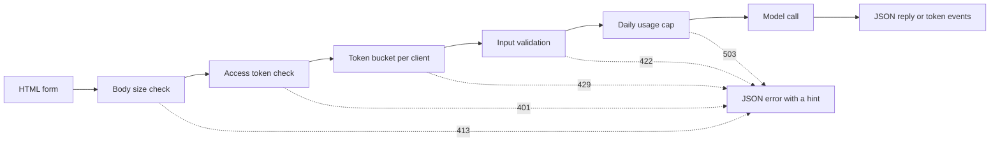

# 模型演示界面: desde la función hasta la aplicación compartible

> 模型演示有一个约定:输入、模型调用和输出──在分享链接之前, primero fijar límites para cada parte──

**Type:** Build
**Languages:** Python
**Prerequisites:** Phase 11 · 13（构建生产级 LLM 应用）、Phase 17 · 08（推理指标）、Phase 17 · 19（AI 网关）
**Time:** ~90 分钟

## El objetivo del aprendizaje

- 写出示的输入、模型调用和输出约定,并设定限制为每部分──
- Utiliza la base de datos para construir una aplicación HTTP, que contiene una página HTML, un punto de JSON y un punto de envío de eventos por servidor.
- 按成本从低到高验证输入,并返回能够告诉用户下一步操作的 JSON 错误――
- Utilice cada bucle de orden de cliente, límite máximo de uso diario y de la visita de la opción de la tarjeta, proteger la presentación pública.
- 编写不保留输入文本和客户端地址的请求日志──
- Comparar la presentación de la base de estándares con las dos versiones de los marcos, y señalar que la presentación debe ser mejorada para el producto de la señal.

##  problemas

Tu modelo ya puede funcionar en el cuaderno. Ahora, un revisor quiere intentar 10 entradas, un cliente quiere ver el resultado en su teléfono.

Notebook 单元格 no tiene restricciones de entrada, tampoco muestra progresos. El informe de error da un montón de seguimiento, sólo puedes leerlo. También utiliza tus credenciales y el presupuesto de funcionamiento. Si no haces cambios, coloca este unidad en el URL de la página de inicio, puedes prever los siguientes fallos:

- Usuario se adhiere a un archivo de 40.000 caracteres.
- Un guión en un minuto envía 500 solicitudes. Cada solicitud se inicia una sola vez.
- 页面八秒没有显示任何内容,于是用户又点击了四次按──
- server日志 conserva cada entrada, incluida la que contiene el número de cuenta del cliente.

interfaces de demostración con poca cantidad de código en el que se pueden prevenir estos fallos.                                                                                                                                                                                                                                                    

## 概念

### El espectáculo es un compromiso

Cada demostración tiene tres partes. La entrada es el contenido que el usuario puede enviar; el modelo de la aplicación se transforma en entrada y salida; la salida es el contenido que el usuario ve, también incluye errores.

Antes de escribir la página, primero escriba este contrato:

| 部分 | 需要回答的问题 | 本课的答案 |
|------|--------------------|-----------------------|
| 输入 | 什么类型、多大、允许哪些字符？ | 长度为 1 到 500 个字符的字符串，不含控制字符 |
| 模型调用 | 一次调用需要多久、成本多少？ | 一个不到一毫秒即可运行完毕、没有调用费用的玩具关键词模型 |
| 输出 | 成功和失败时，用户分别看到什么？ | 标签、分数和回复，或带有操作提示的 JSON 错误 |

Notebook  no establece ninguna limitación para estas tres partes.



Chequear según el costo de la secuencia de ejecución de baja a alta.  Ineffective request will stop at first unpassed inspection, therefore almost does not consume server resources  Modelo de uso puesto en último lugar, porque es el único paso que necesita pagar

### En el modelo de funcionamiento antes de la prueba

El navegador puede consultar cualquier contenido antes de enviar.`maxlength`Y `required`属性,无需网络调用就能向用户提供反────────────────────────────────────────────────────────────────────────────────────────────────────────────────────────────────────────────────────────────────────────────────────────────────────────────────────────────────────────────────────────────────────────────────────────────────────────────────────────────────────────────────────────────────────────────────────────────────────────────────────────────────────────────────────────────────────────────────────────────────────────────────────────────────────────────────────────────────────────────────────────────────────────────────────────────────────────────────────────────────────────────────────────────────────────────────────────────────────────────────────────────────────────────────────────────────────────────────────────────────────────────────────────────────────────────────────────────────────────────────────────────────────────────────────────────────────────────────────────────────────────────────────────────

Para revisar el servidor por costo desde bajo a alto:

1. 读取 `Content-Length`En el caso de los solicitantes, el solicitante debe rechazar el límite de la solicitud.
2. 解析 JSON Pedidos. Rechazar no es un objeto de JSON Pedidos.
3. 检查字段──拒绝空文本、超长文本和控制字符── también se puede leer en el texto de la página web.
4. Sólo a través de la solicitud de todo el control, para consumir una sola modelo de la llamada.

| 未通过的检查 | HTTP 状态 | 错误代码 |
|--------------|-------------|------------|
| 没有 `Content-Length` 请求头 | 411 Length Required（需要长度） | `length_required` |
| `Content-Length` 不是数字 | 400 Bad Request（错误请求） | `bad_length` |
| 请求体超过 4,096 字节 | 413 Content Too Large（内容过大） | `body_too_large` |
| 尚未收到 `Content-Length` 指定的字节数，请求体就停止传输 | 408 Request Timeout（请求超时） | `request_timeout` |
| 内容类型不是 JSON | 415 Unsupported Media Type（不支持的媒体类型） | `unsupported_media_type` |
| 请求体不是 JSON 对象 | 400 Bad Request（错误请求） | `bad_json` |
| 文本缺失、为空、过长或含有控制字符 | 422 Unprocessable Content（无法处理的内容） | `missing_text`、`empty_text`、`text_too_long`、`control_characters` |

RFC 9110 define estos códigos de estado y su nombre.

Ejemplos son parte del diseño de entrada. Ejemplos para mostrar a los usuarios lo que es la entrada adecuada, también permite que el revisor sólo haga clic una vez en que pueda realizar la prueba.

### 让用户知道模型正在工作

模型调用可能需要几秒钟. Si no hay respuesta, el usuario no puede distinguir entre el modelo lento y la página dañado.

Esta página de clases ofrece cuatro tipos de comentarios:

- Solicitud de envío durante el período de ejecución
- Muestra que ya se ha utilizado el tiempo, cada 100 milímetros actualizada una vez.
- El primer token llegó, mostró el primer token 时间
- Por favor, termina, muestra el tiempo total.

En el aprendizaje[推理指标](../../08-inference-metrics-goodput/)时,首代币 时间(TTFT) es un indicador de servidor.

### Envío y salida de corriente

语言模型个别代币 生成回复. Si el servidor espera hasta que el último token 才发送, el usuario es obligado a esperar todo el proceso de generación.

服务器发送事件(Server-Sent Events,SSE) es el estándar de forma de realizar este comportamiento.`text/event-stream` Cada evento es un grupo `event:`Y `data:`行组成,并以一个空行结束──WHATWG HTML 标准 define este formato──

```text
event: token
data: {"index":0,"text":"Label:"}

event: token
data: {"index":1,"text":" positive."}

event: done
data: {"label":"positive","score":1.0,"tokens":11}
```

浏览器提供用于 SSE 的 `EventSource`接口, pero sólo envía GET Petición. Get Petición se introducirá en la URL, mientras que Web  servidor y agente se escribirá la URL en el diario de visita. Por lo tanto, este ejemplo se ha modificado con POST Petición de JSON.`fetch()`Y `response.body.getReader()`读取响应,并自行解析事件格式──

流式响应存在单次 JSON 回复没有问题: el servidor en el primer token 之前就发送了状态码200──如果模型随后失败, el servidor no puede volver a cambiar el estado码──因此, el servidor en el torrente enviará una `error`事件,由页将该事件显示为错误──

En la construcción[生产级 LLM 应用](../../../11-llm-engineering/13-production-app/)时, framework sustituye a usted a través de SSE 发送代币──本课手写同协议,让你能够看到服务器发送的每一行──

###  redactar información errónea de los usuarios que pueden según esta acción

 err errores de información tiene dos tareas: decirle al usuario lo que ha sucedido y decirle al siguiente usuario qué hacer. Para aquellos que no conocen el sistema, el seguimiento no puede completar ninguno de ellos.

Cada error en esta demostración utiliza la misma estructura JSON:

```json
{
  "error": {
    "code": "text_too_long",
    "message": "The text has 812 characters. The limit is 500.",
    "hint": "Shorten the text to 500 characters or fewer.",
    "request_id": "a8f3c2b435e3"
  }
}
```

- `code`Es un nombre estable, código de usuario y prueba de usarlo como comparación.
- `message`陈述事实,并附上用户需求的数值──
- `hint`Dá un usuario que puede ejecutar la operación 
- `request_id`Se puede ver en el archivo de datos de los usuarios.

RFC 9457 define el formato estándar de error de la API HTTP, llamado problema detalle (problem details) ⋅ en este ejemplo se utiliza una estructura más refinada para lograr el mismo propósito.

### Seguridad compartiendo la exposición pública

Public links will change the population who can send requests. Para cada riesgo, se diseña una medida de control:

| 风险 | 本演示中的控制措施 | 面向更多受众的控制措施 |
|------|----------------------|-------------------------------|
| 单个客户端发送过多请求 | 每客户端一个令牌桶，配合 429 和 `Retry-After` | 登录后按用户限流 |
| 陌生人发现链接 | `Authorization` 请求头中的可选访问令牌 | 通过身份提供方实现单点登录 |
| 总成本无限增长 | 每日用量上限，配合 503 和 `Retry-After` | 模型提供方的支出限制和告警 |
| 输入非常大或异常 | 请求体大小限制、文本长度限制、控制字符检查 | 输入与输出的内容审核 |
| 日志保留私人输入 | 只记录输入长度和客户端的带密钥哈希 | 日志保留期限与访问控制 |

El volumen de envío de un pedido es el máximo que puede enviar un cliente; el volumen de envío es el máximo que puede enviar un cliente; el volumen de envío es el máximo que puede enviar un cliente; el volumen de envío es el máximo que puede enviar un cliente; el volumen de envío es el máximo que puede enviar un cliente; el volumen de envío es el máximo que puede enviar un cliente; el volumen de envío es el máximo que puede enviar un cliente; el volumen de envío es el máximo que puede enviar un cliente; el volumen de envío es el máximo que puede enviar un cliente; el volumen de envío es el máximo que puede enviar un cliente; el volumen de envío es el máximo que puede enviar un cliente; el volumen de envío es el máximo que puede enviar un pedido; cada pedido consume un orden, el volumen de envío es el máximo que puede completar, pero no excede el volumen de envío:

```text
tokens = min(capacity, tokens + refill_rate * seconds_since_last_request)
accept the request if tokens >= 1, then subtract 1
```

桶为空时, el servidor regresa `429 Too Many Requests`RFC 6585  define el código de estado 429,并允许 servidor附带 `Retry-After`响应头── Este espectáculo siempre añade la respuesta, da distancia a la siguiente orden disponible y necesita esperar segundos.

En el extremo opuesto del agente, cada solicitud proviene de un agente, por lo que todos los usuarios compartirán un barril. En este momento, debe leer el nombre del cliente en el título de la solicitud de su propia configuración de agente.

En el aprendizaje[AI 网关](../../19-ai-gateways/)时,网关按租户执行限流――演示也需要同样的控制,只是规模更小――限流控制单个客户端,但没有控制总量――一百客户端即使都没有超越各自的限制,仍然可能耗尽全部预算――使用量上限统计一天内所有模型调用,并在达到固定次数后拒绝新调用――

El día y la entrada también requieren un tratamiento cuidadoso.`http.server`El procesador escribirá el IP del cliente y la solicitud en un error estándar. Si la entrada se encuentra en la URL, la entrada también entrará en un diario. Este ejemplo sustituye a este diario. Cada solicitud sólo escribe un registro, que contiene un código de estado, un código de error, una demora y una longitud de entrada. El dirección del cliente se convierte en un hash de clave clave, es decir, el hash de clave de cálculo de la clave secreta, lo que no hace falta guardar la dirección de acuerdo con la solicitud de estadística del cliente.

 Diga al usuario qué información guarda.  Presentation page description, el servidor conserva la longitud del texto, pero nunca conserva el texto en sí mismo.

### 演示何时成为产品

演示由一进程提供服务,面向已知的人群和短时会话──:

- La gente fuera del equipo lo usará cada semana.
- Se propone un objetivo de viabilidad o un informe de interrupción del servicio.
- Usuario requería el registro, el resultado de la conservación o la revisión de la historia.
- El coste de los modelos semanales se convierte en un proyecto del presupuesto.
- 输入包含受合同或法律约束的数据──

| 属性 | 演示 | 产品 |
|----------|------|---------|
| 用户 | 已知人群，短时会话 | 未知人群，每日使用 |
| 状态 | 无 | 账户、历史、已保存的结果 |
| 可用性 | 尽力而为，单进程 | 书面目标、副本、值班责任人 |
| 成本控制 | 一个每日用量上限 | 每用户配额和计费 |
| 可观测性 | 每请求一条日志 | 链路跟踪、指标和告警 |

En este sentido, la tecnología de producción en el programa de LLM se ha incrementado en el nivel de producción, en la aplicación de estos signos, y en el seguimiento de los costes de cada usuario.

```figure
demo-token-bucket
```

## 动手构建 动手构建

Sólo hay un archivo .`code/main.py`, excepto la base de datos no necesita ninguna dependencia.

```bash
python3 code/main.py
```

Se inspecciona el verificador, el formato de la tabla, así como una verdadera comunicación HTTP 往返.

```bash
python3 code/main.py --serve
```

En el navegador abre`http://127.0.0.1:8000`❖ en Ctrl+C 停止服务器──

### Paso 1: Modelo de uso

El modelo es un calculador de palabras clave, que marca el texto como positivo, negativo o medio. También genera un breve resumen, por cada salida de un token.

```python
def classify(text):
    words = WORD_RE.findall(text.lower())
    positive = sum(1 for word in words if word in POSITIVE)
    negative = sum(1 for word in words if word in NEGATIVE)
    score = (positive - negative) / max(1, positive + negative)
    if score > 0:
        label = "positive"
    elif score < 0:
        label = "negative"
    else:
        label = "neutral"
    return {"label": label, "score": round(score, 3), "positive_cues": positive,
            "negative_cues": negative, "words": len(words)}


def generate(text):
    result = classify(text)
    reply = (
        f"Label: {result['label']}. Positive cues: {result['positive_cues']}. "
        f"Negative cues: {result['negative_cues']}. Words read: {result['words']}."
    )
    parts = reply.split(" ")
    yield parts[0]
    for part in parts[1:]:
        yield " " + part
```

Cuando cambias el modelo real, sólo necesitas cambiarlo.`generate` En algunos de ellos se coloca en API 调用或本地模型──保持函数签名不变:输入字符串,输出代币──验证器、限制和页面都保持不变──

### Segundo paso: prueba y respuesta errónea

Una clase anormal contiene todos los errores. Contiene un código de estado HTTP, un código de error estable, mensajes, sugerencias de operación y respuestas selectivas.

```python
class DemoError(Exception):
    def __init__(self, status, code, message, hint, headers=None):
        super().__init__(message)
        self.status = status
        self.code = code
        self.message = message
        self.hint = hint
        self.headers = dict(headers or {})


def validate_text(payload, max_chars=MAX_CHARS):
    if "text" not in payload:
        raise DemoError(422, "missing_text", 'The field "text" is missing.', 'Add a "text" field with your input.')
    text = payload["text"]
    if not isinstance(text, str):
        raise DemoError(422, "text_not_string", 'The field "text" is not a string.', "Send the input as a string.")
    text = text.strip()
    if not text:
        raise DemoError(422, "empty_text", "The text is empty.", "Type a sentence or pick an example.")
    if len(text) > max_chars:
        raise DemoError(422, "text_too_long", f"The text has {len(text)} characters. The limit is {max_chars}.",
                        f"Shorten the text to {max_chars} characters or fewer.")
    if CONTROL_RE.search(text):
        raise DemoError(422, "control_characters", "The text contains control characters.",
                        "Remove the hidden characters, then send the text again.")
    return text
```

El verificador primero elimina el primer final de la página de texto en blanco. Sólo contiene texto en blanco.`check_body_size`Y `parse_json_body`Para 411、413、415 y 400 情形使用相同模式──`error_body`¿Qué es lo que quieres ?`DemoError`转换为概念部分展示的 JSON 结构──

### Paso 3: Empalme de la mano

```python
class TokenBucket:
    def __init__(self, capacity, refill_per_second, now):
        if capacity < 1:
            raise ValueError("capacity must be at least 1")
        if refill_per_second <= 0:
            raise ValueError("refill_per_second must be positive")
        self.capacity = float(capacity)
        self.refill_per_second = float(refill_per_second)
        self.tokens = float(capacity)
        self.updated = now

    def take(self, now, cost=1.0):
        elapsed = max(0.0, now - self.updated)
        self.tokens = min(self.capacity, self.tokens + elapsed * self.refill_per_second)
        self.updated = now
        if self.tokens >= cost:
            self.tokens -= cost
            return 0.0
        return (cost - self.tokens) / self.refill_per_second
```

`take` acepta la solicitud y devuelve 0.0; de lo contrario, devuelve la distancia del barril de orden suficiente para que el servidor pueda esperar el número de segundos.`Retry-After`¿Qué es eso?

`RateLimiter`En el`OrderedDict`Por cada cliente, se guarda un barril.`ThreadingHTTPServer`En línea independiente se procesan cada solicitud, por lo que se utiliza para proteger este guión.`max_clients`Cuando, el limitador eliminará el cliente más largo que no haya emitido la solicitud.`max_clients`Configurar más alto que el número de clientes activos que esperabas 

限流器 acepta uno `clock`参数──测试传入 `FakeClock`, por lo tanto, sin necesidad de esperar, podemos avanzar el tiempo hacia adelante 10 segundos.`UsageCap`Utiliza el mismo modelo horario para procesar el total diario: con 86.400 segundos de tiempo en las ventanas fijas, el número de veces que se utilizan para regresar a la distancia de la ventana siguiente también necesita esperar segundos.

### Sección 4: Eventos

```python
def sse_event(event, data):
    payload = json.dumps(data, separators=(",", ":"), ensure_ascii=False)
    return f"event: {event}\ndata: {payload}\n\n".encode("utf-8")


def stream_events(text, generate_fn=generate, delay=0.0, sleep=time.sleep):
    count = 0
    try:
        for token in generate_fn(text):
            yield sse_event("token", {"index": count, "text": token})
            count += 1
            if delay:
                sleep(delay)
    except Exception:
        yield sse_event("error", MODEL_ERROR)
        return
    result = classify(text)
    yield sse_event("done", {"label": result["label"], "score": result["score"], "tokens": count})
```

`json.dumps`Me gustaría que lo cambiara.`\n`Estos dos caracteres. Por lo tanto, cada evento tiene una sola línea de datos, de los cuales no contiene el cambio de caracteres original.

Productor de la producción de productos de la industria de la producción de productos de la industria de la producción de productos de la industria de la producción de productos de la industria de la producción de productos de la industria de la producción de la industria de la producción de productos de la industria de la producción de la industria de la producción de productos de la industria de la producción de la industria de la producción de productos de la industria de la producción de la industria de la industria de la producción de la industria de la industria de la industria de la producción de la industria de la industria de la industria de la industria de la industria de la industria de la industria de la industria de la industria de la industria de la industria de la industria de la industria de la industria de la industria de la industria de la industria de la industria de la industria de la industria de la industria de la industria de la industria de la industria de la industria de la industria de la industria de la industria de la industria de la industria de la industria de la industria de la industria de la industria`error`事件, porque el servidor ya ha enviado el estado de ejecución.`delay`Y `sleep`Los parámetros pueden ralentizar la velocidad de flujo en la demostración del navegador, mientras que hacer que el test se mantenga rápido.

### Sección 5 步: Request Processor

`DemoHandler`继承自 `BaseHTTPRequestHandler`POST  procesador según concepto porción de la secuencia de ejecución de la inspección:

```python
def do_POST(self):
    app = self.server.app
    request_id = uuid.uuid4().hex[:12]
    client_id = self.client_address[0]
    started = time.perf_counter()
    route = self.path if self.path in self.routes else "other"
    status, code, chars = 200, None, 0
    try:
        declared = self.headers.get("Content-Length")
        try:
            if route == "other":
                raise DemoError(404, "not_found", "This endpoint does not exist.",
                                "Send requests to /api/predict or /api/stream.")
            size = check_body_size(declared, app.config.max_body_bytes)
        except DemoError:
            self.drain(int(declared) if declared and declared.isdigit() else 0)
            raise
        try:
            body = self.rfile.read(size)
        except TimeoutError:
            self.close_connection = True
            raise DemoError(408, "request_timeout", "The request body did not arrive in time.",
                            "Send the request again with the full body.") from None
        app.admit(client_id, self.headers.get("Authorization"))
        text = app.read_text(self.headers.get("Content-Type"), body)
        chars = len(text)
        app.charge()
        if route == "/api/predict":
            self.send_json(200, predict(text), request_id)
        else:
            code = self.send_stream(text, request_id)
    except DemoError as err:
        status, code = err.status, err.code
        self.send_error_json(err, request_id)
    except TimeoutError:
        status, code = 408, "request_timeout"
        self.close_connection = True
    except Exception:
        status, code = 500, "internal_error"
        self.send_error_json(DemoError(500, "internal_error", "The server failed on this request.",
                                       "Try again. Quote the request id if you report the problem."), request_id)
    finally:
        latency_ms = (time.perf_counter() - started) * 1000
        app.log.record(request_id, route, client_id, status, chars, latency_ms, code)
```

`admit`检查访问令牌和令牌桶。`charge`Chequear los límites diarios y ejecutarlos por último, por lo que sólo se pueden calcular los límites de los requisitos válidos.`finally`块中写入一条日志, incluida la solicitud de rechazo.`route`, no es un camino original, ya que el camino puede llevar una cadena de consulta que contiene el texto del usuario.

Cuatro detalles que pueden prevenir fallas fácilmente ignoradas:

-                                                                                                                                                                                                                                                                                                                                                                                                                                                                                                                              `timeout = 10`Cuando el procesador de datos de un servidor deja de enviar, se cierra la conexión. Si el flujo ha comenzado y el tiempo es excesivo, se cierra la conexión, ya que el estado de la solicitud de ID de 408 JSON ha sido enviado.
- `log_message`直接返回,不输出内容── esto eliminará el contenido incluido en el correo electrónico del cliente y el archivo de datos de la solicitud──
- `drain`La última lectura y el desalojo fueron rechazados 64 KiB datos en el pedido de rechazo.
- `send_stream` Captura `BrokenPipeError`No se cierra el generador. Cuando el usuario cierra la página de etiquetas, el modelo se detiene, esta solicitud también deja de aumentar el costo.

`BaseHTTPRequestHandler`默认使用HTTP/1.0── por lo tanto, el servidor se cierra en el momento de la conexión, lo que significa que el proceso de respuesta se termina.

### Seis pasos: página

`render_page` Retorna a un archivo HTML, en el que se incluyen los estilos y las páginas de la página.  Página no carga ningún guión externo  Tipo o imagen  Escritura en el siguiente modo:

```javascript
const reader = response.body.getReader();
const decoder = new TextDecoder();
let buffer = "";
while (true) {
  const chunk = await reader.read();
  if (chunk.done) { break; }
  buffer += decoder.decode(chunk.value, { stream: true });
  let cut = buffer.indexOf("\n\n");
  while (cut >= 0) {
    const frame = parseFrame(buffer.slice(0, cut));
    buffer = buffer.slice(cut + 2);
    cut = buffer.indexOf("\n\n");
    if (frame.event === "token") { output.textContent += frame.data.text; }
  }
}
```

网络数据块可能在事件中结束.`buffer`En medio, hasta que reciba el vuelo.

 página de uso `textContent`写入模型输出, absolutamente no se utiliza `innerHTML` el modelo de salida es un texto increíble.`onerror`属性元素, 属性就可能在用户浏览器中执行代码──

 servidor también enviará con `default-src 'none'`de la `Content-Security-Policy`响应头. Esta estrategia sólo permite un script enbuilt y un estilo enbuilt, y a través de sus respectivos SHA-256 哈希识别它们. El navegador rechazará todos los otros script, incluido el script del atacante en la página.

```python
def csp_hash(source):
    digest = hashlib.sha256(source.encode("utf-8")).digest()
    return "'sha256-" + base64.b64encode(digest).decode("ascii") + "'"
```

### Paso 7: Cumpliérselo, y intenta hacerlo mal.

Iniciar el servidor, luego usar desde el segundo terminal.`curl` El servidor que acaba de iniciar envía continuamente siete solicitudes.

```bash
for i in 1 2 3 4 5 6 7; do
  curl -s -o /dev/null -w '%{http_code} ' -X POST http://127.0.0.1:8000/api/predict \
    -H 'Content-Type: application/json' -d '{"text": "ok"}'
done
```

```text
200 200 200 200 200 429 429
```

Espera 10 segundos, y luego envíe un texto:

```bash
curl -s -X POST http://127.0.0.1:8000/api/predict \
  -H 'Content-Type: application/json' -d '{"text": ""}'
```

```json
{"error": {"code": "empty_text", "message": "The text is empty.", "hint": "Type a sentence or pick an example.", "request_id": "e3e3599feaea"}}
```

Usando el código de acceso`curl -N`观察事件流:

```bash
curl -N -X POST http://127.0.0.1:8000/api/stream \
  -H 'Content-Type: application/json' -d '{"text": "The screen is bright."}'
```

Si quieres solicitar órdenes de acceso, configurar antes de iniciar el servidor `DEMO_ACCESS_TOKEN`△ página posterior mostrará una orden牌 entrada en el cuadro △

```bash
export DEMO_ACCESS_TOKEN="$(python3 -c 'import secrets; print(secrets.token_urlsafe(24))')"
echo "$DEMO_ACCESS_TOKEN"
python3 code/main.py --serve
```

运行测试:

```bash
python3 -m unittest discover -s code/tests -v
```

HTTP 测试在端口 0 上启动服务器, por el sistema operativo seleccionar el`tearDown`停止服务器,并检查 si su línea ha terminado.

## Uso de marco

Gradio y Streamlit estos dos Python frameworks pueden utilizar menos código para construir y mostrar.`main.py`导入约定, por lo tanto el verificador y el modelo permanecen invariables.`main.py`O prueba, no necesita instalar ninguno de ellos.

###  alrededor de un conjunto de funciones

Gradio 为一个Python 函数包装 Web界面──输入和输出组件描述约定, generador de funciones envío de la parte de la salida──

```python
import os

import gradio as gr

from main import EXAMPLES, MAX_CHARS, DemoError, classify, generate, validate_text


def label_text(text):
    try:
        clean = validate_text({"text": text})
    except DemoError as err:
        raise gr.Error(f"{err.message} {err.hint}")
    label = classify(clean)["label"]
    reply = ""
    for token in generate(clean):
        reply += token
        yield reply, label


demo = gr.Interface(
    fn=label_text,
    inputs=gr.Textbox(label="Text to label", lines=5, max_length=MAX_CHARS),
    outputs=[gr.Textbox(label="Reply"), gr.Textbox(label="Label")],
    examples=list(EXAMPLES),
    flagging_mode="never",
)

if __name__ == "__main__":
    demo.queue(max_size=20).launch(auth=("demo", os.environ["DEMO_PASSWORD"]))
```

Cada vez que`yield`Por lo tanto, esta función se produce cada paso hasta el momento completo de la respuesta.

En compartir enlace antes,明确设置 `flagging_mode` Modeo de almacenamiento en modo predeterminado mostrará el marcador en el servidor  Valor `"never"`¡Me voy a mover de esta mesa!

`queue(max_size=20)`限制等待中的请求数量──默认并发发限制是每个事件只运行一个调用──在你提高限制之前,慢模型一次只服务一个用户──Gradio todavía se encuentra en la aplicación inicialización para crear API 端点, hacer que el guión no necesite pasar por la página para poder调用演示──tu límite también debe cubrir estos terminales──

### Cada entrada será re-cargada

Cuando el usuario cambia cada control, el streamlit se ejecuta de nuevo desde el principio hasta el final de todo el guión.

```python
import streamlit as st

from main import EXAMPLES, MAX_CHARS, DemoError, classify, generate, validate_text

st.title("Toy sentiment demo")
st.caption("Do not paste private data.")

example = st.selectbox("Start from an example", ["", *EXAMPLES])
with st.form("demo"):
    text = st.text_area("Text to label", value=example, max_chars=MAX_CHARS)
    submitted = st.form_submit_button("Run model")

if submitted:
    try:
        clean = validate_text({"text": text})
    except DemoError as err:
        st.error(f"{err.message} {err.hint}")
    else:
        st.write_stream(generate(clean))
        st.write(f"Label: {classify(clean)['label']}")
```

`st.write_stream`直接接受生成器, en cada bloque de datos hasta llegar escribir fuera de ella.`@st.cache_resource`Cargar un modelo real, ya que cada vez que se presenta se reutiliza el guión.

### El comportamiento de los diferentes programas

| 需求 | 标准库（本课） | Gradio | Streamlit |
|------|--------------------------------|--------|-----------|
| 表单、示例、结果区域 | 自己编写 HTML | `Interface` 根据组件和 `examples` 构建 | 使用 `st.text_area`、`st.selectbox` 等控件 |
| 输入长度限制 | 页面上的 `maxlength` 加服务器检查 | `Textbox` 上的 `max_length` | `st.text_area` 上的 `max_chars` |
| 部分输出 | 自己编写 SSE 和流读取器 | 使用生成器函数，每次 `yield` 替换输出 | `st.write_stream` 配合数据块生成器 |
| 进度显示 | 自己编写计时器 | 输出区域的进度显示，由 `show_progress` 设置 | `st.write_stream` 在每个数据块到达时显示它 |
| 面向用户的错误 | 带有 `code`、`message`、`hint`、`request_id` 的 JSON | `raise gr.Error(...)` 显示消息 | `st.error(...)` 显示消息 |
| 并发 | 每请求一个线程，无上限 | 队列，默认每个事件只运行一个调用 | 每次交互都会为该会话重新运行脚本 |
| 公开链接 | 自己运行服务器和管理域名 | `launch(share=True)` 提供一周后过期的链接 | 自己将应用部署到服务器 |
| 登录 | Bearer 令牌检查 | `launch(auth=...)` 使用用户名和密码 | `st.login()` 配合 OpenID Connect 提供方 |
| 限流与成本上限 | 令牌桶和每日上限 | 自己编写代码，通过请求获取客户端地址 | 自己编写代码 |
| 工具写入磁盘的输入信息 | 日志中只有输入长度 | 被标记的样本写入 CSV 文件，除非设置 `flagging_mode="never"` | 由自己的代码决定 |

框架在页面方面省省省的工作最多:表单,示例,进度显示和部分输出. 它们 en el aspecto de la relación abierta,省省省省省省工作较少. 它们 en el aspecto de la pérdida de riesgo. 它们 en el ámbito de la public link 风险. 它们 en el ámbito de la public link 风险 省省省省工作较少. 它们 en el ámbito de la public link 风险. 它们 en el ámbito de la public link 节省工作较少. 它们 en el ámbito de la public link 风险 节省工作较少. 它们 en el ámbito de la public link 风险 节省工作较少. 它们 en las tres versiones, 限流, 成本上限和日志隐私, 它们 son de tu responsabilidad. 标准库版本 muestra estas partes, de modo que puedas saber qué debes revisar al usar el marco.

##  entregarlo

本课产 出  `outputs/skill-demo-interface-checklist.md` Proporcionar a la organización una descripción o código de la presentación del modelo, evaluar la determinación, la contradicción, los errores y los controles de los enlaces abiertos, y dar conclusiones aprobadas o no aprobadas.

##  ejercicios

1. ¿ Qué ?`BUCKET_CAPACITY`设置为 2,将 `REFILL_PER_SECOND`设置为1──预测七请求循环的输出,再实际运行并比较──
2. En el cuerpo de la solicitud añadir`language`字段, sólo acepta `"en"`◊ Error 422  de cualquier otro valor de regreso ⋅                                                                                                                                                                                                                                                        
3. 找出一个玩具模型会错分类的句子,例如"La pantalla no es buena".将其作为第四个例子,并在页面上添加说明,解释模型的局限性
4. En tu máquina, la demostración se pondrá en la parte posterior del agente reverso.`trust_proxy`选项, sólo se puede leer de la dirección del agente `X-Forwarded-For`◊ redactar pruebas, demostrar que el cliente no puede seleccionar los teclados de la caja de agua por sí mismo.
5. ¿ Qué ?`generate`替换为对流式返回代币的模型 API调调调――保持验证器、限制和事件形式不变──比较页面上的首个代币 时间与服务器日志中的延迟──

## 关键术语: "El hombre es un hombre"

| 术语 | 人们常说 | 实际含义 |
|------|-----------------|------------------------|
| 演示约定 | “UI” | 输入限制、模型调用，以及包含错误在内的输出结构 |
| 令牌桶 | “限流器” | 每客户端一个计数器，按固定速率补充，最多达到容量上限；每个请求消耗一个令牌 |
| Retry-After | “稍后再试” | 响应头，指定客户端多久之后，或在哪个日期之后，可以再次尝试 |
| 服务器发送事件 | “流式传输” | 由 `event:` 和 `data:` 行组成的 `text/event-stream` 响应，每个事件后有一个空行 |
| 首 token 时间 | “延迟” | 从发出请求到第一个 token 显示在用户屏幕上的时间 |
| 用量上限 | “预算” | 一个时间窗口内所有客户端合计的模型调用次数上限 |
| 带密钥哈希 | “匿名 ID” | 使用秘密盐值对客户端地址计算 HMAC（基于哈希的消息认证码）；它只是化名，任何持有盐值的人都能检验某个已知地址 |
| 内容安全策略 | “CSP” | 响应头，告诉浏览器页面允许使用哪些脚本、样式和连接 |

## 延伸阅读

- [Python `http.server` 文档](https://docs.python.org/3/library/http.server.html)El módulo no es adecuado para el entorno de producción.
- [WHATWG HTML 标准：服务器发送事件](https://html.spec.whatwg.org/multipage/server-sent-events.html): eventos de forma y `EventSource`¿Qué pasa?
- [MDN：使用服务器发送事件](https://developer.mozilla.org/en-US/docs/Web/API/Server-sent_events/Using_server-sent_events): eventos de formato y ejemplos de API del navegador
- [MDN：使用可读流](https://developer.mozilla.org/en-US/docs/Web/API/Streams_API/Using_readable_streams)¿Cómo se puede aprender ?`fetch()`¿Qué es eso?
- [MDN：使用 Fetch API](https://developer.mozilla.org/en-US/docs/Web/API/Fetch_API/Using_Fetch):带 JSON Pedidos de solicitud y respuesta procesados.
- [MDN：429 Too Many Requests](https://developer.mozilla.org/en-US/docs/Web/HTTP/Reference/Status/429)Y [MDN：Retry-After](https://developer.mozilla.org/en-US/docs/Web/HTTP/Reference/Headers/Retry-After):limitrecurrentes y su respuesta
- [MDN：内容安全策略](https://developer.mozilla.org/en-US/docs/Web/HTTP/Guides/CSP):内嵌脚本的哈希和 `default-src`Una orden.
- [RFC 6585](https://www.rfc-editor.org/rfc/rfc6585.html): Nuevo código de estado HTTP, incluido 429。
- [RFC 9110](https://www.rfc-editor.org/rfc/rfc9110.html):HTTP 语义, incluye 413、415 和 422。
- [RFC 9457](https://www.rfc-editor.org/rfc/rfc9457.html): problema detalle, es decir, el estándar de la API HTTP JSON  error formato。
- [RFC 1122](https://www.rfc-editor.org/rfc/rfc1122.html)• Requisitos principales, incluido el cierre de datos aún no leídos de la conexión ocurrida en TCP reimposición (§ 4.2.2.13 节)
- [Gradio：分享应用](https://gradio.app/guides/sharing-your-app): compartir enlaces, ID, API y limitaciones
- [Gradio：流式输出](https://gradio.app/guides/streaming-outputs): a través de la función generadora proporcionan parte de la salida.
- [Gradio：Interface](https://gradio.app/docs/gradio/interface)¿Qué es esto ?`examples`¿Qué es esto?`flagging_mode`Y `concurrency_limit`¿Qué es eso?
- [Gradio：使用标记功能](https://gradio.app/guides/using-flagging): está marcado muestreo en el disco de almacenamiento.
- [Streamlit：基本概念](https://docs.streamlit.io/get-started/fundamentals/main-concepts): re-运行的数据流──
- [Streamlit：st.write_stream](https://docs.streamlit.io/develop/api-reference/write-magic/st.write_stream)Y [Streamlit：缓存](https://docs.streamlit.io/develop/concepts/architecture/caching): porción de salida, así como sólo cargar una vez de modelo.
- [Streamlit：st.login](https://docs.streamlit.io/develop/api-reference/user/st.login)Por medio de OpenID Connect se proporciona un registro.
