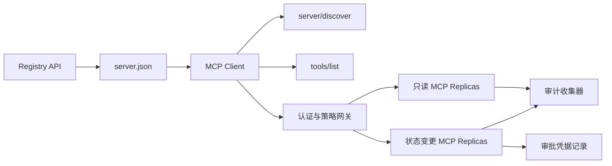

# 综合实战项目 13:带 Registro y administración sin estado MCP Server

> MCP de nivel de producción  no es un solo proceso de servidor simple ‒ es un conjunto completo de pactos ‒: datos de base disponibles ‒ descubrimiento de servicios reales ‒ no tiene petición de estado ‒ Envólogo ‒ identificación y autorización ‒ decisión de estrategia de detalle ‒ certificado de auditoría ‒ y certificado de implementación ‒.

**Type:** Capstone
**Languages:** Python 与 TypeScript 参考模型；支持任何生产级编程语言
**Prerequisites:** Phase 11, Phase 13, Phase 14, Phase 17 与 Phase 18
**必修 MCP 进阶课：** [Lesson 28: Tool Contracts](../../../13-tools-and-protocols/28-mcp-tool-contracts-and-content/docs/en.md)¿ Qué ?[Lesson 29: 可靠性与流控](../../../13-tools-and-protocols/29-mcp-reliability-cancellation-and-flow-control/docs/en.md)¿ Qué ?[Lesson 30: Registry 供应链](../../../13-tools-and-protocols/30-mcp-registry-supply-chain-and-drift/docs/en.md), 及 [Lesson 31: 一致性工程](../../../13-tools-and-protocols/31-mcp-conformance-versioning-and-operations/docs/en.md)
**目标协议规范：**MCP `2026-07-28`
**Time:** ~25 小时

## El objetivo del aprendizaje

- 实现合规的无状态 MCP Solicitudes y resultados Envólogo
- Se encuentra una separación estricta entre el registro de datos en estado de estado y el protocolo real de ejecución.
- construir un sistema de detección de herramientas de determinación y de detección de la capacidad de almacenamiento.
- Para cada herramienta 调用强制执行签发发发发发发 (Emitente) 收受众 (engendros) 作用域 (escala) 及审批策略 (en inglés) 
- 部署无 Session 亲和性绑定的 集群 串流 HTTP 集群──
- En la red de líneas, otorgamiento, estrategia, registro y auditoría, proveer pruebas de ingeniería completas.

## Necesidad de MCP

Antes de que este proyecto sea considerado como productivo, debe completarse en la siguiente fase el curso de cuatro etapas de la Fase 13 关联:

1. [Lesson 28](../../../13-tools-and-protocols/28-mcp-tool-contracts-and-content/docs/en.md)Definir este servidor  debe ser expuesto de herramienta  esquema  contenido estructurado                                                                                                                                                                                                                                                                                                                                                                                                                                                                                                        
2. [Lesson 29](../../../13-tools-and-protocols/29-mcp-reliability-cancellation-and-flow-control/docs/en.md)El objetivo de la investigación es mejorar la calidad de la vida de los trabajadores.
3. [Lesson 30](../../../13-tools-and-protocols/30-mcp-registry-supply-chain-and-drift/docs/en.md)El registro de datos de los datos de los usuarios de los datos de los datos de los datos de los usuarios de los datos de los datos de los usuarios de los datos de los datos de los datos de los usuarios de los datos de los datos de los datos de los usuarios de los datos de los datos de los datos de los usuarios de los datos de los datos de los datos de los usuarios de los datos de los datos de los datos de los datos de los usuarios de los datos de los datos de los datos de los datos de los usuarios de los datos de los datos de los datos de los datos de los usuarios de los datos de los datos de los datos de los datos de los usuarios de los datos de los datos de los datos de los datos de los usuarios de los datos de los datos de los datos de los datos de los usuarios de los datos de los datos de los datos de los datos de los usuarios de los datos de los datos de los datos de los usuarios de los datos de los datos de los datos de los usuarios de los datos de los datos de los usuarios de los datos de los datos de los datos de los usuarios de los datos de los datos de los usuarios de los datos de los datos de los usuarios de los datos de los datos de los usuarios de los datos de los usuarios de los datos de los datos de los usuarios de los datos de los usuarios de los datos de los datos de los usuarios de los datos de los datos de los usuarios de los datos de los usuarios de los datos de los usuarios de los datos de los usuarios de los datos de los usuarios de los datos de los datos de los usuarios de los sitios de los sitios de Internet.
4. [Lesson 31](../../../13-tools-and-protocols/31-mcp-conformance-versioning-and-operations/docs/en.md)En el caso de las empresas de alta tecnología, la definición de los valores de la tecnología de la información es la siguiente:

Este proyecto es responsable de integrar estos elementos de producción en forma estrecha, y no puede ser elaborado con un solo ensayo de SDK simple.

## 问题背景

 La plataforma interna de la empresa necesita un conjunto de herramientas de escritura de datos sólo para leer y una pequeña cantidad de herramientas de operación con capacidad de cambio de estado.  El desarrollador debe ser capaz de encontrar el servidor, entender cómo conectarse, comprobar su capacidad de funcionamiento en tiempo real y solo puede utilizar su operación de acceso autorizado.

El verdadero problema no es escribir una función Python, sino cómo hacer que los siguientes seis conjuntos de fuentes de verdad se mantengan en la altura de la coincidencia:

1. `server.json`Declaró que el servidor está instalado en cualquier lugar o a través de cualquier punto de acceso de la red;
2. `server/discover` declaró la capacidad de apoyo real al proceso actual de la actual operación;
3. Cada solicitud especifica claramente la versión del acuerdo adoptada y la declaración de capacidad del cliente;
4. 授权系统将调用方与合法的签发者、资源指示器(Resource Indicator) y el alcance 绑定;
5.  la capacidad de ejecutar la decisión independiente del motor estratégico sobre la operación y la transmisión de los elementos;
6. 审计日志忠实记录跨界的每次交互,绝不泄露敏感载荷或凭据密钥──

 cualquier conexión que se desplace, la plataforma puede mostrar servidores o servidores que no pueden conectarse  errores de ruta incompatibles con el cliente  errores de uso de tokens emitidos para otros recursos, o realizar operaciones altamente perjudiciales en caso de no estar autorizados

## 两层发现机制 (Las dos capas de descubrimiento)

Registro 静态索引与实时的 MCP Server  responde a una pregunta de una dimensión completamente diferente:

| 发现层次 | 交互契约 | 回答的核心问题 |
|---|---|---|
| 发布层 (Publication) | `server.json` 与 Registry API | 该 Server 是什么？其代码包或远程网络端点在哪里？如何进行配置？ |
| 运行时 (Runtime) | `server/discover` | 该运行进程当前实际支持哪些协议版本、能力特性、扩展及 Server 身份？ |

官方 Registro 采用带版本控制的 `server.json`Esquema。 Un arquivo de distancia puede declarar Dirección de HTTP:

```json
{
  "$schema": "https://static.modelcontextprotocol.io/schemas/2025-12-11/server.schema.json",
  "name": "com.example/internal-readonly",
  "title": "Internal Read-Only Tools",
  "description": "Read-only incident and data lookup tools.",
  "version": "1.0.0",
  "remotes": [
    {
      "type": "streamable-http",
      "url": "https://mcp.internal.example.com/readonly"
    }
  ]
}
```

Registro de esquema  versión con MCP 协议版本 totalmente independiente, no se debe confundir con una conversación.

具備合规 Schema 不代表拥有命名空间所有权──对 `example.com`完成验证的发布者使用反向 DNS 命名空间 `com.example/*`O su nombre es espacio.

El servidor  debe implementarse `server/discover`El cliente puede utilizarlo de forma activa antes de iniciar su negocio:

```json
{
  "resultType": "complete",
  "supportedVersions": ["2026-07-28"],
  "capabilities": {
    "tools": {
      "listChanged": false
    }
  },
  "_meta": {
    "io.modelcontextprotocol/serverInfo": {
      "name": "com.example/internal-readonly",
      "version": "1.0.0"
    }
  },
  "ttlMs": 3600000,
  "cacheScope": "public"
}
```

## 无状态 MCP 核心(Core de MCP sin estado)

MCP `2026-07-28`Se ha eliminado el acuerdo.`initialize`                                                                                                                                                                                                                                                                                                                                                                                                                                                                                                                             `Mcp-Session-Id` Todos los pedidos están en `params._meta`En el texto siguiente:

```json
{
  "io.modelcontextprotocol/protocolVersion": "2026-07-28",
  "io.modelcontextprotocol/clientCapabilities": {},
  "io.modelcontextprotocol/clientInfo": {
    "name": "internal-platform-client",
    "version": "1.0.0"
  }
}
```

负载均衡器 puede sin preocupación enviar continuamente las solicitudes a diferentes réplicas saludables, ya que cualquier réplica puede ser completamente verificada y procesada por el propio usuario.

常规成功结果返回                                                                                                                                                                                                                                                                                                                                                                                                                                                                                                                       `resultType: "complete"`, y el servidor 应在 `_meta.io.modelcontextprotocol/serverInfo`中标明身份──协议版本非法返回 Params invalid 错误码 `-32602`Para la versión legal pero no respaldada, devuelva `-32022`No se ha encontrado en los datos`supported`Con`requested`¿Qué es eso?

### Se puede encontrar un servicio

`tools/list`必须保证确定性排序, sus resultados incluyen:

- `ttlMs`: Fação cara al cliente
- `cacheScope`¿Qué es esto ?`public`(public共享) o `private`(上下文私有)
-  estrictamente estable ordenamiento de herramientas, para que la misma lista pueda utilizar en forma rápida el caché del modelo;
- `resultType: "complete"`Con el servidor de datos.

 Con el control de los derechos de un usuario específico, normalmente debe ser exportado `cacheScope: "private"`, no puede permitir que las herramientas de usuario sean visibles en el archivo público compartido.

## Transporte de datos

面向网络的服务器 暴露单一的 POST 端点──每一个 JSON-RPC 请求或通知均为独立的 POST──

针对请求,Server 返回单个JSON 响应或针对该次请求启动的请求作用域 SSE 流──长周期的变更通知通过 `subscriptions/listen`建立长连接流──

Solicitud debe ser especificado en el URL de la solicitud:

- `MCP-Protocol-Version`: con el pedido de datos;
- `Mcp-Method`: con JSON-RPC 方法名一致;
- `Mcp-Name`: en调用 `tools/call`El nombre de los instrumentos de reflexión;
- `Accept: application/json, text/event-stream`¿Qué es eso?

El jefe no coincide con la solicitud.`-32020`错误码――校验 `Origin`defendiendo DNS 重绑定,并将请求作用域 SSE 流的动作断开视为请求取消──



```figure
cf-mcp-gate
```

## 认证与策略决策

传输层元数据绝对不等于权限凭证.

1. 动态发现受保护资源元数据;
2. Para el recurso seleccionado y el servidor autorizado;
3. 优先使用 客户ID Metadata Documents ((CIMD) 注册 客户;
4. En el proceso de otorgamiento de recursos,
5. 验证返回的                                                                                                                                                                                                                                                                                                                                                                                                                                                                                                                        `iss`¿No se ha autorizado el servidor de registros?
6. 按 Emitente 隔离存储 凭据 客户,绝不跨 Emitente 复用;
7. En MCP Server 侧验证 Token 的签发者、受众、过期时间与 Scope;
8. Se ejecutarán decisiones de estrategia secundaria sobre los nombres y los parámetros reales de los instrumentos concretos.

### La aprobación de la obra es un registro de la prueba, y no un alcance mágico.

status变更调用需要一个结构化的人工审批凭证 (construcción de un documento de aprobación), con el operador, el nombre de un instrumento, la normativa y los elementos de la aprobación (con un valor de cálculo)  el objetivo, el medio ambiente, el tiempo y la estrategia de uso único o múltiple en profundidad de la vinculación.

Python 模型将对排序键的规范化 JSON 计算哈希,并将该 Digest与Token Subject、工具名、服务器 URL 和过期时间签名绑定──改哪怕是一个参数段,该审批记录均不能重放──审批记录是独立证书证书,而不是直接进入Token 里乱塞的 Scope──

## 动手构建步骤 动手构建步骤 动手构建步骤 动手构建步骤 动手构建步骤 动手构建步骤 动手构建步骤

1. **建模发布元数据**:编写并验证 `server.json`, asegurar que el espacio de nombres se ajuste a la normativa de DNS.
2. **实现实时服务发现**: en el tratamiento de cualquier negocio RPC prioridad de realización `server/discover`¿Qué es eso?
3. **实现无状态 Envelope**Cada solicitud debe llenar la versión y capacidades de los datos, para eliminar todos los niveles de sesiones.
4. **构建工具集**• proporcionar herramientas de cambio de estado y sólo lectura, preparar esquemas JSON y sugerencias de información.
5. **支持缓存感知的工具列表**:输出确定性排序的工具列表,并配置 `ttlMs`Con`cacheScope`¿Qué es eso?
6. **接入认证与策略网关**El certificado de aprobación de la prueba de reinstalación se ha aprobado en el curso de la prueba de reinstalación de la prueba de reinstalación de la prueba de reinstalación de la prueba de reinstalación de la prueba de reinstalación de la prueba de reinstalación de la prueba de reinstalación de la prueba de reinstalación de la prueba de reinstalación de reinstalación de la prueba de reinstalación de reinstalación de la prueba de reinstalación de reinstalación de la prueba de reinstalación de reinstalación de reinstalación de reinstalación de reinstalación de reinstalación de reinstalación de reinstalación de reinstalación de reinstalación de reinstalación de reinstalación de reinstalación de reinstalación de reinstalación de reinstalación de reinstalación de reinstalación de reinstalación de reinstalación de reinstalación de reinstalación de reinstalación de reinstalación de reinstalación de reinstalación de reinstalación de reinstalación de reinstalación de reinstalación de reinstalación de reinstalación de reinstalación de reinstalación de reinstalación de reinstalación de reinstalación de reinstalación de reinstalación de reinstalación de reinstalación de reinstalación de reinstalación de reinstalación de reinstalación de reinstalación de reinstalación.
7. **分离静态 Registry 与运行时校验**: en relación con`server.json`Con el tiempo real`server/discover`,及时上报漂移──
8. **接入脱敏审计日志**En el siguiente artículo, el texto se muestra en el siguiente texto:
9. **验证水平扩展**En el balanceador de carga después de la carga de dos replica sin estado, envía y envía la solicitud de verificación de la dependencia sin relación sexual.
10. **真实网络验证**A través de la verdadera red captura de la solicitud de cabeza y JSON cuerpo, prueba de varios casos de uso de la derecha y la contraria de la derecha.

## ¡¡¡¡¡¡¡¡¡¡¡¡¡¡¡¡¡¡¡¡¡¡¡¡¡¡¡¡¡¡¡¡¡¡¡¡¡¡¡¡¡¡¡¡¡¡¡¡¡¡¡¡¡¡¡¡¡¡¡¡¡¡¡¡¡¡¡¡¡¡¡¡¡¡¡¡¡¡¡¡¡¡¡¡¡¡¡¡¡¡¡¡¡¡¡¡¡¡¡¡¡¡¡¡¡¡¡¡¡¡¡¡¡¡¡¡¡¡¡¡¡¡¡¡¡¡¡¡¡¡¡¡¡¡¡¡¡¡¡¡¡¡¡¡¡¡¡¡¡¡¡¡¡¡¡¡¡¡¡¡¡¡¡¡¡¡¡¡¡¡¡¡¡¡¡¡¡¡¡¡¡¡¡¡¡¡¡¡¡¡¡¡¡¡¡¡¡¡¡¡¡¡¡¡¡¡¡¡¡¡¡¡¡¡¡¡¡¡¡¡¡¡¡¡¡¡¡¡¡¡¡¡¡¡¡¡¡¡¡¡¡¡¡¡¡¡¡¡¡¡¡¡¡¡¡¡¡¡¡¡¡¡¡¡¡¡¡¡¡¡¡¡¡¡¡¡¡¡¡¡¡¡¡¡¡¡¡¡¡¡¡¡¡¡¡¡¡¡¡¡¡¡¡¡¡¡¡¡¡¡¡¡¡¡¡¡¡¡¡¡¡¡¡¡¡¡¡¡¡¡¡¡¡¡¡¡¡¡¡¡¡¡¡¡¡¡¡¡¡¡¡¡¡¡¡¡¡¡¡¡¡¡¡¡¡¡¡¡¡¡¡¡¡¡¡¡¡¡¡¡¡¡¡¡¡¡¡¡¡¡¡¡¡¡¡¡¡¡¡¡¡¡¡¡¡¡¡¡¡¡¡¡¡¡¡¡¡¡¡¡¡¡¡¡¡¡¡¡¡¡¡¡¡¡¡¡¡¡¡¡¡¡¡¡¡¡¡¡¡¡¡¡¡¡¡¡¡¡¡¡¡¡¡¡¡¡¡¡¡¡¡¡¡¡¡¡¡¡¡¡¡¡¡¡¡¡¡¡¡¡¡¡¡¡¡¡¡¡¡¡¡¡¡¡¡¡¡¡¡¡

 El código presentado debe incluir los siguientes cinco tipos de pruebas de ingeniería:

| 证据类别 | 最低验证标准 | 来源课程 |
|---|---|---|
| 网络线路 (Wire) | 正反向用例中脱敏的原始 HTTP 头与 JSON-RPC 体，覆盖类型错误、头不匹配、不支持版本等 | [Lesson 31](../../../13-tools-and-protocols/31-mcp-conformance-versioning-and-operations/docs/en.md) |
| 代理网络 (Proxy) | 直连与经过代理转发的报文对比，证明协议错误未被粗暴折叠为 500 且流式传输未被缓冲 | [Lessons 29](../../../13-tools-and-protocols/29-mcp-reliability-cancellation-and-flow-control/docs/en.md) 与 [31](../../../13-tools-and-protocols/31-mcp-conformance-versioning-and-operations/docs/en.md) |
| 准入管理 (Admission) | 已验证的发布者命名空间、不可变 Registry 记录哈希、实时 `server/discover` 观察凭证与准入账本事件 | [Lesson 30](../../../13-tools-and-protocols/30-mcp-registry-supply-chain-and-drift/docs/en.md) |
| 重试与取消 (Retry) | 取消与完成的竞态测试、显式超时、安全只读重试、写操作幂等键、重连刷新机制 | [Lesson 29](../../../13-tools-and-protocols/29-mcp-reliability-cancellation-and-flow-control/docs/en.md) |
| 发布回滚 (Rollback) | 明确的先前版本哈希、描述符锁定、健康检查窗口、路由平滑切换结果与决策证据 | [Lessons 30](../../../13-tools-and-protocols/30-mcp-registry-supply-chain-and-drift/docs/en.md) 与 [31](../../../13-tools-and-protocols/31-mcp-conformance-versioning-and-operations/docs/en.md) |

## En el caso de los modelos de transporte

Python modelo muestra en caso de no abrir un conjunto de conexiones de red externa, completar el proceso de evaluación de nombres espacios, descubrimiento real, lista de determinación, solicitud de pruebas de datos, Token identificación, aprobación y proceso de auditoría basado en hash:

```bash
cd phases/19-capstone-projects/13-mcp-server-with-registry
python3 code/main.py
python3 -m unittest discover -s code/tests -v
```

TypeScript  proyecto mostró en caso de no tomar préstamo externo MCP SDK, a través de estudio original  exposición sin estado JSON-RPC  interfaz y retorno a los parámetros ilegales `isError: true`¿Qué es esto ?

```bash
cd phases/19-capstone-projects/13-mcp-server-with-registry/code/ts
npm install
npm run typecheck
npm test
npm run demo
```

## 线路协议报文范例

```http
POST /mcp HTTP/1.1
Host: mcp.internal.example.com
Content-Type: application/json
Accept: application/json, text/event-stream
MCP-Protocol-Version: 2026-07-28
Mcp-Method: tools/call
Mcp-Name: postgres.readonly
Authorization: Bearer REDACTED

{
  "jsonrpc": "2.0",
  "id": 42,
  "method": "tools/call",
  "params": {
    "name": "postgres.readonly",
    "arguments": {"sql": "SELECT 1"},
    "_meta": {
      "io.modelcontextprotocol/protocolVersion": "2026-07-28",
      "io.modelcontextprotocol/clientCapabilities": {},
      "io.modelcontextprotocol/clientInfo": {
        "name": "internal-platform-client",
        "version": "1.0.0"
      }
    }
  }
}
```

## 核心专业术语

| 术语 | 行业俗称 | 规范真实定义 |
|---|---|---|
| 无状态 MCP (Stateless MCP) | “到处都没有状态” | 协议层不存在 Session；跨调用状态属于显式传递且由业务服务端持久化管理 |
| `server.json` | “工具清单清单” | Registry 静态元数据，用于定义发布命名、代码打包、配置项与传输端点 |
| `server/discover` | “传统握手” | 强制实现的常规业务 RPC，用于获取实时支持的版本与能力，而非建立会话 |
| 缓存作用域 (Cache scope) | “能不能缓存？” | 标识可缓存结果是否可以被跨上下文公共复用（`public`）或仅限当前上下文（`private`） |
| 策略决策 (Policy decision) | “Token 允许就能调” | 针对调用者主体、工具、操作目标、参数载荷及外部上下文的细粒度二次判定 |
| 审批凭证 (Approval record) | “人工在群里点了同意” | 绑定至具体操作者、确切参数哈希与过期时间的强防篡改凭据证据 |
| 显式句柄 (Explicit handle) | “Session ID” | 业务层具名状态的普通应用标识符，绝非底层传输连接会话 |

## 延伸阅读

- [MCP 2026-07-28 核心变更](https://modelcontextprotocol.io/specification/2026-07-28/changelog)
- [Streamable HTTP 传输规范](https://modelcontextprotocol.io/specification/2026-07-28/basic/transports/streamable-http)
- [MCP 服务发现](https://modelcontextprotocol.io/specification/2026-07-28/server/discover)
- [MCP 鉴权与授权规范](https://modelcontextprotocol.io/specification/2026-07-28/basic/authorization)
- [官方 Registry server.json 要求](https://github.com/modelcontextprotocol/registry/blob/main/docs/reference/server-json/official-registry-requirements.md)
