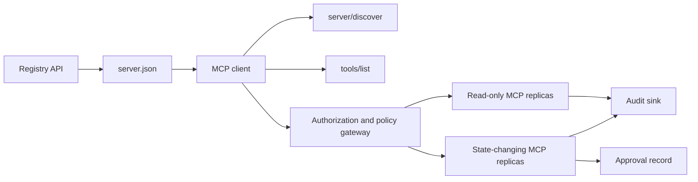

# 综合实战项目 13:带 Registro y administración sin estado MCP Server

> MCP de nivel de producción  no es un solo proceso de servidor simple ‒ es un conjunto completo de pactos ‒: datos de base disponibles ‒ descubrimiento de servicios reales ‒ no tiene petición de estado ‒ Envólogo ‒ identificación y autorización ‒ decisión de estrategia de detalle ‒ certificado de auditoría ‒ y certificado de implementación ‒.

**Type:** Capstone
**Languages:** Python 与 TypeScript 参考模型；支持任何生产级编程语言
**Prerequisites:** Phase 11, Phase 13, Phase 14, Phase 17 与 Phase 18
**必修 MCP 进阶课：** [Lesson 28: Tool Contracts](../../../13-tools-and-protocols/28-mcp-tool-contracts-and-content/docs/en.md)¿ Qué ?[Lesson 29: 可靠性与流控](../../../13-tools-and-protocols/29-mcp-reliability-cancellation-and-flow-control/docs/en.md)¿ Qué ?[Lesson 30: Registry 供应链](../../../13-tools-and-protocols/30-mcp-registry-supply-chain-and-drift/docs/en.md), 及 [Lesson 31: 一致性工程](../../../13-tools-and-protocols/31-mcp-conformance-versioning-and-operations/docs/en.md)
**目标协议规范：**MCP `2026-07-28`
**Time:** ~25 小时

## El objetivo del aprendizaje

- 实现合规的无状态 MCP Solicitudes y resultados Envólogo
- Se encuentra una separación estricta entre el registro de datos en estado de estado y el protocolo real de ejecución.
- construir un sistema de detección de herramientas de determinación y de detección de la capacidad de almacenamiento.
- Para cada herramienta 调用强制执行签发发发发发发 (Emitente) 收受众 (engendros) 作用域 (escala) 及审批策略 (en inglés) 
- 部署无 Session 亲和性绑定的 集群 串流 HTTP 集群──
- En la red de líneas, otorgamiento, estrategia, registro y auditoría, proveer pruebas de ingeniería completas.

## Necesidad de MCP

Antes de que este proyecto sea considerado como productivo, debe completarse en la siguiente fase el curso de cuatro etapas de la Fase 13 关联:

1. [Lesson 28](../../../13-tools-and-protocols/28-mcp-tool-contracts-and-content/docs/en.md)Definir este servidor  debe ser expuesto de herramienta  esquema  contenido estructurado                                                                                                                                                                                                                                                                                                                                                                                                                                                                                                        
2. [Lesson 29](../../../13-tools-and-protocols/29-mcp-reliability-cancellation-and-flow-control/docs/en.md)El objetivo de la investigación es mejorar la calidad de la vida de los trabajadores.
3. [Lesson 30](../../../13-tools-and-protocols/30-mcp-registry-supply-chain-and-drift/docs/en.md)El registro de datos de los datos de los usuarios de los datos de los datos de los datos de los usuarios de los datos de los datos de los usuarios de los datos de los datos de los datos de los usuarios de los datos de los datos de los datos de los usuarios de los datos de los datos de los datos de los usuarios de los datos de los datos de los datos de los usuarios de los datos de los datos de los datos de los datos de los usuarios de los datos de los datos de los datos de los datos de los usuarios de los datos de los datos de los datos de los datos de los usuarios de los datos de los datos de los datos de los datos de los usuarios de los datos de los datos de los datos de los datos de los usuarios de los datos de los datos de los datos de los datos de los usuarios de los datos de los datos de los datos de los datos de los usuarios de los datos de los datos de los datos de los usuarios de los datos de los datos de los datos de los usuarios de los datos de los datos de los usuarios de los datos de los datos de los datos de los usuarios de los datos de los datos de los usuarios de los datos de los datos de los usuarios de los datos de los datos de los usuarios de los datos de los usuarios de los datos de los datos de los usuarios de los datos de los usuarios de los datos de los datos de los usuarios de los datos de los datos de los usuarios de los datos de los usuarios de los datos de los usuarios de los datos de los usuarios de los datos de los usuarios de los datos de los datos de los usuarios de los sitios de los sitios de Internet.
4. [Lesson 31](../../../13-tools-and-protocols/31-mcp-conformance-versioning-and-operations/docs/en.md)En el caso de las empresas de alta tecnología, la definición de los valores de la tecnología de la información es la siguiente:

Este proyecto es responsable de integrar estos elementos de producción en forma estrecha, y no puede ser elaborado con un solo ensayo de SDK simple.

## 问题背景

 La plataforma interna de la empresa necesita un conjunto de herramientas de escritura de datos sólo para leer y una pequeña cantidad de herramientas de operación con capacidad de cambio de estado.  El desarrollador debe ser capaz de encontrar el servidor, entender cómo conectarse, comprobar su capacidad de funcionamiento en tiempo real y solo puede utilizar su operación de acceso autorizado.

El verdadero problema no es registrar una función, sino cómo hacer que los siguientes seis conjuntos de fuentes de verdad se mantengan altamente coherentes:

1. `server.json`Declaró que el servidor está instalado en cualquier lugar o a través de cualquier punto de acceso de la red;
2. `server/discover` declaró la capacidad de apoyo real al proceso actual de la actual operación;
3. Cada solicitud especifica claramente la versión del acuerdo adoptada y la declaración de capacidad del cliente;
4. 授权系统将调用方与合法的签发者、资源指示器(Resource Indicator) y el alcance 绑定;
5. 策略引擎 independiente de decisión sobre si la operación específica está lista para ejecutarse;
6. 审计日志忠实记录跨界的每次交互,绝不泄露敏感载荷或凭据密钥──

 cualquier elemento que se desvíe, la plataforma puede mostrar servidores o servidores que no pueden ser conectados  errores en el ruta incompatible con el cliente  errores en el uso de tokens emitidos para otros recursos, o en el caso de una evaluación imprevista, exponer operaciones destructivas

## 两层发现机制 (Las dos capas de descubrimiento)

Registro 静态索引与实时的 MCP Server  responde a una pregunta de una dimensión completamente diferente:

| 发现层次 | 交互契约 | 回答的核心问题 |
|---|---|---|
| 发布层 (Publication) | `server.json` 与 Registry API | 该 Server 是什么？其代码包或远程网络端点在哪里？如何进行配置？ |
| 运行时 (Runtime) | `server/discover` | 该运行进程当前实际支持哪些协议版本、能力特性、扩展及 Server 身份？ |

官方 Registro 采用带版本控制的 `server.json`Esquema。 Un arquivo de distancia puede declarar Dirección de HTTP:

```json
{
  "$schema": "https://static.modelcontextprotocol.io/schemas/2025-12-11/server.schema.json",
  "name": "com.example/internal-readonly",
  "title": "Internal Read-Only Tools",
  "description": "Read-only incident and data lookup tools.",
  "version": "1.0.0",
  "remotes": [
    {
      "type": "streamable-http",
      "url": "https://mcp.internal.example.com/readonly"
    }
  ]
}
```

Registro de esquema  versión con MCP  protocolo versión completamente independiente, no para hacer que los dos coincidan sino para cambiar una de las fechas.

具備合规 Schema 不代表拥有命名空间所有权──对 `example.com`完成验证的发布者使用反向 DNS 命名空间 `com.example/*`O su hijo denominación espacial. El proceso de certificación del registro es responsable de demostrar esta propiedad.

标准库模型中的                                                                                                                                                                                                                                                                                                                                                                                                                                                                                                                         `validate_registry_document`函数刻意只是 una parte de la configuración remota de un verificador.`name`¿Qué es esto?`description`Con`version`字段,可选的 `title`, el nombre y la duración de la publicación, el formato de la versión específica, así como de cada uno.`streamable-http`O `sse`端点的 HTTP(S) URL 格式──由于 este proyecto integral se encuentra en la búsqueda real de un punto de distancia, también requiere una extra `remotes`列表非空──`validate_publisher_namespace`单独对照已验证的发行者域名检查名称, y `validate_runtime_alignment`则将发布名称与版本同实时的 则将发布名称与版本同实时的`serverInfo`进行比较──官方方案还支持仅含代码包的记录以及更多远程字段──发布前,请使用锁定版本的官方 JSON方案或 `mcp-publisher`校验整个文档; no considere este subconjunto independiente como un esquema completo 校验──

El servidor  debe implementarse `server/discover`El cliente puede hacerlo en el momento de iniciar otro método. El cliente puede hacerlo después de resolver el punto de salida de este proyecto integral, y obtener la versión modificada del actual acuerdo y el conjunto de capacidades en tiempo real:

```json
{
  "resultType": "complete",
  "supportedVersions": ["2026-07-28"],
  "capabilities": {
    "tools": {
      "listChanged": false
    }
  },
  "_meta": {
    "io.modelcontextprotocol/serverInfo": {
      "name": "com.example/internal-readonly",
      "version": "1.0.0"
    }
  },
  "ttlMs": 3600000,
  "cacheScope": "public"
}
```

Los registros privados pueden indicar datos de propiedad extra, de revisión o de ciclo de vida, pero no pueden ser concebidos como un segmento de línea de MCP o un segmento de línea de MCP.`server.json`根字段──組織策略应与已發布记录并列存放──当确实需要公开的自定义元数据时,使用登记的 `_meta.io.modelcontextprotocol.registry/publisher-provided`扩展,并保持在它的4 KB 上限之内──

## 无状态 MCP 核心(Core de MCP sin estado)

MCP `2026-07-28` Eliminar por completo el acuerdo`initialize`- ¿ Qué ?`notifications/initialized`握手, simultáneamente mover `Mcp-Session-Id`¿Qué es eso?

Cada petición está en`params._meta`En el texto siguiente:

```json
{
  "io.modelcontextprotocol/protocolVersion": "2026-07-28",
  "io.modelcontextprotocol/clientCapabilities": {},
  "io.modelcontextprotocol/clientInfo": {
    "name": "internal-platform-client",
    "version": "1.0.0"
  }
}
```

版本与能力是请求层的事实,而不是连接层事实――负载平衡器 puede sin preocupación distribuir continuamente las solicitudes a diferentes réplicas saludables, ya que cualquier réplica puede ser completamente verificada y procesada por la propia redacción.

常规成功结果返回                                                                                                                                                                                                                                                                                                                                                                                                                                                                                                                       `resultType: "complete"`, y el servidor debe estar en cada resultado`_meta.io.modelcontextprotocol/serverInfo`中标明身份──协议版本缺失或不是字符串时返回 Params invalidas 错误码 `-32602`El artículo 1`-32022` sólo para utilizar una versión de código pero no compatible, sus datos  deben ser correctos `{"supported": ["2026-07-28"], "requested": "..."}`¿Qué es eso?

### Se puede encontrar un servicio

 para el mismo conjunto de herramientas válidas,`tools/list`必須是確定性的──其結果包含:

- `ttlMs`: Fação cara al cliente
- `cacheScope`¿Qué es esto ?`public`(public共享) o `private`(上下文私有)
-  Estrictamente estable ordenamiento de herramientas, para que la misma lista pueda utilizar la caché de inmediato del modelo;
- `resultType: "complete"`Con el servidor de datos.

 Con el control de los derechos de un usuario específico, normalmente debe ser exportado `cacheScope: "private"`, no puede permitir que las herramientas de usuario sean visibles en el archivo público compartido.

## Transporte de datos

面向网络的服务器 暴露单一的 POST 端点──每一个 JSON-RPC 请求或通知均为独立的 POST──

针对请求,Server 返回单个JSON 响应或针对该次请求启动的请求作用域 SSE 流──长周期的变更通知通过 `subscriptions/listen`建立长连接流,承载选择订阅的变更通知──当前传输中不存在独立的 GET流、Session DELETE、Session 请求头或 `Last-Event-ID`- ¿Qué quieres?

Cada solicitud contiene:

- `MCP-Protocol-Version`: con el pedido de datos;
- `Mcp-Method`: con JSON-RPC 方法名一致;
- `Mcp-Name`: para uso `tools/call`¿Qué es esto?`resources/read`Con`prompts/get`El artículo 1
- `Accept: application/json, text/event-stream`¿Qué es eso?

Uso de las normas`-32020`错误拒绝不一致的镜像请求头――校验 `Origin`, se desarrollará el servidor  vinculado a la dirección de la redonda, se identificará el cliente distante, y se cerrará el dominio de la solicitud de SSE  respuesta                                                                                                                                                                                                                                                                                                                                                                                                                                                                                    



```figure
cf-mcp-gate
```

## 认证与策略决策

传输层元数据绝对不等于权限凭证. 传输层元数据绝对不等于权限凭证. 传输层元数据绝对不等于权限凭证.

对于远程服务器:

1. 动态发现受保护资源元数据;
2. Para el recurso seleccionado y el servidor autorizado;
3. 优先使用客户ID Metadata Documents(CIMD) 注册客户,将动态客户注册(Dynamic Client Registration)视为兼容性支持;
4. En el proceso de otorgamiento de recursos,
5. 验证返回的                                                                                                                                                                                                                                                                                                                                                                                                                                                                                                                        `iss`¿No se ha autorizado el servidor de registros?
6. 按 Emitente 隔离存储 凭据 客户,绝不跨 Emitente 复用;
7. En MCP Server 侧验证 Token 的签发者、受众、过期时间与 Scope;
8. Se ejecutarán decisiones de estrategia secundaria sobre los nombres y los parámetros reales de los instrumentos concretos.

`readOnlyHint`Con`destructiveHint`Las herramientas de ayuda al cliente presentan riesgos, pero no son un medio de control autorizado.

### La aprobación de la obra es un registro de la prueba, y no un alcance mágico.

status变更调用需要一个结构化的人工审批凭证 (construcción de un documento de aprobación), con el operador, el nombre de un instrumento, la normativa y los elementos de la aprobación (con un valor de cálculo)  el objetivo, el medio ambiente, el tiempo y la estrategia de uso único o múltiple en profundidad de la vinculación.

Python 模型将对排序键的规范化 JSON 计算哈希,并将该 Digest与Token Subject、工具名、服务器 URL 和过期时间绑定──改哪怕是一个参数段,该审批记录也将在处理器运行之前重放失败──审批记录是独立证书证书,而不是添加到Access Token中的 Scope──

Cuando el tamaño de la estructura se reduce en el tamaño de la media, la separación de los instrumentos de alto riesgo se coloca en la superficie independiente de la evaluación independiente.

## 动手构建 动手构建

### 1. 建模发布元数据

 Crear `server.json`Y completó el esquema 校验.`repository`O `packages`Los datos, así como la configuración de transmisión de distancia o de estudio, pueden ingresarse únicamente como variables ambientales de la declaración, no pueden escribirse en el valor de letra.

### 2. 实现实时服务发现 实现实时服务发现

En cualquier negocio RPC  antes de lograr `server/discover`◊ Publicar versiones de protocolos compatibles  capacidades  expansión con servidor personalidad,  añadir un uso `-32022`La versión rechazó el uso de ejemplos.

### 3. 实现无状态信封 (envase)

Cada solicitud debe llevar una versión del acuerdo con la capacidad del cliente; cada resultado debe ser devuelto .`resultType`Con el servidor, el estado de inicialización se puede mover, el conjunto de capacidades de almacenamiento de conexión y el identificador de sesión.

### 4. 构建工具表面

Desde dos herramientas de lectura única y una herramienta de cambio de estado comienza. Para cada herramienta se proporciona un esquema JSON definido, una descripción precisa, una estructura de resultados de determinación y una explicación real. Cuando el cliente depende de los resultados estructurados, se añade un esquema de salida.

### 5. 添加缓存感知的列表 添加缓存感知的列表 添加缓存感知的列表

Es un instrumento de regreso de orden estable, y se lleva`ttlMs`Con`cacheScope`分別测试缓存过期与列表变更通知行为

### 6. 添加认证与策略 (se puede añadir un certificado de certificación)

校验发发发发商、受众、过期时间与范围── para cada instrumento recurrir a la decisión de estrategia de ejecución, y la aprobación se vinculará a operaciones de alto riesgo precisas── antes de que el Administrador ejecutivo rechace la ausencia o la aprobación de la fecha de caducidad──

### 7. Se separa el registro y el funcionamiento de la escuela

Previo estudio de la situación`server.json`记录, reutilizar `server/discover`探测远程端点── Cuando el punto de distancia de la publicación, la identidad, la versión o la capacidad necesaria no coinciden con el proceso real, el informe se desplaza──

### 8. 添加审计证据 (certificado de auditoría)

记录操作者、发发发发发发发发发发发发发发发发发发发发发发发发发发发发发发发发发发发发发发发发发发发发发发发发发发发发发发发发发发发发发发发发发发发发发发发发发发发发发发发发发发发发发发发发发发发发发发发发发发发发发发发发发发发发发发发发发发发发发发发发发发发发发发发发发发发发发发发发发发发发发发发发发发发发发发发发发发发发发发发发发发发发发发发发发发发发发发发发发发发发发发发发发发发发发发发发发发发发发发发发发发发发发发发发发发发发发发发发发发发发发发发发发发发发发发发发发发发发发发发发发发发发发发发发发发发发发发发发发发发发发发发发发发发发发发发发发发发发发发发发发发发发发发发发发发发发发发发发发发发发发发发发发发发发发发发发发发发发发发发发发发发发发发发发发发发发发发发发发发发发发发发发发发发发发发发发发发发发发发发发发发发发发发发发发发发发发发发发发发发发发发发发发发发发发发发发发发发发发发发发发发发发发发发发发发发发发发发发发发发发发发发发发发发发发发发发发发发发发发发发发发发发发发发发发发发发发发发发发发发发发发发发发发发发发发发发发发发发发发发发发发发发发发发发发发发发发发发发发发发发发发发发发

### 9. 验证水平扩展 (la capacidad de desarrollo de las empresas)

Después de colocar dos copias sin estado en el balanceador de carga, envíe al menos 100 y envíe una solicitud, demostrando que la corrección no depende de la naturaleza. Si un instrumento necesita un estado transversal, genera una clara y transparente secuencia de palabras, y la almacena en un sistema de perpetuidad compartido.

### 10. 跨越真实线路 跨越真实线路 跨越真实线路 跨越真实线路 跨越真实线路 跨越真实线路 跨越真实线路 跨越真实线路 跨越真实线路 跨越真实线路 跨越真实线路 跨越真实线路 跨越真实线路 跨越真实线路 跨越真实线路 跨越真实线路 跨越真实线路 跨越真实线路 跨越真实线路 跨越真实线路 跨越真实线路 跨越真实线路 跨越真实线路 跨越真实线路 跨越真实线路 跨越真实线路 跨越真实线路 跨越真实线路 跨越真实线路 跨越真实线路 跨越真实线路 跨越真实线路 跨越真实线路 跨越真实线路 跨越真实线路 跨越真实线路 跨越真实线路 跨越真实线路 跨越真实线路 跨越真实线路 跨越真实线路 跨越真实线路 跨越真实线路

针对真实服务器 二进制运行一致性检查―― capturar la solicitud de cabeza con JSON petición, no sólo en el SDK objetos──覆盖错误版本、请求头不匹配、缺少 Scope、受众错误、参数形、Handler 失败、取消与缓存过期等用例──

## ¡¡¡¡¡¡¡¡¡¡¡¡¡¡¡¡¡¡¡¡¡¡¡¡¡¡¡¡¡¡¡¡¡¡¡¡¡¡¡¡¡¡¡¡¡¡¡¡¡¡¡¡¡¡¡¡¡¡¡¡¡¡¡¡¡¡¡¡¡¡¡¡¡¡¡¡¡¡¡¡¡¡¡¡¡¡¡¡¡¡¡¡¡¡¡¡¡¡¡¡¡¡¡¡¡¡¡¡¡¡¡¡¡¡¡¡¡¡¡¡¡¡¡¡¡¡¡¡¡¡¡¡¡¡¡¡¡¡¡¡¡¡¡¡¡¡¡¡¡¡¡¡¡¡¡¡¡¡¡¡¡¡¡¡¡¡¡¡¡¡¡¡¡¡¡¡¡¡¡¡¡¡¡¡¡¡¡¡¡¡¡¡¡¡¡¡¡¡¡¡¡¡¡¡¡¡¡¡¡¡¡¡¡¡¡¡¡¡¡¡¡¡¡¡¡¡¡¡¡¡¡¡¡¡¡¡¡¡¡¡¡¡¡¡¡¡¡¡¡¡¡¡¡¡¡¡¡¡¡¡¡¡¡¡¡¡¡¡¡¡¡¡¡¡¡¡¡¡¡¡¡¡¡¡¡¡¡¡¡¡¡¡¡¡¡¡¡¡¡¡¡¡¡¡¡¡¡¡¡¡¡¡¡¡¡¡¡¡¡¡¡¡¡¡¡¡¡¡¡¡¡¡¡¡¡¡¡¡¡¡¡¡¡¡¡¡¡¡¡¡¡¡¡¡¡¡¡¡¡¡¡¡¡¡¡¡¡¡¡¡¡¡¡¡¡¡¡¡¡¡¡¡¡¡¡¡¡¡¡¡¡¡¡¡¡¡¡¡¡¡¡¡¡¡¡¡¡¡¡¡¡¡¡¡¡¡¡¡¡¡¡¡¡¡¡¡¡¡¡¡¡¡¡¡¡¡¡¡¡¡¡¡¡¡¡¡¡¡¡¡¡¡¡¡¡¡¡¡¡¡¡¡¡¡¡¡¡¡¡¡¡¡¡¡¡¡¡¡¡¡¡¡¡¡¡¡¡¡¡¡¡¡¡¡¡¡¡¡¡¡¡¡¡¡¡¡¡¡¡¡

 Los documentos presentados deben contener las siguientes cinco categorías de pruebas, de lo contrario, se consideran incompletos:

| 证据类别 | 最低验证标准 | 来源课程 |
|---|---|---|
| 网络线路 (Wire) | 正向与反向用例的脱敏原始请求头与 JSON-RPC 请求体，覆盖元数据类型错误、请求头不匹配、不受支持的版本、缺失或未知的 `resultType`、通知无响应以及响应 ID 匹配 | [Lesson 31](../../../13-tools-and-protocols/31-mcp-conformance-versioning-and-operations/docs/en.md) |
| 代理网络 (Proxy) | 同一稳定用例分别直连与经过已部署的中间层运行，记录入口、源站与出口的状态码及响应体摘要；证明协议错误未被折叠为通用 500 响应，且流式传输未被缓冲 | [Lessons 29](../../../13-tools-and-protocols/29-mcp-reliability-cancellation-and-flow-control/docs/en.md) 与 [31](../../../13-tools-and-protocols/31-mcp-conformance-versioning-and-operations/docs/en.md) |
| 准入管理 (Admission) | 已验证的发布者命名空间、不可变的 Registry 记录摘要、产物或远程端点来源证明、实时 `server/discover` 身份与能力观测、描述符锁定、当前 Registry 状态以及准入账本事件 | [Lesson 30](../../../13-tools-and-protocols/30-mcp-registry-supply-chain-and-drift/docs/en.md) |
| 重试与取消 (Retry) | 取消与完成的竞态、显式超时、安全的只读重试、写操作幂等键、重连后重新拉取，以及证明请求取消不会悄然变成持久任务取消 | [Lesson 29](../../../13-tools-and-protocols/29-mcp-reliability-cancellation-and-flow-control/docs/en.md) |
| 发布回滚 (Rollback) | 确切的先前版本、准入与产物摘要、描述符锁定、当前生效的 Registry 状态、当前健康窗口、路由恢复结果以及脱敏的决策证据 | [Lessons 30](../../../13-tools-and-protocols/30-mcp-registry-supply-chain-and-drift/docs/en.md) 与 [31](../../../13-tools-and-protocols/31-mcp-conformance-versioning-and-operations/docs/en.md) |

随版本一并保存脱敏证据包的摘要──只要缺少任意一类,就暂缓发布── no se deducir de la conducta de agente de la distribución del procesamiento, no se deducir de la entrada de la lista del registro, no se deducir de la nueva identificación JSON-RPC 重试安全, tampoco se deducir de la última implementación 回滚就绪──

## En el caso de los modelos de transporte

Python  modelo en caso de no abrir ningún conjunto de red, muestra Registro 元データ、反向 DNS 發布者命名空间校验、发布与运行时身份核查、实时发现、确定性工具列表、逐请求元数据、可信签发发发发发发发发发发发发发发发发发发发发发发发发发发发发发发发发发发发发发发发发发/过期时间/Scope 检查、绑定操作的审批、一个有档案说明的部分 Registro 校验器、策略以及审核:

```bash
cd phases/19-capstone-projects/13-mcp-server-with-registry
python3 code/main.py
python3 -m unittest discover -s code/tests -v
```

TypeScript 项目在不借助 MCP SDK, en el caso de que el proyecto esté disponible en un estado de exhibición JSON-RPC 结构──其`tools/call`路径执行与   `tools/list`El mismo esquema de entrada de los mismos límites publicados; cuando se introduzcan elementos ilegales en las herramientas conocidas, devuelva los datos.`isError: true`Y no se ajusta el ejecutor:

```bash
cd phases/19-capstone-projects/13-mcp-server-with-registry/code/ts
npm install
npm run typecheck
npm test
npm run demo
```

Estos modelos demuestran que la lógica de los acuerdos es propia, no pueden demostrar que la solicitud de HTTP, OAuth, Exchange, Registro, Publicar, OPA, Integración, Evaluación de Cargas o Recepción de la terminal de captación.

## 线路协议报文范例

```http
POST /mcp HTTP/1.1
Host: mcp.internal.example.com
Content-Type: application/json
Accept: application/json, text/event-stream
MCP-Protocol-Version: 2026-07-28
Mcp-Method: tools/call
Mcp-Name: postgres.readonly
Authorization: Bearer REDACTED

{
  "jsonrpc": "2.0",
  "id": 42,
  "method": "tools/call",
  "params": {
    "name": "postgres.readonly",
    "arguments": {"sql": "SELECT 1"},
    "_meta": {
      "io.modelcontextprotocol/protocolVersion": "2026-07-28",
      "io.modelcontextprotocol/clientCapabilities": {},
      "io.modelcontextprotocol/clientInfo": {
        "name": "internal-platform-client",
        "version": "1.0.0"
      }
    }
  }
}
```

## 交付物  entrega

交付一个包含以下内容的代码仓库:

- 通过 Schema 校验的 `server.json`El artículo 1
- Sólo se puede leer con el estado de los cambios en dos tipos de servidor.
- `server/discover`、 de certeza `tools/list`, así como las estrategias controladas.`tools/call`El artículo 1
- 带有两个 intercambiables copias de la transmisión HTTP 部署;
- 认证与审批集成;
- Registro  emisor o API  adaptador de Registro privado;
-  la definición de estrategia y el registro de aprobación de la operación de vinculación;
- 脱敏的审计输出和追踪传播;
- 线路与代理故障证书;
- 准入、重试、健康与回滚证据, así como resumen de la información de la prueba de desmensaje.

| 权重 | 评分标准 | 证据 |
|---:|---|---|
| 25 | 协议正确性 | 无状态请求元数据、服务发现、结果、请求头与反向用例 |
| 20 | 授权 | 签发者、受众、过期时间、Scope 与绑定操作的审批用例 |
| 15 | Registry 完整性 | 合法的 `server.json`、发布记录、实时发现探测与漂移报告 |
| 15 | 策略与安全 | 允许、拒绝、畸形、过期审批与敏感数据用例 |
| 15 | 扩展性与可靠性 | 两个副本、无亲和性依赖、取消、超时与恢复 |
| 10 | 可审计性 | 接收端脱敏审计与追踪证据 |

##  ejercicios y reflexiones

1. Modificar la URL de distancia publicada, al mismo tiempo que mantener el servidor real-time, hacer que el registro 校验报告确切漂移──
2. Es exactamente la misma entrada y envío dos veces.`tools/list`, prueba herramienta ordenar los niveles de estabilidad; luego hacer `ttlMs`过期并刷新──
3. Envía una solicitud legal, pero`MCP-Protocol-Version`Písiganse que haya sido diferente.`-32020`, y no se utiliza estrategia o herramienta.
4. Para leer sólo el servidor  Emite un token y lo expondrá al servidor en cambio de estado, demostrando que el usuario ha experimentado un error en el manejo  antes de ejecutarlo 
5. En el caso de los Estados miembros, la aprobación se puede restringir a un resumen de parametros de normalización, modificar uno de ellos, demostrando que la aprobación no puede ser reimposada.
6. Se utilizará el intercambio de routes de forma continua hasta diferentes copias.
7. Interrumpe un dominio de solicitud de SSE  conexión, y use un nuevo JSON-RPC Petición ID 重试,验证没有任何使用 `Last-Event-ID`恢复路径── en el que se encuentra el

## 核心专业术语

| 术语 | 行业俗称 | 规范真实定义 |
|---|---|---|
| 无状态 MCP (Stateless MCP) | “到处都没有状态” | 协议层不存在 Session；跨调用状态是显式的，并由 Server 管理 |
| `server.json` | “工具清单” | Registry 静态元数据，用于定义发布命名、代码打包、配置项与传输端点 |
| `server/discover` | “传统握手” | 强制实现的常规 RPC，用于获取实时版本与能力，而非 Session 初始化器 |
| 缓存作用域 (Cache scope) | “能不能缓存？” | 标识可缓存结果是否可以被跨上下文公共复用（`public`）或仅限当前上下文（`private`） |
| 策略决策 (Policy decision) | “Token 允许就能调” | 针对调用者主体、工具、操作目标、参数载荷及外部上下文的细粒度二次判定 |
| 审批凭证 (Approval record) | “有人点了同意” | 在过期策略下绑定到一个操作者与一项重大操作的证据 |
| 显式句柄 (Explicit handle) | “Session ID” | 用于命名由 Server 管理之状态的普通应用数据，而非协议连接状态 |

## 延伸阅读

- [MCP 2026-07-28 核心变更](https://modelcontextprotocol.io/specification/2026-07-28/changelog)
- [Streamable HTTP 传输规范](https://modelcontextprotocol.io/specification/2026-07-28/basic/transports/streamable-http)
- [MCP 服务发现](https://modelcontextprotocol.io/specification/2026-07-28/server/discover)
- [MCP 鉴权与授权规范](https://modelcontextprotocol.io/specification/2026-07-28/basic/authorization)
- [官方 Registry server.json 要求](https://github.com/modelcontextprotocol/registry/blob/main/docs/reference/server-json/official-registry-requirements.md)
- [官方 Registry OpenAPI 契约](https://registry.modelcontextprotocol.io/openapi.yaml)
