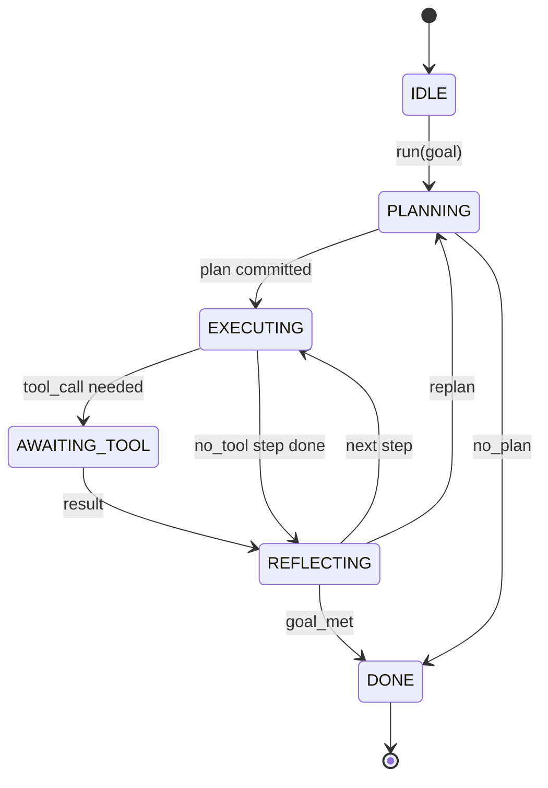

# Contratación de la cadena de agente Harness

> El modelo es un coprocesador. Puedes conectar cualquier modelo de contrato de bucle.

**Type:** Build
**Languages:** Python
**Prerequisites:** Phase 13 lessons 01-07, Phase 14 lesson 01
**Time:** ~90 minutes

## Objetivos de aprendizaje


```figure
cf-loop-contract
```
- La función de la máquina de la determinación de los estados de la operación de un agente es de transición evidente.
- Implementar 10 temas de gancho de ciclo de vida, los operadores pueden incorporar políticas, telemetría y barandillas.
- Definir dos puntos de atracción, el circuito en estas posiciones devolver el control al llamador y luego recuperar la entrada.
- 强制执行 per session budgets (turns, tools calls, wall-clock), simultáneamente en un tiempo superlimitado no se rompe el estado parcial de la información.
- 发发含十一种事件类型的类型流,让下游 UI 和追踪器 无需直接检查循环 即可订阅──

##  marco

Un agente de codificación de cuatro ciclos de funcionamiento no es un circuito de chat. Es una máquina de estado, el operador puede interceptar sus nodos, también puede auditar sus bordes. Una vez que escribas un contrato, sustituye modelos, herramientas o políticas, ya no es una reconstrucción, sino que se convierte en una llamada de registro.

Este contrato es el que se construye en esta clase. Vamos a nombrar seis estados, diez temas, dos puntos de atracción, diez tipos de eventos, así como un presupuesto.

## Estados

El bucle tiene seis estados. Cinco están activos. Uno es terminal.



`IDLE`Es el único punto de entrada legal.`DONE`Es la única exportación legal.`AWAITING_TOOL`Es el único estado que producirá un punto de atracción. Todas las demás transiciones son internas.

Esta máquina de estado es de certeza. Dado que el mismo registro de eventos, el uso volverá a entrar en el mismo estado. Esta naturaleza permite que puedas reproducir las sesiones para probar, sin necesidad de volver a utilizar el modelo.

## temas de gancho

Hooks es el operador 接入循环的接口──harness 会触发十个话题──cada tema puede aceptar un número de suscriptores─ suscriptores 按注册 顺序触发──un suscriptor puede mutar la carga útil、 subir para abortar cuando se hace el primer turno, o volver a una sentinela para saltar el siguiente paso──

```text
before_plan         after_plan
before_tool_call    after_tool_call
before_step         after_step
on_error
on_pause
on_budget_exceeded
on_complete
```

Esta forma maqueta el código de Claude, el cursor y el código abierto hasta el medio de 2025 tendencia a adoptar un modelo.`rm -rf`de gancho  puesto `before_tool_call` Enviar el gancho de OpenTelemetry span  colocar `after_step`◊ En la sesión pausa arriba gancho de recuperación  colocar `on_pause`¿Qué es eso?

## puntos de atracción

Lo primero es que me lo dejes.`AWAITING_TOOL`Cuando no tiene resultados, no puede seguir adelante.`on_pause`, cuando el presupuesto se agota, o algún gancho 明确要求人类审查

Pull point no es una excepción. Es una vuelta. Llamador.`resume(payload)` Arnes Se continúa desde la posición de parada  Este es el mismo tipo de forma que el generador de Python  Pull point  El transporte por tu elección  En TUI es la tecla  a través de MCP `tools/call`                                                                                                                                                                                                                                                              

## flujo de eventos

Loop 会在合同中的特定位置把事件添加到打字流. Este flujo es sólo añadir, los suscriptores pueden reproducir de forma arbitraria.

- `session.start` 调用 `run(goal)`时发出 una vez
- `plan.draft` planificador  regresar el proyecto de plan 时发出
- `plan.commit` proyecto presentado para el plan activo 后发发
- `step.start` Cada paso de ejecución 开始时发出
- `step.end` Cada paso de ejecución 结束时发出
- `tool.call` 需要工具的步骤将控制权交给调用人 发发出 时发出
- `tool.result` Uso de herramienta resultado 恢复时发出
- `tool.error` Uso de error 恢复时, o gancho abortar llamada 时发出
- `budget.warn`  alcanzar el límite presupuestario 时发出
- `session.pause` bucle因 pausa(orario o gancho) hacer salir
- `session.complete` bucle hasta llegar `DONE`时发出 una vez

Los eventos no son un problema, pero son un problema. Los eventos son observacionales. Los eventos son un problema.

## presupuesto

Una sesión 携带三个限制──turn count、tool call count、wall clock seconds── cada turno 会让转加一── cada llamada de herramienta 会让 herramienta calls 加一── cada transición de estado 城市检查墙时── una vez alcanzado el límite, circuito 会触发`on_budget_exceeded`, de la salida`budget.warn`, y luego en el siguiente punto de atracción , la transición hacia`IDLE`,并附带预算超额原因──

El presupuesto no es un interruptor de ejecución. Es un resultado. El que llama decide ampliar el presupuesto y reanudar o cerrar la sesión.

## 本课不做什么

No se puede utilizar un modelo. No se pueden registrar herramientas reales. No se pueden transportar.

`main.py`El planificador determinista medio es un reemplazo. De vuelta a un plan de tres pasos codificado, dos de los cuales necesitan un resultado de herramienta.

## ¿Cómo leer el código?

`HarnessLoop`Es el tipo principal. Tiene estado.`Budget`Con los límites.`Event`Es el envelope de la corriente.`HookRegistry`Es la mesa de envío.`_transition`Es la única función que cambia el estado, por lo que las invariantes de la máquina de estado se concentran en un lugar.

Desde arriba hasta abajo`main.py`✿ Entonces阅读 `code/tests/test_loop.py` pruebas 会 fijar cada transición 和 cada anzuelo de disparo orden 

## Continuar en profundidad

En el entorno de producción, la parte más difícil de construir un arnés no es la máquina de estado, sino que el contrato puede ser ejecutado. Este contrato debe soportar el reload de planificador. Debe soportar la devolución de herramientas de JSON malformadas.`before_tool_call`En este curso, los test se desarrollan en el campo de la prueba.

Siguiente artículo: Siguiente artículo: Siguiente artículo: Siguiente artículo: Siguiente artículo: Siguiente artículo: Siguiente artículo: Siguiente artículo: Siguiente artículo: Siguiente artículo: Siguiente artículo: Siguiente artículo: Siguiente artículo: Siguiente artículo: Siguiente artículo: Siguiente artículo: Siguiente artículo: Siguiente artículo: Siguiente artículo: Siguiente artículo: Siguiente artículo: Siguiente artículo: Siguiente artículo: Siguiente artículo: Siguiente artículo: Siguiente artículo: Siguiente artículo: Siguiente artículo: Siguiente artículo: Siguiente artículo: Siguiente artículo: Siguiente artículo: Siguiente artículo: Siguiente artículo: Siguiente artículo: Siguiente artículo: Siguiente artículo: Siguiente artículo: Siguiente artículo: Siguiente artículo: Siguiente artículo: Siguiente artículo: Siguiente artículo: Siguiente artículo: Siguiente artículo: Siguiente artículo: Siguiente artículo: Siguiente artículo: Siguiente artículo: Siguiente artículo: Siguiente artículo: Siguiente artículo: Siguiente artículo: Siguiente artículo: Siguiente artículo: Siguiente artículo: Siguiente artículo: Siguiente artículo: Siguiente artículo: Siguiente artículo: Siguiente artículo: Siguiente artículo: Siguiente artículo: Siguiente artículo: Siguiente artículo: Siguiente artículo: Siguiente artículo: Siguiente artículo: Siguiente artículo: Siguiente artículo: Siguiente artículo: Siguiente artículo: Siguiente artículo: Siguiente artículo: Siguiente artículo: Siguiente artículo: Siguiente artículo: Siguiente artículo: Siguiente artículo: Siguiente artículo: Siguiente artículo: Siguiente artículo: Siguiente artículo: Siguiente artículo: Siguiente: Siguiente: Siguiente: Siguiente: Siguiente: Siguiente: Siguiente: Siguiente: Siguiente: Siguiente: Siguiente::: Siguiente: El: El: El: El: El: El: El: El: El: El: El: El: El: El: El: El: El: El: El: El: El: El: El: El: El: El: El: El: El: El: El: El: El: El: El: El: El: El: El: El: El: El: El: El: El: El: El: El: El: El: El: El: El: El: El: El: El: El: El: El: El: El: El: El: El: El: El: El: El: El: El: El: El: El: El: El: El: El: El: El: El: El: El: El: El: El: El: El: El: El: El: El: El: El: El: El: El: El: El: El: El: El: El: El: El: El: El: El: El: El: El: El: El: El: El: El:
