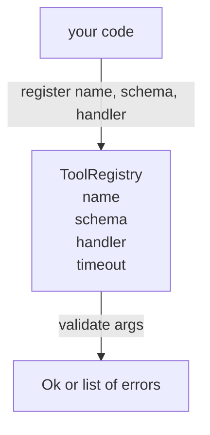

# Registro de herramientas de validación de esquema

> agente 无法验证的工具,就是 agent 无法调用工具――先构建注册表和方案检查器,再构建工具――

**Type:** Build
**Languages:** Python
**Prerequisites:** Phase 13 lessons 01-07, Phase 14 lesson 01
**Time:** ~90 minutes

## Objetivos de aprendizaje


```figure
cf-registry-validate
```
-  tiene un tipo de registro, la herramienta de mapeo nombre → esquema → manipulador, hacer que el despachador sólo necesita consultar una vez, después de eso es la confianza
-  实现 JSON Schema 2020-12   个子集,覆盖百分之九十的工具调用 实际使用的关键字──
- 返回精确的、形如 json-pointer 的错路,让模型可以在一次往返内自我修改──
- En caso de no tener una superposición evidente, rechazar la re-registro, porque la silenciosa cobertura es la razón de la derivación de los catálogos de herramientas de producción.
- 保持 validator 纯净(无I/O、无时间、无全球), así que puede volver a funcionar en el registro de reproducción 上

## ¿Por qué el registro debe ser primero que la herramienta

El registro de un agente de codificación de 2026  posee herramientas registradas, comparable al modelo  puede colocar en una sola ventana de contexto                                                                                                                                                                                                                                             

Nos debemos evitar errores, es publicar esquemas sin manipulación, o publicar esquemas sin validación. Ambos son muy comunes. Ambos se convierten en un juego de conjeturas, y el único modo de fracaso es el manejo de la pila que se ha dejado.

## registro de herramientas 长什么样

```text
ToolRecord
  name        : str          (unique, lowercase alphanumeric and underscore segments separated by dots, e.g., snake_case.segment.case)
  description : str          (one line, shown to the model)
  schema      : dict         (JSON Schema 2020-12 subset)
  handler     : Callable     (async or sync, returns Any)
  idempotent  : bool         (dispatcher uses this for retry decisions)
  timeout_ms  : int          (override per-tool dispatcher default)
```

El esquema es el validador  único que tocará los segmentos ▌el manipulador a él es opaco ▌Nosotros deliberadamente separamos los dos por separado ▌el esquema es el dato ▌el manipulador es el código ▌en su conjunto, te inducirá a poner la lógica de validación ▌en el manipulador, y este es precisamente el error que debemos evitar ▌

## Esquema JSON 2020-12 子集

La especificación completa para 2020-12 es un artículo. Necesitamos ocho palabras clave.

```text
type           string / number / integer / boolean / object / array / null
properties     map of property name -> schema
required       list of property names
enum           list of allowed primitive values
minLength      integer, applies to strings
maxLength      integer, applies to strings
pattern        ECMA-262-compatible regex, applies to strings
items          schema applied to every array element
```

Esto es suficiente para cubrir la API de herramientas  contenido de las necesidades reales. No hemos añadido palabras clave (oneOf, anyOf, allOf, $ref, condicionales) en los esquemas de producción es válido, pero convertirá al validador en un árbol de ciclos.

## Json puntero  error ruta

validación 失败时,validator 返回一个错误列表―― cada error lleva una dirección hacia la entrada 内部的 json-pointer path――pointer es una secuencia de enlaces abiertos, compuesta por nombres de propiedades y índices de matriz 组成――

```text
{"a": {"b": [1, 2, "x"]}}
                    ^
                    /a/b/2
```

modelo 读取错误 paths 的能力强于读取句子的能力──如果 schema 要求 `args.user.email`, y el modelo 传入 un número entero, error  debería ser `/user/email`, y con`expected_type: string`◊modelo 会在下一次调用中修正它, no necesita una ronda de explicaciones de lenguaje natural―

## Registrarse con el control

`register(name, schema, handler, **opts)`默认拒绝重复注册──调用方必须传进 `override=True`才能替换── es una práctica de salud a nivel de operación── dos partes de la biblioteca de códigos están registradas en silencio con el mismo nombre de la herramienta, es el tipo de error que se encuentra en la producción durante una semana──

Registro de datos de datos`get(name)`返回记录或抛出异常──`validate(name, args)` Retorno a uno `Ok`O un grupo de errores.`names()`按注册顺序返回 herramientas nombres。

## Validador es lo que, no es lo que

Es una recursión de un árbol de esquemas por todo el mundo. Es una función pura. No utiliza manipuladores.`"42"`No pasará por el esquema numérico.

Es un sistema de seguridad. La información de la información se puede obtener de la información de la persona que lo ha enviado.

## Forma



## ¿Cómo leer el código?

`code/main.py`Definido .`ToolRegistry`¿Qué es esto?`ToolRecord`¿Qué es esto?`ValidationError`, así como ocho funciones de validador.`schema["type"]`Envía o lleva`enum`处理) ⋅ cada validador de tipo ⋅ regresar a la lista, ⋅ regresar ⋅ regresar ⋅`ValidationError`列表──top-level walker 会拼接 errores, y en el sentido de regreso hacia abajo

`code/tests/test_registry.py`覆盖登记"",override"",validation success"",带 paths" de validación fallida, así como cada palabra clave en el 子集──

## Continuar en profundidad

Después de esta sección, lo que querrás son dos extensiones:`$ref`Resolución, así como para las formas estrictas `additionalProperties: false`◊ ambos son muy pequeños. ◊ Con el catálogo de herramientas creciendo a más de cincuenta herramientas, ambos son muy comunes.

Siguiente artículo: "La información sobre el registro de datos de datos de datos de datos de datos de datos de datos de datos de datos de datos de datos de datos de datos de datos de datos de datos de datos de datos de datos de datos de datos de datos de datos de datos de datos de datos de datos de datos de datos de datos de datos de datos de datos de datos de datos de datos de datos de datos de datos de datos de datos de datos de datos de datos de datos de datos de datos de datos de datos de datos de datos de datos de datos de datos de datos de datos de datos de datos de datos de datos de datos de datos de datos de datos de datos de datos de datos de datos de datos de datos de datos de datos de datos de datos de datos de datos de datos de datos de datos de datos de datos de datos de datos de datos de datos de datos de datos de datos de datos de datos de datos de datos de datos de datos de datos de datos de datos de datos de datos de datos de datos de datos de datos de datos de datos de datos de datos de datos de datos de datos de datos de datos de datos de datos de datos de datos de datos de datos de datos de datos de datos de datos de datos de datos de datos de datos de datos de datos de datos de datos de datos de datos de datos de datos de datos de datos de datos de datos de datos de datos de datos de datos de datos de datos de datos de datos de datos de datos de datos de datos de datos de datos de datos de datos de datos de datos de datos de datos de datos de datos de datos de datos de datos de datos de datos de datos de datos de datos de datos de datos de datos de datos de datos de datos de datos de datos de datos de datos de datos de datos de datos de datos de datos de datos de datos de datos de datos de datos de datos de datos de datos de datos de datos de datos de datos de datos de datos de datos de datos de datos de datos de datos de datos de datos de datos de datos de datos de datos de datos de datos de datos de datos de datos de datos de datos de datos de datos de datos de datos de datos de datos de datos de datos de datos de datos de datos de datos de datos de datos de datos de datos de datos de datos de datos de datos de datos de datos de datos de datos de datos de datos de datos de datos de datos de datos de datos de datos de datos de datos de datos de
