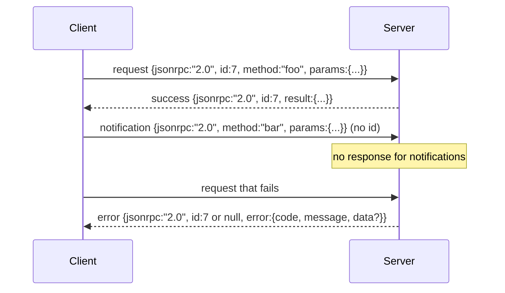

#  Basado en el JSON-RPC 2.0 de Newline-Delimited Stdio

> El transporte entre el cliente modelo y el servidor de herramientas es basado en JSON-RPC de estudio. Escribirlo una vez, te permitirá entender cada capa de enmarcado que está pagando el costo.

**Type:** Build
**Languages:** Python
**Prerequisites:** Phase 13 lessons 01-07, Phase 14 lesson 01
**Time:** ~90 minutes

## Objetivos de aprendizaje


```figure
cf-jsonrpc-frames
```
- Utiliza a través de stdin 和 stdout 上的 nueva línea de JSON delimitado de JSON enmarcado de JSON-RPC 2.0 通信。
- 映射五个标准错误代码(-32700, -32600, -32601, -32602, -32603),并以正确语义暴露它们──
- 区分请求,回应,通知和批发, sin desarrollar nuevas claves de sobre
- Cada vez que se trata de un error de análisis, no se contamina el resto de la corriente.
- Utiliza io.BytesIO  Construir una demo que se termina automáticamente, hacer que el curso no necesite reproducir el proceso de niño 即可运行──

## ¿Por qué JSON-RPC sigue siendo lingua franca

En 2026, un agente de codificación en una sola sesión puede utilizar 12 servidores de herramientas para comunicar. Cada servidor es un proceso independiente o un punto de extremo remoto. El formato de cable es el mismo desde 2013. JSON-RPC 2.0 es de dos páginas de especificaciones. Puede sobrevivir, es debido a un esquema alternativo.

本课构建 stdio variant──Newline-delimited JSON──cada solicitud es una línea──cada respuesta es una línea──transporte límite es `\n`¿Qué es eso?

## forma de alambre

Hay cuatro formas de envoltura. Dos de cliente.



notificación 没有 `id` el servidor no tiene que responder a ella. Si el servidor responde a la notificación, el cliente no tiene manera de conectarla a un sitio de llamada.

Batch es una matriz de solicitudes o notificaciones JSON. El servidor devuelve una matriz de respuestas, orden arbitrario, cada entrada sin notificación a la respuesta. Si cada entrada del batch es una notificación, el servidor no envía ningún contenido.

## 五个 código de error

```text
-32700  Parse error      JSON could not be parsed
-32600  Invalid Request  Envelope shape is wrong
-32601  Method not found
-32602  Invalid params
-32603  Internal error
```

Los códigos entre -32000 y -32099  guardan los errores definidos por el servidor― todos los demás códigos son definidos por la aplicación―.`data.exception`Entra en el nombre de la clase de excepción.

Error de análisis Hay una regla especial.`id`Sí `null`, puesto que la solicitud no ha sido analizada hasta el grado de suficiente para obtener la identificación.

## Enmarcado de línea nueva y BytesIO demo

transporte una vez, una vez, una vez, una vez, una vez, una vez, una vez, una vez, una vez, una vez, una vez, una vez, una vez, una vez, una vez, una vez, una vez, una vez, una vez, una vez, una vez, una vez, una vez, una vez, una vez, una vez, una vez, una vez, una vez, una vez, una vez, una vez, una vez, una vez, una vez, una vez, una vez, una vez, una vez, una vez, una vez, una vez, una vez, una vez, una vez, una vez, una vez, una vez, una vez, una vez, una vez, una vez, una vez, una vez, una vez, una vez, una vez, una vez, una vez, una vez, una vez, una vez, una vez, una vez, una vez, una vez, una vez, una vez, una vez, una vez, una vez, una vez, una vez, una vez, una vez, una vez, una vez, una vez, una vez, una vez, una vez, una vez, una vez, una vez, una vez, una vez, una vez, una vez, una vez, una vez, una vez, una vez, una vez, una vez, una vez, una vez, una vez, una vez, una vez, una vez, una vez, una vez, una vez, una vez, una vez, una vez, una vez,`\n`Si alguna línea no puede ser analizada, el transporte escribirá en una banda.`id: null`La respuesta de -32700 no continuó. El flujo no se contaminará.

En esta clase, nos hemos puesto un par.`io.BytesIO`包装成 stdin 和 stdout──server 读取请求直到 EOF,为每一个请求 写入回复,然后返回──client 再读回回回复──没有过程 spawn──没有时间out──transport 行为与真实子进程管 完全相同,因为 Python 的`io`Interfaz  proporcionó lo mismo `.readline()`Y `.write()`contrato

## Disposición del método

El transporte no sabe qué métodos existen.`handler(method, params)` manipulador  resultados de retorno o抛出异常──三个 clases de excepciones  exponer códigos específicos──

```text
MethodNotFound -> -32601
InvalidParams  -> -32602
Anything else  -> -32603 with exception name in data
```

Transport  nunca verá el registro de herramientas  Registro  está en el controlador                                                                                                                                                                                                                                                                                                                                                                                                                                                                                                         

## errores de corriente  comportamiento

```text
client writes              server reads             server writes
---------------            -----------              -------------
{...valid request...}      parses ok                {...response, id matches...}
{...broken json...         parse fails              {id:null, error: -32700}
{...valid request...}      parses ok                {...response, id matches...}
{...missing method...}     invalid envelope         {id:X, error: -32600}
```

Una línea de JSON roto no se detendrá en el ciclo.`method`campo no se detendrá en el ciclo.

## Notificaciones y flujos de

Notificación es fuego y olvido.Arness Utiliza notificaciones para mostrar eventos de progreso.

本课实现 un asistente de notificación saliente,`write_notification` servidor en la solicitud  llevar en el uso de ella para enviar el progreso―demo  mostró este patrón: una solicitud 进来, el administrador 发发发两条进展通知,然后写入最终回应―

## ¿Cómo leer el código?

`code/main.py`Definido .`StdioTransport`、parse ayudante(`parse_request`3) 、三个 ayudantes de escritura`write_response`¿Qué es esto?`write_error`¿Qué es esto?`write_notification`), así como el ciclo de envío `serve`◊constantes de código de error  en el alcance del módulo。

`code/tests/test_transport.py`覆盖五个错误码、通知(不写回应) 批次(array in, array out, 跳过 notifications) 破碎 JSON(parse error 后继续),以及处理器 在调用中途写入通知的不对称流――

## Continuar en profundidad

Este transporte 足以支后续课程──producción transporte 会添加三件事──一个能在转发后继续存在的相关性 id field你的`id`Ya es esto, pero en la malla dentro también necesitas un ID de rastreo externo.`$/cancelRequest`Una notificación, llevar un ID de llamada en vuelo, así como un apretón de manos de negociación tipo contenido, permite que el mismo enchufe pueda decir JSON-RPC y HTTP en streaming simultáneamente.
