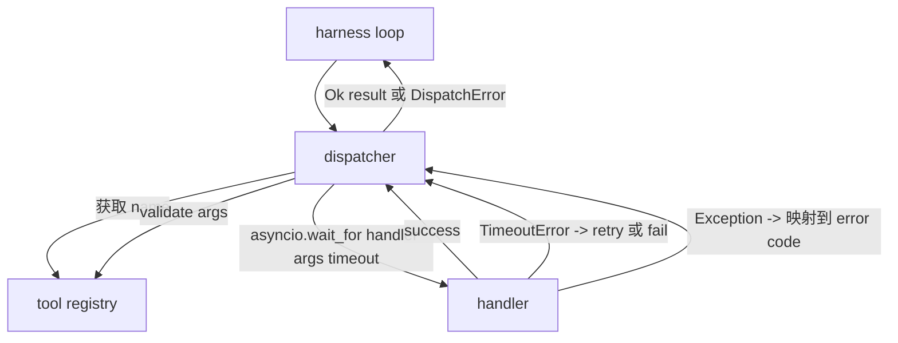
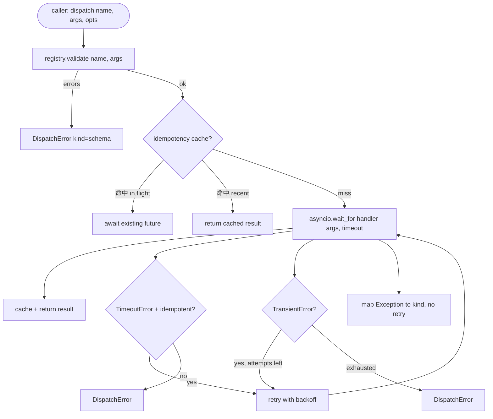

# Dispensador de llamadas de función

> El despachador es el aprovechamiento de un esquema para hacer cada compromiso en un solo lugar.

**Type:** Build
**Languages:** Python
**Prerequisites:** Phase 13 lessons 01-07, Phase 14 lesson 01
**Time:** ~90 minutes

## Objetivos de aprendizaje
- Utiliza el procesador de herramientas de empaquetado por llamada, para que devuelva el error de tipografía, en lugar de hacer que el bucle se ponga en marcha.
- 应用带 jitter 和最大尝试次数的指数式回复试――
- Basado en la clave de impotencia para retrasos, así con el lento llamado original  competencia                                                                                                                                                                                                                                                                                                                                                                                                                                                                                                        
- Las excepciones del manejero y los errores de transporte se han mapeado hasta el bucle de arnés ya se ha comprendido un solo error en el envase.
- Con el límite de concurrencia, evita las llamadas de las cuatro herramientas.


```figure
cf-dispatch-retry
```

## Donde se sienta el despachador

位于 harness loop(lección veinte) y registro de herramientas(lección veinte y uno) entre──transport(lección veinte y dos) hacia el bucle 输入──loop 把 herramienta llamada 交给发送商──发送商 调用 registros,运行处理器,并返回结果或 JSON-RPC 形状的错误包──



El despachador es el único que sabe los tiempos, retiros y la incompetencia de los niveles.

## Tiempos de tiempo

Cada herramienta tiene un tiempo de espera por defecto. Registro de registro.`timeout_ms`Cuando el arnés se transmite por llamada, el dispachador lo utilizará para cubrir el valor de la llamada.`asyncio.wait_for` tiempo fuera 时, tarea del manejador 会被取消,dispensador 返回 `DispatchError(kind="timeout")`¿Qué es eso?

Para las herramientas no idempotentes, el tiempo de espera no es un error retrayable.`db.write`Puede haber sido enviado, también puede haber no. Retiro, volver a escribir.`idempotent`Bandera― herramientas idempotentes 会再试―― herramientas no idempotentes 不会―

## Retempos con retroceso exponencial

Retry política 最多三次尝试──Backoff es el retroceso exponencial de la nerviosismo──

```text
attempt 1  -> delay 0
attempt 2  -> delay 0.1s * (1 + random[0..0.5])
attempt 3  -> delay 0.4s * (1 + random[0..0.5])
```

Sólo .`timeout`Y `transient`Errores, volveré a intentarlo.`schema`error`not_found`O `internal`error no volverá a intentarse. Errores de esquema son definitivos. Retiro no cambiará el resultado, sólo se gastará el presupuesto.

Retry loop se cumplirá con el presupuesto  dado  Si el presupuesto del llamador  residual de herramienta llama a cero, el remitente se encontrará en el primer intento                                                                                                                                                                                                                                                                                                                                                                                                                                                                                    `kind="budget_exceeded"`¿Qué es eso?

## Dedución de la clave de impotencia

Cuando la llamada original still in flight 时触发重复试, es un verdadero error de producción. La primera llamada se hace en cuatro minutos.`payments.charge`, tú sólo has sido retenido dos veces.

Dispector  acepta可选的 `idempotency_key`Si una llamada llega y la llave está en vuelo, el despachador esperará el futuro en vuelo y regresará con el resultado.

La clave es la responsabilidad del llamador.`f"{step_id}:{tool_name}:{hash(args)}"`❖ el despachador no inventará la clave, porque sólo de los argumentos                                                                                                                                                                                                                                                                                                                                                                                                                                                                                                            

## Envase de error

失败的发送 返回单一形状──

```text
DispatchError
  kind        : "timeout" | "transient" | "schema" | "not_found" | "internal" | "budget_exceeded"
  message     : str
  attempts    : int
  jsonrpc_code: int   （-32601、-32602、-32603 之一）
```

el bucle del arnés se`kind`映射到下一个状态──`schema`Y `not_found`Entrar en`on_error`No me ha vuelto a plantear.`timeout`Y `transient`Entrar en`on_error`, puede replanar, también puede no replanar, depende de los intentos.`budget_exceeded`触发                                                                                                                                                                                                                                                                                                                                                                                                                                                                                                                           `on_budget_exceeded`¿Qué es eso?

## Límites de competencia para el ventilador

`gather(*calls)`会同时运行所有 coroutines──四十工具通话意味着四十开源或四十子处理管── la mayoría de los respaldados no les gusta un cliente 发起四十并行连接──

Dispector con semáforo 包装 `gather`                                                                                                                                                                                                                                                                                                      `gather`形状的输出, pero la programación real es de

## Flujo para una llamada



## Cómo leer el código

`code/main.py`Definido .`Dispatcher`¿Qué es esto?`DispatchError`Y `TransientError` Dispatcher 在构造时接收注册`dispatch(name, args, ...)`Es el único punto de entrada... por tiempo de espera.`_run_with_retries`En el interior`asyncio.wait_for`En línea  aplicación `gather_bounded(calls)`Es un límite de concurrencia 运行多个发送──

`code/tests/test_dispatcher.py`覆盖 timeout 触发、transient 上的 retry、schema error 上不 retry、idempotency dedupe(dos con la misma clave de llamadas simultáneas 折叠为一次处理器调用), así como limitación de concurrencia(semaphore 生效) ⋅

pruebas `asyncio.sleep(0)`Y basado en la determinación`Counter`Los manipuladores, así que se terminan en mil segundos, no dependen del tiempo del reloj de la pared.

## Ir más allá

Los despachadores de producción añadirán dos expansiones. Primero, en cada transición, realizarán una registro estructurada.`dispatch.attempt`Y `dispatch.retry`eventos)── Segundo, interruptores de circuito: en una ventana ocurren N 次失败后, herramienta  entra en período de enfriamiento, envíos 会立即返回 `kind="circuit_open"`, en lugar de tratar de manejar. Ambas pueden añadirse en este despachador, sin cambiar el contrato.

Lección 24 Me voy a juntar al dispatcher con el agente de planificación y ejecución, te voy a ver cuatro partes juntos.
