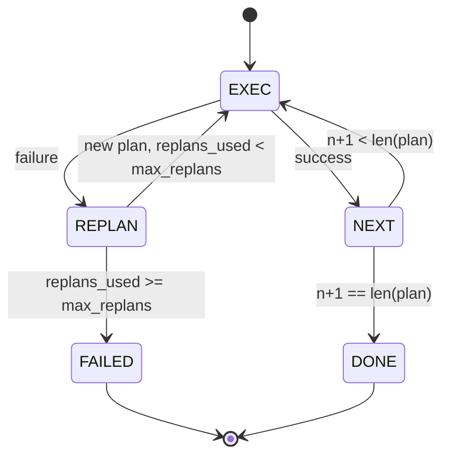

# Planar y ejecutar el flujo de control

> 无法承受失败的计划是脚本――能重复的脚本――才是代理――先构建重组规划者――

**Type:** Build
**Languages:** Python
**Prerequisites:** Phase 13 lessons 01-07, Phase 14 lesson 01
**Time:** ~90 minutes

## Objetivos de aprendizaje


```figure
cg-plan-replan
```
- El plan se expresará en una lista de pasos tipografados, permitiendo al ejecutor evaluar el progreso y el resultado.
- 顺序执行 steps,并将失败 受控地转移 回计划者──
- Desde el cursor actual  empezar a replanar, y en el contexto con el error anterior, hacer un siguiente plan  更有信息──
- Cada revisión emitir plan diferente, hacer un tracer o UI puede mostrar el plan ¿qué cambia?
- 强制执行两个 presupuestos: límite de paso de la durabilidad y límite de replan de la durabilidad.

## Planificar y ejecutar, en lugar de ser una cadena de pensamiento

El agente de cadena de pensamiento Emite tokens,并让循环 猜测 tool call 在哪里结束──Plan y ejecutar agente primero emite un plan estructurado, luego determinación ejecutar cada paso──Plan es aprovechar datos introspectivos──execución es aprovechar 通过发送器 运行这些数据──

两个部分──一个规划者 产生计划──一个执行者 运行计划──真正有意的是执行者 遇到失败 时发生什么──三个选项:

```text
1. Abort         （返回 failed，暴露 error）
2. Skip          （将 step 标记为 failed，继续剩余部分）
3. Replan        （把 error 交给 planner，从 cursor 获取新 plan）
```

Replan es convertir el guión en agente de opciones.

## Forma del paso

```text
Step
  id              : int           （在一个 plan revision 内单调递增）
  tool_name       : str
  args            : dict
  expected_outcome: str           （planner 声明的 success condition）
  result          : Any | None
  error           : str | None
```

`expected_outcome`Es el planificador y el paso de un emite un ejecutor no se obligará a revisarlo. Tiene dos usos: replanificador en el plan de revisión; reelectarlo; transmite el flujo de eventos, permita que el rastreador pueda mostrar este paso.

## Forma del planificador

```python
def planner(goal: str, history: list[Step], last_error: str | None) -> list[Step]:
    ...
```

Una función pura.`goal`Es el objetivo del usuario.`history`Ya han sido ejecutados los pasos (¡¡¡¡¡¡¡¡¡¡¡¡¡¡¡¡¡¡¡¡¡¡¡¡¡¡¡¡¡¡¡¡¡¡¡¡¡¡¡¡¡¡¡¡¡¡¡¡¡¡¡¡¡¡¡¡¡¡¡¡¡¡¡¡¡¡¡¡¡¡¡¡¡¡¡¡¡¡¡¡¡¡¡¡¡¡¡¡¡¡¡¡¡¡¡¡¡¡¡¡¡¡¡¡¡¡¡¡¡¡¡¡¡¡¡¡¡¡¡¡¡¡¡¡¡¡¡¡¡¡¡¡¡¡¡¡¡¡¡¡¡¡¡¡¡¡¡¡¡¡¡¡¡¡¡¡¡¡¡¡¡¡¡¡¡¡¡¡¡¡¡¡¡¡¡¡¡¡¡¡¡¡¡¡¡¡¡¡¡¡¡¡¡¡¡¡¡¡¡¡¡¡¡¡¡¡¡¡¡¡¡¡¡¡¡¡¡¡¡¡¡¡¡¡¡¡¡¡¡¡¡¡¡¡¡¡¡¡¡¡¡¡¡¡¡¡¡¡¡¡¡¡¡¡¡¡¡¡¡¡¡¡¡¡¡¡¡¡¡¡¡¡¡¡¡¡¡¡¡¡¡¡¡¡¡¡¡¡¡¡¡¡¡¡¡¡¡¡¡¡¡¡¡¡¡¡¡¡¡¡¡¡¡¡¡¡¡¡¡¡¡¡¡¡¡¡¡¡¡¡¡¡¡¡¡¡¡¡¡¡¡¡¡¡¡¡¡¡¡¡¡¡¡¡¡¡¡¡¡¡¡¡¡¡¡¡¡¡¡¡¡¡¡¡¡¡¡¡¡¡¡¡¡¡¡¡¡¡¡¡¡¡¡¡¡¡¡¡¡¡¡¡¡¡¡¡¡¡¡¡¡¡¡¡¡¡¡¡¡¡¡¡¡¡¡¡¡¡¡¡¡¡¡¡¡¡¡¡¡¡¡¡¡¡¡¡¡¡¡¡¡¡¡¡¡¡¡¡¡¡¡¡¡¡¡¡¡¡¡¡¡¡¡¡¡¡¡¡¡¡¡¡¡¡¡¡¡¡¡¡¡¡¡¡¡¡¡¡¡¡¡`last_error`En la primera llamada fue Ninguna, en la última llamada fue el último mensaje de falla.

Planner no sabe ejecutor... no sabe retrasos... no sabe tiempos... sólo produce un plan... sólo eso y ya...

## Ejecutor

El ejecutor es una máquina de estado pequeño. Cada paso pasa por el despachador.`FAILED`Resultado de la sesión.



## Plan de revisión

Cuando el planificador regresa al nuevo plan después del fracaso, el ejecutor emitirá un contenido de tres segmentos.`plan.diff`evento

```text
removed: 旧 plan 中存在但新 plan 中不存在的 step ids 列表
added  : 新 plan 中存在但旧 plan 中不存在的 step ids 列表
revised: tool_name 或 args 已改变的 step ids 列表
```

Tracer o UI puede transformarse en el paso de los pasos eliminados, así como en el punto de relieve de los añadidos.

## ∆ dos presupuestos

`max_steps`limitando toda la sesión de ejecuciones de los pasos, incluyendo replanización. 默认是十二──失败的尝试也计入──一个在最后一步失败的五步计划 已经花了五次执行──如果每次重复计划都重试该步并新增三步步,而第一次修改的最后步再次失败,计数是九,第二修改还需要四次:十三──执行会运行第十二次,拒绝第十三次,并合理`step_budget` Retorno FALIDO

`max_replans`限制第一次计划 后规划师 被调用次数──默认是五──这是更重要的限制──一个连续五次回归同一个破碎的计划规划师,否则会一直循环,直到步骤预算 抓获它──限制重规划会让失败更快发生,原因也更清楚──

## Planador determinista en 本课中

Esta lección no utiliza el modelo. La lección proporciona un planificador determinista, según lo que se dice.`last_error`选择 plan 』

```text
last_error is None    -> emit 一个 four-step plan
last_error matches X  -> emit 一个绕过 X 的 three-step plan
last_error matches Y  -> emit 一个优雅放弃的 two-step plan
otherwise             -> return []（表示没有内容可 replan）
```

Este es el ejecutor de pruebas en cada paso de transición.

## Forma del resultado

```text
SessionResult
  status      : "completed" | "failed"
  reason      : str     ("goal_met" | "step_budget" | "replan_budget" | "no_plan")
  history     : list[Step]
  revisions   : list[PlanDiff]
  events      : list[Event]
```

Lección veinte El circuito de arnés del medio puede leerlo directamente. Lección veintitrés El despachador del medio ejecuta cada paso. Lección veintiún El registro del medio valida cada paso de los argumentos. Lección veintitrés El transporte del medio Reunión a través de JSON-RPC expondrá todo el flujo.

## Cómo leer el código

`code/main.py`Definido .`PlanExecuteAgent`¿Qué es esto?`Step`¿Qué es esto?`PlanDiff`¿Qué es esto?`SessionResult`Y el planificador determinista.`run(goal)`método, regreso `SessionResult`◊ plan de diferencia                                                                                                                                                                                                                                                                                                                                                                                                                                                                                                                         `(tool_name, args)`Túples 计算。

`code/tests/test_agent.py`覆盖 linear éxito 一次中计划失败 后重计划 返回 `failed:replan_budget`La reducción de los costes de la planificación de la actividad, así como la reducción de los costes de la planificación de la actividad, se aplican a la reducción de los costes de la actividad.

## Ir más allá

连接到真实模型 后,你会需要两个扩展──第一,部分计划缓存:当一个计划的六步中前三个成功、后失败时,你不想重新运行前三个──执行者 已保留历史;planner 只需要读取它──第二, paralelos ramas:当前执行者是严格序列的──发行独立分支`gather_step`En vez de`next_step`El planificador puede realizar dos llamadas simultáneas a través del despachador.

 ambos aumentan la complejidad real                                                                                                                                                                                                                                                          
