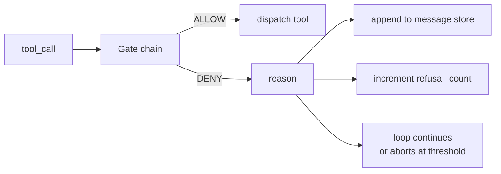
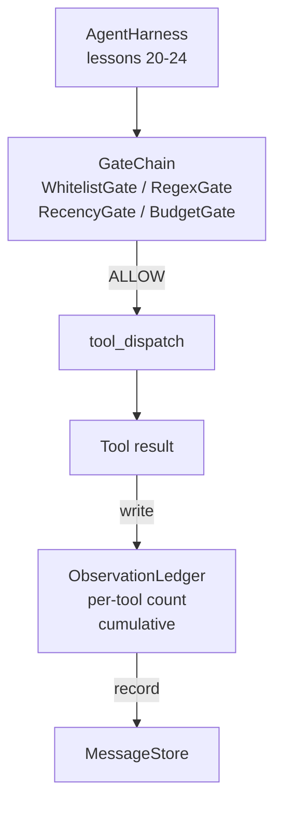

# Capstone 第 25 课: Puertas de verificación y presupuesto de observación

> 无验证层的代理利用,只是披露外套的愿望. 本课会构建确定性门链,用来决定是否允许一次工具调用 触发、代理可以看到多少输出,以及当代理 已读取太多内容时循环 何时必须停止──这个链由小小的门名的门加上观察账本组成; ledger 会追踪已经显示给模型的每个代币──

**Type:** Build
**Languages:** Python (stdlib)
**Prerequisites:** Phase 19 · 20-24（Track A1：agent loop、tool registry、message store、prompt builder、model router），Phase 14 · 33（instructions as constraints），Phase 14 · 36（scope contracts），Phase 14 · 38（verification gates）
**Time:** ~90 minutes

## Objetivos de aprendizaje

- construcción con certeza `evaluate(call)`¿Cómo se hace esto?`VerificationGate`Protocolo
- La cadena de la cadena de la cadena de la cadena de la cadena de la cadena de la cadena de la cadena de la cadena de la cadena de la cadena de la cadena de la cadena de la cadena de la cadena de la cadena de la cadena de la cadena de la cadena de la cadena de la cadena de la cadena de la cadena de la cadena de la cadena de la cadena de la cadena de la cadena de la cadena de la cadena de la cadena de la cadena de la cadena de la cadena de regex.
-                                                                                                                                                                                                                                                                                                                                                                                                                                                                                                                              `ObservationLedger` Seguir cada vez que se observa ∙
- Cuando el presupuesto acumulado de observación se sobreponga, rechace una llamada de herramienta.
-  expositoria estructurada `GateDecision`registro,供下游 observabilidad 摄取──

##  problemas

Cuando el agente aprovecha los instrumentos, en la primera hora de su uso real, aparecen tres tipos de errores.

Primer tipo es la observación infinita. En una serie de operaciones de pago de 20 mil líneas, se pondrá en la siguiente ronda la salida de 50 mil.

El segundo tipo es la actualidad obsoleta. Una tarea de largo tiempo en ejecución acumula 50 veces las llamadas de herramientas. El modelo relega el primer archivo de lectura de la tercera ronda cuando se vuelve a leer en el estado real.

Tres clases son privilegios. Una tarea de estudio.`web_search`开始,随后不知怎么就运行了 `shell`, porque el modelo ha creado un nombre de herramienta, y aprovecha 默认宽松──等有人读取痕迹 时,/tmp 里已经放一个垃圾文件,并且一次卷 已打到了私人API──

La puerta de verificación es el arnés, el que está responsable de los componentes.`(call, history, ledger)`La función de determinación, regresar ALLOW o DENY,并附带理由──reason 会被记录──模型会被告知──loop 会继续或停止──

## 概念



La puerta es cualquier cosa con `evaluate(call, ctx) -> GateDecision`方法的对象──chain 是一个有序列表──evaluation 在第一次拒绝时短路──序列很重要:便宜的结构性门 会先于昂贵的代币计数门 运行──

本课提供四门:

- `WhitelistGate` Los nombres de herramientas permitidos son un conjunto de objetos. Todo lo que esté fuera del conjunto será negado.
- `RegexGate`◊ Argumentos de herramientas 会与 regex 匹配──适合拒绝包含 `rm -rf`Las llamadas de shell, o las llamadas HTTP de IP internas. Depende de la carga útil de la llamada.
- `RecencyGate`◊ el modelo sólo puede ver las observaciones más recientes de N 轮 ◊ las observaciones más antiguas serán ocultas ◊ esta puerta rechazará sus resultados y ampliará una llamada de herramienta de la ventana de observación ya expirada ◊
- `BudgetGate` Modelo en toda la sesión en la acumulación de tokens de lectura hay un límite superior. Cuando el libro mayor indique que ya ha alcanzado el límite superior, cada llamada posterior a la herramienta será rechazada.

El libro de observación 负责记账―― cada vez que la herramienta tiene éxito llama ciudad会写入一行: herramienta nombre、turn、tokens emitido、cumulativo。 el libro de observación  responde dos preguntas: modelo总共看到了多少,以及它看到了工具 X 的多少──puerta presupuestaria 读取第一──puerta presupuestaria por herramienta es tu contenido de ejercicio, se leerá la segunda──


```figure
cg-gate-chain
```

## 架构



Harness 会询问链――链 要么点头,要么拒绝――如果它点头,工具会运行,账户会计数,结果将被添加到消息商店――如果它拒绝,模型将以系统信息的形式获得拒绝,然后循环决定是重试还是停止――

## ¿Qué construirás?

                                                                                 `main.py`Además de pruebas.

1. `Observation`Y `ToolCall`clases de datos  definir formas de alambre。
2. `ObservationLedger` registro `(turn, tool, tokens)`filas,并回答 `cumulative()`Y `per_tool(name)`¿Qué es eso?
3. `GateDecision`¿ Qué es eso ?`(allow, reason, gate_name)`¿Qué es eso?
4. `VerificationGate`Es un protocolo. Cada puerta se ha implementado.`evaluate(call, ctx)`¿Qué es eso?
5. `GateChain`Envuelve una lista de cosas. Requiere cada puerta y regresa a la primera.
6. El programa de investigación de la Comisión de Investigación y Desarrollo de la Investigación de la Investigación de la Investigación de la Investigación de la Investigación de la Investigación de la Investigación de la Investigación de la Investigación de la Investigación de la Investigación de la Investigación de la Investigación de la Investigación de la Investigación de la Investigación de la Investigación de la Investigación de la Investigación de la Investigación de la Investigación de la Investigación de la Investigación de la Investigación de la Investigación de la Investigación de la Investigación de la Investigación de la Investigación de la Investigación de la Investigación de la Investigación de la Investigación de la Investigación de la Investigación de la Investigación de la Investigación de la Investigación de la Investigación de la Investigación de la Investigación de la Investigación de la Investigación de la Investigación de la Investigación de la Investigación de la Investigación de la Investigación de la Investigación de la Investigación de la Investigación de la Investigación de la Investigación de la Investigación de la Investigación de la Investigación de la Investigación de la Investigación de la Investigación de la Investigación de la Investigación de la Investigación de la Investigación de la Investigación de la Investigación de la Investigación de la Investigación de la Investigación de la Investigación de la Investigación de la Investigación de la Investigación de la Investigación de la Investigación de la Investigación de la Investigación de la Investigación de la Investigación de la Investigación de la Investigación de la Investigación de la Investigación de la Investigación de la Investigación de la Investigación de la Investigación de la Investigación de la Investigación de la Investigación de la Investigación de la Investigación de la Investigación de la Investigación de la Investigación de la Investigación de la Investigación de la Investigación de la Investigación de la Investigación de la Investigación de la Investigación de la Investigación de la Investigación de la Investigación de la Investigación de la Investigación de la Investigación de la Investigación de la Investigación de la Investigación de la Investigación de la Investigación de la Investigación de la Investigación de la Investigación de la Investigación de la Investigación de la Investigación de la Investigación de la Investigación de la Investigación de la Investigación de la Investigación de la Investigación

Contador de tokens tiene intención de adoptar muy grosero`len(text) // 4`Heurística. 本课重点是门管,而不是代币器.

## ¿Por qué la cadena  orden importante

Una vez negar, una vez permitir, más barato.`WhitelistGate`运行                                                                                                                                                                                                                                                                                                                                                                                                                                                                                                                           $O(1)$Buscar por hash.`RegexGate`运行                                                                                                                                                                                                                                                                                                                                                                                                                                                                                                                           $O(\text{pattern} \cdot \text{argv})$¿Qué es eso?`RecencyGate`读取 mensaje de la tienda de una pequeña rebanada。`BudgetGate`读取整个账本──你需要按成本升序排列它们,因此被拒绝的电话就能在执行昂贵的工作前短路──

Usted también debe seguir el radio de explosión 排序──Whitelist 是最强的主张: este instrumento 不在合同中──regex gate 其次: este argumento 不在合同中──Recency 在后面:harness 仍然关心,但电话 在结构上是合法的──Budget 放在最后,因为按照定义,它只会在其他检查都通过后触发──

## ¿Cómo se combina con el resto de la pista A?

 El curso anterior ya le ha dado un bucle, registro de herramientas, almacenamiento de mensajes, constructor de mensajes y modelo de router.  El curso añade modelos y herramientas entre las capas.  El curso 26 ofrece una caja de arena, cuando la cadena de puertas regresa al permiso.  El dispatcher ofrece una llamada de herramienta.  El curso 27 ofrece un uso de la evaluación, cuenta de rechazo.  Como un registro de señales de calidad.  El curso 28 ofrece una solución de puertas.  El curso 29 ofrece un código de código de código de trabajo.

## 运行方式

```bash
cd phases/19-capstone-projects/25-verification-gates-observation-budget
python3 code/main.py
python3 -m pytest code/tests/ -v
```

El programa de pruebas de la red de datos de la red de datos de la red de datos de la red de datos de la red de datos de la red de datos de la red de datos de la red de datos de la red de datos de la red de datos de la red de datos de la red de datos de la red de datos de la red de datos de la red de datos de la red de datos de la red de datos de la red de datos de la red de datos de la red de datos de la red de datos de la red de datos de la red de datos de la red de datos de la red de datos de la red de datos de la red de datos de la red de datos de la red de datos de la red de datos de la red de datos de la red de datos de la red de datos de datos de la red de datos de datos de la red de datos de datos de la red de datos de datos de la red de datos de datos de datos de la red de datos de datos de datos de la red de datos de datos de datos de datos de la red de datos de datos de datos de datos de la red de datos de datos de datos de datos de datos de datos de la red de datos de datos de datos de datos de datos de datos de la red de datos de datos de datos de datos de datos de datos de datos de la red de datos de datos de datos de datos de datos de datos de datos de datos de datos de la red de datos de datos de datos de datos de datos de datos de datos de datos de datos de datos de datos de datos de datos de datos de la red de datos de datos de datos de datos de datos de datos de datos de datos de datos de datos de datos de datos de datos de datos de datos de datos de datos de datos de datos de datos de datos de datos de datos de datos de datos de datos de datos de datos de datos de datos de datos de datos de datos de datos de datos de datos de datos de datos de datos de datos de datos de datos de datos de datos de datos de datos de datos de datos de datos de datos de datos de datos de datos de datos de datos de datos de datos de datos de datos de datos de datos de datos de datos de datos de datos de datos de datos de datos de datos de datos de datos de datos de datos de datos de datos de datos de datos de datos de datos de datos de datos de datos de datos de datos de datos de datos de datos de datos
