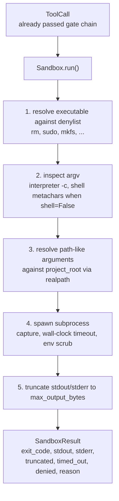
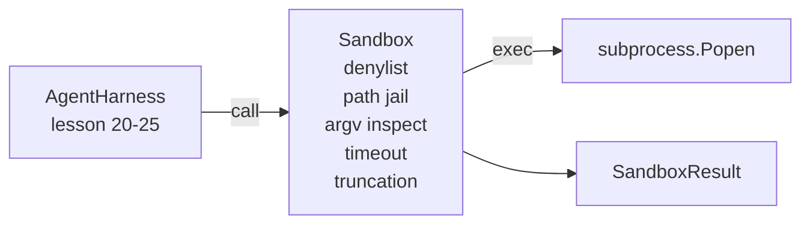

# Capstone 第 26 课:带 Denylist 与 Path Jail de Sandbox Runner

> La puerta de verificación decide una llamada de herramienta si debería funcionar. La caja de arena decide qué ocurrirá cuando se ejecute. Este curso proporciona un subprocesador, que rechazará ejecutables peligrosos, rechazará formas de argv peligrosas, limitará cada ruta de archivo a la raíz del proyecto, cortará las grandes salidas y matará los procesos fugitivos en el tiempo límite de tiempo del reloj de la pared.

**Type:** Build
**Languages:** Python (stdlib)
**Prerequisites:** Phase 19 · 25（verification gates and observation budget），Phase 14 · 33（instructions as constraints），Phase 14 · 38（verification gates）
**Time:** ~90 minutes

## Objetivos de aprendizaje

-  Construir un paquete `subprocess.run`de la `Sandbox`clase,带有时间out, captura y truncation.
- 按名称通过 denylist、按结构通过 argv inspector 拒绝命令──
-  Rechazar cualquier argumento de ruta fuera de la raíz del proyecto  de resolución hasta la declaración
- En modo shell 关闭时拒绝 shell metacaracteres。
-                                                                                                                                                                                                                                                                                                                                                                                                                                                                                                                              `SandboxResult`, , , , , , , , , , , , , , , , , , , , , , , , , , , , , , , , , , , , , , , , , , , , , , , , , , , , , , , , , , , , , , , , , , , , , , , , , , , , , , , , , , , , , , , , , , , , , , , , , , , , , , , , , , , , , , , , , , , , , , , , , , , , , , , , , , , , , , , , , , , , , , , , , , , , , , , , , , , , , , , , , , , , , , , , , , , , , , , , , , , , , , , , , , , , , , , , , , , , , , , , , , , , , , , , , , , , , , , , , , , , , , , , , , , , , , , , , , , , , , , , , , , , , , , , , , , , , , , , , , , , , , , , , , , , , , , , , , , , , , y , , y , , y , , , y , , y , , y , , y , , , y , , y , , , y , , , y , , , y , , y , , y , , , y , y , , , , y , y , y , , y , y , y , , y , y , y , , , y , y , y , y , y , y , y , y , y , y , y , y , y , y , y , y , y , y , y , y , y , y , y , y , y , y , y , y , y , y , y , y , y , y , y , y , y , y , y , y , y , y , y , y , y , y , y , y , y , y , y , y , y , y , y , y , y , y , y , y , y , y , y , y , y , y , y , y , y , y , y , y , y , y , y , y , y , y

##  problemas

能够 shell out de un agente de codificación puede instalar en un turno las puertas traseras, las llaves de escape, los problemas en el ordenador portátil del desarrollador, y generar una factura en la nube.

Trazas de agentes 中反复出现三类失败──

Primero, los ejecutables peligrosos. Un intento de modelo en el camino de reparación.`sudo`¿Qué es esto?`chmod -R 777`¿Qué es esto?`rm -rf`¿Qué es esto?`mkfs`¿Qué es esto?`dd` Estos no pertenecen a la carrera de agentes.

El segundo tipo es el argumento de los trucos. Un acusado no puede usar el modelo de la concha, pasará por el intérprete.`python3 -c "import os; os.system('rm -rf /')"`¿Qué es esto?`bash -c '...'`¿Qué es esto?`node -e '...'`¿Qué es esto?`perl -e '...'`✿ Sandbox ✿ Necesita saber, cualquier cosa con algo parecido ✿`-c`La ejecución del intérprete de la bandera, en realidad es sólo un llamado de proyección de varios pasos.

El tercer tipo es el escape del camino.`./src/main.py`Pero lo he leído.`../../etc/passwd`◊ sandbox 会通过 `os.path.realpath`解析 cada argumento de camino,并断言其前, de modo que los restringirá en prisión 内──

Esta caja de arena no es un límite de seguridad en el sentido del sistema operativo. Un atacante firme que tiene la ejecución de código todavía puede escapar. Esta caja de arena es un barranco de tiempo de desarrollo: hace que los modos de falla comunes se vuelvan evidentes, y impide que el agente cause daño por simple falta de tiempo.

## 概念



Sandbox tiene cuatro ejes de rechazo: nombre, argv, camino, estructura, cada eje es la pura función de la llamada, ahora no hay un subproceso, sólo todos los ejes pasan después, el subproceso sólo va a desatarse.

`SandboxResult`Códigos de salida Utilize habitu例值:0 表示成功,非零表示失败,另外有三个哨码:denied (-100)、timed_out (-101) 和 truncated(código de salida 是真实值,同时设置旗)。下游课程会读取这个结构化结果,而不是解析 stderr。


```figure
cg-path-jail
```

## 架构



Denylist es el nombre de base ejecutable de los nombres de base.`/bin/rm`¿Qué es esto?`/usr/bin/rm`) todos resolverán hasta el mismo nombre básico.`-c`O `-e`开头的 argv 都会被拒绝──当电话 没有显然请求 shell 时, shell metacharacters(`;`¿Qué es esto?`|`¿Qué es esto?`&`¿Qué es esto?`>`¿Qué es esto?`<`Las piernas traseras`$()`) dará lugar a la negativa.

El camino de la cárcel es la parte más delicada.`project_root`Cualquier argumento que parezca un camino`/`O corresponde a los documentos existentes) todos pasarán`os.path.realpath`归一化,然后与项目根的真实路比较──如果解析后的目标不在根下,则拒绝──Symlink escape attempts(project root 中指向外部的 symlink) serán examinados realpath 阻止, en lugar de examinar字面路径──

## ¿Qué construirás?

                                                                                  `main.py`Además de una prueba, ahora mismo.

1. `SandboxResult`Dataclass:exit_code、stdout、stderr、truncated、timed_out、denied、reason、duration_ms。
2. `SandboxConfig`Dataclass:project_root、max_output_bytes、timeout_seconds、denylist、interpreter_block。
3. `Sandbox`clase:`run(argv, *, shell=False, cwd=None)` regresar `SandboxResult`¿Qué es eso?
4. 内部 ayudantes de rechazo:`_check_executable_denylist`¿Qué es esto?`_check_argv_interpreter`¿Qué es esto?`_check_shell_metachars`¿Qué es esto?`_check_path_jail`¿Qué es eso?
5. truncation de salida,带清晰的 `truncated`bandera y corriente capturada en el centro de la línea de marcador.
6. 底部 демо:一系列合法与对抗的电话―― cada llamada ciudad会显示其结果――

caja de arena 默认使用 `subprocess.run`且 `shell=False`¿Qué es esto?`capture_output=True`△ tiempo de espera del reloj de pared `timeout`argumentos;`TimeoutExpired`Cuando, Sandbox se reunirá con un grupo de proceso de asesinato y se formará un SandboxResultado.

## ¿Por qué no es una verdadera caja de arena?

El proceso de protección de la caja de arena no utiliza espacios de nombres, grupos, secuencias, gVisor, Firecracker o cualquier aislamiento a nivel de núcleo.

 Para los agentes de producción, necesitas superponerlos: en un recipiente de Docker no privilegiado, en un microVM, en una caja blanca de seguridad conocida, en una microVM, en una capabilidad de caída, en una base de proyecto, en una base de texto, en una base de texto, en una base de texto, en una base de texto, en una base de texto, en una base de texto, en una base de texto, en una base de texto, en una base de texto, en una base de texto, en una base de texto, en una base de texto, en una base de texto, en una base de texto, en una base de texto, en una base de texto, en una base de texto, en una base de texto, en una base de texto, en una base de texto, en una base de texto, en una base de texto, en una base de texto, en una base de texto, en una base de texto, en una base de datos, en una base de datos, en una base de datos, en una base de datos, en una base de datos, en una base de datos, en una base de datos, en una base de datos, en una base de datos, en una base de datos, en una base de datos, en una base de datos, en una base de datos, en el que se puede utilizar en una base de datos, en una base de datos, en una base de datos, en un sitio de datos, en un sitio de datos, en el que se puede utilizar en un sitio web, en un sitio de datos, en el que se puede utilizar en un sitio de datos, en el que se puede utilizar en un sitio de datos, en el que se puede utilizar en el mismo, en el que se puede utilizar en el mismo, en el que se puede utilizar en el mismo, en el mismo, en el que se puede utilizar en el mismo, en el mismo, en el que se puede utilizar en el mismo, en el mismo, en el que se puede utilizar en el mismo, en el mismo, en el que se puede utilizar en el mismo, en el mismo, en el mismo, en el que se puede utilizar en el mismo, en el mismo, en el mismo, en el que se, en el mismo, en el mismo, en el que se, en el mismo, en el que se, en el mismo, en el que se,

## 运行方式

```bash
cd phases/19-capstone-projects/26-sandbox-runner-denylist
python3 code/main.py
python3 -m pytest code/tests/ -v
```

Demo 会 crear un directorio temporal, poner en un archivo de datos, luego ejecutar un grupo de llamadas.`denied=True`Y razón de la caja de arenaResultado.`timed_out=True`❖ Truncation 会设置 `truncated=True`◊demo 会印结果的 JSON tabla,并以零退出──

## ¿Cómo se combina con el resto de la pista A?

Se trata de un programa de evaluación de la aplicación de la ley de acceso a la red de acceso a la red de acceso a la red de acceso a la red de acceso a la red de acceso a la red de acceso a la red de acceso a la red de acceso a la red de acceso a la red de acceso a la red de acceso a la red de acceso a la red de acceso a la red de acceso a la red de acceso a la red de acceso a la red de acceso a la red de acceso a la red de acceso a la red de acceso a la red de acceso a la red de acceso a la red de acceso a la red de acceso a la red de acceso a la red de acceso a la red de acceso a la red de acceso a la red de acceso a la red de acceso a la red de acceso a la red de acceso a la red de acceso a la red de acceso a la red de acceso a la red de acceso a la red de acceso a la red de acceso a la red de acceso a la red de acceso a la red de acceso a la red de acceso a la red de acceso a la red de acceso a la red de acceso a la red de acceso a la red de acceso a la red de acceso a la red de acceso a la red de acceso a la red de acceso a la red de acceso a la red de acceso a la red de acceso a la red de acceso a la red de acceso a la red de acceso a la red de acceso a la red de acceso a la red de acceso a la red de acceso a la red de acceso a la red de acceso a la red de acceso a la red de acceso a la red de acceso a la red de acceso a la red de acceso a la red de acceso a la red de acceso a la red de acceso a la red de acceso a la red de acceso a red de acceso a la red de acceso a la red de acceso a red de acceso a la red de acceso a la red de acceso a red de acceso a red de acceso a la red de acceso a la red de acceso a red de acceso a red de acceso a la red de acceso a red de acceso a red de acceso a red de red de red de red de red de red de red de red de red de red de red de red de red de red de red de red de red de red de red de red de red de red de red de red de red de red de red de red de red de red de red de`Sandbox.run`调用发出一个 `gen_ai.tool.execution`La demostración de los 29 de la clase de extremo a extremo se conectará a estos dos niveles.
