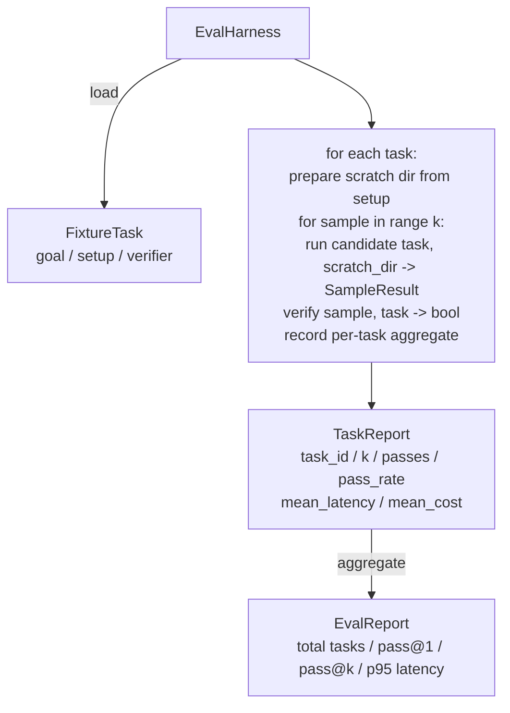

# Lección 27: 带 Fijación de tareas de Eval Harness

> El nivel de un agente de codificación depende de lo que utilices para medir su conjunto de tareas. Este curso construirá un arnés de evaluación: recibe una tarea fija.

**Type:** Build
**Languages:** Python (stdlib)
**Prerequisites:** Phase 19 · 25 (verification gates), Phase 19 · 26 (sandbox runner), Phase 14 · 30 (eval-driven agent development), Phase 14 · 19 (SWE-bench and GAIA benchmarks)
**Time:** ~90 minutes

## Objetivos de aprendizaje

- La tarea de fijación se define como meta, configuración y verificación de los tres grupos.
- Para cada tarea, varias veces se ejecuta una muestra 打分,并计算 pass@1 和 pass@k。
- La latencia y el costo se agrupan en la media con las métricas del 95o percentil.
- Se puede utilizar una función de control de datos de datos de datos de datos de datos de datos de datos de datos de datos de datos de datos de datos de datos de datos de datos de datos de datos de datos de datos de datos de datos de datos de datos de datos de datos de datos de datos de datos de datos de datos de datos de datos de datos de datos de datos de datos de datos de datos de datos de datos de datos de datos de datos de datos de datos de datos de datos de datos de datos de datos de datos de datos de datos de datos de datos de datos de datos de datos de datos de datos de datos de datos de datos de datos de datos de datos de datos de datos de datos de datos de datos de datos de datos de datos de datos de datos de datos de datos de datos de datos de datos de datos de datos de datos de datos de datos de datos de datos de datos de datos de datos de datos de datos de datos de datos de datos de datos de datos de datos de datos de datos de datos de datos de datos de datos de datos de datos de datos de datos de datos de datos de datos de datos de datos de datos de datos de datos de datos de datos de datos de datos de datos de datos de datos de datos de datos de datos de datos de datos de datos de datos de datos de datos de datos de datos de datos de datos de datos de datos de datos de datos de datos de datos de datos de datos de datos de datos de datos de datos de datos de datos de datos de datos de datos de datos de datos de datos de datos de datos de datos de datos de datos de datos de datos de datos de datos de datos de datos de datos de datos de datos de datos de datos de datos de datos de datos de datos de datos de datos de datos de datos de datos de datos de datos de cuyo de cuyo de cuyo cuyo cuyo cuyo cuyo cuyo cuyo cuyo cuyo cuyo cuyo cuyo cuyo cuyo cuyo cuyo cuyo cuyo cuyo cuyo cuyo cuyo cuyo cuyo cuyo cuyo cuyo cuyo cuyo cuyo cuyo cuya cuya cuya cuya cuya cuya cuya cuya cuya cuya cuya cuya cuya cuya cuya cuya cuya cuya cuya cuya cuya cuya cuya cuya cuya cuya cuya cuya cuya cuya cuya cuya cuya
- 输出结构化 JSON report,供回归跟踪脚本 摄取──

## El problema

 sin valorar el uso en los puntos de referencia de los agentes de construcción, se encontrará con tres tipos de fallas 

Primero, el agente dice que ha arreglado el error, humano, a un vistazo diferente, ya que el conjunto se etiquetó de color verde, tres semanas después de la prueba de regresión, se expone al mismo error.

El segundo tipo es la regresión no descubierta. Una vez que se cambia la plantilla de la plantilla, el agente aumenta el 4% en las tareas visibles, pero disminuye el 14% en las tareas en silencio.

El tercer tipo es el desplazamiento de tareas por tareas. El primero utiliza 100 tareas, el segundo sólo usa 95 de ellas, porque alguien ha cambiado el nombre de 5 fichas.

El sistema de control es un proceso que transforma estos fracasos en hechos. Cada vez se ejecuta en orden reproducible en cada fijación, y utiliza un verificador, que devuelve verdad o falsedad según la determinación.

## El concepto

```mermaid
flowchart LR
  F1[fixtures/task_001/<br/>task.json + expected/] --> Harness
  F2[fixtures/task_002/<br/>...] --> Harness
  Harness[Harness<br/>for each task:<br/>setup / run agent k samples /<br/>verify each sample /<br/>record latency, cost]
  Harness --> Report[EvalReport<br/>pass@1 / pass@k<br/>mean ms / p95 ms<br/>mean cost]
```

`FixtureTask`Es un pequeño archivo JSON, además de una opción.`expected/`¡ ¡ ¡ ¡ ¡ ¡ ¡ ¡ ¡ ¡ ¡ ¡ ¡ ¡ ¡ ¡ ¡ ¡ ¡ ¡ ¡ ¡ ¡ ¡ ¡ ¡ ¡ ¡ ¡ ¡ ¡ ¡ ¡ ¡ ¡ ¡ ¡ ¡ ¡ ¡ ¡ ¡ ¡ ¡ ¡ ¡ ¡ ¡ ¡ ¡ ¡ ¡ ¡ ¡ ¡ ¡ ¡ ¡ ¡ ¡ ¡ ¡ ¡ ¡ ¡ ¡ ¡ ¡ ¡ ¡ ¡ ¡ ¡ ¡ ¡ ¡ ¡ ¡ ¡ ¡ ¡ ¡ ¡ ¡ ¡ ¡ ¡ ¡ ¡ ¡ ¡ ¡ ¡ ¡ ¡ ¡ ¡ ¡ ¡ ¡ ¡ ¡ ¡ ¡ ¡ ¡ ¡ ¡ ¡ ¡ ¡ ¡ ¡ ¡ ¡ ¡ ¡ ¡ ¡ ¡ ¡ ¡ ¡ ¡ ¡ ¡ ¡ ¡ ¡ ¡ ¡ ¡ ¡ ¡ ¡ ¡ ¡ ¡ ¡ ¡ ¡ ¡ ¡ ¡ ¡ ¡ ¡ ¡ ¡ ¡ ¡ ¡ ¡ ¡ ¡ ¡ ¡ ¡ ¡ ¡ ¡ ¡ ¡ ¡ ¡ ¡ ¡ ¡ ¡ ¡ ¡ ¡ ¡ ¡ ¡ ¡ ¡ ¡ ¡ ¡ ¡ ¡ ¡ ¡ ¡ ¡ ¡ ¡ ¡ ¡ ¡ ¡ ¡ ¡ ¡ ¡ ¡ ¡ ¡ ¡ ¡ ¡ ¡ ¡ ¡ ¡ ¡ ¡ ¡ ¡ ¡ ¡ ¡ ¡ ¡ ¡ ¡ ¡ ¡ ¡ ¡ ¡ ¡ ¡ ¡ ¡ ¡ ¡ ¡ ¡ ¡ ¡ ¡ ¡ ¡ ¡ ¡ ¡ ¡ ¡ ¡ ¡ ¡ ¡ ¡ ¡ ¡ ¡ ¡ ¡ ¡ ¡ ¡ ¡ ¡ ¡ ¡ ¡ ¡ ¡ ¡ ¡ ¡ ¡ ¡ ¡ ¡ ¡ ¡ ¡ ¡ ¡ ¡ ¡ ¡ ¡ ¡ ¡ ¡ ¡ ¡ ¡ ¡ ¡ ¡ ¡ ¡ ¡ ¡ ¡ ¡ ¡ ¡ ¡ ¡ ¡ ¡ ¡ ¡ ¡ ¡ ¡ ¡ ¡ ¡ ¡ ¡ ¡ ¡ ¡ ¡ ¡ ¡ ¡ ¡ ¡ ¡ ¡ ¡ ¡ ¡ ¡ ¡ ¡ ¡ ¡ ¡ ¡ ¡ ¡ ¡ ¡ ¡ ¡ ¡ ¡ ¡ ¡ ¡ ¡ ¡ ¡ ¡ ¡ ¡ ¡ ¡ ¡ ¡ ¡ ¡ ¡ ¡ ¡ ¡ ¡ ¡ ¡ ¡ ¡ ¡ ¡ ¡ ¡ ¡ ¡ ¡ ¡ ¡ ¡ ¡ ¡ ¡ ¡ ¡ ¡ ¡ ¡ ¡ ¡ ¡ ¡ ¡ ¡ ¡ ¡ ¡ ¡ ¡ ¡ ¡ ¡ ¡ ¡ ¡ ¡ ¡ ¡ ¡ ¡ ¡ ¡ ¡ ¡ ¡ ¡ ¡ ¡ ¡ ¡ ¡ ¡ ¡ ¡ ¡ ¡ ¡ ¡ ¡ ¡ ¡ ¡ ¡ ¡ ¡ ¡ ¡ ¡ ¡ ¡ ¡ ¡ ¡ ¡ ¡ ¡ ¡ ¡ ¡ ¡ ¡ ¡ ¡ ¡ ¡ ¡ ¡ ¡ ¡ ¡ ¡ ¡ ¡ ¡ ¡ ¡ ¡ ¡ ¡ ¡ ¡ ¡ ¡ ¡ ¡ ¡ ¡ ¡ ¡ ¡ ¡ ¡ ¡ ¡ ¡ ¡ ¡ ¡ ¡ ¡ ¡ ¡ ¡ ¡ ¡ ¡ ¡ ¡ ¡ ¡ ¡ ¡ ¡ ¡ ¡ ¡ ¡ ¡ ¡ ¡ ¡ ¡ ¡ ¡ ¡ ¡ ¡ ¡ ¡ ¡`id`¿Qué es esto?`goal`(给代理的提示)`setup`块(要放入划分 dir 的文件) así como `verifier`块──verifier 块指定 harness 块指定 harness 块指定 harness 块指定 harness 块指定 harness 块指定 harness 块指定 harness 块指定 harness 块指定 harness 块指定 harness 块指定 harness 块指定 harness 块指定 harness 块指定 harness 块指定 harness 块指定 harness 块指定 harness 块指定 harness 块指定 harness 块指定 harness 块指定 harness 块指定 harness 块指定 harness 块指定 harness 块 块指定 harness 块 块指定 harness 块 块 块指定 harness 块 块 块 块指定 harness 块 块 块 块 块 块 块 块 块 块 块 块 块 块 块 块 块 块 块 块 块 块 块 块 块 块 块 块 块 块 块 块 块 块 块 块 块 块 块 块 块 块 块 块 块 块 块 块 块 块 块 块 块 块 块 指定 harness 块 块 块 块 块 块 块 块 块 块 块 块 块 块 块 块 块 块 块 块 块 块 块 块 块 块 块 块 指定 harness 块 块 块 块 块 块 块 块 块 块 块 块 块 块 块 块 块 块 块 块 块 块 块 块 块 指定 harness 块 块 块 块 块 块 块 块 块 块 块 函数 函数 函数 函数 函数 函 函 函 函 函 函 函 函 函 函 函 函 函 函 函 函 函 函 函 函 函 函 函 函 函 函 函 函 函 函 函 函 函 函 函 函 函 函 函 函 函 函 函

Tres tipos de verificador 形态覆盖大多数有用任务――

La primera es:`file_equals` Agente  Después de la ejecución, se determinará el archivo con el contenido esperado comparar .

La segunda es:`regex_match`                                                                                                                                                                                                                                                              

¿ Qué es eso ?`shell_exit_zero` harness 运行一个 shell command (en inglés)  通过课26的沙盒), sólo cuando la orden es cero 退出时才让任务通过──

Harness va a ejecutar cada tarea`k`Siguiente: Pas@k `1 - (1 - p)^k`, entre ellos p es la tasa de pasa de experiencia;harness también reportar recuentos crudos, facilita la detección de variaciones;.Latencia es el reloj de pared de cada muestra;.Costo es el contenido del informe automático del agente.

```figure
pass-at-k
```

## Arquitectura



El candidato es un llamado:`Callable[[FixtureTask, str], SampleResult]` El arnés                                                                                                                                                                                                                                                                                                                                                                                                                                                                                                                         `tempfile.mkdtemp()`创建草图目录,并把其路径作为普通字符串传入──harness 不关心候选人 如何工作──候选人 可以是确定性的补丁申请人(对 harness自测 很有用) 、真实LLM agent、fuzzer──契约是 SampleResult──

## Lo que construirás

`main.py`提供:

1. `FixtureTask`clase de datos
2. `SampleResult`Dataclass:success_self_reported、latency_ms、cost_units、edits。
3. 带 `to_dict()`de la `TaskReport`¿Qué es esto?`EvalReport`Las clases de datos
4. 将 verificador nombre 映射到 función de `VerifierRegistry` Verificadores de configuración:files_equals、regex_match、shell_exit_zero。
5. `EvalHarness`clase── con un candidato 运行一个任务目录──返回 EvalReport──
6. 捆绑在                                                                                                                                                                                                                                                                                                                                                                                                                                                                                                                          `tasks/`En el centro de las cinco tareas fijas:
   - `fizzbuzz`En el centro de la salida por uno
   - `factorial`- Reto de la falta
   - Mensaje de error
   - 空 cuerpo de función
   - Enlace de lista de cruce de la lista de cruces de la lista de cruces de la lista de cruces de la lista de cruces de la lista de cruces de la lista de cruces de la lista de cruces de cruces de la lista de cruces de cruces de cruces de cruces de cruces de cruces de cruces de cruces de cruces de cruces de cruces de cruces de cruces de cruces de cruces de cruces de cruces de cruces de cruces de cruces de cruces de cruces de cruces de cruces de cruces de cruces de cruces de cruces de cruces de cruces de cruces de cruces de cruces de cruces de cruces de cruces de cruces de cruces de cruces de cruces de cruces de cruces de cruces de cruces de cruces de cruces de cruces de cruces de cruces de cruces de cruces de cruces de cruces de cruces de cruces de cruces de cruces de cruces de cruces de cruces de cruces de cruces de cruces de cruces de cruces de cruces de cruces de cruces de cruces de cruces de cruces de cruces de cruces de cruces de cruces de cruces de cruces de cruces de cruces de cruces de cruces de cruces de cruces de cruces de cruces de cruces de cruces de cruces de cruces de cruces de cruces de cruces de cruces de cruces de cruces de cruces de cruces de cruces de cruces de cruces de cruces de cruces de cruces de cruces de cruces de cruces de cruces de cruces de cruces de cruces de cruces de cruces de cruces de cruces de cruces de cruces de cruces de cruces de cruces de cruces de cruces de cruces de cruces de cruces de cruces de cruces de cruces de cruces de cruces de cruces de cruces de cruces de cruces de cruces de cruces de cruces de cruces de cruces de cruces de cruces de cruces de cruces de cruces de cruces de cruces de cruces de cruces de cruces de cruces de cruces de cruces de cru
7. Un candidato de referencia de determinación`apply_known_fixes`),harness Usando el mismo, se muestra el pasaje de la base@1 = 1.0
8. Demo 打印 EvalReport JSON y no a cero 退出。

tareas de fijación 以 `tasks/`En el formato de archivo JSON, está enlazado, y está enlazado.`tasks/<id>/buggy/`Y `tasks/<id>/expected/`En el caso de los equipos de la empresa, el equipo de la empresa de la empresa de la empresa de la empresa de la empresa de la empresa de la empresa de la empresa de la empresa de la empresa de la empresa de la empresa de la empresa de la empresa de la empresa de la empresa de la empresa de la empresa de la empresa de la empresa de la empresa de la empresa de la empresa de la empresa de la empresa de la empresa de la empresa de la empresa de la marca de la marca de la marca de la marca de la marca de la marca de la marca de la marca de la marca de la marca de la marca de la marca de la marca de la marca de la marca de la marca de la marca de la marca de la marca de la marca de la marca de la marca de la marca de la marca de la marca de la marca de la marca de la marca de la marca de la marca de la marca de la marca de la marca de la marca de la marca de la marca de la marca de la marca de la marca de la marca de la marca de la marca de la marca de la marca de la marca de la marca de la marca de la marca de la marca de la marca de la marca de la marca de la marca de la marca de la marca de la marca de la marca de la marca de la marca de la marca de la marca de la marca de la marca de la marca de la marca de la marca de la marca de la marca de la marca de la marca de la marca de la marca de la marca de la marca de la marca de la marca de la marca de la marca de la marca de la marca de la marca de la marca de la marca de la marca de la marca de la marca de la marca de la marca de la marca de la marca de la marca de la marca de la marca de la marca de la marca de la marca de la marca de la marca de la marca de la marca de la marca de la marca de la marca de la marca de la marca de la marca de la marca de marca de la marca de la marca de la marca de la marca de marca de la marca de la marca de la marca de la marca de la marca de la marca de la marca de marca de la marca de la marca de marca de la marca de la marca de marca de la marca de la marca de la marca de la marca de la marca de la marca de la marca de marca de la marca de marca de marca de la marca de la marca de la

## ¿Por qué usar pas@k, no sólo pas@1

Los agentes de LLM verdaderos son de forma casual. Pases de 1 a 0.6 parecen fracasos. Pases de 5 a 0.95 indican que los agentes de la mayoría de las veces pueden obtener la respuesta correcta, pero en las primeras muestras, los resultados son más positivos.

Pass@k 会和 pass@1 一起报告,因为 pass@k 会掩盖真实失败: si el modelo 二十次里 sólo una vez obtiene la respuesta correcta, usted no tiene un agente útil.

## ¿Cómo se combina con el resto de la pista A?

Lección 25 产出门链――Leyción 26 产出沙箱――harness对任何`shell_exit_zero`Verificador Utiliza sandbox。Leyón 28 会把每次 harness run 包进 OTel trace。Leyón 29 针对其中一个捆绑的固定 运行端到端演示,并断言参考候选人的 pass@1 = 1.0。

## 运行方式

```bash
cd phases/19-capstone-projects/27-eval-harness-fixture-tasks
python3 code/main.py
python3 -m pytest code/tests/ -v
```

demo 以 JSON 打印 EvalReport, incluye pass@1、pass@5、media latencia 和逐任务 breakdown──exit code 为零──tests 覆盖 verifier functions、pass@k math、fixture loading,以及 harness 针对捆绑参考候选人的端到端 行为──
