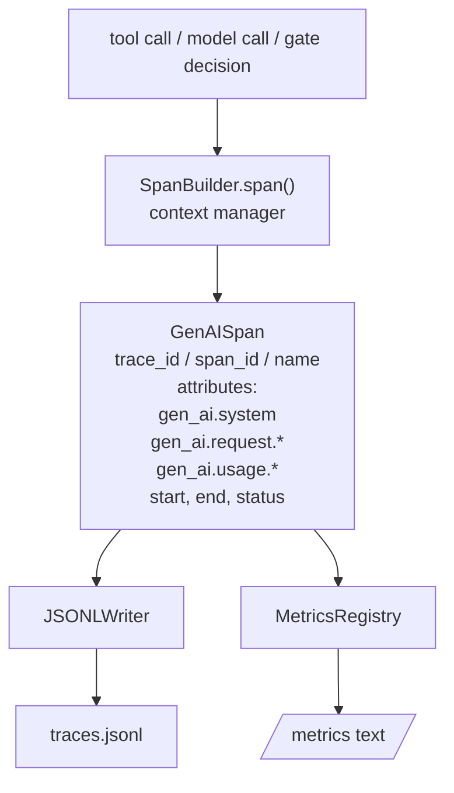
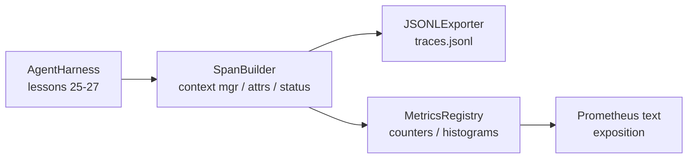

# Capstone Lección 28: Utiliza OTel GenAI Spans y Prometheus Metrics  lograr la observabilidad

> 无可观察的代理harness 是一个会花钱的黑盒──本课会手写一个跨度构造商,发发出符合OpenTelemetry GenAI semántica convenciones de registros,把它们写入JSON-Lines文件,每行一个跨度,并以Prometheus text format 暴露计和 histograms──整个实现都是Stdlib Python,并且可离线运行──

**Type:** Build
**Languages:** Python (stdlib)
**Prerequisites:** Phase 19 · 25 (verification gates), Phase 19 · 26 (sandbox), Phase 19 · 27 (eval harness), Phase 13 · 20 (OpenTelemetry GenAI), Phase 14 · 23 (OTel GenAI conventions)
**Time:** ~90 minutes

## Objetivos de aprendizaje

- 构建一个符合OpenTelemetry GenAI semánticas convenciones 形态的跨度数据类──
- 实现 un exportador JSONL, cada línea de escritura entra en un espacio de autocontenido.
- 构建带标签 和 Prometheus text-format exposition counters 与 histograms──
- Us span context manager 包装 arbitrario llamadas, registro de duración、estatus y excepciones。
- 验证 emitidos de extensiones 可通过 `json.loads`viaje de ida y vuelta,并匹配 especificación de forma.

## El problema

Cada ciclo de producción de un agente de codificación produce tres tipos de artefactos: una llamada de modelo, una ejecución de herramientas, así como una decisión de puerta de verificación.

Primero, el modelo de fracaso es el rastro perdido. Pero el único registro es un registro de chat de 500 páginas. No hay registro de qué herramienta se ejecuta.

Segundo tipo de modelo de fracaso es un rastro imperceptible. Harness escribió extensiones, pero utilizó sus propios nombres de campo ad hoc. Grafana, Honeycomb, Jaeger o CLI locales están en el juego.

El tercer tipo de modelo de fracaso es una métrica no agregada. Puedes ver una llamada de herramienta muy lenta en el rastro, pero no puedes responder a las llamadas de p95 de las llamadas de archivo de lectura en el último minuto. ¿Cuánto tiempo tardó en hacerlas?

Las convenciones semánticas de la GenAI de OpenTelemetry están ahí para que existan. Las convenciones definen un grupo de atributos estándar, para que los emisores de los diferentes marcos de LLM puedan compartirlos.

## El concepto



Cada operación en el arnés produce un span. span. span. tiene un ID de rastro.`gen_ai.chat`¿Qué es esto?`gen_ai.tool.execution`)、 seguir los atributos de las convenciones de la GenAI、el tiempo de inicio y final, así como el estado¬¬¬¬¬¬¬¬¬¬¬¬¬¬¬¬¬¬¬¬¬¬¬¬¬

Las convenciones de GenAI han estandarizado estas claves de atributos:`gen_ai.system`(¿Qué proveedor, por ejemplo `anthropic`¿Qué es esto?`openai`)`gen_ai.request.model`(identificación del modelo)`gen_ai.request.max_tokens`¿Qué es esto?`gen_ai.usage.input_tokens`¿Qué es esto?`gen_ai.usage.output_tokens`¿Qué es esto?`gen_ai.response.model`¿Qué es esto?`gen_ai.response.id`¿Qué es esto?`gen_ai.operation.name`, así como claves específicas de las herramientas `gen_ai.tool.name`Y `gen_ai.tool.call.id`¿Qué es eso?

exportador escribir JSONL。 para cada línea de un objeto JSON。 es un herramienta de descarga, captura y importación más simple de todo el mundo.

Metricas y rastros no están presentes. Cada llamada de herramienta se hace en un contador:`tools_called_total{tool="read_file"}`◊histograma 记录观察到的延迟:`tool_latency_ms{tool="read_file"}`◊ los dos tipos de datos se clasifican en formato de exposición de texto Prometheus, esto es el estándar de hecho de las métricas basadas en la atracción.

## Arquitectura



Es una clase pequeña, con un gran número de personas.`span(name, attrs)`método, regresar a un gestor de contexto. El gestor de contexto en el momento de ingresar 记录 start time, en el momento de salir 记录 end time, si se lanza una excepción, se añade esta excepción, y se remite a un exportador.

El registro de métricas es dos dicts.`{(name, frozen_labels): int}` Histogramas almacenar muestras crudas en la lista de existencias y en la exposición 时序列化为Prometeus histogram buckets──

## Lo que construirás

`main.py`提供:

1. `GenAISpan`Dataclass:trace_id、span_id、parent_span_id、nombre、atributos、start_unix_nano、end_unix_nano、status、status_message、events。
2. 带 `span(name, attrs, parent=None)`gerente de contexto `SpanBuilder`clase.
3. 带 `export(span)`de la `JSONLExporter`clase, adicional escribir en una línea.
4. `Counter`Y `Histogram`clases, así como`MetricsRegistry`¿Qué es eso?
5. 生成 formato de texto de salida de `prometheus_exposition(registry)`¿Qué es eso?
6. 发发发期并更新的 métricas `wrap_tool_call(name)`decoratora.
7. Demo: sintetizada una vez completa invocación de agente (extra-level-包 gen_ai.chat span),写入 traces.jsonl,打印 Prometheus exposición,并以零 退出。

span id 和 trace id es una cadena hex de 16 bytes, por `os.urandom`生成── esto se ajusta al contexto de rastreo de OTel en el W3C──exportador 永不抛出; errores IO 会被浮现, pero el arnés 会继续运行──

Histograma tiene un grupo de cubo fijo(OTel para el valor predeterminado de latencia de milisegundos: 5、10、25、50、100、250、500、1000、2500、5000、10000、+Inf)  Muestras de la lista 保存; exposición 会按需计算每个桶的数量──

## ¿Por qué escribir a mano, en lugar de usar opentelemetry-sdk

OTel Python SDK es una verdadera dependencia. También tiene miles de líneas de código, varios procesos de OTLP exportador, así como se inundará de un porción del presupuesto de la clase de costo de ejecución.

Las convenciones son estables. El formato de cable emitido por este curso seguirá siendo resuelto hasta el año 2030, ya que OTel no destruye los nombres de atributos de GenAI; sólo añadirán nuevos nombres.

## ¿Cómo se combina con el resto de la pista A?

Lección 25 producido cadena de puertas。Lección 26 producido sandbox。Lección 27 producido valoración harness。Lección 28 让这三者都可观测。Lección 29 会把端到端演示的每一步都包进跨度,并在最后打印 Prometheus text。

## 运行方式

```bash
cd phases/19-capstone-projects/28-observability-otel-traces
python3 code/main.py
python3 -m pytest code/tests/ -v
```

Demo reunión en el trabajo de esta clase en el medio de lanzar un `traces.jsonl`(最后清理), luego imprimir tres períodos de muestra, volver a imprimir contadores y histogramas de exposición Prometheus;; pruebas 验证 períodos de viaje de ida y vuelta 序列化、canonical GenAI atributos 存在、counter 正确递增, y la exposición del histograma 包含预期桶 counts。

```figure
trace-spans
```
