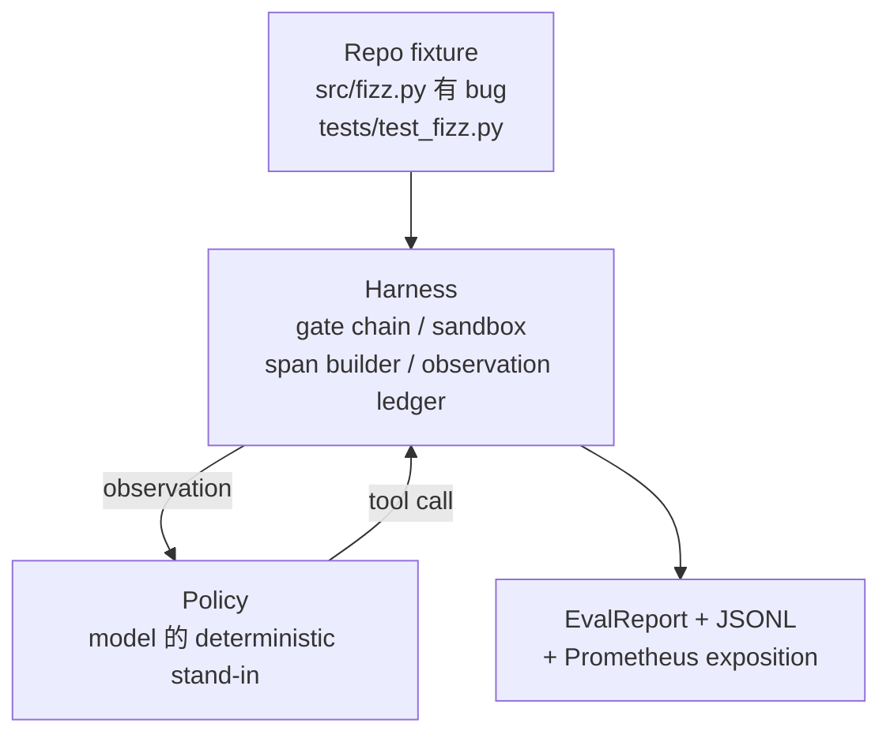
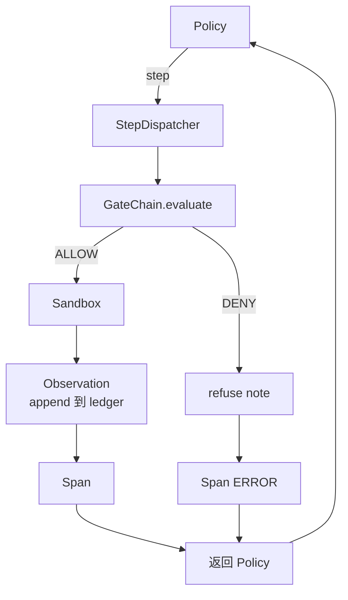

# Capstone  curso 29: Harness Upper End to End Agente de codificación

> Tracking A's results──本课程把门链、沙盒、eval harness 和 OTel spans 串连成一个可工作的编码代理,用来修复一个多文件Python项目中真实的(小型固定规模)bug──这个代理是确定性政策,不是LLM;这个替换让课程可复现,并说明 harness 才始终是最关键部分──合同 完全相同:真实模型可以插入政策──

**Type:** Build
**Languages:** Python (stdlib)
**Prerequisites:** Phase 19 · 25 (verification gates), Phase 19 · 26 (sandbox), Phase 19 · 27 (eval harness), Phase 19 · 28 (observability), Phase 14 · 38 (verification gates), Phase 14 · 41 (workbench for real repos), Phase 14 · 42 (agent workbench capstone)
**Time:** ~90 minutes

## Objetivos de aprendizaje

- La cadena de la puerta, la caja de arena, el arnés y el constructor de espacios, un único bucle de agentes.
- 实现一个使用 read_file、run_tests 和 write_file 修复 fixture bug 的决定主义政策──
- En un tiempo de ejecución de un proyecto de ley y un proyecto de ley de observación,
- Para completar el funcionamiento, lanzará los rastros de OTEL y Prometheus.
- Agente de verificación en menos de 12 pasos dentro de resolver el fijo, y herramientas legales.

## El problema

La mayoría de las demostraciones de agentes son de trabajo aislado: un único armazón de arena, un único arnés de evaluación, un único emisor de espacio de tiempo.

La cadena de puertas  otorgó permiso, pero sandbox Porque la cadena  no se espera que la causa rechazó  Evall Harness  Record Pass, pero OTel span  Muestra puerta  rechazó el agente  Clasificando el uso de herramientas  Prometheus counter Este debería aumentar una vez, pero aumentó dos veces ✿ Presupuesto de observación  Ya ha superado, pero el agente  Continuar a funcionar, porque el presupuesto sólo está en la cadena de rastreo, mientras que sandbox 不知道。

Este curso es una prueba de integración de toda la pista. El agente debe completar cuatro cosas en orden: leer proyectos, ejecutar pruebas, salir de la prueba, identificar errores, escribir y volver a ejecutar pruebas, y luego detenerse. Cada operación pasa por la cadena de puertas. Cada ejecución de herramientas pasa por la caja de arena.

## El concepto



La política del agente es una máquina estatal.

`SURVEY`:agent 读取 proyecto listing──下一个状态是RUN_TESTS──

`RUN_TESTS`Si las pruebas pasan, la máquina de estado 以 éxito 停止──否则下一个状态 是 INSPECT──

`INSPECT`:agent 读取失败的源文件──下一个状态是FIX──

`FIX`:agent 写入修正后的文件──下一个状态是 VERIFY──

`VERIFY`:agent Repeat operation test command──si las pruebas pasan, entonces detenga el éxito──si no, detenga con el fracaso──

Cada estado ha respondido a una llamada de herramienta. Cada llamada de herramienta ha pasado por la cadena de puertas. Si una llamada de herramienta es rechazada, el agente se encuentra en el rastro.

error de fijación `fizz.py`Por medio de regex del mensaje de falla de prueba, el sistema de control de la prueba de la prueba de prueba de prueba de prueba de prueba de prueba de prueba de prueba de prueba de prueba de prueba de prueba de prueba de prueba de prueba de prueba de prueba de prueba de prueba de prueba de prueba de prueba de prueba de prueba de prueba de prueba de prueba de prueba de prueba de prueba de prueba de prueba de prueba de prueba de prueba de prueba de prueba de prueba de prueba de prueba de prueba de prueba de prueba de prueba de prueba de prueba de prueba de prueba de prueba de prueba de prueba de prueba de prueba de prueba de prueba de prueba de prueba de prueba de prueba de prueba de prueba de prueba de prueba de prueba de prueba de prueba de prueba de prueba de prueba de prueba de prueba de prueba de prueba de prueba de prueba de prueba de prueba de prueba de prueba de prueba de prueba de prueba de prueba de prueba de prueba de prueba de prueba de prueba de prueba de prueba de prueba de prueba de prueba de prueba de prueba de prueba de prueba de prueba de prueba de prueba de prueba de prueba de prueba de prueba de prueba de prueba de prueba de prueba de prueba de prueba de prueba de prueba de prueba de prueba de prueba de prueba de prueba de prueba de prueba de prueba de prueba de prueba de prueba de prueba de prueba de prueba de prueba de prueba de prueba de prueba de prueba de prueba de prueba de prueba de prueba de prueba de prueba de prueba de prueba de prueba de prueba de prueba de prueba de prueba de prueba de prueba de prueba de prueba de prueba de prueba de prueba de prueba de prueba de prueba de prueba de prueba de prueba de prueba de prueba de prueba de prueba de prueba de prueba de prueba de prueba de prueba de prueba de prueba de prueba de prueba de prueba de prueba de prueba de prueba de prueba de prueba de prueba de prueba de prueba de prueba de prueba de prueba de prueba de prueba de prueba de prueba de prueba de prueba de prueba de prueba de prueba de prueba de prueba de prueba de prueba de prueba de prueba de prueba de prueba de prueba de prueba de prueba de prueba de prueba de prueba de prueba de prueba de prueba de prueba de prueba de prueba de prueba de prueba de prueba de prueba de prueba de prueba de prueba de prueba de prueba de prueba de prueba de prueba de prueba de prueba de prueba de prueba de prueba de prueba de prueba de prueba de prueba de prueba de prueba de prueba de prueba de prueba de prueba de prueba de prueba de prueba de prueba de prueba de prueba de prueba


```figure
cg-harness-weave
```

## Arquitectura



Este curso es autocontenido. Cada lección previa primitiva está en la ciudad.`main.py`En el caso de las clases de la escuela de la escuela de la escuela de la escuela de la escuela de la escuela de la escuela de la escuela de la escuela de la escuela de la escuela de la escuela de la escuela de la escuela de la escuela de la escuela de la escuela de la escuela de la escuela de la escuela de la escuela de la escuela de la escuela de la escuela de la escuela de la escuela de la escuela de la escuela de la escuela de la escuela de la escuela de la escuela de la escuela de la escuela de la escuela de la escuela de la escuela de la escuela de la escuela de la escuela de la escuela de la escuela de la escuela de la escuela de la escuela de la escuela de la escuela de la escuela de la escuela de la escuela de la escuela de la escuela de la escuela de la escuela de la escuela de la escuela de la escuela de la escuela de la escuela de la escuela de la escuela de la escuela de la escuela de la escuela de la escuela de la escuela de la escuela de la escuela de la escuela de la escuela de la escuela de la escuela de la escuela de la escuela de la escuela de la escuela de la escuela de la escuela de la escuela de la escuela de la escuela de la escuela de la escuela de la escuela de la escuela de la escuela de la escuela de la escuela de la escuela de la escuela de la escuela de la escuela de la escuela de la escuela de la escuela de la escuela de la escuela de la escuela de la escuela de la escuela de la escuela de la escuela de la escuela de la escuela de la escuela de la escuela de la escuela de la escuela de la escuela de la escuela de la escuela de la escuela de la escuela de la escuela de la escuela de la escuela de la escuela de la escuela de la escuela de la escuela de la escuela de la escuela de la escuela de la escuela de la escuela de la escuela de la escuela de la escuela de la escuela de la escuela de la escuela de la escuela de la escuela de la escuela de la escuela de la escuela de la escuela de la escuela de la escuela de la escuela de la escuela de la escuela de la escuela de la escuela de la escuela de la escuela de la escuela de la escuela de la escuela de la escuela de la escuela de la escuela de la escuela de la escuela de la escuela de la escuela de la escuela de la escuela de la escuela de la escuela de la escuela de la escuela de la escuela de la escuela de la escuela de la escuela de la escuela de la escuela

## Lo que construirás

`main.py`提供:

1. Último arnés primitivos, nombre y lecciones 25-28 相同:`GateChain`¿Qué es esto?`Sandbox`¿Qué es esto?`ObservationLedger`¿Qué es esto?`SpanBuilder`¿Qué es esto?`MetricsRegistry`¿Qué es eso?
2. `CodingAgentPolicy`clase: contendrá cinco estados de la máquina estatal.
3. `Repo`Help: Preparar un rasguño, incluyendo un paquete de fijación de buggy.
4. `AgentRun`clase: política de accionamiento, a través del envío de arnés,并返回 `AgentRunReport`¿Qué es eso?
5. Una fijación en paquete`fixture_repo/`), incluye src/fizz.py、tests/test_fizz.py, así como el árbol/esperado/para el uso de eval harness.
6. Demo: de un lado a otro de la política de ejecución, imprimir rastro a paso, hacer un pase,并印测量──

La estructura de tareas de la lección 27 tiene la misma forma: un archivo de errores y un archivo de pruebas. El mensaje de falla del test contiene suficiente información, permita que la política determinista pueda identificarse.

## ¿Por qué la política no es LLM

El verdadero LLM  necesita API clave  llamada de red, así como la estocástica de la imposibilidad de comprobar  la capacidad  es sólo parte del interés de este curso  la sustitución por una política determinista  permite que el curso se ejecute en cualquier ordenador portátil de desarrollador  la dependencia externa  la composición de la suite de pruebas  el cálculo de los pasos precisos 

Política del curso es el agente de LLM que hace las cosas en el trabajo. Política: leer el reporte, ver la prueba fallida, identificar la tendencia, y luego emitir una corrección.

## ¿Qué dice el demo ?

端到端 demo 在退出时断言五件事,test suite también volverá a afirmarlos de manera programada.

La política en menos de 12 pasos en resolver el fijo.

Presupuesto de observación 从未超出──

Las herramientas legales han provocado la negación de la puerta de entrada.

Traces.jsonl En cada paso hay un rango de respuesta.

La exposición de Prometeo contiene una`tools_called_total{tool="read_file"}`Entrada y una `tool_latency_ms`Histograma

## ¿Cómo se combina con el resto de la pista A?

Lección 27  redactó el valor de la evaluación arnés。 Lección 28  redactó observabilidad。 Lección 29  prueba que son un sistema puede trabajar。 real agente arnés 从这里扩展:把确定性政策 换成模型,把捆绑的固定 换成实例任务,把 JSONL exporter 换成 OTLP。

## 运行方式

```bash
cd phases/19-capstone-projects/29-end-to-end-coding-task-demo
python3 code/main.py
python3 -m pytest code/tests/ -v
```

demo 会打印 per-step trace、final evalu report 和 Prometheus exposition──退出码为零──tes 覆盖政策状态转变、synthetic tool calls 上的 gate rejections、bundled fix 上的 end-to-end run,以及 step-budget invariants──
