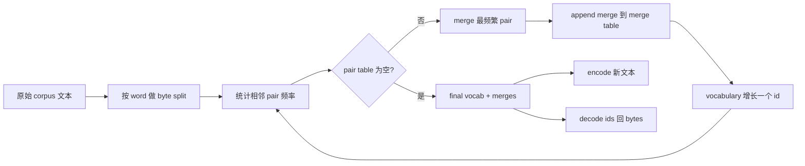
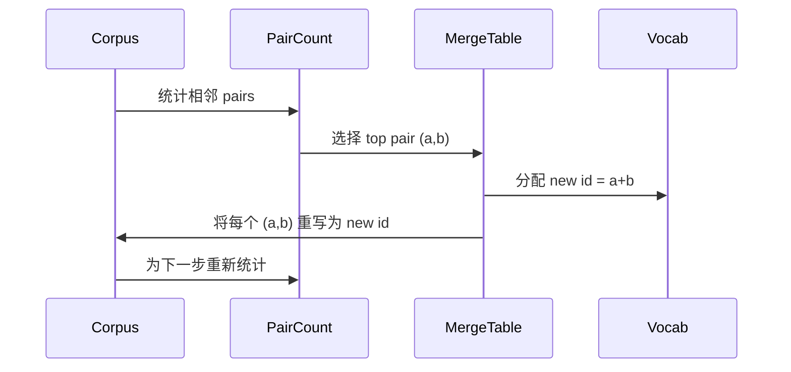

# Desde零 construcción de BPE Tokenizer

> 字节进, 出, 出, 字节 再回到相同字节──构建每个现代文本模型仍然起步于此的Tokenizer──

**Type:** Build
**Languages:** Python
**Prerequisites:** Phase 04 lessons, Phase 07 transformer lessons
**Time:** ~90 minutes

## Objetivos de aprendizaje
- 通过反复 merge 最频繁的相邻符号对, desde el corpus de texto original 训练 Byte-Pair Encoding vocabulario。
- 实现 deterministic merge table,并将其应用到新文本上, generar ids de subpalabra 流──
- Se puede utilizar un sistema de datos de datos de UTF-8 para obtener información de forma automática.
- 保留并保护 tokens especiales`<|endoftext|>`¿Qué es esto?`<|pad|>`), que puedan mantenerse inalteradas durante el entrenamiento y la descodificación.
- 推理为什么字节级字母是通用Tokenizer的正确下限──


```figure
cap-bpe-merge
```

## El marco

El modelo de lenguaje 永远看不到文本―― se ve en números enteros―把 string 映射为整数列并再映射回来的东西,就是Tokenizer―这个层做错了,训练运行中每条损失曲线都在衡量错误的东西―

La palabra Tokenizers Familia es Byte-Pair Encoding──idea muy pequeña── desde un alfabeto conocido 开始── encontrar el par de símbolos vecinos más frecuente en el cuerpo de entrenamiento──把它合并成一个新象征──重复,直到词汇 达到目标大小──编码 新文本会按同顺序复用相同的合并列──

Vamos a construir una variante a nivel de byte. El alfabeto es de 256 bytes crudos, en lugar de puntos de código Unicode. Esta opción permite que Tokenizer pueda procesar cualquier entrada de UTF-8, sin necesidad de retroceder hasta Token desconocido.

## El oleoducto



Si en la inferencia cambias el orden de la fusión, entonces descifrarás diferentes IDs 流。

## El alfabeto byte

Antes de 256 个IDs guardarse para bytes crudos 0x00 hasta 0xFF。 esto garantiza que cada cadena de entrada puede expresarse con el vocabulario antes de que ocurra cualquier fusión ∼ después de un bloque de byte ∼ después, guardamos tokens especiales ∼ un pequeño segmento de alcance ∼ un ciclo de entrenamiento ∼ nunca propondremos estas IDs ∼ como objetivos de fusión, porque las eliminaremos completamente fuera del flujo pre-tokenizado ∼

Pre-tokenizer 会在训练 见体 之前,按白空间和点击界限 进行分裂──如果没有这个分裂,BPE merge step 会很乐意学习跨越词界限的合并,词汇库 会被常见整句短语填满──有了这个分裂,会留在词内,结果也更能泛化──

## El ciclo de entrenamiento

En cada paso de entrenamiento, el ciclo hace tres cosas. En cada palabra del corpus, se calcula la frecuencia de aparición de cada par de símbolos vecinos, y se aumenta la frecuencia de aparición de cada par según la palabra.



El costo de cada paso y el corpus como una lista de secuencias de símbolos expresa en el momento de la presentación ⋅ para un millón de palabras y diez mil ids, el ciclo se completará en unos segundos, ya que las secuencias de símbolos se acortarán con la fusión ⋅

## Encriptando texto nuevo

Inferencia no utiliza el contador de fusiones. Se aplica en la misma orden que se ha aprendido en la tabla de fusiones. Para una nueva palabra, el codificador se divide en byte.

按排序 排序 按排序 按排序 按排序 按排序 按排序 按排序 按排序 按排序 按排序 按排序 按排序 按排序 按排序 按排序 按排序 按排序 按排序 按排序 按排序 按排序 按排序 按排序 按排序 按排序 按排序 按排序 按排序 按排序 按排序 按排序 按排序 按排序 按排序 按排序 按排序 按排序 按排序 按排序 按排序 按排序 按排序 按排序 按排序 按排序 按排序 按排序 按排序 按排序 按排序 按排序 按排序 按排序 按排序 按排序 按排序 按排序 按排序 按排序 按排序 按排序 按排序 按排序 按排序 按排序 按 按 按 按 按 排序 按 按 按 按 按 按 按 按 按 按 按 按 按 按 按 按 按 按 按 按 按 按 按 按 按 按 按 按 按 按 按 按 按 按 按 按 按 按 按 按 按 按 按 按 按 按 按 按 按 按 按 按 按 按 按 按 按 按 按 按 按 按 按 按 按 按 按 按 按 按 按 按 按 按 按 按 按 按 按 按 按 按 按 按 按 按 按 按 按 按 按 按 按 按 按 按 按 按 按 按 按 按 按 按 按 按 按 按 按 按 按 按 按 按 按 按 按

## Tokens especiales

Los tokens especiales son un flujo de byte. Nunca se pueden generar.

- `<|endoftext|>`Durante el pre-entrenamiento, se seguran los documentos. El modelo dice: Un nuevo documento desde aquí, no deje que el contexto del anterior documento se escape.
- `<|pad|>`填充短序列,让批可以成为矩形 tensor──Loss mask 会在训练期间藏它──

codificador  acepta una bandera, para permitir que aparezcan fichas especiales en la entrada― Cuando la bandera 关闭时,字符串 `<|endoftext|>`Y `<|pad|>`Las cadenas literales se proyectan a sus id reservados y no participan en ninguna fusión.

## Garantia de ida y vuelta

Encodigo 后再解码 必须精确返回输入字节──decoder 会按顺序拼接每个 id的字节扩展──由于每个 id 要么是原字节,要么是两个 previamente conocidos ids concatenation,recursive expansion 总会终止于原字节──decoding 随后返回这些字节 拼出的 UTF-8 string──

El conjunto de pruebas de este curso se encuentra en una oración invisible, una que contiene un emoji de Unicode, así como una que contiene un literal.`<|endoftext|>`La oración de Token 上检查这个属性──

## Lo que esta lección no hace

No construirá el pre-tokenizer de producción más grande. El pre-tokenizer de este tipo es un pequeño espacio blanco y una división de puntuación.

No paralelaliza el par de contra. En Python, el corpus de varios mil palabras se realiza en un ciclo de completos en menos de un segundo. Para corpora más grandes, la práctica más evidente es hacer un par de cada palabra, y luego reducir.

## Cómo leer el código

`main.py`Definir cuatro objetos.`BPETokenizer`持有词汇库, 合并表 和 特殊代币表.`train`Es un ciclo de entrenamiento.`encode`Es el camino de la inferencia.`decode`Es una concatenation de byte. La demo del fondo del corpus se encuentra en el interior.`code/tests/test_bpe.py`Los test fijaron la propiedad de ida y vuelta, reserva de tokens especiales y orden de fusiones.

运行 demo──然后把 demo 中的目标词汇规模从300 改成600,观察长度的编码长度 如何下降──那条曲线就是BPE压缩曲线──
